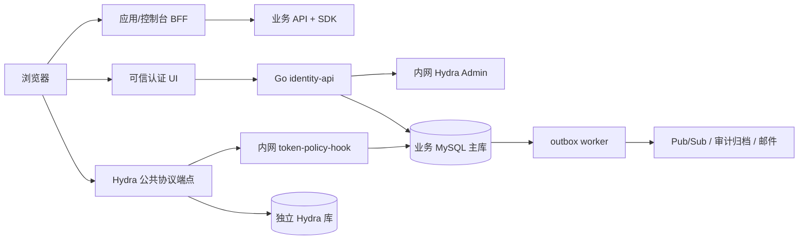
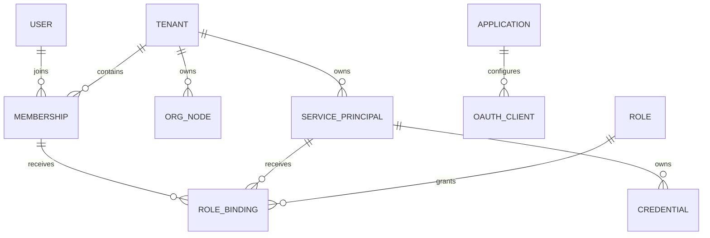

# 架构与数据边界

状态：实施设计，尚未通过生产验收。基于原始设计 v1；冲突需新增 ADR，不得静默修改原文。

## 系统边界

Hydra 是唯一 token 签发者。浏览器不能调用 Admin 或 Hook。登录页面在固定认证 origin 下运行，品牌配置只能使用受控文案、颜色和经审核资源；控制台与登录域分离。公网 ingress 必须显式允许路径，不能将整个管理服务反向代理到公网。

## 部署与代码所有权

| 单元 | 权威数据/职责 | 接口 | 失败行为 |
| --- | --- | --- | --- |
| identity-api | User、Tenant、Membership、Org、Session、RBAC | 可信交互/管理 API | 资格或事务失败即拒绝 |
| token-policy-hook | 读取主库资格、版本、上下文 | 内网认证 POST | 超时、未知 client、缺上下文全部拒绝 |
| Hydra | 协议状态、code、refresh、签名密钥引用 | OIDC/OAuth + 内网管理 | 禁止业务服务直接改表 |
| event-worker | outbox 投递、补偿、通知 | 幂等消费者 | 按 event_id 去重、版本防乱序 |
| console BFF | 自身会话、CSRF、OIDC callback | 同源 UI API | token 不进入浏览器存储 |
| SDK/资源 API | 资源归属、验签、缓存水位 | 本地校验/高风险权威查询 | 无法证明归属或权限即拒绝 |

Go 模块化单体共享业务模型，但 Hook 单独部署和扩容。缓存不是权威源。数据库、Hydra Admin 不对公网开放。生产使用 Workload Identity、Secret Manager，业务库与协议库分离账号及 migration 权限。

## 领域关系

User 全局存在；Membership 决定租户资格。租户内外键必须包含 tenant_id；User/Application 等全局引用列入白名单。root 由租户行指向，组织移动锁定 org_version 并事务更新闭包、audit/outbox。禁止移除最后 active owner。

授权上下文绑定 client、subject、tenant、membership/session 或 credential、授权交易与到期时间。refresh 使用原上下文，不接受请求覆写 tid。每个 token 一个业务 audience、一个租户。M2M 通过 Credential registry 解析 tenant，浏览器 hint 不参与最终权限判定。

## 一致性与降级

身份/授权变更、审计、outbox 必须同事务；协议对象创建采用 pending → active 与补偿对账。先提交本地 revoked，再异步撤销协议对象。主库写入权威不明时停止签发，不能读副本继续发 token。已在途 Hook 与禁用存在竞态，普通读的最坏撤销窗口 330 秒，高风险执行前重新查询主库。

部署首选东京三可用区、热备地区待服务可用性核实；单写与 fencing 优先。异步 DR 无法保证安全状态 RPO=0，恢复屏障、旧会话/refresh 清理和旧 AK 冻结是恢复门槛。99.99% 仅为待实测目标。

## 尚未冻结

Hydra 稳定版本、镜像 digest、Go/SDK 版本、MySQL 8.4 兼容性必须由 M0 真实测试冻结。Cloud SQL HA、跨区恢复、许可证维护状态、邮件供应商和域名在后续验证；本地 Docker 成功不能替代这些证据。

## 当前本地实现

实际业务登录现使用独立 Hydra 引擎、业务主库 Hook、中央 MFA 会话和两套 BFF，见 [ADR 0005](adr/0005-trusted-login-mfa-bff.md)。Hook 在每次 code/refresh 签发查询主库；示范资源请求也实时检查 grant，未使用目标架构的 330 秒缓存窗口。两套示范 client 属于同一个 Application，不能据此推断完整跨产品授权已实现。核心、应用 A/B 三网隔离及每应用数据库视图是本地权限边界；云端网络/IAM 方案待 SRE 实施验收。

公共管理入口新增独立 platform-api，使用独立平台 audience 与 read/write scope；API 验签后在操作事务内复查 grant/session/资格，Owner 管理继续复用 tenant 行锁和 audit/outbox。新空间原子启用第一方平台，其他应用仍须显式启用。公共合同在 api/openapi.yaml，原 M0 内部合同迁至 api/m0-internal.openapi.yaml；两者不能共同对外路由。实现边界见 [ADR 0006](adr/0006-public-platform-api.md)。

控制台的实际 BFF 使用独立 confidential client/key/SQL 视图和 console 网桥，只有公开协议窄代理、业务 API 和受限 SQL 路径。每个标签页对应独立 context cookie 与授权链，浏览器只持有非秘密 context ID/CSRF/业务响应。React 生产构建嵌入 Go，运行时没有 Node/Vite 服务；具体决策见 [ADR 0007](adr/0007-console-bff-contexts.md)。

## 自有应用与公开客户端登记

新增 migration 008 将自有 Application 绑定到唯一拥有空间，区别于已有共享应用的 tenant_applications 启用资格。管理仍只授予当前空间 owner；可信平台 API 通过固定内部 Admin 适配器执行受控公开客户端 profile 核对，不向 BFF 提供任意协议代理。客户端先 pending/inactive，精确核对后才 active；撤销先提交本地 inactive/version，再核对远端清理。普通核对/撤销复用有界租户事务锁，超时/未知提交先读取，不自动重放。当前没有周期性补偿 worker，见 [ADR 0015](adr/0015-owned-public-client-registration.md)。

## 机器身份切片

机器身份当前切片：自有应用拥有 SP 和每 credential 独立的 client_credentials-only 登记；管理 User realm 与机器资源 realm 分离。签发 Hook 从主库解析资格，资源侧验签后再次查询版本/状态/expiry。设计和约束见 machine-credentials.md / ADR 0016。
