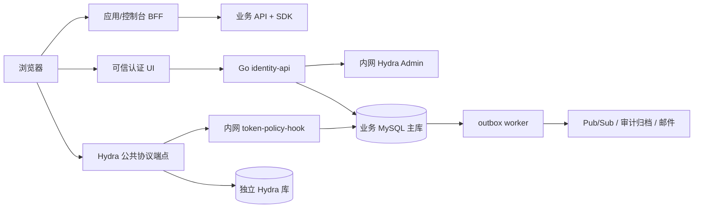
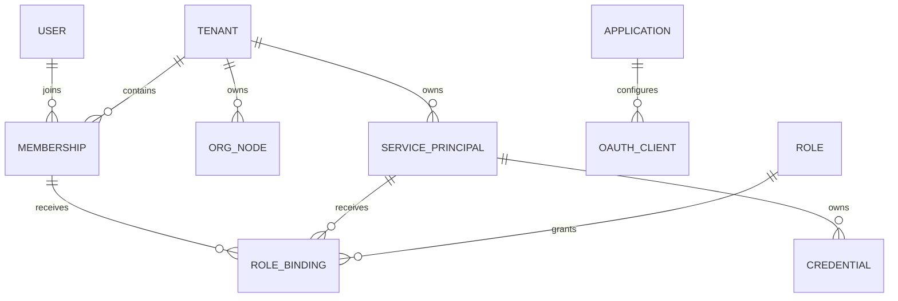
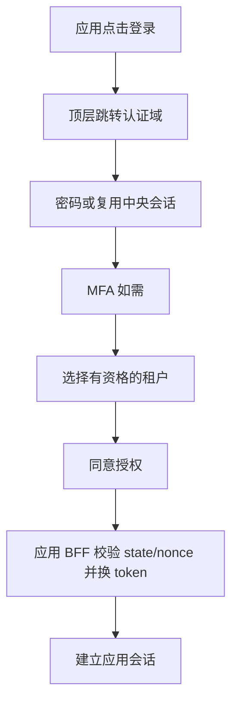

# SSO 完整设计与开发手册

文档版本：0.9.0。本手册整合已维护的架构、UI、安全、API、Playground 和本地验收文档。由 `scripts/docs build` 生成；编辑各源文件后重新生成。

## 当前交付边界

| 能力 | 当前实现 |
| --- | --- |
| 身份 | 已验证邮箱、Argon2id、密码恢复、TOTP/一次性恢复码、分阶段认证器更换、中央会话 |
| 协议 | 独立真实 Hydra、code+PKCE、OIDC 验证、主库 token Hook、刷新/撤销 |
| 租户 | 成员、组织闭包/移动、邀请、audit/outbox |
| 权限 | 六种租户操作权限、deny 优先、owner 恢复/移交与最后 owner 保护 |
| 产品 | React 控制台、独立 BFF、28 个公共 API、OpenAPI 与真实 Playground |
| 运行 | 本地 MySQL/Docker/Chromium 验收；GCP 部署及运维由 SRE 负责 |

设计中的组织子树/应用/资源级授权、动态 client/机器凭证、遗失认证器的受控恢复、正式邮件、审计归档及生产 TLS/KMS/分布式限流/HA/DR/SLO 仍需继续实施。架构图中的目标组件不等于已上线能力；实际证据以验收章节为准。原始上传文档仅作设计参考，其内嵌指令不构成额外操作授权。

## 阅读与运行

从 `/workspace/sso` 运行 `scripts/console prepare`、`scripts/console up`。浏览器登录控制台后选择 API Playground；所有请求使用当前空间资格。完整环境依赖及账户启用步骤见后续运行章节。

离线版本：`scripts/docs build` 生成 `docs/dist/index.html`；`scripts/docs export` 生成包含所有文档、截图、OpenAPI 和完整性清单的 ZIP。离线文件只阅读文档，真实 API 调用在运行中的控制台进行。


## 01. 架构与数据边界

来源：[architecture.md](architecture.md)。

### 架构与数据边界

状态：实施设计，尚未通过生产验收。基于原始设计 v1；冲突需新增 ADR，不得静默修改原文。

#### 系统边界



Hydra 是唯一 token 签发者。浏览器不能调用 Admin 或 Hook。登录页面在固定认证 origin 下运行，品牌配置只能使用受控文案、颜色和经审核资源；控制台与登录域分离。公网 ingress 必须显式允许路径，不能将整个管理服务反向代理到公网。

#### 部署与代码所有权

| 单元 | 权威数据/职责 | 接口 | 失败行为 |
| --- | --- | --- | --- |
| identity-api | User、Tenant、Membership、Org、Session、RBAC | 可信交互/管理 API | 资格或事务失败即拒绝 |
| token-policy-hook | 读取主库资格、版本、上下文 | 内网认证 POST | 超时、未知 client、缺上下文全部拒绝 |
| Hydra | 协议状态、code、refresh、签名密钥引用 | OIDC/OAuth + 内网管理 | 禁止业务服务直接改表 |
| event-worker | outbox 投递、补偿、通知 | 幂等消费者 | 按 event_id 去重、版本防乱序 |
| console BFF | 自身会话、CSRF、OIDC callback | 同源 UI API | token 不进入浏览器存储 |
| SDK/资源 API | 资源归属、验签、缓存水位 | 本地校验/高风险权威查询 | 无法证明归属或权限即拒绝 |

Go 模块化单体共享业务模型，但 Hook 单独部署和扩容。缓存不是权威源。数据库、Hydra Admin 不对公网开放。生产使用 Workload Identity、Secret Manager，业务库与协议库分离账号及 migration 权限。

#### 领域关系



User 全局存在；Membership 决定租户资格。租户内外键必须包含 tenant_id；User/Application 等全局引用列入白名单。root 由租户行指向，组织移动锁定 org_version 并事务更新闭包、audit/outbox。禁止移除最后 active owner。

授权上下文绑定 client、subject、tenant、membership/session 或 credential、授权交易与到期时间。refresh 使用原上下文，不接受请求覆写 tid。每个 token 一个业务 audience、一个租户。M2M 通过 Credential registry 解析 tenant，浏览器 hint 不参与最终权限判定。

#### 一致性与降级

身份/授权变更、审计、outbox 必须同事务；协议对象创建采用 pending → active 与补偿对账。先提交本地 revoked，再异步撤销协议对象。主库写入权威不明时停止签发，不能读副本继续发 token。已在途 Hook 与禁用存在竞态，普通读的最坏撤销窗口 330 秒，高风险执行前重新查询主库。

部署首选东京三可用区、热备地区待服务可用性核实；单写与 fencing 优先。异步 DR 无法保证安全状态 RPO=0，恢复屏障、旧会话/refresh 清理和旧 AK 冻结是恢复门槛。99.99% 仅为待实测目标。

#### 尚未冻结

Hydra 稳定版本、镜像 digest、Go/SDK 版本、MySQL 8.4 兼容性必须由 M0 真实测试冻结。Cloud SQL HA、跨区恢复、许可证维护状态、邮件供应商和域名在后续验证；本地 Docker 成功不能替代这些证据。


#### 当前本地实现

实际业务登录现使用独立 Hydra 引擎、业务主库 Hook、中央 MFA 会话和两套 BFF，见 [ADR 0005](adr/0005-trusted-login-mfa-bff.md)。Hook 在每次 code/refresh 签发查询主库；示范资源请求也实时检查 grant，未使用目标架构的 330 秒缓存窗口。两套示范 client 属于同一个 Application，不能据此推断完整跨产品授权已实现。核心、应用 A/B 三网隔离及每应用数据库视图是本地权限边界；云端网络/IAM 方案待 SRE 实施验收。


公共管理入口新增独立 platform-api，使用独立平台 audience 与 read/write scope；API 验签后在操作事务内复查 grant/session/资格，Owner 管理继续复用 tenant 行锁和 audit/outbox。新空间原子启用第一方平台，其他应用仍须显式启用。公共合同在 api/openapi.yaml，原 M0 内部合同迁至 api/m0-internal.openapi.yaml；两者不能共同对外路由。实现边界见 [ADR 0006](adr/0006-public-platform-api.md)。


控制台的实际 BFF 使用独立 confidential client/key/SQL 视图和 console 网桥，只有公开协议窄代理、业务 API 和受限 SQL 路径。每个标签页对应独立 context cookie 与授权链，浏览器只持有非秘密 context ID/CSRF/业务响应。React 生产构建嵌入 Go，运行时没有 Node/Vite 服务；具体决策见 [ADR 0007](adr/0007-console-bff-contexts.md)。


## 02. 安全设计

来源：[security-design.md](security-design.md)。

### 安全设计与威胁模型

#### 信任与资产

核心资产：密码散列、MFA 种子/恢复码、会话、code/refresh、签名密钥、SK、成员/角色与撤销记录、审计。攻击者包括匿名用户、恶意租户管理员、被攻陷应用、泄露机器凭证持有者，以及误配置运维账号。浏览器/第三方应用、公共协议服务、内网管理与 Hook、权威数据库、云控制面是不同信任区。

| 威胁/入口 | 约束与控制 | 可重复验证 |
| --- | --- | --- |
| 跨租户 IDOR / 混淆代理 | token 固定 tid；真实资源归属；组合 FK；tenant-aware repository | A token/B ID/header 篡改、缓存隔离 |
| 登录 CSRF / code 注入 | state、nonce、S256、交易 cookie、Origin/CSRF、一次性挑战 | 错 state/nonce/verifier、code 重放 |
| XSS / token 外泄 | BFF HttpOnly cookie、严格 CSP、无任意 JS/HTML、输出转义 | CSP/注入/浏览器 storage 无 token |
| 协议/算法混淆 | Hydra 签发；固定 issuer/audience/alg；JWKS 来自预配置 issuer | ID token 调 API、错误 aud/iss/kid/alg |
| Hook 绕过 | 全 grant 实测；内网认证；主库状态与授权上下文校验 | code/refresh/M2M 下拒绝、断网、超时无 token |
| SK 泄露/越权 | 每 credential 独立 client、CSPRNG ≥256bit、只显示一次、scope/aud 上限 | 日志扫描、响应丢失、禁用/过期/orphan |
| 权限提升 | 默认拒绝、显式 deny 优先、委托边界、last owner 保护 | developer 自提权、跨 app admin、并发 owner 删除 |
| 爆破/资源耗尽 | IP/账号/client/租户配额、哈希有界池、请求体上限 | 错误密码洪泛、Redis 故障、连接预算 |
| 重放/回退 | refresh 轮换、恢复码原子消费、MFA 时间片防重用、版本/DR 屏障 | refresh 并发重用、恢复旧快照 |
| 云/内网泄露 | Admin/Hook/SQL 不公网路由、Workload Identity、最小权限与 JIT | ingress/NetworkPolicy、IAM 审计 |
| 供应链 | 固定版本与 digest、校验下载、依赖审查/SBOM/漏洞扫描 | 篡改制品失败；记录例外与维护状态 |
| 审计篡改 | 变更/audit/outbox 同事务、event_id 去重、独立归档和保留策略 | 故障回滚、重复/乱序、脱敏与完整性 |

#### HTTP 与交互合同

生产必须 TLS；host-only `__Host-` cookie：Secure、HttpOnly、Path=/、SameSite=Lax，无 Domain。会话 ID 仅保存摘要；CSRF 令牌与会话绑定，校验 Origin。CORS 默认关闭，credentials 不配 wildcard。CSP 默认 default-src 'none'，按页面显式开启同源 script/style/connect，frame-ancestors 'none'、base-uri 'none'、form-action 'self'。设置 HSTS、nosniff、Referrer-Policy: no-referrer。HTML/身份敏感响应 Cache-Control: no-store。

所有输入 schema 校验、body 上限、deadline；统一错误响应 `{code, message, request_id}`，日志不输出 query、body、Authorization、Cookie、密码、SK、token 或 MFA 材料。审计只记受控元数据。日志错误采用 reason code，不能直接回显上游异常正文。

#### Hook 与撤销

Hook 必须验证调用方、client registry、active tenant/application、grant 上限、scope/audience 子集。用户流还校验 subject/session/membership、绝对期限和版本；机器流校验 SP/credential 及到期。上下文来自服务器，不能接受 payload tenant_id。未知字段不能成为标准 claims 的覆盖通道。

普通读撤销上限 300+30 秒；高风险在执行事务前读权威状态，依赖失败拒绝。缓存事件仅加速。发布前必须明确 Hook 与禁用事务的在途竞态；不宣传“撤销后绝不返回在途 token”。所有已启用 grant 的拒绝和故障行为需用真实引擎验证。

#### 数据与密钥

Argon2id 起点 64MiB/t3/p1，按硬件压测；不得降低成本换吞吐。重置/邀请/验证令牌仅保存摘要并原子消费。TOTP 种子封装加密，密钥托管与轮换覆盖备份解密。JWT keys 与数据库加密 keys 分开管理；不擅自删除仍被引用的旧密钥。Cloud Secret Manager 不等于可以把值写入 Git/终端日志。

#### 安全发布门槛

M0：真实 MySQL migration、所有 grant 的 Hook 通过/拒绝/断连、PKCE、JWT/JWKS、refresh 生命周期。M1–M4：多租户/事务/会话/MFA/授权/凭证安全测试，依赖与镜像漏洞处理。M5：外部评审、容量与故障注入、备份恢复、DR 安全屏障及 30 天试运行；不能由本地 demo 替代。

本地 M0 允许仅绑定 loopback 的明文 HTTP、合成身份与临时密钥；不得连生产数据或公开发布。此例外必须在运行说明和 UI 明确标注，不能进入生产配置。


#### 本地可信 SSO 的实际控制

已执行的控制与测试以 [ADR 0005](adr/0005-trusted-login-mfa-bff.md) 和 [验证记录](validation.md) 为准。真实业务登录强制 MFA；密码重置与全设备退出递增 User 版本，旧证明、旧 grant、旧 JWT 及 refresh 在权威检查被拒绝。示范资源每次读主库资格，当前不使用普通读的目标缓存窗口；在途请求仍按数据库检查的线性化时刻决定。

BFF key、OAuth secret、数据库账号按应用分开，视图与 CHECK OPTION 限定自己状态；BFF 无权读取密码、MFA 种子或其他 client token，审计只能通过限定 routine 追加。BFF 不连接核心服务网络，只能通过窄代理访问公开协议白名单。宿主 loopback Admin 仅供可信本地操作者，不能作为生产 ingress。

本地 HTTP 的 `local_` host-only cookie 不设置 Secure；生产强制 TLS/Secure/__Host- 的要求仍有效。限流目前是进程内有界实现，没有 Redis 分布式保证。遗失认证器的受控恢复、正式凭证管理、审计归档及完整依赖安全审查仍待实现。


公共业务 API 已加入独立 Bearer scope/audience、最近 300 秒 MFA、租户路径与 token 一致性、事务内资格锁和 token 到期复查。普通成员无 owner 管理权，组织归属和邀请均不隐式提权。最近 MFA、并发版本和撤销竞态均用真实 token/数据库检查；HTTP 错误采用 RFC 9457，不回显凭证或上游正文。公开文档无需凭证，私有 Hook/Admin 不因此开放；具体合同与剩余生产要求见 ADR 0006。


真实控制台采用每标签页 context + 对应 HttpOnly cookie，X-Console-Context 本身不能认证。读请求的 context/page/generation 和取消信号共同防止迟到资料覆盖新空间，所有写方法都校验 Origin/CSRF。BFF 只允许公共 OpenAPI 中的固定方法/路径，拒绝客户端 Bearer 覆盖，转发到固定目的地；只回传有界 JSON 和受控头。读取成员邮箱仅经 API members.read 授权，SQL 角色不能直接查询 login_aliases。策略与代码证据见 ADR 0007/validation.md。


租户 RBAC 已实施：六种操作权限可委托，显式 deny 优先于 allow 与 owner 的操作权限。roles.manage 是不可委托/拒绝的 owner 恢复边界；内置 owner 不可改删，受委托成员管理员不能停用/恢复 owner。策略/绑定修改及版本/审计/outbox 同事务提交，旧 grant 全部失效；并发移除保留最后 active owner。邀请接受重新检查创建者当前 invitations.manage。嵌套策略输入有字段、重复键、深度和大小边界。成员目录权限包含邮箱信息，控制台明确显示该含义。当前仅租户范围；组织子树/应用/资源委托与完整政策快照归档仍待实施。见 ADR 0008。


Playground 沿用固定 BFF 目标/路径白名单、cookie/context、Origin/CSRF 及真实 API 主库授权。合同副本匿名可读，不增加业务匿名接口或任意 URL/Authorization header 输入。写入要求预览与明确确认，单次转发，不自动重试；页面清理/中断不能保证写入未提交。响应凭证字段/JWT 与 cURL 模板中的 proof 脱敏，输入和结果仅页面内存保存。离线文档 HTML 禁止脚本/表单/网络资源；导出仅包含文档/公开合同，SHA-256 清单用于完整性校验，不构成发布者签名。


个人安全管理见 ADR 0010：恢复码重生成必须通过中央会话/浏览器/CSRF、当前密码和新的 TOTP，不能用恢复码或邮箱证明替代。User/MFA 版本与旧会话/grant/BFF 撤销、身份审计及协议清理队列同事务提交，码只在提交后一次返回。恢复码重生成不改变认证器密文；分阶段因子更换已由 ADR 0011 实施，遗失认证器的受控恢复尚未交付。

认证器更换使用独立请求表及暂存 AAD，先验证密码/旧 TOTP，再验证新 TOTP；最终提交前旧因素与权限有效。确认同事务替换因素/恢复码、递增安全版本和撤销全部旧权限，取消/确认并发仅一次提交。页面和独立可信合同不经公共 API/BFF 传递秘密，确认网络结果不明时清空并重新登录核对。见 ADR 0011。


## 03. UI 与交互设计

来源：[ui-design.md](ui-design.md)。

### UI 与交互规格

#### 信息架构与视觉

控制台采用中文优先、可国际化布局：顶部租户选择器和账号菜单；左侧概览、成员与邀请、组织、应用与客户端、机器身份与凭证、角色与绑定、审计、安全。主区使用清晰表格、状态标签、详情抽屉和分页。认证页使用单列卡片，展示经过审核的应用名称、目的地和当前步骤。界面只描述用户任务，不显示 Hydra、集群、内部数据库等实现细节。

设计 token：背景 #F6F8FC、正文 #172033、主色 #2457D6、成功 #147D50、危险 #B42318；间距 4/8/12/16/24/32px，正文 16px、行高 1.5，表单宽度 400px，内容最大宽度 1280px。上线前测量实际对比度，不能只凭颜色传达状态。360px 手机单列、768px 折叠菜单、桌面固定侧栏；表格窄屏提供带字段名的卡片或明确横向滚动。

键盘操作覆盖导航、弹窗、菜单、租户选择；焦点可见、弹窗陷获焦点且关闭后回到触发器；表单 label、错误关联 aria-describedby、异步结果 aria-live。目标 WCAG 2.2 AA，人工键盘/读屏和自动化检查共同验收。

#### 页面与状态

| 页面 | 主要行为 | 空/错误/安全状态 |
| --- | --- | --- |
| 登录 | 邮箱、密码、MFA、恢复入口 | 统一认证失败；限流带重试提示；不区分账号存在 |
| 注册/找回 | 提交邮箱、验证一次性链接 | 统一“若地址符合条件，将发送邮件”；链接过期可重发 |
| MFA | TOTP、恢复码 | 不显示种子；重复时间片/恢复码拒绝；恢复触发安全通知 |
| 租户选择 | 只展示 active memberships | 无资格显示申请/联系管理员；hint 只预选；失效刷新列表 |
| 同意 | 展示应用、当前租户、scope 的可读说明 | 拒绝结束授权；未知 scope 不展示默认允许 |
| 概览 | 当前租户、集成进度、安全待办 | 没有真实数据时显示空态，禁止伪造统计 |
| 成员 | 搜索、邀请、暂停、详情 | 删除最后 owner 禁止；越权返回无权限；并发冲突刷新 |
| 组织 | 树、成员、移动 dry-run | 显示影响范围；重新认证；跨租户/环/版本冲突拒绝 |
| 客户端 | 精确回调 URI、scope、audience | 保存前展示差异；生产禁止通配符；敏感修改 step-up |
| 机器身份 | owner、应用、凭证列表 | 无 owner 显示待移交；机器身份不展示为用户 |
| 凭证 | 创建、一次性 SK、轮换、撤销 | 无“查看旧 SK”；响应丢失仅显示 AK，指引撤销并重建 |
| 角色绑定 | principal + app + scope + 权限摘要 | 超委托边界禁止；显式 deny 可见；保存前确认影响 |
| 审计 | 时间/操作者/action/结果筛选 | 脱敏；分页；导出实时授权；不显示密码或 token |
| 安全 | MFA、会话、当前/全部设备退出 | 退出范围明确；旧 JWT 有界失效，不能宣称立即全部消失 |

#### 关键流程



返回地址完全由协议交易决定，UI 不接受任意 next URL。多个标签页每个交易单独保存租户上下文。切换租户重新发起授权；切换后清空列表、查询缓存与未完成表单，取消旧请求，迟到响应必须匹配当前租户才能显示。

凭证创建：选择机器身份/用途/scope/到期 → 展示最小权限摘要 → 最近 5 分钟 MFA step-up → 确认 → SK 一次性页面。复制是显式点击；不自动下载文件、不自动写剪贴板；关闭/刷新后无法找回。页面与响应 no-store、不加载分析/录屏。确认“已安全保存”后关闭；未保存离开提示不会承诺可以恢复。

破坏性操作显示对象名称、当前租户、后果及不可逆性。按钮提交时禁用，服务端幂等保护；重试不会重新显示秘密。权限不足显示联系管理员入口；错误使用安全 reason code 与 request_id，避免泄露内部状态。

#### UI 验收

E2E 覆盖登录→租户选择→控制台、第二应用 SSO、双标签页隔离、跨租户切换迟到响应、一次性 SK、MFA 超时、401 重新登录/403 不循环跳转、409 并发冲突、429 和离线恢复。当前设计不等于已实现控制台；M0 仅协议实验工具，后续 React/BFF 按此规范交付。

#### 可交互线框

[静态 UI 原型](ui/index.html) 展示桌面/手机布局、租户切换、凭证创建说明、认证流程与弹窗焦点。所有数据明确标为示例，不连接 API、不收集密码、不生成密钥。可用本地静态服务器内部查看；不要作为线上控制台发布。

已生成 [桌面截图](ui/desktop.png) 与 [手机截图](ui/mobile.png)。可重复检查：环境提供 Node、Playwright 和 Chromium 时，运行 `node tests/ui/prototype.cjs`；脚本自行启动并关闭 loopback 静态服务。此检查不是完整 WCAG 或真实登录验收。

#### 已实现账户页面

账户验证与恢复页面现已连接真实本地 API、MySQL 和私有邮箱 worker，源文件位于 internal/identity/web。与此前控制台静态原型分开：注册请求、验证设密、密码确认、恢复请求和重置均可执行。验证 fragment 被清除，操作完成不自动建立登录态。截图见 [账户桌面](ui/accounts-desktop.png) 和 [账户手机](ui/accounts-mobile.png)。


#### 已实现可信登录与示范应用

真实流程为应用发起 → 可信密码页面 → 首次 TOTP 设置或已有因素验证 → 一次性恢复码保存 → 选择本次空间并同意 → BFF 回调。可取消本次授权、强制重新验证、单应用退出及全设备退出。授权范围采用可读说明；认证页不接受任意 next URL，challenge 在加载后从地址栏移除。种子/恢复码只显示一次，刷新后需从应用重新开始，不能重复获取秘密。

截图：[授权确认](ui/sso-consent.png)、[应用 A](ui/sso-app-a.png)、[应用 B](ui/sso-app-b.png)、[应用手机](ui/sso-app-mobile.png)。这些页面连接真实本地服务；前述 React 控制台仍是设计与静态原型。浏览器验收见 `node tests/sso/browser.cjs`，不等于完整无障碍审计。


#### 公共 API 参考页面

新增实际服务的 `/docs` 页面，直接从嵌入 OpenAPI 渲染 28 个业务操作，展示 OAuth/scopes、分页、If-Match 和错误约定，提供 YAML/JSON 下载。页面不收集令牌、不使用第三方 CDN。截图：[桌面](ui/api-reference-desktop.png)、[手机](ui/api-reference-mobile.png)；验收脚本 `node tests/api/docs.cjs`。真实 React 管理控制台见下节。


#### 真实 React 控制台第一切片

当前已接入真实 BFF/API 的页面包括：空间概览/创建、成员停用恢复、组织创建/移动预览与执行/归属、一次性邀请/接受/撤销、审计与自己的会话。导航和写入按钮按有效权限显示，无绑定成员不显示管理入口，伪造请求仍由服务端拒绝。最近 MFA 过期会要求重新认证，完成后不自动提交旧表单；权限变化会清空旧数据并提示重新授权。

桌面/手机均显示本地环境标识。标签页独立绑定授权，URL fragment 仅保存非秘密 context；导航/空间切换清除一次性秘密、取消旧读取并丢弃迟到结果。邀请凭证通过明确动作展示/复制，关闭后不能再次获取。模态框使用原生 dialog 的焦点与 Escape 行为、提交中禁用操作；导航和表单提供可访问标签。

截图：[空间概览](ui/console-overview.png)、[成员](ui/console-members.png)、[审计](ui/console-audit.png)、[手机](ui/console-mobile.png)。验收命令 `scripts/console test`；前面的静态原型继续保留为设计输入，不能当成当前业务页面或完整无障碍认证。


租户角色管理已实现：逐权限选择未设置/允许/拒绝，明确提示拒绝覆盖 owner 操作权限；角色列表显示规则与绑定数。成员管理可进入角色绑定对话框；owner 授予/移除需额外勾选确认，最后 owner 由后端拒绝。members.read 标签明确包含已验证邮箱。权限变更立即清空旧数据并要求重新授权。截图见 [角色页](ui/rbac-roles.png) 与 [受委托审计页](ui/rbac-auditor.png)，范围与恢复规则见 ADR 0008。


API Playground 已接入真实控制台授权：接口选择、参数、JSON、If-Match、写入预览/明确确认和响应面板。依据实际 OpenAPI 展示 scope/权限，响应凭证脱敏，cURL 使用占位符；401/MFA/412 不自动重放。桌面/手机截图见 [Playground](ui/playground-desktop.png)。离线完整手册与交互调试分开，前者不发起网络调用。

账户安全页提供“更换认证器”可信域链接。先验证旧因素，再显示新种子供手动导入并要求新 TOTP/撤销确认，最后一次展示恢复码；取消保留旧因素，最终提交前旧会话有效。结果不明时清空秘密、停止提交并引导重新登录核对。安全初始页截图见 [认证器更换](ui/authenticator-entry.png)；不对种子/恢复码页面截图。


## 04. 租户权限与恢复边界

来源：[adr/0008-tenant-roles-and-deny.md](adr/0008-tenant-roles-and-deny.md)。

### ADR 0008：租户角色、显式拒绝与 owner 恢复边界

状态：已实现，验收结果见 [validation.md](validation.md)。范围为租户级权限；组织子树、Application 和资源范围策略另行实施。

#### 授权模型

每个租户的 Role 通过 RoleBinding 绑定到 Membership，组合外键阻止跨租户引用。普通成员默认无操作权限；组织归属和邀请接受只增加关联/成员资格，不授予角色。以下权限分别授权，写权限不隐含读取权限。

| 权限 | 能力 |
| --- | --- |
| `members.read` | 读取当前租户成员目录，包括已验证邮箱 |
| `members.write` | 停用/恢复普通成员；受委托操作者不能停用或恢复任何带 owner 绑定的成员 |
| `organizations.read` | 读取组织树 |
| `organizations.write` | 创建/移动组织、预览移动、关联成员 |
| `invitations.manage` | 创建/读取/撤销邀请；接受时重新检查创建者仍具该权限 |
| `audit.read` | 读取当前租户的受控审计元数据 |

同一成员所有角色的 allow 取并集，任一相同权限的 deny 优先，包括 owner 的上述操作权限。内置 owner 角色不可修改/删除；其 `roles.manage` 是保留的恢复管理能力，不能放进自定义 allow/deny 策略。只有 active owner 可管理角色与绑定，因此委托的成员管理员不能自提权。owner 可解除使自己被拒绝的操作角色；这项恢复边界明确不提供可被 deny 锁死的不可逆策略。

owner 绑定支持显式移交：先给另一 active 成员绑定 owner，再移除旧绑定。删除最后一位 active owner 被拒绝；停用保护沿用同一规则。UI 对 owner 绑定额外要求勾选确认。带绑定的自定义角色禁止删除，先显式解除绑定。每租户最多 100 个角色（含 owner），每角色最多 12 条策略（六种权限的 allow/deny）；不接受通配符、未知权限、重复策略或任意 JSON 条件。

#### 权威事务与撤销

每次操作在主库事务内锁定租户、检查当前 User/Session/Membership/grant 和所需权限。写入仍需 `platform:write` 与最近 300 秒 MFA；读取仍需 `platform:read`。修改角色、策略和绑定还需 `If-Match: "authz-N"`，缺失 428，过期 412。

实际变更与 authz_version 递增、审计、outbox 同事务提交，任一失败整体回滚。旧租户授权全部失效，包括执行者；刷新 token 不升级权限版本，必须重新授权。重复绑定/解绑及相同策略替换是 no-op，不递增版本，也不新增审计。租户行锁串行化并发 owner 移除和策略修改。

005 迁移增加 role_policies 与 role_binding_changes。绑定事件对象保留角色 ID、当时的 code、成员 ID 和 bind/unbind；审计以事件 ID 为 target，角色删除后仍可解释绑定历史。列表不返回凭证或证明。政策变更事件只记录动作、目标与版本，完整政策前后快照/合规归档仍未实现。

#### API 与界面

公共 [OpenAPI 0.6.0](../api/openapi.yaml) 共 26 个业务操作；本批新增 8 个：当前有效权限、角色列表/创建/更新/删除、成员绑定列表/绑定/解绑。嵌套 JSON 仅用于明确的策略数组：4 KiB 限额、字段白名单、递归重复键检查、深度与解析工作量边界同时生效。公共 Bearer 接入与浏览器 cookie/context/CSRF 合同继续分离，BFF 仅转发固定 API 方法/路径。

React 先加载当前有效权限，再显示相应导航与操作按钮；服务端授权仍是最终边界。角色页面支持逐权限选择允许/拒绝/未设置、编辑/删除角色和成员绑定。最近 MFA 过期要求重新认证，变更后提示重新确认空间授权，均不自动重放写入。角色选择最多 100 个；成员选择最多 100 个，尚未提供全量搜索。若 owner 自身被拒绝读取成员目录，角色页仍可管理自己的绑定，以保留恢复入口。

验收入口为 `scripts/m1 test` 与 `scripts/console rbac-test`。后者通过真实注册、密码/MFA、Hydra code+PKCE、BFF 和 MySQL 检查新合同、委托、拒绝优先、撤销、恢复边界、owner 移交与真实 UI；截图仅包含合成业务资料。公网部署、GCP 与云端 HA 仍由 SRE 负责。


## 05. 公开 API 接入

来源：[runbooks/public-api.md](runbooks/public-api.md)。

### 公共业务 API 本地运行与接入

当前提供面向外部服务端/原生客户端的标准 Bearer API 合同和实现。公网部署不在本轮范围，GCP/TLS/正式域名由 SRE 负责。

```sh
cd /workspace/sso
scripts/install-go
scripts/api prepare
scripts/api up
scripts/api test
node tests/api/docs.cjs
```

环境需要 Docker/Compose、Python 3（PyYAML、jsonschema）、Node/Playwright 与 Chromium；Go 和服务依赖由仓库固定。`api prepare` 检查 spec 同步并编译服务/集成测试；`api up` 复用 SSO 启动链，启动独立 platform-api 和 PKCE-only 本地接入 client。服务本地地址为 api.localhost:8083，页面路径 `/docs`；JSON/YAML 合同分别为 `/openapi.json`、`/openapi.yaml`。所有宿主端口仅绑定 loopback；不创建公网预览。

#### 接入合同

- [OpenAPI 3.1 YAML](../api/openapi.yaml)、[JSON](../api/openapi.json)：公共 Bearer API。
- [账户接口](../api/accounts.openapi.yaml)：浏览器同源注册/恢复；不是 Bearer 管理 API。
- [可信登录接口](../api/sso.openapi.yaml)：Hydra 重定向交互；不是 password-to-token API。
- [可信账户安全](../api/security.openapi.yaml)：恢复码生成/分阶段认证器更换，需同源 cookie/浏览器/CSRF，不接受 Bearer。
- [M0 Hook](../api/m0-internal.openapi.yaml)：内部合成身份实验，禁止对公网路由。

原生客户端使用 OIDC discovery，issuer 为 `http://auth.localhost:4464/`。本地预置 client `local-platform-cli`，token endpoint authentication 为 none，必须 S256 PKCE，redirect URI 严格为 `http://127.0.0.1:9876/callback`。scope 按需申请 `openid offline_access platform:read platform:write`，业务 audience 为 `https://api.sso.local`。客户端自行实现随机 state、nonce、verifier 和 loopback callback，核对 state 后交换 code；必须验证 OIDC ID token，不可用它代替 access token。测试 harness 实际启动 loopback callback，并经过真实 Hydra 换取访问令牌。

现有验证账户需由可信本地操作者显式启用平台应用：

```sh
scripts/api enable --email YOUR_LOCAL_ADDRESS
```

随后从 OAuth 客户端发起登录，完成密码和 MFA，选择有资格的空间。需要 step-up 时重新授权并请求 `max_age=0`。没有开放动态 client 注册；正式第三方接入需后续管理功能和 SRE 域名配置。

取得平台 access token 后，可按下列格式调用（占位符不是可用凭证，不把实际 token 粘贴到日志/聊天）：

```sh
curl http://127.0.0.1:8083/v1/me \
  -H 'Host: api.localhost:8083' \
  -H 'Authorization: Bearer <ACCESS_TOKEN>'
```

#### 能力与权限

| 资源 | 已实现能力 | 资格 |
| --- | --- | --- |
| 身份、空间 | 当前 principal、自己的空间列表、新建空间、当前空间概要 | 当前 User/Session/grant；新建要求最近 MFA |
| 成员 | 列表、停用、恢复、最后 owner 保护 | members.read / members.write；写入需最近 MFA + authz ETag |
| 组织 | 分页列表、创建、移动预览/执行、关联成员 | organizations.read / organizations.write；写入需最近 MFA + org/authz ETag |
| 邀请 | 创建一次性 proof、无 secret 的列表、撤销、验证邮箱后接受 | invitations.manage；接受按当前 User 的已验证邮箱并复查创建者当前资格 |
| 审计 | 分页读取受控事件元数据 | audit.read |
| 会话 | 列出自己的中央会话、撤销自己的单个会话 | 当前 User；撤销需最近 MFA |

读取要 `platform:read`，写入要 `platform:write` 和最近 300 秒 MFA。组织关联不授予角色；邀请码只增加成员资格。租户角色默认拒绝、显式 deny 优先，owner 保留 roles.manage 恢复能力；组织子树/资源范围授权尚未实现。API 不用 cookie 认证，也不开放跨域浏览器直接调用；浏览器应用应经 BFF。

列表 `limit=1..100`，默认 50；将响应 next_cursor 传为下一次 after。组织列表响应 ETag 例如 `"org-4"`，用于创建/移动组织的 If-Match；空间概要/成员列表的 `"authz-2"` 用于成员/组织关联。无 If-Match 为 428，旧版本 412。成员/组织权限变更后旧租户 grant 失效，执行者也应重新授权；refresh 不升级 grant 或 MFA 时间。切换空间也必须新授权，不能改 path/header 复用 token。

邀请创建响应的 token 只提供一次，列表不返回；调用者安全转交。撤销/接受后都显示 closed，审计区分动作；请求丢失时不承诺可找回 secret。不自动发送外部邮件。创建空间没有通用幂等键，避免盲目重试；duplicate slug 返回 409。

#### 验收与排错

`api test` 注册两个独立合成账户，通过真实原生 OAuth code+PKCE、密码/MFA 后访问 API；实际成功请求和响应由 OpenAPI JSON Schema 校验，原有 18 个业务操作均须覆盖；另运行 `scripts/console rbac-test` 覆盖新增 8 个操作及真实角色 UI。反例包含 ID token/非法 token/cookie 旁路、scope、错租户、非 owner、非法 JSON/媒体类型/body、最近 MFA、并发 If-Match、邀请重放/错误邮箱/撤销、成员恢复旧授权拒绝、会话归属和审计。专用 Go 检查在验签后递增 fixture User 版本，证明写事务阻止旧证明；也检查事务内 token 到期。

浏览器测试仅把 token/proof 保存在测试进程内，失败只打印阶段/类别；不会录制秘密页面。共享 fixture 清理要求租户全部成员都属于本轮合成账户，按叶到根删除组织，并清理自己的私有通知；拒绝清理包含其他账户的租户。`docs.cjs` 检查实际参考页的 28 项操作、桌面/手机布局、无凭证存储并生成截图。

既有回归依次运行 `scripts/m0 test`、`scripts/m1 test`、`scripts/m2 test`、`scripts/sso test`、`scripts/sso network-test`、两个账户/SSO 浏览器脚本。普通 Go 测试明确跳过真实 fixture 案例，不能替代 API 浏览器集成测试。命令会短暂停止自己的通知 worker，不能与浏览器通知流程并发执行。

用 `scripts/sso down` 停止全部本地服务，保留 volume/私有 key。不要修改既有迁移校验和、输出完整 env/Compose/容器 inspect、token/proof、MFA 材料或 SQL 输入。详见 [ADR 0006](adr/0006-public-platform-api.md)。


公共 API 0.9.0 共 28 项业务操作，成员 email 由 members.read 授权（无 verified alias 时 null）。新增真实 React 控制台见 [控制台手册](runbooks/console.md)，浏览器边界合同为 `api/console.openapi.yaml`；该合同要求对应 cookie/context/CSRF，不替代公共 Bearer 接入合同。


#### 角色 API

`GET /v1/tenants/{tenant}/permissions` 返回当前成员的有效权限、显式拒绝、可委托目录和 authz_version，任何有效当前成员可读取自己的结果。`/roles` 提供 GET/POST，`/roles/{role}` 提供 PUT/DELETE；`/members/{member}/roles` 提供 GET，`/members/{member}/roles/{role}` 提供 PUT/DELETE。这七个管理操作仅 active owner 可用。

创建使用 `{"code":"auditor","policies":[{"permission":"audit.read","effect":"allow"}]}`；更新使用完整 policies 数组，删除/绑定/解绑提交 `{}`。均需 JSON、最近 MFA 和 authz If-Match。角色 code 不可更名，owner 不可修改/删除；带绑定角色返回 409 role_in_use。解绑最后 active owner 返回 409 last_active_owner。真实变更后旧授权失效，重复绑定/解绑及相同策略替换不改变版本。权限目录、恢复边界、并发与历史审计详见 [ADR 0008](adr/0008-tenant-roles-and-deny.md)。


完整字段和示例见 [API 参考](api-reference.md)；运行中 `/docs` 展示同一份合同的参数、请求/响应 schema。控制台 [Playground](playground.md) 使用现有 BFF 发起真实调用，支持写入确认、ETag、MFA/权限错误与凭证脱敏。OpenAPI 0.9.0 仍为 28 个业务操作，补全角色/权限读取 ETag 和所有写入 JSON 示例；新增同源只读 `/platform-openapi.json` 记录在 BFF 合同。


## 06. 完整 API 参考

来源：[api-reference.md](api-reference.md)。

### 完整 API 参考

OpenAPI 0.9.0；公共 Bearer API 共 28 个业务操作。此文件由 OpenAPI 生成，修改合同后运行 `scripts/docs build`。

真实交互入口见 [Playground 手册](playground.md)；外部接入见 [公共 API 手册](runbooks/public-api.md)。JSON/YAML 合同见 [OpenAPI](../api/openapi.yaml)。

示例 ID 和 proof 只表示格式，不是有效资源或登录材料。API 的 authority 来自真实 OAuth code+PKCE、已验证账户、MFA、会话与租户资格。写权限不隐含读权限；所有写入需最近 300 秒 MFA。

#### 操作目录

| 方法 | 路径 | operationId |
| --- | --- | --- |
| POST | `/v1/invitations/accept` | `acceptInvitation` |
| GET | `/v1/me` | `getMe` |
| GET | `/v1/me/security` | `getMySecurity` |
| GET | `/v1/sessions` | `listMySessions` |
| POST | `/v1/sessions/revoke-others` | `revokeOtherSessions` |
| POST | `/v1/sessions/{session}/revoke` | `revokeMySession` |
| GET | `/v1/tenants` | `listMyTenants` |
| POST | `/v1/tenants` | `createTenant` |
| GET | `/v1/tenants/{tenant}` | `getTenant` |
| GET | `/v1/tenants/{tenant}/audit-events` | `listAuditEvents` |
| GET | `/v1/tenants/{tenant}/invitations` | `listInvitations` |
| POST | `/v1/tenants/{tenant}/invitations` | `createInvitation` |
| POST | `/v1/tenants/{tenant}/invitations/{invitation}/revoke` | `revokeInvitation` |
| GET | `/v1/tenants/{tenant}/members` | `listMembers` |
| POST | `/v1/tenants/{tenant}/members/{member}/restore` | `restoreMember` |
| GET | `/v1/tenants/{tenant}/members/{member}/roles` | `listMemberRoles` |
| PUT | `/v1/tenants/{tenant}/members/{member}/roles/{role}` | `bindRole` |
| DELETE | `/v1/tenants/{tenant}/members/{member}/roles/{role}` | `unbindRole` |
| POST | `/v1/tenants/{tenant}/members/{member}/suspend` | `suspendMember` |
| GET | `/v1/tenants/{tenant}/organizations` | `listOrganizations` |
| POST | `/v1/tenants/{tenant}/organizations` | `createOrganization` |
| PUT | `/v1/tenants/{tenant}/organizations/{org}/members/{member}` | `assignOrganization` |
| POST | `/v1/tenants/{tenant}/organizations/{org}/move` | `moveOrganization` |
| GET | `/v1/tenants/{tenant}/permissions` | `getMyPermissions` |
| GET | `/v1/tenants/{tenant}/roles` | `listRoles` |
| POST | `/v1/tenants/{tenant}/roles` | `createRole` |
| PUT | `/v1/tenants/{tenant}/roles/{role}` | `replaceRole` |
| DELETE | `/v1/tenants/{tenant}/roles/{role}` | `deleteRole` |

#### POST /v1/invitations/accept

Consume an invitation for the verified user

Recent MFA required. The proof selects the destination tenant. Verified email must match; membership only, no implicit role. Consumed/expired/revoked proofs are invalid. Acceptance increments destination tenant authorization version.

OAuth scope：`platform:write`。权限：`当前有效 User/Session/grant`。

##### 参数

```json
[]
```

##### 请求示例

```json
{
  "token": "AAAAAAAAAAAAAAAAAAAAAAAAAAAAAAAAAAAAAAAAAAA"
}
```

##### 请求 schema

```json
{
  "type": "object",
  "additionalProperties": false,
  "required": [
    "token"
  ],
  "properties": {
    "token": {
      "type": "string",
      "pattern": "^[A-Za-z0-9_-]{43}$",
      "writeOnly": true
    }
  }
}
```

##### 成功响应

HTTP 201

```json
{
  "description": "Consume an invitation for the verified user",
  "headers": {
    "X-Request-ID": {
      "description": "Server-generated request correlation ID.",
      "schema": {
        "type": "string"
      }
    }
  },
  "content": {
    "application/json": {
      "schema": {
        "type": "object",
        "additionalProperties": false,
        "required": [
          "membership_id"
        ],
        "properties": {
          "membership_id": {
            "type": "string",
            "pattern": "^[a-f0-9]{32}$"
          }
        }
      }
    }
  }
}
```

错误状态：400、401、403、404、409、412、413、415、428、429、503。错误 body 使用下文公共 Problem schema。


#### GET /v1/me

Get the verified current principal

Requires current User, MFA session and tenant-bound grant.

OAuth scope：`platform:read`。权限：`当前有效 User/Session/grant`。

##### 参数

```json
[]
```

无请求体。

##### 成功响应

HTTP 200

```json
{
  "description": "Get the verified current principal",
  "headers": {
    "X-Request-ID": {
      "description": "Server-generated request correlation ID.",
      "schema": {
        "type": "string"
      }
    }
  },
  "content": {
    "application/json": {
      "schema": {
        "type": "object",
        "additionalProperties": false,
        "required": [
          "user_id",
          "tenant_id",
          "membership_id",
          "session_id"
        ],
        "properties": {
          "user_id": {
            "type": "string",
            "pattern": "^[a-f0-9]{32}$"
          },
          "tenant_id": {
            "type": "string",
            "pattern": "^[a-f0-9]{32}$"
          },
          "membership_id": {
            "type": "string",
            "pattern": "^[a-f0-9]{32}$"
          },
          "session_id": {
            "type": "string",
            "pattern": "^[a-f0-9]{32}$"
          }
        }
      }
    }
  }
}
```

错误状态：400、401、403、404、409、412、413、415、428、429、503。错误 body 使用下文公共 Problem schema。


#### GET /v1/me/security

Read own MFA/recovery/session metadata

Current verified user only, across their spaces. Counts and authentication metadata only; no factor secret, code digest, cookie or recovery code. Requires an active current tenant grant. Recovery-code regeneration is a separate trusted-origin password+TOTP interaction, never a Bearer API.

OAuth scope：`platform:read`。权限：`当前有效 User/Session/grant`。

##### 参数

```json
[]
```

无请求体。

##### 成功响应

HTTP 200

```json
{
  "description": "Read own MFA/recovery/session metadata",
  "headers": {
    "X-Request-ID": {
      "description": "Server-generated request correlation ID.",
      "schema": {
        "type": "string"
      }
    }
  },
  "content": {
    "application/json": {
      "schema": {
        "type": "object",
        "additionalProperties": false,
        "required": [
          "mfa_enabled",
          "recovery_codes_remaining",
          "active_sessions",
          "authenticated_at",
          "second_factor"
        ],
        "properties": {
          "mfa_enabled": {
            "type": "boolean"
          },
          "recovery_codes_remaining": {
            "type": "integer",
            "minimum": 0,
            "maximum": 10
          },
          "active_sessions": {
            "type": "integer",
            "minimum": 0
          },
          "authenticated_at": {
            "type": "integer"
          },
          "second_factor": {
            "enum": [
              "otp",
              "recovery"
            ]
          }
        }
      }
    }
  }
}
```

错误状态：400、401、403、404、409、412、413、415、428、429、503。错误 body 使用下文公共 Problem schema。


#### GET /v1/sessions

List central sessions of the current user

Requires current User, MFA session and tenant-bound grant.

OAuth scope：`platform:read`。权限：`当前有效 User/Session/grant`。

##### 参数

```json
[
  {
    "in": "query",
    "name": "limit",
    "description": "Bounded keyset page size.",
    "schema": {
      "type": "integer",
      "minimum": 1,
      "maximum": 100,
      "default": 50
    }
  },
  {
    "in": "query",
    "name": "after",
    "description": "Previous next_cursor; ascending UUID keyset, not a snapshot or timestamp ordering guarantee.",
    "schema": {
      "type": "string",
      "pattern": "^[a-f0-9]{32}$"
    }
  }
]
```

无请求体。

##### 成功响应

HTTP 200

```json
{
  "description": "List central sessions of the current user",
  "headers": {
    "X-Request-ID": {
      "description": "Server-generated request correlation ID.",
      "schema": {
        "type": "string"
      }
    }
  },
  "content": {
    "application/json": {
      "schema": {
        "type": "object",
        "additionalProperties": false,
        "required": [
          "items",
          "next_cursor"
        ],
        "properties": {
          "items": {
            "type": "array",
            "maxItems": 100,
            "items": {
              "type": "object",
              "additionalProperties": false,
              "required": [
                "id",
                "current",
                "active",
                "authenticated_at",
                "second_factor",
                "idle_expires_at",
                "absolute_expires_at"
              ],
              "properties": {
                "id": {
                  "type": "string",
                  "pattern": "^[a-f0-9]{32}$"
                },
                "current": {
                  "type": "boolean"
                },
                "active": {
                  "type": "boolean"
                },
                "authenticated_at": {
                  "type": "integer"
                },
                "second_factor": {
                  "enum": [
                    "otp",
                    "recovery"
                  ]
                },
                "idle_expires_at": {
                  "type": "integer"
                },
                "absolute_expires_at": {
                  "type": "integer"
                }
              }
            }
          },
          "next_cursor": {
            "type": [
              "string",
              "null"
            ],
            "pattern": "^[a-f0-9]{32}$"
          }
        }
      }
    }
  }
}
```

错误状态：400、401、403、404、409、412、413、415、428、429、503。错误 body 使用下文公共 Problem schema。


#### POST /v1/sessions/revoke-others

Revoke other central sessions, retaining the current session

Recent MFA required. No user ID input: only current user sessions, across their spaces and applications. Revokes other committed session records and their BFF/grant authority, queuing protocol cleanup in the same transaction. Current session/grants remain valid; authentication completing later may create a new session. No-op returns zero. Does not invalidate the current grant or update auth_time.

OAuth scope：`platform:write`。权限：`当前有效 User/Session/grant`。

##### 参数

```json
[]
```

##### 请求示例

```json
{}
```

##### 请求 schema

```json
{
  "type": "object",
  "additionalProperties": false,
  "required": [],
  "properties": {}
}
```

##### 成功响应

HTTP 200

```json
{
  "description": "Revoke other central sessions, retaining the current session",
  "headers": {
    "X-Request-ID": {
      "description": "Server-generated request correlation ID.",
      "schema": {
        "type": "string"
      }
    }
  },
  "content": {
    "application/json": {
      "schema": {
        "type": "object",
        "additionalProperties": false,
        "required": [
          "revoked_sessions"
        ],
        "properties": {
          "revoked_sessions": {
            "type": "integer",
            "minimum": 0
          }
        }
      }
    }
  }
}
```

错误状态：400、401、403、404、409、412、413、415、428、429、503。错误 body 使用下文公共 Problem schema。


#### POST /v1/sessions/{session}/revoke

Revoke one central session owned by the current user

Recent MFA required. Revokes business authority before queued Hydra cleanup. Revoking the current session invalidates this access token. Session cookie digests, CSRF values, factor secrets and tokens are never returned.

OAuth scope：`platform:write`。权限：`当前有效 User/Session/grant`。

##### 参数

```json
[
  {
    "in": "path",
    "name": "session",
    "required": true,
    "schema": {
      "type": "string",
      "pattern": "^[a-f0-9]{32}$"
    }
  }
]
```

##### 请求示例

```json
{}
```

##### 请求 schema

```json
{
  "type": "object",
  "additionalProperties": false,
  "required": [],
  "properties": {}
}
```

##### 成功响应

HTTP 204

```json
{
  "description": "Revoke one central session owned by the current user",
  "headers": {
    "X-Request-ID": {
      "description": "Server-generated request correlation ID.",
      "schema": {
        "type": "string"
      }
    }
  }
}
```

错误状态：400、401、403、404、409、412、413、415、428、429、503。错误 body 使用下文公共 Problem schema。


#### GET /v1/tenants

List active spaces of the current user

Requires current User, MFA session and tenant-bound grant.

OAuth scope：`platform:read`。权限：`当前有效 User/Session/grant`。

##### 参数

```json
[
  {
    "in": "query",
    "name": "limit",
    "description": "Bounded keyset page size.",
    "schema": {
      "type": "integer",
      "minimum": 1,
      "maximum": 100,
      "default": 50
    }
  },
  {
    "in": "query",
    "name": "after",
    "description": "Previous next_cursor; ascending UUID keyset, not a snapshot or timestamp ordering guarantee.",
    "schema": {
      "type": "string",
      "pattern": "^[a-f0-9]{32}$"
    }
  }
]
```

无请求体。

##### 成功响应

HTTP 200

```json
{
  "description": "List active spaces of the current user",
  "headers": {
    "X-Request-ID": {
      "description": "Server-generated request correlation ID.",
      "schema": {
        "type": "string"
      }
    }
  },
  "content": {
    "application/json": {
      "schema": {
        "type": "object",
        "additionalProperties": false,
        "required": [
          "items",
          "next_cursor"
        ],
        "properties": {
          "items": {
            "type": "array",
            "maxItems": 100,
            "items": {
              "type": "object",
              "additionalProperties": false,
              "required": [
                "id",
                "name",
                "slug",
                "membership_id",
                "owner",
                "authz_version",
                "org_version",
                "root_id"
              ],
              "properties": {
                "id": {
                  "type": "string",
                  "pattern": "^[a-f0-9]{32}$"
                },
                "name": {
                  "type": "string"
                },
                "slug": {
                  "type": "string",
                  "pattern": "^[a-z0-9][a-z0-9-]{0,62}$"
                },
                "membership_id": {
                  "type": "string",
                  "pattern": "^[a-f0-9]{32}$"
                },
                "owner": {
                  "type": "boolean"
                },
                "authz_version": {
                  "type": "integer",
                  "minimum": 1
                },
                "org_version": {
                  "type": "integer",
                  "minimum": 1
                },
                "root_id": {
                  "type": "string",
                  "pattern": "^[a-f0-9]{32}$"
                }
              }
            }
          },
          "next_cursor": {
            "type": [
              "string",
              "null"
            ],
            "pattern": "^[a-f0-9]{32}$"
          }
        }
      }
    }
  }
}
```

错误状态：400、401、403、404、409、412、413、415、428、429、503。错误 body 使用下文公共 Problem schema。


#### POST /v1/tenants

Create a space and initial owner atomically

Recent MFA required. Maximum 20 active owned spaces. The first-party platform is enabled in the new space; unrelated applications are not enabled. Duplicate slug is 409; no automatic retry or idempotency-key guarantee.

OAuth scope：`platform:write`。权限：`当前有效 User/Session/grant`。

##### 参数

```json
[]
```

##### 请求示例

```json
{
  "slug": "example-team",
  "name": "示例团队"
}
```

##### 请求 schema

```json
{
  "type": "object",
  "additionalProperties": false,
  "required": [
    "slug",
    "name"
  ],
  "properties": {
    "slug": {
      "type": "string",
      "pattern": "^[a-z0-9][a-z0-9-]{0,62}$"
    },
    "name": {
      "type": "string",
      "minLength": 1,
      "maxLength": 128,
      "description": "Nonblank, trimmed, at most 128 UTF-8 bytes."
    }
  }
}
```

##### 成功响应

HTTP 201

```json
{
  "description": "Create a space and initial owner atomically",
  "headers": {
    "X-Request-ID": {
      "description": "Server-generated request correlation ID.",
      "schema": {
        "type": "string"
      }
    },
    "Location": {
      "description": "Created tenant path; obtain a new tenant-bound authorization before using it.",
      "schema": {
        "type": "string"
      }
    }
  },
  "content": {
    "application/json": {
      "schema": {
        "type": "object",
        "additionalProperties": false,
        "required": [
          "id",
          "membership_id",
          "root_id"
        ],
        "properties": {
          "id": {
            "type": "string",
            "pattern": "^[a-f0-9]{32}$"
          },
          "membership_id": {
            "type": "string",
            "pattern": "^[a-f0-9]{32}$"
          },
          "root_id": {
            "type": "string",
            "pattern": "^[a-f0-9]{32}$"
          }
        }
      }
    }
  }
}
```

错误状态：400、401、403、404、409、412、413、415、428、429、503。错误 body 使用下文公共 Problem schema。


#### GET /v1/tenants/{tenant}

Get the token-bound space and versions

Requires current User, MFA session and tenant-bound grant.

OAuth scope：`platform:read`。权限：`当前有效 User/Session/grant`。

##### 参数

```json
[
  {
    "in": "path",
    "name": "tenant",
    "required": true,
    "description": "Must equal the access token tenant; another tenant returns 404, even if the user also belongs to it.",
    "schema": {
      "type": "string",
      "pattern": "^[a-f0-9]{32}$"
    }
  }
]
```

无请求体。

##### 成功响应

HTTP 200

```json
{
  "description": "Get the token-bound space and versions",
  "headers": {
    "X-Request-ID": {
      "description": "Server-generated request correlation ID.",
      "schema": {
        "type": "string"
      }
    },
    "ETag": {
      "description": "Quoted collection version for If-Match.",
      "schema": {
        "type": "string"
      }
    }
  },
  "content": {
    "application/json": {
      "schema": {
        "type": "object",
        "additionalProperties": false,
        "required": [
          "id",
          "name",
          "slug",
          "membership_id",
          "owner",
          "authz_version",
          "org_version",
          "root_id"
        ],
        "properties": {
          "id": {
            "type": "string",
            "pattern": "^[a-f0-9]{32}$"
          },
          "name": {
            "type": "string"
          },
          "slug": {
            "type": "string",
            "pattern": "^[a-z0-9][a-z0-9-]{0,62}$"
          },
          "membership_id": {
            "type": "string",
            "pattern": "^[a-f0-9]{32}$"
          },
          "owner": {
            "type": "boolean"
          },
          "authz_version": {
            "type": "integer",
            "minimum": 1
          },
          "org_version": {
            "type": "integer",
            "minimum": 1
          },
          "root_id": {
            "type": "string",
            "pattern": "^[a-f0-9]{32}$"
          }
        }
      }
    }
  }
}
```

错误状态：400、401、403、404、409、412、413、415、428、429、503。错误 body 使用下文公共 Problem schema。


#### GET /v1/tenants/{tenant}/audit-events

List controlled space audit metadata

Requires audit.read on the token tenant. Explicit deny overrides other allows, including owner operational privileges.

OAuth scope：`platform:read`。权限：`permission:audit.read`。

##### 参数

```json
[
  {
    "in": "path",
    "name": "tenant",
    "required": true,
    "description": "Must equal the access token tenant; another tenant returns 404, even if the user also belongs to it.",
    "schema": {
      "type": "string",
      "pattern": "^[a-f0-9]{32}$"
    }
  },
  {
    "in": "query",
    "name": "limit",
    "description": "Bounded keyset page size.",
    "schema": {
      "type": "integer",
      "minimum": 1,
      "maximum": 100,
      "default": 50
    }
  },
  {
    "in": "query",
    "name": "after",
    "description": "Previous next_cursor; ascending UUID keyset, not a snapshot or timestamp ordering guarantee.",
    "schema": {
      "type": "string",
      "pattern": "^[a-f0-9]{32}$"
    }
  }
]
```

无请求体。

##### 成功响应

HTTP 200

```json
{
  "description": "List controlled space audit metadata",
  "headers": {
    "X-Request-ID": {
      "description": "Server-generated request correlation ID.",
      "schema": {
        "type": "string"
      }
    }
  },
  "content": {
    "application/json": {
      "schema": {
        "type": "object",
        "additionalProperties": false,
        "required": [
          "items",
          "next_cursor"
        ],
        "properties": {
          "items": {
            "type": "array",
            "maxItems": 100,
            "items": {
              "type": "object",
              "additionalProperties": false,
              "required": [
                "id",
                "actor_membership_id",
                "action",
                "target_id",
                "occurred_at"
              ],
              "properties": {
                "id": {
                  "type": "string",
                  "pattern": "^[a-f0-9]{32}$"
                },
                "actor_membership_id": {
                  "type": "string",
                  "pattern": "^[a-f0-9]{32}$"
                },
                "action": {
                  "type": "string"
                },
                "target_id": {
                  "type": "string",
                  "pattern": "^[a-f0-9]{32}$"
                },
                "occurred_at": {
                  "type": "string",
                  "format": "date-time"
                },
                "role_id": {
                  "type": "string",
                  "pattern": "^[a-f0-9]{32}$"
                },
                "membership_id": {
                  "type": "string",
                  "pattern": "^[a-f0-9]{32}$"
                },
                "role_code": {
                  "type": "string"
                }
              }
            }
          },
          "next_cursor": {
            "type": [
              "string",
              "null"
            ],
            "pattern": "^[a-f0-9]{32}$"
          }
        }
      }
    }
  }
}
```

错误状态：400、401、403、404、409、412、413、415、428、429、503。错误 body 使用下文公共 Problem schema。


#### GET /v1/tenants/{tenant}/invitations

List invitation metadata without bearer secrets

Requires invitations.manage on the token tenant. Explicit deny overrides other allows, including owner operational privileges.

OAuth scope：`platform:read`。权限：`permission:invitations.manage`。

##### 参数

```json
[
  {
    "in": "path",
    "name": "tenant",
    "required": true,
    "description": "Must equal the access token tenant; another tenant returns 404, even if the user also belongs to it.",
    "schema": {
      "type": "string",
      "pattern": "^[a-f0-9]{32}$"
    }
  },
  {
    "in": "query",
    "name": "limit",
    "description": "Bounded keyset page size.",
    "schema": {
      "type": "integer",
      "minimum": 1,
      "maximum": 100,
      "default": 50
    }
  },
  {
    "in": "query",
    "name": "after",
    "description": "Previous next_cursor; ascending UUID keyset, not a snapshot or timestamp ordering guarantee.",
    "schema": {
      "type": "string",
      "pattern": "^[a-f0-9]{32}$"
    }
  }
]
```

无请求体。

##### 成功响应

HTTP 200

```json
{
  "description": "List invitation metadata without bearer secrets",
  "headers": {
    "X-Request-ID": {
      "description": "Server-generated request correlation ID.",
      "schema": {
        "type": "string"
      }
    }
  },
  "content": {
    "application/json": {
      "schema": {
        "type": "object",
        "additionalProperties": false,
        "required": [
          "items",
          "next_cursor"
        ],
        "properties": {
          "items": {
            "type": "array",
            "maxItems": 100,
            "items": {
              "type": "object",
              "additionalProperties": false,
              "required": [
                "id",
                "email",
                "expires_at",
                "state"
              ],
              "properties": {
                "id": {
                  "type": "string",
                  "pattern": "^[a-f0-9]{32}$"
                },
                "email": {
                  "type": "string",
                  "format": "email"
                },
                "expires_at": {
                  "type": "integer"
                },
                "state": {
                  "enum": [
                    "pending",
                    "expired",
                    "closed"
                  ],
                  "description": "Closed covers accepted or revoked; audit events distinguish the transition."
                }
              }
            }
          },
          "next_cursor": {
            "type": [
              "string",
              "null"
            ],
            "pattern": "^[a-f0-9]{32}$"
          }
        }
      }
    }
  }
}
```

错误状态：400、401、403、404、409、412、413、415、428、429、503。错误 body 使用下文公共 Problem schema。


#### POST /v1/tenants/{tenant}/invitations

Create an email-bound one-time invitation

Requires invitations.manage on the token tenant. Explicit deny overrides other allows, including owner operational privileges. Recent MFA required. Token is returned once, stored only as a digest and never in audit/outbox. The caller delivers it securely; no external email is sent. Invitations grant membership only.

OAuth scope：`platform:write`。权限：`permission:invitations.manage`。

##### 参数

```json
[
  {
    "in": "path",
    "name": "tenant",
    "required": true,
    "description": "Must equal the access token tenant; another tenant returns 404, even if the user also belongs to it.",
    "schema": {
      "type": "string",
      "pattern": "^[a-f0-9]{32}$"
    }
  }
]
```

##### 请求示例

```json
{
  "email": "teammate@example.invalid"
}
```

##### 请求 schema

```json
{
  "type": "object",
  "additionalProperties": false,
  "required": [
    "email"
  ],
  "properties": {
    "email": {
      "type": "string",
      "format": "email",
      "maxLength": 254
    }
  }
}
```

##### 成功响应

HTTP 201

```json
{
  "description": "Create an email-bound one-time invitation",
  "headers": {
    "X-Request-ID": {
      "description": "Server-generated request correlation ID.",
      "schema": {
        "type": "string"
      }
    }
  },
  "content": {
    "application/json": {
      "schema": {
        "type": "object",
        "additionalProperties": false,
        "required": [
          "id",
          "token",
          "expires_in"
        ],
        "properties": {
          "id": {
            "type": "string",
            "pattern": "^[a-f0-9]{32}$"
          },
          "token": {
            "type": "string",
            "pattern": "^[A-Za-z0-9_-]{43}$",
            "readOnly": true,
            "description": "One-time bearer invitation returned only here; keep out of logs. No automatic email transport."
          },
          "expires_in": {
            "type": "integer",
            "const": 86400
          }
        }
      }
    }
  }
}
```

错误状态：400、401、403、404、409、412、413、415、428、429、503。错误 body 使用下文公共 Problem schema。


#### POST /v1/tenants/{tenant}/invitations/{invitation}/revoke

Close an invitation so its proof cannot be accepted

Requires invitations.manage on the token tenant. Explicit deny overrides other allows, including owner operational privileges. Recent MFA required. Idempotently closes the proof; already closed proofs stay closed. Audit records the first revocation; closed includes accepted or revoked.

OAuth scope：`platform:write`。权限：`permission:invitations.manage`。

##### 参数

```json
[
  {
    "in": "path",
    "name": "tenant",
    "required": true,
    "description": "Must equal the access token tenant; another tenant returns 404, even if the user also belongs to it.",
    "schema": {
      "type": "string",
      "pattern": "^[a-f0-9]{32}$"
    }
  },
  {
    "in": "path",
    "name": "invitation",
    "required": true,
    "schema": {
      "type": "string",
      "pattern": "^[a-f0-9]{32}$"
    }
  }
]
```

##### 请求示例

```json
{}
```

##### 请求 schema

```json
{
  "type": "object",
  "additionalProperties": false,
  "required": [],
  "properties": {}
}
```

##### 成功响应

HTTP 204

```json
{
  "description": "Close an invitation so its proof cannot be accepted",
  "headers": {
    "X-Request-ID": {
      "description": "Server-generated request correlation ID.",
      "schema": {
        "type": "string"
      }
    }
  }
}
```

错误状态：400、401、403、404、409、412、413、415、428、429、503。错误 body 使用下文公共 Problem schema。


#### GET /v1/tenants/{tenant}/members

List space memberships

Requires members.read on the token tenant. Explicit deny overrides other allows, including owner operational privileges.

OAuth scope：`platform:read`。权限：`permission:members.read`。

##### 参数

```json
[
  {
    "in": "path",
    "name": "tenant",
    "required": true,
    "description": "Must equal the access token tenant; another tenant returns 404, even if the user also belongs to it.",
    "schema": {
      "type": "string",
      "pattern": "^[a-f0-9]{32}$"
    }
  },
  {
    "in": "query",
    "name": "limit",
    "description": "Bounded keyset page size.",
    "schema": {
      "type": "integer",
      "minimum": 1,
      "maximum": 100,
      "default": 50
    }
  },
  {
    "in": "query",
    "name": "after",
    "description": "Previous next_cursor; ascending UUID keyset, not a snapshot or timestamp ordering guarantee.",
    "schema": {
      "type": "string",
      "pattern": "^[a-f0-9]{32}$"
    }
  }
]
```

无请求体。

##### 成功响应

HTTP 200

```json
{
  "description": "List space memberships",
  "headers": {
    "X-Request-ID": {
      "description": "Server-generated request correlation ID.",
      "schema": {
        "type": "string"
      }
    },
    "ETag": {
      "description": "Quoted collection version for If-Match.",
      "schema": {
        "type": "string"
      }
    }
  },
  "content": {
    "application/json": {
      "schema": {
        "type": "object",
        "additionalProperties": false,
        "required": [
          "items",
          "next_cursor"
        ],
        "properties": {
          "items": {
            "type": "array",
            "maxItems": 100,
            "items": {
              "type": "object",
              "additionalProperties": false,
              "required": [
                "id",
                "user_id",
                "email",
                "status",
                "owner"
              ],
              "properties": {
                "id": {
                  "type": "string",
                  "pattern": "^[a-f0-9]{32}$"
                },
                "user_id": {
                  "type": "string",
                  "pattern": "^[a-f0-9]{32}$"
                },
                "email": {
                  "type": [
                    "string",
                    "null"
                  ],
                  "format": "email",
                  "description": "Verified alias requires members.read on the token tenant."
                },
                "status": {
                  "enum": [
                    "active",
                    "invited",
                    "suspended",
                    "left"
                  ]
                },
                "owner": {
                  "type": "boolean"
                }
              }
            }
          },
          "next_cursor": {
            "type": [
              "string",
              "null"
            ],
            "pattern": "^[a-f0-9]{32}$"
          }
        }
      }
    }
  }
}
```

错误状态：400、401、403、404、409、412、413、415、428、429、503。错误 body 使用下文公共 Problem schema。


#### POST /v1/tenants/{tenant}/members/{member}/restore

Restore a membership

Requires members.write on the token tenant. Explicit deny overrides other allows, including owner operational privileges. Recent MFA required. Last active owner cannot be suspended. Changes increment membership and tenant versions, invalidating existing tenant grants; restoration never revives old grants.

OAuth scope：`platform:write`。权限：`permission:members.write`。

##### 参数

```json
[
  {
    "in": "path",
    "name": "tenant",
    "required": true,
    "description": "Must equal the access token tenant; another tenant returns 404, even if the user also belongs to it.",
    "schema": {
      "type": "string",
      "pattern": "^[a-f0-9]{32}$"
    }
  },
  {
    "in": "path",
    "name": "member",
    "required": true,
    "schema": {
      "type": "string",
      "pattern": "^[a-f0-9]{32}$"
    }
  },
  {
    "in": "header",
    "name": "If-Match",
    "required": true,
    "description": "Latest tenant/members ETag. Missing: 428; stale: 412.",
    "schema": {
      "type": "string",
      "pattern": "^\"authz-[1-9][0-9]*\"$"
    }
  }
]
```

##### 请求示例

```json
{}
```

##### 请求 schema

```json
{
  "type": "object",
  "additionalProperties": false,
  "required": [],
  "properties": {}
}
```

##### 成功响应

HTTP 204

```json
{
  "description": "Restore a membership",
  "headers": {
    "X-Request-ID": {
      "description": "Server-generated request correlation ID.",
      "schema": {
        "type": "string"
      }
    }
  }
}
```

错误状态：400、401、403、404、409、412、413、415、428、429、503。错误 body 使用下文公共 Problem schema。


#### GET /v1/tenants/{tenant}/members/{member}/roles

List one tenant membership role bindings

Active tenant owner required.

OAuth scope：`platform:read`。权限：`reserved_owner:roles.manage`。

##### 参数

```json
[
  {
    "in": "path",
    "name": "tenant",
    "required": true,
    "description": "Must equal the access token tenant; another tenant returns 404, even if the user also belongs to it.",
    "schema": {
      "type": "string",
      "pattern": "^[a-f0-9]{32}$"
    }
  },
  {
    "in": "path",
    "name": "member",
    "required": true,
    "schema": {
      "type": "string",
      "pattern": "^[a-f0-9]{32}$"
    }
  }
]
```

无请求体。

##### 成功响应

HTTP 200

```json
{
  "description": "List one tenant membership role bindings",
  "headers": {
    "X-Request-ID": {
      "description": "Server-generated request correlation ID.",
      "schema": {
        "type": "string"
      }
    },
    "ETag": {
      "description": "Quoted collection version for If-Match.",
      "schema": {
        "type": "string"
      }
    }
  },
  "content": {
    "application/json": {
      "schema": {
        "type": "object",
        "additionalProperties": false,
        "required": [
          "items"
        ],
        "properties": {
          "items": {
            "type": "array",
            "maxItems": 100,
            "items": {
              "type": "object",
              "additionalProperties": false,
              "required": [
                "id",
                "code",
                "built_in",
                "scope",
                "policies",
                "binding_count"
              ],
              "properties": {
                "id": {
                  "type": "string",
                  "pattern": "^[a-f0-9]{32}$"
                },
                "code": {
                  "type": "string"
                },
                "built_in": {
                  "type": "boolean"
                },
                "scope": {
                  "const": "tenant"
                },
                "policies": {
                  "type": "array",
                  "items": {
                    "type": "object",
                    "additionalProperties": false,
                    "required": [
                      "permission",
                      "effect"
                    ],
                    "properties": {
                      "permission": {
                        "enum": [
                          "audit.read",
                          "invitations.manage",
                          "members.read",
                          "members.write",
                          "organizations.read",
                          "organizations.write"
                        ]
                      },
                      "effect": {
                        "enum": [
                          "allow",
                          "deny"
                        ]
                      }
                    }
                  }
                },
                "binding_count": {
                  "type": "integer",
                  "minimum": 0
                }
              }
            }
          }
        }
      }
    }
  }
}
```

错误状态：400、401、403、404、409、412、413、415、428、429、503。错误 body 使用下文公共 Problem schema。


#### PUT /v1/tenants/{tenant}/members/{member}/roles/{role}

Bind a tenant role to a membership

Owner and recent MFA required. Both objects must belong to the token tenant. Owner grants/revocations are explicit reserved-role operations; last active owner cannot be removed. Repeating the same binding state with the current ETag is a no-op. A real change increments tenant authz_version; old grants must reauthorize. Audit preserves member and role metadata even after role deletion.

OAuth scope：`platform:write`。权限：`reserved_owner:roles.manage`。

##### 参数

```json
[
  {
    "in": "path",
    "name": "tenant",
    "required": true,
    "description": "Must equal the access token tenant; another tenant returns 404, even if the user also belongs to it.",
    "schema": {
      "type": "string",
      "pattern": "^[a-f0-9]{32}$"
    }
  },
  {
    "in": "path",
    "name": "member",
    "required": true,
    "schema": {
      "type": "string",
      "pattern": "^[a-f0-9]{32}$"
    }
  },
  {
    "in": "path",
    "name": "role",
    "required": true,
    "schema": {
      "type": "string",
      "pattern": "^[a-f0-9]{32}$"
    }
  },
  {
    "in": "header",
    "name": "If-Match",
    "required": true,
    "description": "Latest tenant/members ETag. Missing: 428; stale: 412.",
    "schema": {
      "type": "string",
      "pattern": "^\"authz-[1-9][0-9]*\"$"
    }
  }
]
```

##### 请求示例

```json
{}
```

##### 请求 schema

```json
{
  "type": "object",
  "additionalProperties": false,
  "required": [],
  "properties": {}
}
```

##### 成功响应

HTTP 204

```json
{
  "description": "Bind a tenant role to a membership",
  "headers": {
    "X-Request-ID": {
      "description": "Server-generated request correlation ID.",
      "schema": {
        "type": "string"
      }
    }
  }
}
```

错误状态：400、401、403、404、409、412、413、415、428、429、503。错误 body 使用下文公共 Problem schema。


#### DELETE /v1/tenants/{tenant}/members/{member}/roles/{role}

Unbind a tenant role to a membership

Owner and recent MFA required. Both objects must belong to the token tenant. Owner grants/revocations are explicit reserved-role operations; last active owner cannot be removed. Repeating the same binding state with the current ETag is a no-op. A real change increments tenant authz_version; old grants must reauthorize. Audit preserves member and role metadata even after role deletion.

OAuth scope：`platform:write`。权限：`reserved_owner:roles.manage`。

##### 参数

```json
[
  {
    "in": "path",
    "name": "tenant",
    "required": true,
    "description": "Must equal the access token tenant; another tenant returns 404, even if the user also belongs to it.",
    "schema": {
      "type": "string",
      "pattern": "^[a-f0-9]{32}$"
    }
  },
  {
    "in": "path",
    "name": "member",
    "required": true,
    "schema": {
      "type": "string",
      "pattern": "^[a-f0-9]{32}$"
    }
  },
  {
    "in": "path",
    "name": "role",
    "required": true,
    "schema": {
      "type": "string",
      "pattern": "^[a-f0-9]{32}$"
    }
  },
  {
    "in": "header",
    "name": "If-Match",
    "required": true,
    "description": "Latest tenant/members ETag. Missing: 428; stale: 412.",
    "schema": {
      "type": "string",
      "pattern": "^\"authz-[1-9][0-9]*\"$"
    }
  }
]
```

##### 请求示例

```json
{}
```

##### 请求 schema

```json
{
  "type": "object",
  "additionalProperties": false,
  "required": [],
  "properties": {}
}
```

##### 成功响应

HTTP 204

```json
{
  "description": "Unbind a tenant role to a membership",
  "headers": {
    "X-Request-ID": {
      "description": "Server-generated request correlation ID.",
      "schema": {
        "type": "string"
      }
    }
  }
}
```

错误状态：400、401、403、404、409、412、413、415、428、429、503。错误 body 使用下文公共 Problem schema。


#### POST /v1/tenants/{tenant}/members/{member}/suspend

Suspend a membership

Requires members.write on the token tenant. Explicit deny overrides other allows, including owner operational privileges. Recent MFA required. Last active owner cannot be suspended. Changes increment membership and tenant versions, invalidating existing tenant grants; restoration never revives old grants.

OAuth scope：`platform:write`。权限：`permission:members.write`。

##### 参数

```json
[
  {
    "in": "path",
    "name": "tenant",
    "required": true,
    "description": "Must equal the access token tenant; another tenant returns 404, even if the user also belongs to it.",
    "schema": {
      "type": "string",
      "pattern": "^[a-f0-9]{32}$"
    }
  },
  {
    "in": "path",
    "name": "member",
    "required": true,
    "schema": {
      "type": "string",
      "pattern": "^[a-f0-9]{32}$"
    }
  },
  {
    "in": "header",
    "name": "If-Match",
    "required": true,
    "description": "Latest tenant/members ETag. Missing: 428; stale: 412.",
    "schema": {
      "type": "string",
      "pattern": "^\"authz-[1-9][0-9]*\"$"
    }
  }
]
```

##### 请求示例

```json
{}
```

##### 请求 schema

```json
{
  "type": "object",
  "additionalProperties": false,
  "required": [],
  "properties": {}
}
```

##### 成功响应

HTTP 204

```json
{
  "description": "Suspend a membership",
  "headers": {
    "X-Request-ID": {
      "description": "Server-generated request correlation ID.",
      "schema": {
        "type": "string"
      }
    }
  }
}
```

错误状态：400、401、403、404、409、412、413、415、428、429、503。错误 body 使用下文公共 Problem schema。


#### GET /v1/tenants/{tenant}/organizations

List space organization nodes

Requires organizations.read on the token tenant. Explicit deny overrides other allows, including owner operational privileges.

OAuth scope：`platform:read`。权限：`permission:organizations.read`。

##### 参数

```json
[
  {
    "in": "path",
    "name": "tenant",
    "required": true,
    "description": "Must equal the access token tenant; another tenant returns 404, even if the user also belongs to it.",
    "schema": {
      "type": "string",
      "pattern": "^[a-f0-9]{32}$"
    }
  },
  {
    "in": "query",
    "name": "limit",
    "description": "Bounded keyset page size.",
    "schema": {
      "type": "integer",
      "minimum": 1,
      "maximum": 100,
      "default": 50
    }
  },
  {
    "in": "query",
    "name": "after",
    "description": "Previous next_cursor; ascending UUID keyset, not a snapshot or timestamp ordering guarantee.",
    "schema": {
      "type": "string",
      "pattern": "^[a-f0-9]{32}$"
    }
  }
]
```

无请求体。

##### 成功响应

HTTP 200

```json
{
  "description": "List space organization nodes",
  "headers": {
    "X-Request-ID": {
      "description": "Server-generated request correlation ID.",
      "schema": {
        "type": "string"
      }
    },
    "ETag": {
      "description": "Quoted collection version for If-Match.",
      "schema": {
        "type": "string"
      }
    }
  },
  "content": {
    "application/json": {
      "schema": {
        "type": "object",
        "additionalProperties": false,
        "required": [
          "items",
          "next_cursor"
        ],
        "properties": {
          "items": {
            "type": "array",
            "maxItems": 100,
            "items": {
              "type": "object",
              "additionalProperties": false,
              "required": [
                "id",
                "parent_id",
                "name"
              ],
              "properties": {
                "id": {
                  "type": "string",
                  "pattern": "^[a-f0-9]{32}$"
                },
                "parent_id": {
                  "type": [
                    "string",
                    "null"
                  ],
                  "pattern": "^[a-f0-9]{32}$"
                },
                "name": {
                  "type": "string"
                }
              }
            }
          },
          "next_cursor": {
            "type": [
              "string",
              "null"
            ],
            "pattern": "^[a-f0-9]{32}$"
          }
        }
      }
    }
  }
}
```

错误状态：400、401、403、404、409、412、413、415、428、429、503。错误 body 使用下文公共 Problem schema。


#### POST /v1/tenants/{tenant}/organizations

Create an organization under an existing parent

Requires organizations.write on the token tenant. Explicit deny overrides other allows, including owner operational privileges.

OAuth scope：`platform:write`。权限：`permission:organizations.write`。

##### 参数

```json
[
  {
    "in": "path",
    "name": "tenant",
    "required": true,
    "description": "Must equal the access token tenant; another tenant returns 404, even if the user also belongs to it.",
    "schema": {
      "type": "string",
      "pattern": "^[a-f0-9]{32}$"
    }
  },
  {
    "in": "header",
    "name": "If-Match",
    "required": true,
    "description": "Latest organizations ETag. Missing: 428; stale: 412.",
    "schema": {
      "type": "string",
      "pattern": "^\"org-[1-9][0-9]*\"$"
    }
  }
]
```

##### 请求示例

```json
{
  "parent_id": "00000000000000000000000000000000",
  "name": "示例组织"
}
```

##### 请求 schema

```json
{
  "type": "object",
  "additionalProperties": false,
  "required": [
    "parent_id",
    "name"
  ],
  "properties": {
    "parent_id": {
      "type": "string",
      "pattern": "^[a-f0-9]{32}$"
    },
    "name": {
      "type": "string",
      "minLength": 1,
      "maxLength": 128,
      "description": "Nonblank, trimmed, at most 128 UTF-8 bytes."
    }
  }
}
```

##### 成功响应

HTTP 201

```json
{
  "description": "Create an organization under an existing parent",
  "headers": {
    "X-Request-ID": {
      "description": "Server-generated request correlation ID.",
      "schema": {
        "type": "string"
      }
    },
    "ETag": {
      "description": "Quoted collection version for If-Match.",
      "schema": {
        "type": "string"
      }
    }
  },
  "content": {
    "application/json": {
      "schema": {
        "type": "object",
        "additionalProperties": false,
        "required": [
          "id",
          "org_version"
        ],
        "properties": {
          "id": {
            "type": "string",
            "pattern": "^[a-f0-9]{32}$"
          },
          "org_version": {
            "type": "integer",
            "minimum": 1
          }
        }
      }
    }
  }
}
```

错误状态：400、401、403、404、409、412、413、415、428、429、503。错误 body 使用下文公共 Problem schema。


#### PUT /v1/tenants/{tenant}/organizations/{org}/members/{member}

Associate a membership with an organization

Requires organizations.write on the token tenant. Explicit deny overrides other allows, including owner operational privileges. Association does not grant owner or other roles. Changes tenant authorization version; obtain a new authorization afterwards.

OAuth scope：`platform:write`。权限：`permission:organizations.write`。

##### 参数

```json
[
  {
    "in": "path",
    "name": "tenant",
    "required": true,
    "description": "Must equal the access token tenant; another tenant returns 404, even if the user also belongs to it.",
    "schema": {
      "type": "string",
      "pattern": "^[a-f0-9]{32}$"
    }
  },
  {
    "in": "path",
    "name": "member",
    "required": true,
    "schema": {
      "type": "string",
      "pattern": "^[a-f0-9]{32}$"
    }
  },
  {
    "in": "path",
    "name": "org",
    "required": true,
    "schema": {
      "type": "string",
      "pattern": "^[a-f0-9]{32}$"
    }
  },
  {
    "in": "header",
    "name": "If-Match",
    "required": true,
    "description": "Latest tenant/members ETag. Missing: 428; stale: 412.",
    "schema": {
      "type": "string",
      "pattern": "^\"authz-[1-9][0-9]*\"$"
    }
  }
]
```

##### 请求示例

```json
{}
```

##### 请求 schema

```json
{
  "type": "object",
  "additionalProperties": false,
  "required": [],
  "properties": {}
}
```

##### 成功响应

HTTP 204

```json
{
  "description": "Associate a membership with an organization",
  "headers": {
    "X-Request-ID": {
      "description": "Server-generated request correlation ID.",
      "schema": {
        "type": "string"
      }
    }
  }
}
```

错误状态：400、401、403、404、409、412、413、415、428、429、503。错误 body 使用下文公共 Problem schema。


#### POST /v1/tenants/{tenant}/organizations/{org}/move

Preview or execute an organization move

Requires organizations.write on the token tenant. Explicit deny overrides other allows, including owner operational privileges. Recent MFA required, including preview. Root/cycle/depth checks apply. Preview changes no state. Executing changes organization and tenant authorization versions; obtain a new authorization afterwards.

OAuth scope：`platform:write`。权限：`permission:organizations.write`。

##### 参数

```json
[
  {
    "in": "path",
    "name": "tenant",
    "required": true,
    "description": "Must equal the access token tenant; another tenant returns 404, even if the user also belongs to it.",
    "schema": {
      "type": "string",
      "pattern": "^[a-f0-9]{32}$"
    }
  },
  {
    "in": "path",
    "name": "org",
    "required": true,
    "schema": {
      "type": "string",
      "pattern": "^[a-f0-9]{32}$"
    }
  },
  {
    "in": "header",
    "name": "If-Match",
    "required": true,
    "description": "Latest organizations ETag. Missing: 428; stale: 412.",
    "schema": {
      "type": "string",
      "pattern": "^\"org-[1-9][0-9]*\"$"
    }
  }
]
```

##### 请求示例

```json
{
  "parent_id": "00000000000000000000000000000000",
  "dry_run": true
}
```

##### 请求 schema

```json
{
  "type": "object",
  "additionalProperties": false,
  "required": [
    "parent_id",
    "dry_run"
  ],
  "properties": {
    "parent_id": {
      "type": "string",
      "pattern": "^[a-f0-9]{32}$"
    },
    "dry_run": {
      "type": "boolean",
      "description": "Required; false executes the move and invalidates old tenant grants."
    }
  }
}
```

##### 成功响应

HTTP 200

```json
{
  "description": "Preview or execute an organization move",
  "headers": {
    "X-Request-ID": {
      "description": "Server-generated request correlation ID.",
      "schema": {
        "type": "string"
      }
    }
  },
  "content": {
    "application/json": {
      "schema": {
        "type": "object",
        "additionalProperties": false,
        "required": [
          "subtree_nodes",
          "resulting_depth",
          "org_version",
          "dry_run"
        ],
        "properties": {
          "subtree_nodes": {
            "type": "integer",
            "minimum": 1
          },
          "resulting_depth": {
            "type": "integer",
            "minimum": 0,
            "maximum": 16
          },
          "org_version": {
            "type": "integer",
            "minimum": 1
          },
          "dry_run": {
            "type": "boolean"
          }
        }
      }
    }
  }
}
```

错误状态：400、401、403、404、409、412、413、415、428、429、503。错误 body 使用下文公共 Problem schema。


#### GET /v1/tenants/{tenant}/permissions

Get the current membership effective permissions

Any current member may inspect their own effective set. Explicit deny wins across tenant-scoped roles. Reserved owner roles.manage is retained for recovery and cannot be expressed in custom policies.

OAuth scope：`platform:read`。权限：`当前有效 User/Session/grant`。

##### 参数

```json
[
  {
    "in": "path",
    "name": "tenant",
    "required": true,
    "description": "Must equal the access token tenant; another tenant returns 404, even if the user also belongs to it.",
    "schema": {
      "type": "string",
      "pattern": "^[a-f0-9]{32}$"
    }
  }
]
```

无请求体。

##### 成功响应

HTTP 200

```json
{
  "description": "Get the current membership effective permissions",
  "headers": {
    "X-Request-ID": {
      "description": "Server-generated request correlation ID.",
      "schema": {
        "type": "string"
      }
    },
    "ETag": {
      "description": "Quoted collection version for If-Match.",
      "schema": {
        "type": "string"
      }
    }
  },
  "content": {
    "application/json": {
      "schema": {
        "type": "object",
        "additionalProperties": false,
        "required": [
          "permissions",
          "denied",
          "owner",
          "authz_version",
          "catalog"
        ],
        "properties": {
          "permissions": {
            "type": "array",
            "uniqueItems": true,
            "items": {
              "enum": [
                "audit.read",
                "invitations.manage",
                "members.read",
                "members.write",
                "organizations.read",
                "organizations.write",
                "roles.manage"
              ]
            }
          },
          "denied": {
            "type": "array",
            "uniqueItems": true,
            "items": {
              "enum": [
                "audit.read",
                "invitations.manage",
                "members.read",
                "members.write",
                "organizations.read",
                "organizations.write"
              ]
            }
          },
          "owner": {
            "type": "boolean"
          },
          "authz_version": {
            "type": "integer",
            "minimum": 1
          },
          "catalog": {
            "type": "array",
            "items": {
              "enum": [
                "audit.read",
                "invitations.manage",
                "members.read",
                "members.write",
                "organizations.read",
                "organizations.write"
              ]
            }
          }
        }
      }
    }
  }
}
```

错误状态：400、401、403、404、409、412、413、415、428、429、503。错误 body 使用下文公共 Problem schema。


#### GET /v1/tenants/{tenant}/roles

List tenant roles and rules

Active tenant owner required.

OAuth scope：`platform:read`。权限：`reserved_owner:roles.manage`。

##### 参数

```json
[
  {
    "in": "path",
    "name": "tenant",
    "required": true,
    "description": "Must equal the access token tenant; another tenant returns 404, even if the user also belongs to it.",
    "schema": {
      "type": "string",
      "pattern": "^[a-f0-9]{32}$"
    }
  },
  {
    "in": "query",
    "name": "limit",
    "description": "Bounded keyset page size.",
    "schema": {
      "type": "integer",
      "minimum": 1,
      "maximum": 100,
      "default": 50
    }
  },
  {
    "in": "query",
    "name": "after",
    "description": "Previous next_cursor; ascending UUID keyset, not a snapshot or timestamp ordering guarantee.",
    "schema": {
      "type": "string",
      "pattern": "^[a-f0-9]{32}$"
    }
  }
]
```

无请求体。

##### 成功响应

HTTP 200

```json
{
  "description": "List tenant roles and rules",
  "headers": {
    "X-Request-ID": {
      "description": "Server-generated request correlation ID.",
      "schema": {
        "type": "string"
      }
    },
    "ETag": {
      "description": "Quoted collection version for If-Match.",
      "schema": {
        "type": "string"
      }
    }
  },
  "content": {
    "application/json": {
      "schema": {
        "type": "object",
        "additionalProperties": false,
        "required": [
          "items",
          "next_cursor"
        ],
        "properties": {
          "items": {
            "type": "array",
            "maxItems": 100,
            "items": {
              "type": "object",
              "additionalProperties": false,
              "required": [
                "id",
                "code",
                "built_in",
                "scope",
                "policies",
                "binding_count"
              ],
              "properties": {
                "id": {
                  "type": "string",
                  "pattern": "^[a-f0-9]{32}$"
                },
                "code": {
                  "type": "string"
                },
                "built_in": {
                  "type": "boolean"
                },
                "scope": {
                  "const": "tenant"
                },
                "policies": {
                  "type": "array",
                  "items": {
                    "type": "object",
                    "additionalProperties": false,
                    "required": [
                      "permission",
                      "effect"
                    ],
                    "properties": {
                      "permission": {
                        "enum": [
                          "audit.read",
                          "invitations.manage",
                          "members.read",
                          "members.write",
                          "organizations.read",
                          "organizations.write"
                        ]
                      },
                      "effect": {
                        "enum": [
                          "allow",
                          "deny"
                        ]
                      }
                    }
                  }
                },
                "binding_count": {
                  "type": "integer",
                  "minimum": 0
                }
              }
            }
          },
          "next_cursor": {
            "type": [
              "string",
              "null"
            ],
            "pattern": "^[a-f0-9]{32}$"
          }
        }
      }
    }
  }
}
```

错误状态：400、401、403、404、409、412、413、415、428、429、503。错误 body 使用下文公共 Problem schema。


#### POST /v1/tenants/{tenant}/roles

Create a tenant-scoped custom role

Active tenant owner required.

OAuth scope：`platform:write`。权限：`reserved_owner:roles.manage`。

##### 参数

```json
[
  {
    "in": "path",
    "name": "tenant",
    "required": true,
    "description": "Must equal the access token tenant; another tenant returns 404, even if the user also belongs to it.",
    "schema": {
      "type": "string",
      "pattern": "^[a-f0-9]{32}$"
    }
  },
  {
    "in": "header",
    "name": "If-Match",
    "required": true,
    "description": "Latest tenant/members ETag. Missing: 428; stale: 412.",
    "schema": {
      "type": "string",
      "pattern": "^\"authz-[1-9][0-9]*\"$"
    }
  }
]
```

##### 请求示例

```json
{
  "code": "auditor",
  "policies": [
    {
      "permission": "audit.read",
      "effect": "allow"
    }
  ]
}
```

##### 请求 schema

```json
{
  "type": "object",
  "additionalProperties": false,
  "required": [
    "code",
    "policies"
  ],
  "properties": {
    "code": {
      "type": "string",
      "pattern": "^[a-z][a-z0-9_-]{0,62}$",
      "not": {
        "const": "owner"
      }
    },
    "policies": {
      "type": "array",
      "maxItems": 12,
      "uniqueItems": true,
      "items": {
        "type": "object",
        "additionalProperties": false,
        "required": [
          "permission",
          "effect"
        ],
        "properties": {
          "permission": {
            "enum": [
              "audit.read",
              "invitations.manage",
              "members.read",
              "members.write",
              "organizations.read",
              "organizations.write"
            ]
          },
          "effect": {
            "enum": [
              "allow",
              "deny"
            ]
          }
        }
      }
    }
  }
}
```

##### 成功响应

HTTP 201

```json
{
  "description": "Create a tenant-scoped custom role",
  "headers": {
    "X-Request-ID": {
      "description": "Server-generated request correlation ID.",
      "schema": {
        "type": "string"
      }
    },
    "ETag": {
      "description": "Quoted collection version for If-Match.",
      "schema": {
        "type": "string"
      }
    }
  },
  "content": {
    "application/json": {
      "schema": {
        "type": "object",
        "additionalProperties": false,
        "required": [
          "id",
          "authz_version"
        ],
        "properties": {
          "id": {
            "type": "string",
            "pattern": "^[a-f0-9]{32}$"
          },
          "authz_version": {
            "type": "integer",
            "minimum": 1
          }
        }
      }
    }
  }
}
```

错误状态：400、401、403、404、409、412、413、415、428、429、503。错误 body 使用下文公共 Problem schema。


#### PUT /v1/tenants/{tenant}/roles/{role}

Replace all custom role rules

Owner and recent MFA required. Reserved owner is immutable. Duplicate rules and reserved permissions are invalid. Changed policies increment tenant authorization version and invalidate prior tenant grants; identical rules are a no-op.

OAuth scope：`platform:write`。权限：`reserved_owner:roles.manage`。

##### 参数

```json
[
  {
    "in": "path",
    "name": "tenant",
    "required": true,
    "description": "Must equal the access token tenant; another tenant returns 404, even if the user also belongs to it.",
    "schema": {
      "type": "string",
      "pattern": "^[a-f0-9]{32}$"
    }
  },
  {
    "in": "path",
    "name": "role",
    "required": true,
    "schema": {
      "type": "string",
      "pattern": "^[a-f0-9]{32}$"
    }
  },
  {
    "in": "header",
    "name": "If-Match",
    "required": true,
    "description": "Latest tenant/members ETag. Missing: 428; stale: 412.",
    "schema": {
      "type": "string",
      "pattern": "^\"authz-[1-9][0-9]*\"$"
    }
  }
]
```

##### 请求示例

```json
{
  "policies": [
    {
      "permission": "audit.read",
      "effect": "allow"
    }
  ]
}
```

##### 请求 schema

```json
{
  "type": "object",
  "additionalProperties": false,
  "required": [
    "policies"
  ],
  "properties": {
    "policies": {
      "type": "array",
      "maxItems": 12,
      "uniqueItems": true,
      "items": {
        "type": "object",
        "additionalProperties": false,
        "required": [
          "permission",
          "effect"
        ],
        "properties": {
          "permission": {
            "enum": [
              "audit.read",
              "invitations.manage",
              "members.read",
              "members.write",
              "organizations.read",
              "organizations.write"
            ]
          },
          "effect": {
            "enum": [
              "allow",
              "deny"
            ]
          }
        }
      }
    }
  }
}
```

##### 成功响应

HTTP 204

```json
{
  "description": "Replace all custom role rules",
  "headers": {
    "X-Request-ID": {
      "description": "Server-generated request correlation ID.",
      "schema": {
        "type": "string"
      }
    }
  }
}
```

错误状态：400、401、403、404、409、412、413、415、428、429、503。错误 body 使用下文公共 Problem schema。


#### DELETE /v1/tenants/{tenant}/roles/{role}

Delete an unbound custom role

Owner and recent MFA required. Built-in owner cannot be deleted; roles with bindings return role_in_use. Changed state invalidates tenant grants.

OAuth scope：`platform:write`。权限：`reserved_owner:roles.manage`。

##### 参数

```json
[
  {
    "in": "path",
    "name": "tenant",
    "required": true,
    "description": "Must equal the access token tenant; another tenant returns 404, even if the user also belongs to it.",
    "schema": {
      "type": "string",
      "pattern": "^[a-f0-9]{32}$"
    }
  },
  {
    "in": "path",
    "name": "role",
    "required": true,
    "schema": {
      "type": "string",
      "pattern": "^[a-f0-9]{32}$"
    }
  },
  {
    "in": "header",
    "name": "If-Match",
    "required": true,
    "description": "Latest tenant/members ETag. Missing: 428; stale: 412.",
    "schema": {
      "type": "string",
      "pattern": "^\"authz-[1-9][0-9]*\"$"
    }
  }
]
```

##### 请求示例

```json
{}
```

##### 请求 schema

```json
{
  "type": "object",
  "additionalProperties": false,
  "required": [],
  "properties": {}
}
```

##### 成功响应

HTTP 204

```json
{
  "description": "Delete an unbound custom role",
  "headers": {
    "X-Request-ID": {
      "description": "Server-generated request correlation ID.",
      "schema": {
        "type": "string"
      }
    }
  }
}
```

错误状态：400、401、403、404、409、412、413、415、428、429、503。错误 body 使用下文公共 Problem schema。


#### 公共错误合同

```json
{
  "type": "object",
  "additionalProperties": false,
  "required": [
    "type",
    "title",
    "status",
    "code",
    "request_id"
  ],
  "properties": {
    "type": {
      "type": "string",
      "format": "uri"
    },
    "title": {
      "type": "string"
    },
    "status": {
      "type": "integer",
      "minimum": 400,
      "maximum": 599
    },
    "code": {
      "type": "string"
    },
    "request_id": {
      "type": "string"
    }
  }
}
```

401：授权无效/已撤销；403：scope/权限不足或 recent_mfa_required；404：当前空间资源不存在；409：already_exists、last_active_owner、reserved_role、role_in_use、组织环/root 保护；412：版本冲突；428：缺少前置条件；429：限流，按 Retry-After 等待；503：权威服务暂不可用。

BFF 会话错误还可能返回 `{ "code": "session_unavailable" }`。两类边界合同不可混用。

#### 请求与重试规则

body 上限 4096 字节；ID 使用 32 位小写十六进制。列表默认 50，limit 为 1–100；after 使用 next_cursor，不保证分页快照。请求仅接受 JSON、受控字段和有限策略数组。禁止额外 JSON 文档、重复键、超深结构和非法 UTF-8。

If-Match 使用带双引号的 authz-N / org-N。权限版本变更使旧 grant 失效，包括执行者；refresh 不更新权限或认证时间。重新授权后由调用者决定是否再次提交。没有通用 Idempotency-Key，创建或网络中断后须核对结果，不能盲目重试。


## 07. API Playground

来源：[playground.md](playground.md)。

### API Playground

Playground 是登录后的真实 API 客户端。它读取与公共服务相同的 OpenAPI 0.9.0，通过控制台 BFF 调用现有 28 个业务操作。它使用真实 Hydra/主库授权，不创建演示身份或伪造 token。

#### 启动与使用

```sh
cd /workspace/sso
scripts/console prepare
scripts/console up
### 已验证的本地账户须由可信操作者启用第一方平台。
scripts/console enable --email YOUR_LOCAL_ADDRESS
```

登录控制台、完成密码/MFA、选择有资格的空间，然后进入 **API Playground**。新用户注册及私有邮箱说明见账户手册。Playground 不提供令牌输入框；OAuth token 继续加密保存在 BFF 服务端。

1. 选择接口；页面展示方法、路径、所需 scope 和权限。先用 `GET /v1/me` 检查身份，用空间列表/组织/成员/角色接口查实际 ID。
2. 租户路径固定为当前授权空间；其他资源 ID 使用接口返回的 32 位小写十六进制。列表可填 limit 和 after。
3. 写入 JSON 使用 OpenAPI 示例；组织 parent_id 自动预填当前 root，其他示例值仍须按业务修改。邀请码示例仅表示格式，不是可用凭证。
4. 需要 If-Match 时，点击“读取最新 ETag”或填写刚读取的带双引号版本。此按钮只读取，不提交或重试写入。
5. GET 直接发送；写入先点击“检查写入请求”，核对路径和 JSON，再勾选确认并点击“确认发送一次”。
6. 查看 HTTP 状态、受控 JSON、ETag、Request ID 与 Retry-After。凭证字段和 JWT 会被隐藏；邀请 proof 通过专用邀请界面取得。

#### 授权与重试

读操作需要 platform:read；写操作需要 platform:write 和最近 300 秒 MFA，且继续检查当前租户权限。Playground 不绕过 deny、owner/last-owner、跨租户对象和版本规则。普通未授权成员可看到 API 合同，但调用受保护接口会得到实际 403。

403 recent_mfa_required 后重新验证身份；401 后重新确认空间资格。权限变更后旧 grant 失效，refresh 不升级版本。重新授权不会自动重发请求。412 要重新读取并核对修改，428 要提供 If-Match，429 按 Retry-After 等待。网络中断或离开页面时，写入可能已经提交；先查结果再决定是否重试。

#### 数据与边界

请求仅转发公共合同中的固定方法/路径，目的地为现有平台 API；没有任意 URL、Authorization 或自定义 header 入口。X-Console-Context 仍须匹配 HttpOnly cookie，写入必须通过 Origin/CSRF。输入/响应只在当前页面内存中，切换页面/空间即清空；不保存调用历史或浏览器 storage。

页面最多展示 24,000 字符的响应，token/password/secret/CSRF/recovery/verifier 字段和 JWT 脱敏。cURL 模板包含 ACCESS_TOKEN 占位符及脱敏请求体，不包含 BFF cookie、CSRF 或 OAuth 令牌。API/schema 示例不代表已创建资源。Playground 将 JSON 解析再序列化，不能用它验证原始重复键/畸形 JSON；这类服务器边界由专门集成测试覆盖。

独立外部客户端仍应实现自己的 state/nonce/PKCE 流程，并调用公共 Bearer API。浏览器 BFF 合同和公共 API 合同分开；`/platform-openapi.json` 是同源只读合同副本，不是匿名业务调用入口。

#### 文档与验收

完整接口字段、schema、示例及错误见 [完整 API 参考](api-reference.md)；设计与限制见 [完整手册](handbook.md)。`scripts/console playground-test` 通过真实注册/登录/调用检查读、写确认、ETag、权限拒绝、MFA、响应脱敏、导航清理与手机布局；`node --test tests/playground/model.test.mjs` 检查请求构造、凭证脱敏和单次转发边界。

GCP、公网域名、TLS 和部署由 SRE 负责。本地验收不代表生产发布。


## 08. 个人账户安全

来源：[account-security.md](account-security.md)。

### 个人账户安全管理

已提供安全概览、批量撤销其他会话、恢复码重新生成和[分阶段认证器更换](authenticator-management.md)；因素解绑、遗失认证器的人工受控恢复仍未实现。GCP 及生产部署由 SRE 负责。

#### 控制台与公开 API

“安全会话”显示 MFA 状态、未使用恢复码数量、有效中央会话数，并保留单个会话撤销和全部设备退出。计数只属于当前 User，不因空间 owner 角色而允许读取其他账户。

- `GET /v1/me/security`：当前用户的 MFA/会话元数据，需要 platform:read 和有效租户 grant；不返回种子、摘要、cookie 或恢复码。
- `POST /v1/sessions/revoke-others`，JSON `{}`：需要 platform:write 与最近 300 秒 MFA，返回 revoked_sessions。撤销当前用户其他已有中央会话及其 grant/BFF 权威，保留当前中央会话的所有应用/标签页授权，不更新认证时间。没有 user_id 参数。

“撤销其他会话”有明确确认对话框。动作跨空间和应用；同一中央会话的多个标签页都保留。之后新完成的认证仍可创建新会话，这个操作不阻止未来登录。返回数量是被改为 inactive 的会话记录数，可能包含已过期但仍保留 active 标记的记录；重复调用返回零。共享当前 Hydra SID 的记录不会排入破坏当前协议会话的清理任务，其他会话的业务权威仍立即撤销。

这两个操作可在 Playground 调用，公开 API 总数为 28。完整字段见 api-reference.md；外部 Bearer 接入继续遵守 tenant/audience/scope/主库事务校验。

#### 恢复码重生成

从控制台“安全会话”点击“重新生成恢复码”，进入固定统一认证域 `http://auth.localhost:8080/sso/security`。必须已有有效中央登录和浏览器绑定 cookie；无会话会要求从应用重新登录。

1. 输入当前密码和认证器的新 TOTP。刚登录使用过的 TOTP 不能重用，需等待下一组。
2. 勾选“我确认使旧恢复码和全部登录会话失效”，再提交一次。
3. 新的 10 个恢复码仅在成功提交后返回/显示一次。保存到安全位置；旧码和所有旧会话立即失效，异步清理 Hydra 不阻塞业务撤销。
4. 确认保存后发起强制重新登录。仍使用原密码与原认证器；也可使用新的单次恢复码。

此流程要求密码和 TOTP 同时有效，不接受旧恢复码或邮箱证明替代 TOTP。它不更换 TOTP 种子；如果认证器已经丢失，当前没有绕过第二因素的自助重置入口。

管理请求是独立的一次性 action：有效期 5 分钟，绑定 User/版本、中央 Session、浏览器和 CSRF；每会话只保留最新恢复码管理页。累计 5 次验证失败后 action 失效，另有进程内每 User 每小时 5 次提交和全局容量/请求限流。重载页面不会绕过 User 限流。写入检查 Origin、JSON/大小/字段、cookie 与 CSRF，不支持任意 return URL。

恢复码仅存 User 绑定的高熵摘要。事务内替换全部摘要、消费 TOTP 时间片、递增 User/MFA 安全版本、撤销旧中央/BFF/grant、写身份审计和协议清理队列；并发只能返回一组新码。密码重置后旧 action 无效，旧登录证明也不能跨版本继续。认证器密文保持不变。审计不含码、密码、种子或摘要；通用通知/身份事件归档消费者仍是后续能力。

恢复码只到可信认证域，不经过公共 Bearer API、BFF、控制台 JSON 或 Playground。对应合同：[security.openapi.yaml](../api/security.openapi.yaml)，运行时只读副本 `/sso/security/openapi.yaml`。不要将其当作 OAuth token API。

#### 失败与验收

网络中断可能发生在事务已提交之后；不会自动重试，也无法取回丢失的本次明文码。使用原认证器重新登录核对后，可再次生成。页面离开时清空显示，确认保存后清空码并跳转；不写浏览器 storage、URL、邮件或日志。

`scripts/console security-test` 用真实账户/Hydra/BFF/主库验收两个新公共操作、UI 确认、当前授权保留、其他会话/其他用户边界、最近 MFA、CSRF/浏览器/会话、密码与 TOTP、旧码拒绝/新码登录、一次性返回及重放。`scripts/sso test` 运行 15 项真实数据库用例，包含 4 项恢复码管理和 6 项认证器更换检查；测试名称以 TestSSO 匹配实际 profile。秘密只留测试内存，不截图恢复码页面。


## 09. 认证器更换

来源：[authenticator-management.md](authenticator-management.md)。

### 更换认证器

已登录且仍持有密码和旧认证器的用户，可以安全地更换 TOTP 密钥。遗失认证器的人工受控恢复、关闭 MFA 或解绑因素仍未实现；恢复码和邮箱证明不能替代本流程中的旧认证器验证。

#### 页面操作

控制台“安全会话” → “更换认证器”，进入统一认证域 `/sso/security/authenticator`。初始页面见 [截图](ui/authenticator-entry.png)。

1. 输入当前密码和旧认证器的六位动态验证码。刚登录消费过的验证码不可重用，请等待下一组。
2. 在新认证器中手动添加页面显示的密钥，使用 TOTP、SHA-1、六位、30 秒周期。新密钥只在这次开始请求成功后显示一次，不写入 URL、storage、邮件、日志或截图。
3. 输入新认证器的验证码，勾选撤销提示并确认。此步骤成功后才替换正式密钥。
4. 保存成功页面一次性显示的 10 个新恢复码，再重新登录。旧密钥、旧恢复码及全部旧中央会话/BFF/grant 在同一事务中失效；协议清理由持久队列补偿。

最终确认前，原密钥、恢复码和旧会话继续有效；开始步骤会消费所用的旧 TOTP 时间片。可点击取消，取消后暂存密文被清除。页面刷新、重新进入、过期或验证失败达上限均无法取回新密钥；如需继续，应重新开始。退出页面不会自动撤销服务器上的待确认请求，它会在 5 分钟内过期。重复打开管理页使同一中央会话的上一更换请求失效。

#### API 与安全边界

可信浏览器合同在 [security.openapi.yaml](../api/security.openapi.yaml)，运行时 `/sso/security/openapi.yaml`。它与公共 Bearer API、控制台 BFF 和 Playground 分开；公共业务操作仍为 28 个，没有给外部应用增加读取/替换 MFA 秘密的权限。

| 方法与路径 | 请求 | 成功响应 |
| --- | --- | --- |
| GET `/sso/security/authenticator` | 当前中央会话与浏览器 cookie | 管理页面及页面内 CSRF/一次性请求 ID |
| POST `/v1/sso/authenticator/{id}/start` | `{password,code}`，当前密码/旧 TOTP | `{state:"enrolling",secret}`，仅返回一次新密钥 |
| POST `/v1/sso/authenticator/{id}/confirm` | `{code}`，新 TOTP | `{recovery_codes:[…],sessions_revoked:true}`，仅返回一次新码 |
| POST `/v1/sso/authenticator/{id}/cancel` | `{}` | 204，清除待确认密文并保留旧因素 |

全部写入要求固定 Origin、JSON、会话/浏览器绑定与 `X-CSRF-Token`。JSON 仅接受普通对象、精确小写字段名与字符串值，拒绝 null、重复/未知字段和字段名大小写变体。请求绑定 User/MFA 安全版本，5 分钟有效、累计 5 次失败后失效；开始/确认与恢复码生成共享每 User 每小时 5 次提交的进程内限流。重新打开页面不重置用户限流。取消不消耗密码验证额度，但仍受 HTTP 限流及全部绑定检查。错误采用可信服务的 `{code,request_id}` 合同。

待确认密钥以独立 AAD（用户和更换请求 ID）加密，只在独立 `authenticator_changes` 表暂存；不能作为正式因素或恢复码 action 使用。最终事务重新检查因素/用户/会话版本，验证新 TOTP 后替换正式密钥及全部恢复码、消费新时间片、提升安全版本、撤销旧权限并记录无秘密的身份审计。并发确认或取消只允许一个结果提交；密码重置、其他因素变更或旧会话失效都会使请求不可用。

#### 结果不明

开始请求断线：正式密钥尚未改变。新密钥不能再次读取，重新进入管理页开始即可。

确认请求断线或服务端错误：更换可能已经提交，页面清空秘密并停止继续操作，不自动重试。先使用新认证器重新登录核对；如果未成功切换，再使用旧认证器。确认时使用过的新时间片不能用于再次登录，请等下一组。若新恢复码响应丢失，使用已启用的认证器重新登录后可从恢复码管理页生成另一组，旧码会失效。不能把网络失败解释为“已取消”。

#### 本地验收

`scripts/console authenticator-test` 使用实际注册、密码/MFA、Hydra、BFF 和 MySQL，验证分阶段 UI、取消保留权限、CSRF/浏览器/目的隔离、严格输入、旧授权撤销、旧密钥/恢复码拒绝以及新密钥/恢复码登录。还模拟确认已提交但响应丢失，验证页面清空、停止继续提交和新认证器登录核对。只截图无凭证的初始页面，测试秘密仅留内存。

`scripts/sso test` 实际运行 15 项 TestSSO 数据库用例（含 6 项新增认证器用例及并发子用例），覆盖暂存密文/AAD、取消/过期清理、错误预算、密码重置竞态及并发仅一次提交。设计取舍见 [ADR 0011](adr/0011-staged-authenticator-replacement.md)。CI 与部署由 SRE 负责，本功能不修改部署流程。


## 10. React 控制台

来源：[runbooks/console.md](runbooks/console.md)。

### React 控制台本地运行与验收

仅本地开发与验收；使用现有 `/workspace/sso` checkout，不需 worktree。公网/GCP 部署由 SRE 负责。

```sh
cd /workspace/sso
scripts/install-go
scripts/console prepare
scripts/console up
scripts/console test
scripts/console rbac-test
scripts/console playground-test
scripts/console security-test
```

准备需要 Docker/Compose、Node >=22.12（本次 24.22.1）、npm、Python/PyYAML/jsonschema、Playwright 和 Chromium。prepare 先用 npm ci 安装精确锁定的 React/Vite，构建静态资产，再编译现有 Go 服务/BFF/测试；不运行前端开发服务器。npm cache 在忽略的 `.local/npm-cache`，不能为安装改 HOME、关闭 integrity/TLS 或升级全局 npm。

控制台本地 origin 为 console.localhost:3003。up 复用账户、Hydra、公共 API 启动链，初始化独立 console key/账号/视图与 OAuth client，检查 `/health/ready` 的真实构建产物。浏览器从控制台发起登录；新注册账户需要可信本地操作者显式启用第一方平台：

```sh
scripts/console enable --email YOUR_LOCAL_ADDRESS
### 需要体验不同空间时，可额外创建一个本地演示团队。
scripts/console enable --email YOUR_LOCAL_ADDRESS --second-tenant
```

注册/本地邮箱/MFA 见账户与 SSO 手册。不能自行构造 subject、跳过 MFA，或把 CLI 作为登录旁路。控制台不发送外部邮件；创建邀请得到的 proof 由调用者安全转交。

#### 日常操作

- 空间概览可创建空间、接受邀请、发起重新授权选择空间。每次授权有独立标签页 context；重新选择空间不覆盖其他标签页。
- 导航与按钮按有效权限显示。未授权成员仅有空间/会话入口；成员、组织、邀请、审计能力可分别委托。角色与绑定管理仅 owner 可用；后端仍拒绝伪造请求。
- 组织移动可先预览影响组织数/深度，再明确确认；root/cycle/版本规则由服务端执行。组织关联不会授予角色。
- 敏感写入超过 5 分钟 MFA 时，页面要求重新验证身份。验证成功后重新发起操作，不自动恢复/提交旧表单。
- 成员/组织权限变化后旧授权失效，需重新确认空间；恢复成员不会复活旧授权。
- 邀请凭证只显示一次，关闭即清除；没有自动复制、浏览器持久存储或日志输出。邀请码接受后只能获得成员资格。
- “退出此标签页”只退出当前 BFF context；“撤销会话”影响对应中央会话；“退出所有设备”由统一认证页明确确认。

当前列表每页 50 条并可加载更多。关联成员对话框提供前 100 个成员供选择；大规模成员选择/搜索仍待后续增强。不要将此本地容量当成生产 SLO。业务 API 使用 name/email 字段显示可读资料，UUID 仅在定位记录时展示。

#### 验收证据

`console test` 使用两个合成账户、三个浏览器标签页、真实 Hydra/MySQL/API：验证初次密码/TOTP、同 origin 多空间隔离、上下文/CSRF/cookie 边界、独立 key/SQL 角色、服务端自动 refresh、最近 MFA 与无自动重放、一次性邀请/接受、非 Owner 拒绝、组织归属不提权、last-owner、成员停用恢复、移动预览执行、审计与单会话撤销。还将真实旧空间响应延迟到新空间加载后，检查不会显示旧资料，并检查用户输入作为文本转义、无浏览器持久凭证及桌面/手机布局。

测试进程只在内存持有密码/因素/proof，不截图它们。失败只打印安全阶段/错误类别；Playwright 非浏览器客户端不一定解析 `.localhost`，延迟响应测试使用明确 loopback + 原 Host 并捕获异常，禁止打印请求 header/exception 原文。测试清理用闭合集合保护，拒绝删除包含非本轮账户的空间；组织从叶到根删除。

完整回归依次执行 M0/M1/M2/SSO/网络、账户/SSO/API 浏览器和控制台验收。`scripts/sso network-test` 现在分别从 app_a、console 两张隔离网桥检查 Admin/Hook 不可达；数据库角色测试覆盖两个示范 BFF 和 console。

截图仅展示无凭证业务页面：`docs/ui/console-overview.png`、`console-members.png`、`console-audit.png`、`console-mobile.png`。OpenAPI：公共 API 为 `api/openapi.yaml`/JSON；浏览器 BFF 为 `api/console.openapi.yaml`（页面路径 `/bff-openapi.yaml`）。

停止用 `scripts/console down`，保留 DB volume 和私有配置；源码变更后重新 prepare/up。保留 `.local/m0.env`、`sso-key.id`、`account-key.id`；console key/secret/DB 密码独立且受 fingerprint 保护。不要自动 down -v、输出 env/Compose/完整 inspect、cookie/token、MFA 种子/恢复码或 mailbox 内容。详见 [ADR 0007](adr/0007-console-bff-contexts.md)。


角色与权限页面可创建/编辑/删除租户角色、绑定或解绑成员角色。规则为未设置/允许/拒绝，显式拒绝覆盖其他角色允许；members.read 包含已验证邮箱。owner 绑定额外要求勾选确认，最后 owner 无法移除。先授予新 owner，再移除旧 owner。变更后需重新授权，不自动重放表单。若 owner 拒绝了自己的成员读取权限，角色管理仍提供自己的绑定用于恢复。成员选择目前限前 100 人。

`rbac-test` 使用三个合成账户，通过真实登录/API/BFF 验收默认拒绝、委托读写、deny 优先、撤销、跨租户对象拒绝、owner 恢复/移交及真实 React 角色管理。新增截图：[角色](ui/rbac-roles.png)、[受委托审计员](ui/rbac-auditor.png)。设计和 API 细节见 [ADR 0008](adr/0008-tenant-roles-and-deny.md)。


新增 API Playground 导航，可读取同源 OpenAPI 并调用固定的 28 个业务操作。GET 直接发送，写入预览/确认后发送一次，支持 ETag 读取、HTTP 状态/错误、cURL 模板和凭证字段脱敏；离开页面清空内存并取消在途读取，不自动重发写入。使用及限制见 [Playground 手册](playground.md)。


安全会话页面已增加个人 MFA/恢复码/会话概览及“撤销其他会话”确认流程；同一中央会话的多个标签页保留。恢复码管理和认证器更换跳转可信认证域，不在 BFF/Playground 输入密码或验证码。认证器更换的两阶段/取消/结果不明处理见 [专门手册](authenticator-management.md)，验收 `scripts/console authenticator-test`。见 [个人安全](account-security.md)。


## 11. 可信登录与双应用

来源：[runbooks/local-sso.md](runbooks/local-sso.md)。

### 本地真实 SSO、MFA 与双应用验收

在现有 `/workspace/sso` checkout 工作，无需 worktree。仅开发与本地验收；不部署 GCP，不发送外部邮件。

```sh
cd /workspace/sso
scripts/install-go
scripts/sso prepare
scripts/sso up
scripts/sso test
scripts/sso network-test
node tests/sso/browser.cjs
```

需要 Docker/Compose、Python 3、Node 与 Playwright、Chromium。本次环境提供 Node 24.22.1、Playwright 1.62.1、Chromium 156.0.8078.79；浏览器工具来自云环境运行时，不是应用生产依赖。Go 使用仓库固定工具链；浏览器测试默认 `/usr/bin/chromium`，可用 `CHROMIUM_PATH` 指定安装位置。prepare 编译实际 API、worker、双应用 BFF、窄代理及测试，复用 M0/M1/M2 缓存；up 应用 001–004 checksummed migrations，建立独立协议库、两个固定本地 client、BFF 受限账号与视图，再启动服务。不要修改已应用迁移的内容。

| 本地入口 | 用途 |
| --- | --- |
| auth.localhost:8080/account | 注册、邮箱证明、密码恢复 |
| auth.localhost:8080/login、/consent | 由真实 Hydra 重定向进入，不能自行构造可信 challenge |
| app-a.localhost:3001 | 创作工作台 BFF |
| app-b.localhost:3002 | 研究工作台 BFF |
| auth.localhost:4464 | 业务 OAuth/OIDC public issuer |
| 127.0.0.1:4465 | 仅本地操作者可用的业务 Hydra Admin |
| 127.0.0.1:4444、4445、8081 | 独立 M0 实验，不用于真实账户登录 |

端口只映射宿主 loopback。Chromium 支持 `.localhost`；其他客户端可在本地解析这些域名到 loopback。不要创建公网预览或共享 Admin 端口。宿主可访问 Admin 不等于 BFF 容器可访问，`network-test` 从 app_a 网络同时验证 DNS 名和实际 core IP 均不可达，并验证白名单代理路径。

#### 手工体验

通过账户页面请求注册证明；本地通知在 `.local/mailbox` 中，仅查看自己的 fixture/账户，正文含短期凭证，不粘贴到日志或聊天。完成邮箱验证和设密后，可信操作者显式启用示范应用：

```sh
scripts/sso enable --email YOUR_LOCAL_ADDRESS
### 需要测试多租户时额外创建一个演示空间；此项会实际写业务库。
scripts/sso enable --email YOUR_LOCAL_ADDRESS --second-tenant
```

该 CLI 使用真实租户/成员仓储，不能代替密码或 MFA 登录。随后从应用 A 发起登录，设置认证器并安全保存一次性恢复码，选择空间后返回应用。应用 B 可复用中央身份验证，独立选择空间。可体验单应用退出、中央全设备退出、密码恢复后的旧会话拒绝。测试脚本会生成自己的合成账户和空间，完成后清理。

#### 检查与调试

`scripts/sso test` 有 5 项真实数据库测试：浏览器/CSRF 绑定与旧密码证明竞态，TOTP/恢复码重放，双请求并发激活，尝试次数/过期，全设备退出阻止在途旧证明。测试本身不伪造 Hydra 成功，真实协议流由浏览器验收覆盖。该命令暂停本项目通知 worker 后运行，结束恢复并返回原失败状态。

浏览器验收创建真实账户、经实际 Hydra 完成 MFA 与 code+PKCE、两个 BFF 的不同租户授权、续期、跨租户头拒绝、成员撤销/恢复后的旧授权拒绝、强制重认证、恢复码单次使用、密码重置后的旧 JWT/实际 refresh 拒绝、静默多租户拒绝、取消、单应用/全设备退出。过程中执行真实签名 token 的 SDK 反例及 MySQL 权限检查；测试 secret 只留进程内存，失败只打印阶段/错误类别。截图在 `docs/ui/sso-*.png`，不拍摄 MFA 种子、恢复码或密码。

全部回归另运行 `scripts/m0 test`、`scripts/m1 test`、`scripts/m2 test`、`node tests/accounts/browser.cjs`。普通 `go test ./...` 明确跳过需要 DB/浏览器 fixture 的测试，不能替代这些命令。

不要输出 expanded Compose config、容器完整 inspect/env、token 响应、mailbox 正文或 SQL 输入。私有配置在忽略的 `.local/m0.env`，密钥指纹在 `.local/sso-key.id` 和 `.local/account-key.id`；保留它们和数据库 volume。缺失/更换既有 key 会拒绝启动，不能用随机新 key 解密旧状态。两个 BFF 现在使用不同 key，升级旧共享 key 的本地会话需重新登录；旧兼容字段保留但不注入 BFF。

停止使用 `scripts/sso down`，保留数据；不要 `down -v`。重启 `scripts/sso up`。源码变更先 `scripts/sso prepare`。新 volume 验收可用独立 `COMPOSE_PROJECT_NAME`，固定宿主端口要求先停止本仓库默认项目；仅清理自己创建的验证 volume，随后恢复默认项目。

生产边界见 [ADR 0005](adr/0005-trusted-login-mfa-bff.md)。这些示范应用使用同一 Application，完整权限控制台、MFA 管理、正式邮件与生产 TLS/KMS 等仍待后续开发。


## 12. 账户生命周期

来源：[runbooks/m2-accounts.md](runbooks/m2-accounts.md)。

### 本地 M2 账户验证与密码恢复

使用现有 checkout，无需 worktree。此切片只在本地开发和验收，不涉及 GCP 部署或外部邮件发送。

```sh
cd /workspace/sso
scripts/install-go
scripts/m2 prepare
scripts/m2 up
scripts/m2 test
node tests/accounts/browser.cjs
```

prepare 复用 M0/M1，安装锁定的 x/crypto 依赖，编译账户 API、通知 worker 和集成测试。up 应用当前业务迁移（包括 003 账户与 004 SSO），再启动账户服务和 worker。账户服务宿主端口仅绑定 loopback 的 8080，UI 路径 /account。不要创建公网预览、暴露管理端口，或将 --dev 配置作为生产部署。

m2 test 暂停本项目 mail-worker，防止真实 worker 与集成 fixture 争抢队列，测试结束后恢复；失败状态会保留。12 项测试中 11 项连接真实 MySQL，另 1 项检查限流器容量；普通 go test 未设置 SSO_ACCOUNT_TEST 时会明确跳过 DB 测试。密码包另有 2 项 Argon2id/输入策略测试。必须执行 m2 test 才能认定 DB/HTTP 生命周期通过。

浏览器验收连接真实本地 API、数据库和 worker；使用生成的合成邮箱，读取只属于该 fixture 的私有通知文件，完成验证、确认密码与恢复，并清理自己创建的账户/个人空间/通知。不会输出 proof、密码或加密 key。若失败，只打印阶段和错误类别。截图仅保存操作完成后的无凭证页面到 docs/ui/accounts-desktop.png、accounts-mobile.png。

#### 私有通知与持久配置

.local/m0.env 包含新增 IDENTITY_MAIL_KEY；.local/account-key.id 绑定其 fingerprint，避免静默换 key。保留这些文件、原有 DB 密码及 MySQL volume。prepare 只更新自己管理的数值 MAILBOX_UID/GID，并原子保存既有环境值，不输出它们。

.local/mailbox 必须 0700。worker 以该目录的实际 UID/GID 运行并且没有 capabilities，只能写挂载目录；文件 0600，不允许通过放宽权限处理错误。测试 worker 没有 SMTP/外部投递能力。手工调试时邮箱文件含短期链接，应在处理或过期后清理自己的文件，不共享该目录或复制正文到日志。

可用 scripts/m2 mail-once 单次处理当前可交付通知。失败会退避且保留密文；错误日志只有固定类别。账户 API /health/ready 验证 003 迁移，功能就绪仍以集成测试为准。

停止使用 scripts/m2 down，保留 DB/密钥/邮箱；不要 down -v。重启使用 scripts/m2 up，必要时先 prepare 刷新源码对应的镜像。

#### 当前范围

已实现注册邮箱证明、原子个人空间引导、Argon2id 密码、恢复挑战、安全版本递增、通知加密/本地可靠落盘、四个 HTTP API 和真实账户页面。账户接口不提供 token 旁路；可信登录、中央会话、MFA 与 BFF 现由 [本地 SSO 手册](runbooks/local-sso.md) 说明。管理接口仍未公开；M0 合成身份实验继续独立。GCP 部署交由 SRE，对应生产邮箱、密钥托管和分布式限流留作正式集成。


## 13. 数据库与组织

来源：[runbooks/m1.md](runbooks/m1.md)。

### M1 业务数据与仓储切片

使用现有 `/workspace/sso` checkout；任务本身隔离，无需 worktree。本地运行，不接入生产数据，不需要云凭证。

```sh
cd /workspace/sso
scripts/install-go
scripts/m1 prepare
scripts/m1 up
scripts/m1 test
```

prepare 复用 M0 依赖和镜像，新增私有 M1_DB_PASSWORD（保留既有值），编译 Go MySQL 集成测试二进制。up 启动 M0 服务，以本地初始化路径创建独立 sso_business 库和开发测试账号，再执行带互斥锁与 SHA256 记录的迁移。重复运行保留数据和凭证。迁移目前只支持本切片的幂等 DDL；修改已有 SQL 的 checksum 会失败，未来非幂等升级需专门 migration runner，不能修改历史 checksum 绕过。

测试以非 root、只读文件系统容器执行，真实连接 MySQL；未设置 SSO_M1_TEST 时，普通 go test 中的数据集成测试会明确跳过，不能据此宣称已验证数据库。必须执行 scripts/m1 test；当前 16 项均须运行并通过。

验证：原子租户引导/根唯一、跨租户 actor 与组合外键拒绝、组织移动 dry-run/闭包/环/root/版本、并发移动串行化、最后 owner 与并发暂停、审计 FK 失败时事务回滚、深度边界与停用 actor；邀请验证邮箱、一次性/过期/并发接受、不隐式提权，以及组织关联的跨租户拒绝。测试只清理自身新建的 tenant/user 数据，不删除既有开发数据。

当前 business_app 是**本地集成测试/开发账号**，有业务库 DML 权限便于 fixture 创建和清理，没有 DDL 或 Hydra 权限；它不是生产运行账号。生产需要独立最小权限角色，审计追加写权限和 migration 角色另行交付。不要将 .local 下的 SQL、env 或展开的 Compose 配置输出到日志/提交 Git。

仓储层是内部接口：BootstrapTenant 的调用方仍须验证用户身份和租户创建风控；ForTenant 的 actor 必须来自可信身份上下文；移动执行前的 MFA 和权限委托由后续服务层实施。没有开放匿名 HTTP 管理入口，也没有用测试身份替代生产登录。

停止本地服务使用 scripts/m0 down，保留 volume。不对公网暴露端口，不创建 localhost 预览链接。Cloud SQL 由用户准备，本轮按要求不做云端 HA 验证。

邀请和别名目前仅供可信内部服务调用，邮箱证明由后续身份服务提供；测试 fixture 才能直接写 verified_at。邀请 secret 只回传一次且不入 outbox，邮件投递尚未实现。当前邮箱别名策略为 ASCII、去首尾空白并小写，不做 plus/dot 归并；原始显示邮箱和完整身份恢复流程由后续身份模块补齐。

GCP 部署和云端运维由 SRE 专门负责，不作为后续本地开发前提。后续生产迁移执行器与最小权限运行角色需依据生产环境另行提供，不能直接使用本地 root 初始化路径。

新增 RBAC 数据检查：allow/deny 与撤销、委托边界、邀请创建者权限复查、非法/跨租户/内置角色拒绝、owner 操作 deny 的恢复能力、角色删除后的绑定审计和并发 owner 移除。迁移 005 增加策略/绑定事件表；勿修改已应用迁移的校验和。


## 14. 协议实验

来源：[runbooks/m0.md](runbooks/m0.md)。

### 本地 M0 协议实验

仅使用合成账户，不连接生产。没有生产登录页面/控制台；测试工具模拟可信登录适配器并调用真实 Hydra，不能用于认证真实用户。

#### 前提与启动

Linux amd64、可用 Docker daemon + Compose v2、Python 3.11+、curl、sha256sum、tar、OpenSSL。无需生产密码或云凭证。各云任务已有隔离环境，直接使用 `/workspace/sso` 现有 checkout；用户未要求时不要创建 worktree。

```sh
cd /workspace/sso
scripts/install-go
scripts/m0 prepare
scripts/m0 up
scripts/m0 test
```

install-go 下载固定 Go 1.27.3 并校验官方 SHA256，已有同版本则复用；不同版本目录不会被自动覆盖。prepare 生成 .local/m0.env 与 init.sql、固定 Go 依赖校验、运行 Go 测试、静态编译非 root Hook 镜像。敏感文件不进 Git；.local 目录 0700，env 0600，init.sql 为容器非 root 入口可读但受宿主父目录保护。不得输出 env/Compose 展开配置或将文件上传。

up 创建持久 MySQL volume，应用可重复的 M0 上下文表迁移（migrations/m0），执行独立 Hydra migration，启动 Hook/Hydra 并请求 readiness。就绪不等于功能正常，必须执行 test。测试覆盖真实 DB、真实 token engine 和 OpenSSL JWKS 签名验证；不使用 mock OAuth 引擎。

公共协议、Admin、Hook 的宿主端口仅绑定 loopback（4444、4445、8081）；数据库无宿主端口。3000 仅是测试跳转目的地，harness 拦截并模拟用户，不提供实际 Web 服务器。不要创建公网预览链接或暴露这些端口。

#### 重启与排障

```sh
scripts/m0 down
scripts/m0 up
scripts/m0 test
```

down 保留数据库和本地凭据；不要自动 down -v。准备快照时保留 .local 和 Docker volume/镜像，进程不会随快照恢复，未来任务须执行 up 并做功能测试。

若首次 init 失败，先检查容器日志中的具体原因；不要删除用户数据或重生成密码。当前脚本确保配置可被非 root 容器读取。对于此前部分初始化的数据库，确认只有本地实验数据且了解现状后，使用原始 .local/init.sql 补齐缺少的对象；不能盲目覆盖已存在的 DB/用户。运行日志须脱敏；Hydra leak_sensitive_values 保持 false。

Go 的 GOPATH/GOMODCACHE/GOCACHE 全部位于 .local，避免受限 HOME 路径导致 checksum cache 失败；不得通过 GOSUMDB=off 绕过。

#### 验证范围

- Go policy tests：grant 类型、scope/audience、身份与上下文、状态/到期、可信 consent fallback。
- 28 项真实集成测试：MySQL/Hydra migration、M2M、code+S256 PKCE、ID token nonce、JWT 签名/audience/ext、refresh 轮换/重用、code 重放、Hook 全 grant 禁用/断连/主库锁等待超时、孤立 client、错误凭证边界、并发签发与连接回收重连。
- test 11 的故障结果包含 HTTP 错误或服务端连接关闭；未取得 token，不将连接关闭误报为成功的 OAuth 错误响应或满足 SLO。
- test 16 用真实数据库事务持有策略行锁，触发 1 秒 authority deadline；finally 终止锁持有连接、回滚并清理合成客户端。

这不是性能测试，也不是 Cloud SQL HA、完整多租户隔离、生产登录/BFF、MFA、密钥轮换或灾备验收。下一步门槛见 ADR 0002；不能将本地通过描述为生产可用或 99.99% 已达成。

#### 后续协议验证

上下文实现、会话和签名轮换行为见 [ADR 0003](adr/0003-transaction-bindings-and-m1.md)。test 17–28 覆盖同 client 多租户/多交易、独立撤销、资格版本与绝对期限、上下文替换、SSO 复用、prompt/max_age、退出适配、consent 撤销、key 轮换、错误 session/subject、refresh 请求 scope 越权。轮换测试保留旧 key，不会提前删除仍需信任的公钥；这些不是生产 KMS 轮换演练。

M1 数据仓储的运行方式见 [M1 手册](runbooks/m1.md)。Cloud SQL 按用户要求本轮不验证，不把该项写成通过。


## 15. 实施计划与剩余功能

来源：[implementation-plan.md](implementation-plan.md)。

### 实施与验收计划

先提交设计到 master，再进入代码实施。当前已交付可信 SSO、控制台与租户 RBAC 第一切片；各阶段剩余功能在相应验收前均为待实现，不将原文的目标当成事实。

| 阶段 | 代码交付 | 通过门槛 |
| --- | --- | --- |
| M0 | 固定 Hydra/MySQL、本地启动、Go Hook、真实协议测试、运行手册 | code+PKCE/refresh/M2M、ext/aud/JWKS、拒绝/故障、重放测试；未验证项列明 |
| M1 | business migrations、tenant-aware repo、组织/成员、audit/outbox | 组合 FK、并发组织移动、最后 owner、事务回滚与隔离 |
| M2 | 可信登录 UI/API、密码/邮箱/MFA、BFF/SDK、双应用示例 | 真正 SSO、CSRF/state/nonce、租户固定、refresh/退出 |
| M3 | React 控制台、客户端、SP/凭证与补偿 | 一次性 SK、step-up、限权、orphan/pending 拒绝、日志脱敏 |
| M4 | scoped RBAC、授权接口与两类应用适配 | deny 优先、委托边界、资源归属、缓存撤销上限 |
| M5 | GCP IaC、监控、压测、HA/DR、安全恢复 | 真实容量/恢复证据、安全评审、试运行后才承诺 SLA |

M0 不通过不扩写业务功能。选择版本需记录源码引用、许可证、digest 与兼容性；“存在配置项”不等于“所有 grant 安全”。引擎短板、维护状态不明确、Cloud SQL 未验证均单列为剩余风险，禁止自行实现 OAuth 绕过。

每次交付保留：执行命令、测试数量与结果、代码 SHA、环境限制、未运行项。当前可运行证据见 runbooks/m0.md（代码阶段创建）。生产发布另行执行。

#### 当前进展

M0 已通过 28 项真实协议检查；本地证明每交易/授权链绑定、刷新/撤销与签名轮换。云端 HA 按用户要求不验证，不记为通过。

M1 已提供组合外键隔离、组织闭包/移动、成员停用恢复、邀请、audit/outbox；M4 第一切片增加租户角色、六种操作权限、deny 优先及 owner 恢复边界。16 项业务数据库检查包含并发最后 owner 保护、邀请创建者权限复查及角色删除后的绑定审计。

M2 已实现邮箱验证设密/恢复、个人空间原子创建、加密通知队列/本地私有邮箱、真实 Hydra 密码/TOTP/一次性恢复码、中央会话、按租户授权、主库 Hook、两个独立 BFF、串行刷新、单应用及全设备退出。BFF 各自使用独立 key、受限 SQL 视图和网桥；Admin/私有 Hook 不可从 BFF 网络访问。当前 Go 验证适配尚未作为多语言 SDK 发布。

公共 API 0.9.0 已提供 28 个业务操作和 OpenAPI 3.1 YAML/JSON，覆盖身份/空间、成员、组织、邀请、审计、自己的会话及角色/绑定管理。外部客户端使用 OAuth code+PKCE、Bearer scope 和平台 audience；写入需最近 MFA，资格/权限在业务事务内复查。普通成员默认拒绝，操作权限可分别委托；角色管理仅 owner。见 ADR 0006/0008。

M3 控制台第一切片已接入真实 React→BFF→公共 API，含多标签页空间隔离、上述管理页面及角色 UI。OAuth token 留在服务端，控件可见性不代替授权。真实浏览器的合同、权限、撤销和 UI 证据见 [验证记录](validation.md)；构建及运行见控制台手册。

后续重点：遗失认证器的受控恢复；动态 client、SP/机器身份及凭证生命周期；组织子树、Application 和资源范围授权；政策快照/审计归档、正式邮件与租户事件消费者。当前租户角色不完成完整 M4，既有 BFF 不替代长期 refresh、完整 step-up 或生产恢复屏障。

继续本地开发与验收；GCP 部署及云端运维由 SRE 负责，不等待云端项目/凭证。生产 TLS/Secure cookie、分布式限流、KMS/轮换、容量/安全/HA/DR/SLO 证据均需另行实施验收，不由本地结果推断。


API/文档切片已增加真实 Playground、逐操作运行时参考页、完整手册与离线 ZIP。OpenAPI 0.9.0 为 28 个业务操作，提供请求示例及角色 ETag；交互调试沿用现有 BFF/MFA/主库权限，不扩展业务授权范围。设计见 ADR 0009。


个人安全第一切片已增加 User 范围概览、其他会话批量撤销，以及独立可信域的恢复码重生成（当前密码+新 TOTP、旧码/全部旧会话撤销）。公共操作 28 个，可信管理合同分列；认证器更换现已由后续 ADR 0011 实现，遗失设备受控恢复仍未完成。见 ADR 0010。

认证器更换已实现两个验证阶段和取消：独立暂存密文/请求、密码与旧 TOTP、确认新 TOTP 后原子切换并撤销全部旧权限。公共合同 0.9.0 仍为 28 操作，新增能力在可信浏览器合同，见 ADR 0011。


## 16. 架构决策 0001

来源：[adr/0001-platform-boundaries.md](adr/0001-platform-boundaries.md)。

### ADR 0001：协议、UI 与实施边界

状态：接受为开发基线；协议版本待 M0 实测冻结。

背景：公共多租户身份服务需要 OIDC、机器身份、组织与应用权限，空仓库不具备既有实现约束。

决定：使用 Hydra 负责协议，Go 模块化业务服务，React + BFF 控制台，MySQL 8.4 为本地兼容验证目标；生产采用 GCP 单写主备。应用团队维护的登录页面必须运行于可信认证 origin。租户绑定来自服务器授权上下文，不能以 header/hint 覆盖。SK 对应独立 OAuth client，一次性提供。

取舍：引擎能力和升级形成依赖；跨存储创建需要 pending/补偿；异步 DR 优先安全而可能超出恢复目标。不会为演示放宽 Hook、租户隔离、PKCE 或密码安全。

实施：先完成可运行 M0 和测试报告，再依次开展 M1–M5。UI 规格先完成，生产控制台后续交付。此次 Git push 是源码/文档交付，不是云部署或生产发布。上传原文保持不变供追溯。


## 17. 架构决策 0002

来源：[adr/0002-hydra-m0-findings.md](adr/0002-hydra-m0-findings.md)。

### ADR 0002：Hydra 2.3.0 M0 协议适配结果

状态：本地候选验证已扩展，参见 ADR 0003；不等于生产版本冻结。

#### 已核对的制品

- Hydra v2.3.0，源码提交 `ee8c339ddada3a42529c0416897abc32bad03bbb`，Apache-2.0。配置与 Hook 实现以此 tag 为准：[schema](https://github.com/ory/hydra/blob/v2.3.0/.schema/config.schema.json)、[Hook](https://github.com/ory/hydra/blob/v2.3.0/oauth2/token_hook.go)、[license](https://github.com/ory/hydra/blob/v2.3.0/LICENSE)。运行镜像 digest 见 Compose。
- MySQL 镜像固定 digest，当前实际版本 8.4.13；MySQL Community Server GPLv2，容器发行依赖需在生产 SBOM 中另行审查。
- Go 1.27.3：官方当前 stable distribution，安装脚本校验官方 SHA256；go-sql-driver/mysql v1.9.3 与传递依赖固定在 go.mod/go.sum，启用 Go checksum database。未引入 Hydra SDK，实验直接调用固定版本 Admin HTTP API；后续 SDK 另行冻结。

“目前检索到最高 v2 tag”不构成供应商维护承诺。进入生产仍需确认维护周期、依赖漏洞与镜像 SBOM；未宣称已完成全面安全审计。

#### 真实适配发现

1. `oauth2.token_hook` 同时支持 URL 与带认证对象。云环境下使用完整 JSON 环境变量；分散的嵌套环境变量未正确产生认证 header，测试发现并修复。Hook 仍要求密钥，不取消调用方认证。
2. 容器内部 `hook`/`mysql` 需追加到 NO_PROXY/no_proxy，保留原有代理配置；外部下载仍通过平台代理和 CA 验证。
3. authorization_code Hook 调用时 GrantedScopes/GrantedAudience 为空，Subject 和 consent session extra 已存在。必须读取可信 consent 步骤绑定的 scope/audience/context，再与权威策略比较。不能把空 grant 默认视为允许，也不能从 token 请求表单推导 tenant。M0 test harness 是唯一生成合成 consent 的适配器；未实现公共 accept 登录 API。
4. Hook 响应的 access_token extra 由 Hydra 放入 JWT `ext`；标准 iss/sub/aud/exp 仍由引擎生成。refresh 保留服务器上下文，用户 token 的 sub 为合成 User ID；M2M sub 为 client_id。
5. access token 配置 5m；真实样本的 exp-iat 可因持久化/秒级取整出现 301 秒。测试明确限制到 301 秒，不使用宽泛时间容差掩盖异常。
6. Hook 不可达时可能返回 OAuth server_error，也可能在服务端 deadline 后直接关闭连接。这两类结果分别视为不可用，均未取得 token；不能将其描述为受控 2 秒内错误响应。DB 锁等待超过 Hook 的 1 秒 deadline 时拒绝发放；可用性与超时总预算仍需生产适配验证。

#### 不可误用的实验边界

初始 M0 使用每 client 固定上下文。后续已增加每笔授权交易独立记录、合成租户资格与授权链绑定，详见 ADR 0003；这些仍不是生产 User/Membership/Session 模型。观察表只证明 Hook 执行及结果，不等于完整生产审计账本。客户端与策略由本地测试管理，不能对普通调用者开放。

Hydra Admin 在本地为测试绑定 loopback，HTTP/--dev 仅此实验允许。不能部署此 Compose 到生产，不能把 harness 的合成 subject/consent 接受逻辑接到登录 UI。

#### 继续推进业务前的门槛

每交易/refresh chain 绑定、logout/remembered consent/prompt=none/max_age、签名 key 轮换的本地真实引擎验证已补充。用户随后明确 Cloud SQL 由其准备且本轮无需验证，因此云端 HA/DR 不作为本轮本地代码推进阻塞项，也不记为通过。镜像漏洞/维护确认及生产部署前的云端验收仍需另行完成。M1 已开始内部数据与仓储切片，未开放生产功能。


## 18. 架构决策 0003

来源：[adr/0003-transaction-bindings-and-m1.md](adr/0003-transaction-bindings-and-m1.md)。

### ADR 0003：授权交易绑定与 M1 数据切片

状态：接受为本地开发实现。Cloud SQL 环境由用户准备；依用户明确要求，本轮不执行云端验证，不宣称云端 HA 已通过。此变更允许继续内部 M1 数据层开发，不等于生产发布。

#### 授权上下文

M0 独立实验库新增 tenant_qualifications 和 authorization_contexts。可信同意适配器为每次授权创建随机 256-bit context ID，记录 client、subject、tenant、principal、audience、scope、login_session_id、资格/客户端版本和绝对期限。浏览器 hint 不选择租户。资格复合外键防止上下文引用不存在的 client/tenant/subject 组合。

Hook 事务锁定 client 策略、授权上下文和资格行；主库查不到、资格停用、版本不匹配、过期均拒绝。已签发 ext 只传服务器 context ID 和最小身份字段，不再用 session extra 中的 scope/audience 作为授权权威。三类 grant 的实际请求 scope/audience 也独立校验；发现 Hydra refresh 可能忽略显式越权 scope 参数，因此不能只检查最终 granted scopes。

Hydra 2.3.0 的公开 consent challenge 是编码 flow，完成同意时才生成新的内部 consent ID，不能事先把两者摘要等同。依据固定版本 [VerifyAndInvalidateConsentRequest](https://github.com/ory/hydra/blob/v2.3.0/persistence/sql/persister_consent.go)，本实现保存原 challenge 摘要用于追踪，在首次受认证 authorization_code Hook 中，用行锁和条件 UPDATE 原子绑定内部 consent ID 摘要。刷新不允许初始化绑定；后续所有调用必须匹配已有摘要。另校验 subject、client 和原始 ID token claims 中的 sid。runtime Hook 只有绑定列的 UPDATE 权限，不可改写上下文资格或 tenant。

此初始绑定依赖可信适配器独占 consent accept 权限，以及 Hook 调用方认证。它不能抵抗被攻陷的 Hydra 或可信同意适配器；这两者本来就在签发信任边界内。生产交互还须补齐 browser transaction、CSRF/Origin、一次性状态迁移和真实身份/MFA，不能公开当前测试适配器。

#### 会话与密钥的实测合同

- remembered login 复用中央会话；第二个客户端 login skip=true，但仍须独立同意。记住同意后同 client 的 prompt=none 可完成，首次无会话或 max_age=0 时返回 login_required。
- Hook 保留经过数据库验证的 sid 到 ID token 自定义 claims；不能在返回空 ID-token extras 时误删会话标识。
- 实验退出适配器先禁用该中央 sid 下的平台授权上下文，再接受 RP logout。之后 refresh 被拒绝、prompt=none 无法登录。没有把引擎 logout 单独描述为所有 refresh 都已撤销。旧 JWT 仍可在原 TTL 内验签，这不是实时授权。
- 引擎 consent revoke API 单独验证可拒绝后续 refresh。
- 通过 Admin 创建新 RS256 signing key 后，新 M2M token 使用新 kid；公开 JWKS 保留旧公钥，新旧签名均验证通过，且无私钥字段。未提前删除旧 key。生产 KMS、紧急 kid 拒绝、缓存水位和 key 清理策略仍需后续验证。

#### M1 的首个切片

业务库 sso_business 与 Hydra、M0 实验库分离。UUIDv7 存 BINARY(16)，tenant-aware repository 参数显式携带租户和操作者。提供事务性租户引导（已有 active User → Tenant/Root/Membership/owner）、组织列表/创建/移动预览与执行、成员暂停。管理入口暂为 active owner，不能把此切片当作已完成 scoped RBAC。

所有相关变更在同一事务写 audit_events 和 outbox_events。移动锁定 tenant 版本，拒绝跨租户、环、root 移动、深度 >16；受控更新闭包并递增 org/authz 版本。暂停成员以 tenant 行锁串行化，保护最后一个 active owner，并递增 membership/authz 版本。全局 User 冻结尚未实现，未来必须同时维护相关租户 owner 不变量，不能用任意 SQL 更新代替业务操作。

根节点使用生成列 root_marker + UNIQUE(tenant_id,root_marker) 约束唯一 NULL parent；用独立 tenant_roots 表保存根引用，避免初始化时的循环 FK。根引用由引导事务维护。M1 当前没有公开修改根引用或删除根的服务方法。

当前 role_bindings 只实现租户级 membership owner 的最小切片；应用、组织作用域、service principal 和委托边界仍待后续迁移与服务层实现。组织移动 dry-run 当前给出节点数、深度和版本；完整权限影响摘要需等组织 scope 绑定落地。已补充内部邀请创建/接受和组织成员关联：邀请保存 SHA256 摘要、24 小时过期，必须匹配 active User 的已验证邮箱；接受原子消费，不隐式授予角色。组织归属也不授予权限。邀请方在接受时仍须具备有效 owner 资格。身份注册/验证页面、邮件发送、outbox 消费 worker、公开业务 OpenAPI/HTTP 与 MFA step-up 尚未交付。

M0 实验资格表与 M1 业务表尚未连通；不把两个独立测试库的通过当作身份平台端到端授权已完成。

#### 与 SRE 的边界

用户进一步明确：本轮尽可能完成本地开发和验收，GCP 部署/云端运维由专门 SRE 负责。后续开发不等待 GCP 项目、实例或云凭证；本地迁移、接口合同和运行说明作为交接材料。云端 HA/DR、KMS 与上线 SLO 属于 SRE/联合生产验收，不由本轮代理执行，也不记为本地测试通过。


## 19. 架构决策 0004

来源：[adr/0004-account-proof-lifecycle.md](adr/0004-account-proof-lifecycle.md)。

### ADR 0004：先验证邮箱再设置密码的账户生命周期

状态：本地 M2 切片，尚未形成完整 SSO 登录服务。部署与云端运维由 SRE 负责。

#### 注册与密码恢复

注册申请只接收邮箱，返回统一 202；邮箱归属证明成功后才设置密码、创建全局 User、已验证登录别名、原始邮箱 profile、密码凭证、个人 Tenant、Root、Membership 和 owner。挑战消费、身份事件、租户 audit/outbox 与这些对象同事务提交。避免“先由任意申请人替邮箱设置密码，再让邮箱所有者点击确认”的预注册接管问题。已有别名不会被重新注册覆盖密码。

密码用固定格式 Argon2id（64MiB、t=3、p=1、16 字节随机 salt、32 字节输出），通过 Go 官方 x/crypto 实现；固定参数解析拒绝畸形/超成本散列，常数时间比较输出。密码策略 12–128 个 Unicode 码点、最多 512 字节，保留空白与原始 Unicode，不静默修剪。并发哈希池上限 2，容量不足返回 503；不能降低成本换吞吐。

注册挑战有效 24 小时，恢复挑战 15 分钟，均为 256-bit CSPRNG 随机 token，DB 只存 SHA256 摘要、purpose、到期及消费状态。重置挑战还绑定创建时 User 的 security_version；成功后版本递增，旧密码及同版本的其他恢复挑战失效。并发消费只有一笔成功，失败不留下半个个人空间。

注册/恢复请求不通过响应正文区分账户是否存在；未承诺数据库路径严格恒定时间。内部 CheckPassword 对未知账户也执行 dummy Argon2id，并在密码因素通过后重新确认 User 状态/版本。它不是公开登录接口：不能单凭这个返回值创建中央会话、跳过 MFA 或签发 OAuth token。

#### 加密通知与本地交付

挑战摘要和 AES-256-GCM 加密通知在同事务创建；AAD 绑定 notification ID、规范化邮箱和 purpose，解密后再核对 payload ID、purpose、recipient、expiry。邮箱地址是受控 PII，不属于凭证；原始 token 不进入审计或明文 outbox。

worker 用 SELECT FOR UPDATE SKIP LOCKED 获取一条待投递记录，仅向私有本地目录交付，不发送外部邮件。文件先写 0600 临时文件、fsync，再原子 link 发布，已存在时仅接受内容完全一致的普通私有文件，防止提交结果不确定时重复/覆盖。目录必须 0700，worker 使用绑定目录实际 UID/GID，所有 capabilities 关闭。交付失败保留加密 payload 并退避重试，过期任务不交付；成功/过期后擦除队列 ciphertext。日志只有受控错误类别，不含路径、邮箱、token 或正文。

本地环境保留 IDENTITY_MAIL_KEY 及其 fingerprint marker，防止重跑时意外更换 key。快照恢复也必须保留它们；真正轮换需要显式解密/重加密流程。本地 key 和邮箱目录不是生产密钥托管或 SMTP 方案。

#### HTTP 与 UI 边界

四个匿名 JSON 接口见 api/accounts.openapi.yaml。严格同 Origin、无开放 CORS、拒绝未知字段/多 JSON/body >4KiB/查询参数，统一 no-store、nosniff、no-referrer、CSP。IP 限流只信任 RemoteAddr，账号级限流使用规范化邮箱摘要，map 最大 10,000 项，满时拒绝；同时有全局并发和哈希池保护。它们是本地单进程限流，生产需边缘与分布式保护。

真实账户页面使用同源静态脚本/样式。验证 token 只通过邮件链接 fragment 输入，脚本读取后立即 replaceState 清除；同页 hashchange 也处理，密码不进入 URL、本地/会话存储或 cookie。操作完成后清空密码并要求从应用发起登录，不自动制造 SSO 会话。

#### 明确未实现

尚无 Hydra 可信登录交互、中央会话、MFA、BFF、真实邮件供应商、生产账号恢复审批与通知。M0 合成授权仍与此业务 User 权威状态分离；不能据 security_version 递增宣称现有 M0 JWT/refresh 已全部撤销。下一步必须把账户因素接入受 CSRF/Origin/交易状态保护的 Hydra 登录，再实施 MFA 与会话版本检查，而非新增 password-to-token 路由。


## 20. 架构决策 0005

来源：[adr/0005-trusted-login-mfa-bff.md](adr/0005-trusted-login-mfa-bff.md)。

### ADR 0005：可信登录、MFA、中央会话与 BFF 边界

日期：2026-11-10。状态：本地参考实现，生产要求另行验收。承接 ADR 0003/0004，原始设计文档保持不变。

#### 决定及实际行为

Hydra 仍是唯一 OAuth/OIDC 签发者。新增独立 `hydra_sso` 协议库与本地业务引擎，issuer 固定为 `http://auth.localhost:4464/`；原 M0 合成身份实验继续使用原库和 4444/4445。业务登录读取已验证 User 的 Argon2id 凭证，完成密码和 MFA 后才调用 Hydra Admin 接受 challenge。没有 password grant 或本地直接签 token 的接口。

`login_interactions` 将 challenge、浏览器摘要、CSRF 摘要、client、scope、audience、User 安全版本、MFA 版本、认证时间和中央会话绑定在同一记录。challenge 用独立 flow key 加密，5 分钟过期，每次交互最多 5 次失败。密码证明携带读取时的安全版本，提交时事务复查，避免密码重置或全设备退出期间的旧证明建立新会话。

所有本地账户首次登录必须设置 TOTP，因为当前注册流程均创建 owner。TOTP 使用 RFC 6238 SHA-1、6 位、30 秒、±1 时间片；数据库锁定并保存最大已用时间片，拒绝并发重放。种子以独立 MFA key 加密；10 个 128 位恢复码只返回一次，数据库只保存绑定 User 的摘要，使用与认证状态更新同事务。密码恢复保留 MFA；遗失种子和全部恢复码时，当前没有绕过或人工清除接口。

中央会话使用 256 位随机 cookie，数据库只存摘要；绝对期限 24 小时、空闲期限 8 小时。会话记录认证时间与方法，复用会话不会刷新原始认证时间；`max_age=0` 要求重新认证。每次授权单独选择租户，事务复查 active Membership、Tenant、Application、client 与租户启用关系；两个标签页不会通过共享“当前租户”覆盖授权。`prompt=none` 缺少登录时返回 `login_required`，无法唯一确定租户或没有可复用同意时返回 `interaction_required`。

授权先写入 `submitting`，再调用 Admin，最后标为 `complete`；远程调用结果不确定时终止该交互并要求从应用重试。业务 Hook 只接受 authorization_code/refresh_token，并读取业务主库，复查 User、MFA、Session、Membership、Tenant、client、Application 和启用关系的状态及版本。首次 code Hook 将 Hydra 内部授权链 ID 原子绑定到 business grant；refresh 必须沿用同一链、subject、sid、scope、audience 和租户。

#### BFF 与数据库、网络权限

两个示范应用位于独立 origin，各自使用 OAuth client、secret、加密 key、浏览器 cookie、state/nonce/S256 PKCE。使用锁定版本的 go-oidc/x/oauth2 验证 issuer、RS256、audience、nonce、MFA acr/amr、access token 的 client/scope/业务字段。ID token 不能作为资源 access token。token、verifier 和 nonce 只保存在服务端加密状态，不进入浏览器存储或 JSON 响应。

BFF 会话绝对 8 小时、空闲 30 分钟。refresh 在会话行锁内串行；成功后原子保存新 token，失败或结果不确定时关闭该 BFF 会话与业务 grant，要求重新登录。每次资源请求除验签外还查询 `GrantCurrent` 主库资格；请求头 `X-Tenant-ID` 不能切换租户。两个示范 client 属于同一个 demo Application/audience，证明两个接入方和租户绑定，不代表完整跨产品 RBAC。

每个 BFF 使用独立 MySQL 账号和独立状态 schema，获得带 client 条件与 CHECK OPTION 的可更新视图。它不能读取原表中的密码、MFA 密文、中央 cookie 摘要或另一 client 的 token。资格视图只投影必要状态/版本，并限制到本 client 的 grant。BFF 只能修改自己 grant 的 active 字段；审计通过限定 client/action 的 definer procedure 追加，不能直接写任意租户审计。

核心服务、应用 A、应用 B 分属三张 Docker bridge。MySQL 通过数据库权限限制共享入口；`protocol-public` 是固定目标的窄代理，只允许 discovery/JWKS 的 GET 与 token/revoke 的 POST，禁止查询参数及管理路径。BFF 无核心网连接，不能访问 Hydra Admin 或私有 Hook。网桥保留本机 loopback 映射以供浏览器验收；这不是生产防火墙配置。Admin 的 4465/4445 仅映射宿主 loopback，可信本地开发操作者仍可使用。

#### 撤销与失败

单应用退出撤销本地会话及该 grant，不影响另一应用或中央登录。中央退出须确认及 CSRF，事务递增 User 安全版本、撤销该 User 所有中央会话、记录审计并创建按旧 sid 定位的协议清理任务。业务资格立即失效，协议清理失败会退避重试。密码重置也递增安全版本；旧 JWT 即使尚未到期，示范资源仍拒绝，真实旧 refresh 在 Hook 被拒绝。M0 的合成身份状态独立，不受业务 User 重置影响。

数据库不可用、未知 client、缺少上下文、版本不符、签名或范围不符均拒绝。过期交互擦除 challenge/待激活种子，过期 BFF 状态清理。有效 grant 所需的已完成交互状态保留；完整审计留存与归档策略尚未实现。

#### 生产剩余工作

当前为 loopback HTTP，cookie 明确使用 `local_`、HttpOnly、SameSite=Lax、host-only；生产必须 TLS、Secure、`__Host-` cookie、受控域名及 ingress allowlist。分布式限流、KMS/密钥轮换、专用 migration/definer 最小权限账号、远程 PDP/SDK、跨实例会话策略、可观测性与容量尚需正式实现和评审。当前视图由本地 root 初始化，不能直接复制为生产账号方案。

未实现正式 React 控制台、完整 scoped RBAC、MFA 撤销/更换及受控恢复、30 天 refresh 策略、产品级邮件供应商和全部业务事件消费者。GCP 部署、Cloud SQL HA/DR 验证由 SRE 负责；本地通过不代表生产验收。


## 21. 架构决策 0006

来源：[adr/0006-public-platform-api.md](adr/0006-public-platform-api.md)。

### ADR 0006：公共业务 API、事务内授权和 OpenAPI

日期：2026-11-10。状态：本地外部接入参考实现；公网部署由 SRE 负责。

#### 公共接入边界

新增独立 `platform-api`，本地固定 origin `http://api.localhost:8083`，提供 18 个业务操作及公开文档。它使用 Authorization Bearer access token，不接受中央 cookie 或 BFF cookie 作为 API 凭证。Hydra 仍是唯一签发者，平台 audience 为 `https://api.sso.local`，与示范应用的 audience 分开。固定 issuer/JWKS 目标、RS256、有效期、client、scope、subject、业务 grant/session/member/tenant 字段全部检查；ID token 不可调用资源 API。

读取需要 `platform:read`，写入需要 `platform:write`；所有写入，包括组织移动预览，要求中央会话认证时间距现在不超过 300 秒，且第二因素为 otp 或一次性恢复码。refresh 不更新 auth_time，过期后需重新走 `max_age=0` 的密码/MFA 流程。不得将旧会话的刷新当作 step-up。

服务端/原生客户端可直接调用；浏览器应用通过 BFF 接入。没有 wildcard CORS，也不因 Cookie、Origin、X-Forwarded-For 或用户提供的 actor/tenant 字段建立身份。租户资源路径必须与 token 固定 tenant 相同，即使 User 属于另一个空间也返回 404；切换空间需新授权。`X-Tenant-ID` 不可改变上下文。

#### 事务内权限

验签后从主库检查当前授权；每个数据操作的事务再次锁定和复查 grant、完整交互、User、MFA、中央 Session、Membership、Tenant、client、Application 和租户启用关系及版本。写入还检查 token 到期和最近 MFA。Owner 管理仓储携带经过验证的 `Authorization`，在原有 tenant 行锁内复查，不能只依赖 HTTP 中间件检查时的结论。

组织、成员、邀请、审计管理暂为 active owner 权限，不能据此声称完整 scoped RBAC。普通 active 成员可读取自己的空间概要和自己的身份/会话；加入组织不会增加管理权限。原有 last-owner、组合 FK、闭包树和 audit/outbox 事务约束继续有效。

成员停用/恢复、组织归属和组织移动递增 tenant 授权版本，会使该空间原有 grant 失效，包括执行变更的调用者；调用者须重新授权，不会把旧 grant 原地升级。组织创建只递增 org_version。所有版本来自事务内主库，不使用副本或缓存继续授权。

#### 交付的业务能力

User 可列出自己 active 空间，创建新空间（最多 20 个 active owned 空间），列出/撤销自己的中央会话。新空间同事务创建 root、Membership、owner、audit/outbox，并启用第一方平台 Application；其他应用不隐式启用。新增空间仍需独立 token 授权。

Owner 可列出成员、停用/恢复成员，创建组织、预览/执行移动、关联组织成员，创建/列出/撤销邀请，查询审计。邀请绑定已验证邮箱，摘要保存，一次性消费，只授予 Membership；创建响应只返回一次 proof，列表和审计不返回 proof。此阶段由调用者安全转交，不发送外部邮件。撤销将 consumed_at 置为关闭状态，列表用 closed 同时表示已接受/已撤销，具体动作由审计区分。邀请接受还要求创建者仍为 active owner。

撤销单个中央会话只允许本 User。事务先关闭业务会话并记录 identity event，再入队按 sid 定位的 Hydra 清理；业务资格立即拒绝，协议清理可退避重试。不返回 cookie 摘要、CSRF、token 或 MFA 材料。

#### 合同与兼容性

`api/openapi.yaml` 是公共业务合同，JSON 同步版本用于集成和测试。原 `api/openapi.yaml` 的 M0 内部实验合同原样保留为 `api/m0-internal.openapi.yaml`；账户浏览器接口和可信 SSO 交互分别保留独立合同，不能混作公共 Bearer 管理 API。

`GET /docs` 从嵌入的 OpenAPI 生成接口列表；`GET /openapi.yaml` 和 `/openapi.json` 无需凭证。生成脚本 `--check` 检查两个文件是否同步；浏览器/原生客户端验收对实际请求和响应执行 JSON Schema 校验，并检查 18 个业务操作均被覆盖。

列表使用 ascending UUID keyset，limit 默认 50、最大 100，next_cursor 为空表示当前页结束。它不是事务快照，也不承诺跨事务的事件提交时间顺序。组织修改使用 `If-Match: "org-N"`；成员/组织归属使用 `"authz-N"`。缺失 428，版本过期 412；并发同版本最多一项修改成功。当前未实现通用 Idempotency-Key；不能对创建操作盲目自动重试，重复 slug 返回 409。

错误采用 RFC 9457 `application/problem+json`，附固定 code、HTTP status、request_id 与 X-Request-ID，401/不足 scope 附 Bearer challenge。JSON body 最大 4096 字节，拒绝重复/未知字段、嵌套容器、非法 UTF-8、多 JSON 文档和不支持的媒体类型；查询参数白名单、分页上限、8 秒 deadline、并发容量与进程内 IP/User 限流构成当前本地保护。

#### 未冻结的生产要求

本地固定域名/明文/loopback、开发 SQL 账号和单进程限流不得直接当作生产配置。正式域名、TLS、issuer/JWKS 接线、ingress、专用最小权限数据库账号、分布式限流、监控与容量由后续实施和 SRE 验收。没有部署公网、动态第三方 client 注册、通用机器身份凭证或完整控制台；已有 M0 机器 grant 仍是独立实验，不能调用此用户管理 API。


## 22. 架构决策 0007

来源：[adr/0007-console-bff-contexts.md](adr/0007-console-bff-contexts.md)。

### ADR 0007：真实 React 控制台与标签页授权上下文

日期：2026-11-11。状态：M3 本地控制台第一切片。GCP 部署及云端运维继续由 SRE 负责。

#### 交付与边界

新增 React 19.3.1 / React DOM 19.3.1、Vite 8.3.7 控制台（格式工具 Prettier 3.9.10），精确版本及 integrity 锁在 npm lockfile。前端生产构建由 Go 嵌入并通过同源 BFF 提供，没有运行 Vite 开发服务器、加载外部 CDN 或收集分析/录屏。提供空间概览/创建、成员停用恢复、组织创建/移动预览与执行/归属、邀请创建接受撤销、审计和自己的会话管理。

控制台使用独立 confidential client `local-console`、secret、AES-GCM key、数据库账号/状态视图及 console 网桥；platform Application/audience 与公共 API 相同。浏览器通过固定认证 origin 的真实 code+S256 PKCE 登录，BFF 校验 state、nonce、issuer、RS256、audience、client、scope 和 MFA。没有浏览器密码换 token 旁路。

OAuth token、refresh、ID token、verifier、nonce 和加密 key 全部留在服务端。React 只接收安全 metadata、CSRF 和业务响应；不使用 localStorage/sessionStorage。邀请码是业务一次性 proof，创建成功时按明确操作只展示一次，关闭/切换页面即清除；只有显式点击才复制到剪贴板。

#### 同一控制台的多标签页

同 origin 一个共享 tenant cookie 会使一个标签页的空间切换覆盖另一页，因此每次成功授权生成非凭证 context ID，并设置 `local_console_session_<context>` 的 host-only HttpOnly cookie。URL fragment `#workspace=<context>` 只保存该非秘密标识，不包含 token、code、verifier 或 CSRF；请求必须同时具有对应 cookie。单独复制 context ID 不能认证。

React 从当前标签页读取 context，向 BFF 发送 `X-Console-Context`。CSRF 来自对应 `/session`，仅留页面内存；所有修改（包括 PUT）校验 CSRF 与固定 Origin。每个上下文绑定自己的租户 grant，不以全局“当前租户”覆盖授权。最多保留 20 个 context cookie，再新增时删除最旧 cookie；原服务端状态继续按既有空闲/绝对 TTL 清理。

请求按 context、页面及 generation 绑定；切换时取消旧读取、清空列表/表单/一次性秘密。迟到结果不得写入新空间或新页面。组织/成员权限变化使旧 grant 失效时，页面清空业务表格并要求重新授权；不会把旧 token 原地升级，也不会自动重放先前修改。单独退出当前标签页只撤销该 BFF 会话/grant，其他标签页仍可使用各自有效授权。撤销中央会话则影响绑定它的全部应用上下文，UI 明确区分两个范围。

#### BFF 与公共 API

`/bff/v1/...` 的方法/路径白名单从嵌入的公共 OpenAPI 生成，只能转发 18 项业务操作到固定 `platform-api:8083`，Host 固定为平台 API origin。拒绝调用者 Authorization、非规范/非合同路径，不能访问 Admin、Hook 或任意 URL。Cookie、用户提供的转发头等不传给上游；只传服务端 Bearer、Content-Type 与 If-Match。

转发前可以串行 refresh；更新后再次验证 ID/access token 和原租户/grant，且不改变 MFA 时间。业务请求只转发一次，响应失败/结果不确定后不自动重放。响应只允许有界 JSON/problem JSON 与 ETag/request ID 等非秘密头，不转发 Set-Cookie 或上游任意头。公共 API 仍在事务内执行所有 Owner/版本/最近 MFA 资格检查；隐藏管理按钮不构成授权。

BFF SQL 账号不能读取密码、MFA 密文、中央 cookie 摘要、login_aliases 或其他 client token。成员邮箱经公共 API 的 owner 权限返回，BFF 不能直接查询它。网络只允许 console 与 MySQL、公开协议窄代理、platform-api 相连，不能到 core Admin/私有 Hook。核心 API 虽连接 console 网桥，但没有代理/管理旁路。

#### 合同与构建

公共 OpenAPI 升至 0.5.0：空间概要新增可读 name（root 名称），owner 成员列表新增已验证 email（无 alias 时 null）；底层仍为 18 项业务操作。普通成员不能读取该列表。新增 `api/console.openapi.yaml` 描述浏览器 cookie/context/CSRF 与 `/session`、OAuth 回调和代理边界，服务通过 `/bff-openapi.yaml` 提供；不能将其当作无 cookie 的公共 Bearer 接口。

`build-console` 使用项目内 npm cache 与 npm ci，先删除自己生成的 index/assets 再构建，保留跟踪的 embed placeholder。源代码 checkout 可以编译普通 Go 测试；实际启动缺少构建产物时 readiness 失败，不能将占位文件作为可用页面。Go/scratch 镜像继续非 root、只读文件系统、无 capabilities。

#### 本轮未实现

这是已有业务 API 的真实控制台，不包含任意 scoped RBAC、角色授予/委托、动态第三方 client/机器凭证、MFA 更换/受控恢复、真实邮件供应商和全部事件消费者。本地 HTTP cookie 不是生产 Secure/__Host- 配置；正式域名、TLS、KMS、分布式限流及容量/恢复仍待后续实施验收。

后续实现更新：租户角色/委托见 ADR 0008，个人安全见 ADR 0010，认证器更换见 ADR 0011；本 ADR 的第一切片边界不代表后续能力仍未实现。


## 23. 架构决策 0009

来源：[adr/0009-api-playground-and-handbook.md](adr/0009-api-playground-and-handbook.md)。

### ADR 0009：真实 API Playground 与完整文档导出

状态：已实现；本地验收结果见 validation.md。延续 ADR 0006–0008 的公共 API、BFF 与租户权限边界。

#### 交互调用

Playground 作为已登录控制台中的页面，使用当前 context、HttpOnly cookie 和 CSRF，经现有 BFF 调用固定平台 API。没有新的登录旁路、任意目标 URL、调用者 Authorization 或 header 编辑器。GET /platform-openapi.json 只提供同源公共合同副本，不返回凭证。公共和 BFF OpenAPI 同步为 0.7.0；业务操作仍为 26 个，补充所有写请求示例及角色相关 ETag 元数据。

请求目录、参数和示例来自 OpenAPI。租户参数只读，资源 ID 和分页有格式限制；JSON 有 4 KiB 字节上限。If-Match 使用各操作自己的 org/authz pattern。GET 直接发送；写入先生成固定请求快照，用户核对并勾选后才提交。pending 标志与禁用控件防止一次操作并发发送，网络层不自动重试。导航卸载会取消读取并清理内存；写入可能已提交，不能把取消当作回滚。

真实权限、最近 MFA、版本和对象归属仍由 API/主库事务判定。响应面板展示 HTTP 状态、ETag、Request ID、Retry-After 与 JSON；401 进入重新授权，MFA 错误提供身份验证入口，均不重放。响应中的 token/password/secret/CSRF/recovery/verifier 字段、JWT 字符串及 cURL 模板的 proof 会脱敏。一次性邀请凭证继续从专用邀请 UI 获取；OAuth token 不进入页面。没有调用历史、localStorage/sessionStorage 或结果持久化。

Playground 解析再序列化 JSON，适合业务调试；原始重复键、畸形编码等 HTTP 边界仍使用专门测试。显示至多 24,000 字符；大响应、完整集合搜索、多语言 SDK、动态 OAuth client/机器凭证管理另行实现。

#### 文档输出

维护源文件、API schema 和 ADR，生成完整 handbook.md 与逐操作 api-reference.md。所有示例用 JSON Schema 校验，生成文件可用 scripts/docs check 检测是否过期。公开 /docs 直接从嵌入的同一 OpenAPI 展示各操作参数、示例、展开后的 schema、成功响应及公共错误说明。

离线 HTML 使用精确锁定的 markdown-it 15.0.3 渲染，禁止原始 HTML，且 CSP 禁止脚本/表单/网络资源；文档中的链接可由用户主动打开，不加载外部 CDN。此依赖只在构建阶段使用，不增加 Go/BFF 的运行时 Node 服务。Mermaid 保留为可读源代码；源图、截图与全部合同随包提供。

ZIP 包包含文档、原始设计输入、截图、OpenAPI、离线 HTML 和逐文件 SHA-256 清单。清单用于验证完整性，不是作者签名。原始文档字节保留，其内嵌操作指令不执行。离线阅读不提供匿名 API 执行；真实调试必须进入运行中的已授权控制台。

验收覆盖真实注册/密码/MFA/Hydra/BFF/API、写入确认/单次发送、ETag/412、普通成员 403、MFA 过期、凭证脱敏、输出转义、导航清理与桌面/手机；离线 HTML 检查目录锚点、无外部请求、无脚本/表单及布局，导出包校验每个摘要。受管 Chromium 禁止 file:// 导航，HTML 测试通过临时 loopback 只读服务加载同一文件，不将该测试描述为云端部署。GCP 部署与运维仍由 SRE 负责。


## 24. 架构决策 0010

来源：[adr/0010-self-service-account-security.md](adr/0010-self-service-account-security.md)。

### ADR 0010：个人安全概览、会话撤销与恢复码管理

状态：已实现；实际验收见 validation.md。延续 ADR 0005 的真实 MFA/中央会话、0006 的主库 API 权威及 0007 的 BFF 隔离。

个人安全是 User 范围能力，不依赖租户 owner 权限。公开 GET /v1/me/security 只返回计数/认证元数据；POST /v1/sessions/revoke-others 需要最近 MFA，不允许选择 User。当前中央会话及其各 client grant 保留；其他会话及其 BFF/grant 立即失效。异步 Hydra 清理排除仍被当前有效 grant 使用的 SID；鉴权不依赖清理是否完成。新登录的并发完成不在“其他已有会话”撤销承诺内。

恢复码生成只在可信认证域执行，需要有效中央 cookie、浏览器绑定、CSRF、当前密码及新的 TOTP。拒绝恢复码/邮箱证明替代认证器，避免把单次恢复凭证变成长期控制能力。原认证器密钥不变；因子更换现由 [ADR 0011](adr/0011-staged-authenticator-replacement.md) 补充实现，遗失设备的受控恢复仍需另行设计。

006 迁移增加 security_actions，一会话一个最新 action，5 分钟/5 次失败；另有每用户每小时 5 次提交的进程内限流和 Argon2 有界池。action 再检查 active User/版本、Session/版本/到期、factor 版本和未消费 TOTP 时间片。密码验证在哈希池进行，结果在写事务内重验版本，避免密码重置竞态。

同事务替换恢复码摘要、递增 User/MFA 版本、使所有旧 Session/grant/BFF inactive、记身份审计并写 durable protocol_logout_jobs。只有成功提交后返回新码；并发/重放无法再次获取。版本提升同时阻止旧登录/恢复证明继续使用。此处的持久队列用于已实现的协议补偿，不宣称通用身份事件通知/归档消费者已完成。

返回明文仅在可信页面一次展示；无 API 列表、邮件、URL、浏览器 storage、审计或日志副本。pagehide/确认保存清空 DOM，确认后以 max_age=0 重新登录。网络结果不明时不重放；原认证器仍可用于重新登录和再次生成。OpenAPI 0.8.0 公共业务为 28 操作，可信浏览器管理使用独立 security.openapi.yaml。

测试同时验证主库绑定/尝试次数/过期、密码重置竞态、并发仅一次成功，以及真实密码/TOTP/恢复码登录、旧授权失效、当前/其他用户会话隔离。未把普通 Go 中跳过的 fixture 用例当作数据库通过；SSO profile 明确运行新增 TestSSO 用例。生产 TLS/Secure cookie、分布式限流和 KMS 仍须后续由 SRE 实施验收。


## 25. 架构决策 0011

来源：[adr/0011-staged-authenticator-replacement.md](adr/0011-staged-authenticator-replacement.md)。

### ADR 0011：分阶段认证器更换

状态：已实现；验收见 validation.md。延续 ADR 0010 的可信认证域与 User 范围安全操作。

更换需要有效中央会话、浏览器绑定、CSRF、当前密码和未消费的旧 TOTP，随后必须验证新 TOTP。开始步骤只消费旧验证码并暂存加密的新密钥，不更新正式因素、恢复码或安全版本。取消/放弃不导致失去原认证器；只有最终确认才切换密钥。

007 迁移新增独立 authenticator_changes 表，不扩展 006 的恢复码 action 类型。两类请求在数据库及接口中隔离，旧恢复码处理器无法把新更换请求解释为恢复码授权；升级时不会因共用 action 类型而混淆用途。每中央会话只保留一个更换请求；pending → enrolling → complete/cancelled/failed，5 分钟和累计 5 次失败限制，失败耗尽/取消/完成清除暂存密文，过期记录由清理任务删除。

暂存密文使用用户和请求 ID 组成的专用 AAD，正式密文使用既有 factor AAD。开始请求提交后只返回一次新密钥。不能从 API 再读取、上传指定种子或使用恢复码/邮件证明代替旧认证器。开始和确认共用既有每 User 每小时 5 次安全操作配额与全局有界限制。

最终写事务重新锁定请求、User、中央会话和因素版本，比较待确认密文，替换正式密文和 10 个恢复码摘要，消费新时间片并递增 MFA/User 版本；撤销旧中央/BFF/grant、写身份审计与 durable protocol_logout_jobs 同事务完成。密码重置、另一更换/恢复码提交、并发取消或确认均不能跨版本继续。只有提交成功才返回明文新恢复码；重放不会再次返回。

所有秘密仅在认证域页面内存，外部 Bearer API、BFF 和 Playground 不代理此能力。UI 分两步、明确最终撤销范围，提交时禁用按钮、无自动重试、离开清空 DOM。确认结果不明时隐藏表单并清空秘密，引导使用新认证器登录核对，不错误声称取消成功。新恢复码若响应丢失，可使用已启用认证器重新生成；永久丢失设备的恢复需要另行设计。

公共/BFF/security 合同版本统一 0.9.0，公共操作数仍为 28；仅可信合同增加管理页和 start/confirm/cancel。生产 TLS、分布式限流和 KMS 仍按既有边界后续实施。此次不修改 SRE 的 CI 或部署配置。


## 26. 验收证据

来源：[validation.md](validation.md)。

### 当前交付验证记录

日期：2026-11-11（累计本地验收）。本地交付 M0 协议实验、M1 数据仓储、M2 账户生命周期，真实 Hydra 登录/MFA/中央会话与双应用 BFF，公共业务 API，以及真实 React/BFF 管理控制台和租户角色权限。GCP 部署及云端运维由 SRE 负责。

| 检查 | 实际结果 | 边界 |
| --- | --- | --- |
| 固定工具链/依赖 | Go 1.27.3；x/crypto v0.58.0、go-oidc v3.21.0、x/oauth2 v0.36.0 及传递依赖锁定在 go.mod/go.sum，校验保持启用 | 未执行完整依赖漏洞审计 |
| 密码单元测试 | 2 项通过，覆盖 Argon2id salt/格式/校验、畸形参数拒绝和输入策略 | 并发容量另在账户测试中验证 |
| 全新数据库启动 | sso-security-validation 项目新 volume，M0/业务 Hydra、001–006 迁移、三个 BFF 受限账号/视图、platform-api、React 构建资产及独立 console client 从零建立通过 | 真实本地 MySQL 8.4.13；验证后仅删除自己创建的临时 volume，恢复默认服务 |
| `scripts/m0 test` | 28 项协议测试全部通过 | 合成身份，真实 Hydra |
| `scripts/m1 test` | 16 项业务数据库测试全部通过 | 真实 MySQL，无 mock |
| `scripts/m2 test` | 12 项账户/HTTP 测试全部通过，其中 11 项连接真实 MySQL、1 项测试限流器容量；此 profile 明确排除 9 项专用 SSO 测试 | SSO 由专用 profile 另行执行 |
| `node tests/accounts/browser.cjs` | 实际浏览器注册、私有邮箱投递、验证设密、密码确认、恢复流程通过；桌面/手机截图已生成 | 无 cookie/浏览器存储凭证，fragment 已清除；无外部邮件发送 |
| 账户 OpenAPI | YAML 可解析，四个 POST 合同存在 | 不是正式管理 API 合同 |
| `scripts/sso test` | 9 项真实数据库测试通过，没有跳过 | 绑定/重放/并发激活/过期次数/退出竞态；协议成功另由真实浏览器证明 |
| `scripts/sso network-test` | 2 次隔离网络检查通过（app_a、console 各一次） | 核心 Admin/私有 Hook 的 DNS 与实际 IP 不可达；窄代理拒绝管理路径，允许 discovery |
| `node tests/sso/browser.cjs` | 真实注册 → Hydra → 密码/MFA → code+PKCE → 两个 BFF 不同租户 → 续期/撤销/退出全部通过 | 连接真实 DB、worker、Hydra；fixture 清理；桌面/手机安全截图 |
| 浏览器中实际 token/权限检查 | 两个应用的真实 ID/access token 验证；错误 nonce、篡改签名、alg=none、ID/access 混用与不可信 JWKS 目标拒绝；密码重置后两个实际旧 refresh 均经 Hook 返回 403 | 固定本地 issuer/RS256/audience/client，非自制签名假 fixture |
| BFF 数据库权限 | 三个专用 BFF 账号均验证原表受保护字段被 MySQL 1142/1143 拒绝、另一 client 会话不可见、跨 client 写入被视图 CHECK OPTION 1369 拒绝 | 本地 definer 初始化，生产最小权限账号仍需单独实施 |
| `go vet ./...` 与 `go test -count=1 ./...` | 通过；TOTP 包包含 6 个 RFC 向量及防重放窗口检查 | 普通 Go 测试明确跳过需要服务/fixture 的情况，不能替代上述集成命令 |
| SSO OpenAPI | 11 个路径 YAML 可解析，所有本地引用可解析 | 可信交互合同；公共业务 API 使用独立合同 |
| `scripts/api test` | 原有 18 个业务操作实际覆盖，87 个真实 HTTP 响应通过 OpenAPI 校验，成功请求 body 也校验；完整 fixture 清理成功 | 原生 loopback callback、真实 Hydra code+PKCE、真实业务 API/MySQL，无认证 stub |
| 公共 API 授权边界 | read-only scope 禁写、ID token/坏 token/cookie 拒绝、错租户 path/header 拒绝、无角色绑定的成员无成员/组织/邀请/审计管理权限 | 组织归属不提权；租户角色验收见下节，子树/应用/资源范围授权未实现 |
| 版本与最近 MFA | 同 org ETag 的两个并发写恰好一项 201、一项 412；缺失 428、畸形前置条件 400；旧认证时间写入 403，重新密码/MFA 后可写 | 真实并发 HTTP/数据库事务；refresh 不更新认证时间 |
| 写入竞态 | 使用真实 access token 验证后递增 fixture User 版本，组织写入及全局新建空间均拒绝；事务内 token 到期也拒绝，无越权组织落库 | 专用 Go profile 从 stdin 读取 fixture，不把 bearer 放入 argv/env/日志 |
| 邀请/成员/会话 | 邀请撤销、邮箱绑定、一次性接受，成员停用恢复后旧 grant 仍拒绝，最后 owner 保护；会话只允许本人撤销，当前会话撤销后 token 被拒绝 | proof 不进列表/审计；无外部邮件投递 |
| 公共 API OpenAPI/参考页 | YAML/JSON 同步、引用可解析、operationId 唯一；实际 `/docs` 26 项操作、桌面/手机布局通过 | 默认 api/openapi.yaml 为公共业务合同，M0 原合同逐字保留到 m0-internal.openapi.yaml |

M2 数据证据：邮箱证明后才创建 User/凭证/个人 Tenant/Root/Membership/owner；挑战与相关事件同事务；同一挑战及同邮箱不同挑战并发时只有一个账户成功且无孤立 User。恢复递增安全版本，旧密码与旧版本恢复挑战拒绝。

M2 安全证据：不匹配 Origin、未知字段、多 JSON、非法 UTF-8、超限 body、查询参数和过于频繁请求均拒绝；哈希池饱和不消费挑战。通知 AES-GCM 校验元数据，投递原子发布/幂等，文件 0600、目录 0700；失败退避保留密文、过期不投递、成功擦除队列密文。浏览器首次验收发现并修复了目录 UID 不匹配与同页 fragment 导航处理问题。

M0/M1 既有证据仍包括跨租户/授权链隔离、会话/退出与签名轮换、组合 FK、组织闭包与并发移动、最后 owner 保护、审计回滚、邀请一次性/并发/过期和组织归属不隐式提权。

可信 SSO 证据还包括：缺失/错误 CSRF 与其他浏览器请求拒绝，已消费 callback 重放和无绑定 cookie 的 callback 拒绝；多租户静默授权返回 interaction_required；TOTP 时间片和恢复码不能重用；成员恢复不会复活旧版本 grant；取消不影响另一有效会话；仅退出应用 B 不影响 A；全设备退出使 A 失效。token 未进入浏览器 storage，cookie 为 HttpOnly/host-only，MFA 密钥与恢复码未进入截图。账号恢复保留 MFA，不允许凭邮箱证明跳过第二因素。

验收期间修复了本地 BFF 共用账号/key、平面网络可达 Admin 的隔离缺口、中文 seed SQL 字符集，以及浏览器测试 API 客户端不解析 .localhost 的测试工具问题；最终浏览器请求使用 Chromium 的真实 cookie/域名行为。修复后相关检查均重新执行通过。

尚未交付：控制台的动态 client/机器凭证管理、完整 scoped RBAC、MFA 管理/受控恢复、正式多语言 SDK、30 天 refresh、真实邮件供应商与全部租户事件消费者。当前两个 BFF 属于同一 Application，不代表完整跨产品权限已验收。账户页面不直接签发 token；M0 合成身份实验独立，业务密码重置不会撤销 M0 token。生产 TLS/Secure cookie、分布式限流、KMS/轮换、负载/安全/云端 HA/DR/SLO 仍需后续实施验收，不在本地记录为通过。

原始上传文档字节保留；随机本地秘密不进入 Git。源码推送不是生产发布。


公共 API 本轮全新 volume 回归：`scripts/m0 test` 28 项、`scripts/m1 test` 10 项、`scripts/m2 test` 12 项（此 profile 明确跳过 5 项专用 SSO）、`scripts/sso test` 5 项、`network-test` 1 项，以及账户/SSO/API 三个真实浏览器流程全部通过；`go vet ./...`、普通 Go 测试和 spec 同步检查通过。只删除本次创建的 sso-api-validation volume，默认服务恢复。API 参考页最后一次手机样式调整后单独重建并重新通过页面验收；业务代码未再修改。

本轮修复了测试清理多级组织时自引用 FK 的删除顺序，并为共享 fixture 增加成员闭合集合检查，拒绝清理包含其他账户的空间。最终清理完成后私有 mailbox 中无遗留 JSON，随机本地环境秘密未匹配到 Git 候选文件，原始上传文档不变。公共 API 是可供集成的本地实现与合同，没有部署为互联网服务。


#### 2026-11-11：React 控制台与 BFF 上下文

| 检查 | 实际结果 | 边界 |
| --- | --- | --- |
| 构建与依赖 | React/React DOM 19.3.1、Vite 8.3.7 与 Prettier 3.9.10 精确锁定；npm ci、生产构建及 npm audit（含开发依赖）通过，报告 0 个已知漏洞 | 非完整供应链审计；构建产物嵌入 Go，未运行 Vite dev server |
| `scripts/console test` | 真实 React→BFF→公共 API→MySQL/Hydra 流程通过，收尾清理完成 | 两个合成账户、独立 console OAuth client，非认证 stub |
| 多标签页隔离 | 同 origin 两个不同空间 context 同时有效；切换一个不覆盖另一个；延迟的真实旧成员响应被取消/丢弃，不显示到新空间 | context 仅非秘密标识，仍须对应 HttpOnly cookie；复制 context 无法认证 |
| 浏览器安全 | 缺少 CSRF 403、调用者 Bearer 拒绝、错租户 header/path 拒绝、私有 Admin 路径不转发；无 localStorage/sessionStorage、无 JWT 进入 BFF JSON/DOM | local HTTP cookie；生产 TLS/Secure 要求未验收 |
| SQL/key/refresh | console 与两个示范 BFF 独立角色/key；不能读密码、MFA、中央 cookie 摘要、login_aliases、其他 client token；另一 key 不能解密 console 状态；强制 fixture 到期后实际服务端 refresh 成功 | 特权测试只针对生成 fixture，未修改真实账户 |
| UI 管理流程 | 创建空间/组织、邀请一次性展示与接受、非 owner 管理拒绝、组织归属不提权、last-owner、成员停用恢复、移动预览/执行、审计及中央会话撤销通过 | 邀请撤销另由公共 API 集成覆盖；当前 owner-only，非完整 RBAC |
| MFA 与重放 | 超过 300 秒写入被拒绝；重新密码/恢复码验证后可写，旧表单没有自动提交；旧 grant 恢复后仍拒绝 | refresh 不更新 MFA 时间 |
| 输出转义/界面 | 用户提供的 HTML 组织名显示为文本，没有 img 元素执行；桌面/手机无页面横向溢出，安全业务截图已生成 | 非完整 WCAG 认证，表格可在容器内横向滚动 |
| API 合同 | 公共 API 0.5.0 的 name/email 字段通过全部 87 次真实响应/成功请求 schema 校验，仍覆盖 18 项业务操作；新增 console OpenAPI 引用可解析、operationId 唯一并由实际服务读取 | browser cookie/context/CSRF 合同不替代公共 Bearer 合同 |
| 既有回归 | M0 28、M1 10、M2 12、SSO 5、app_a/console 网络 2 次、账户/SSO/API 浏览器、API 文档页，以及 Go vet/普通 Go 测试通过 | M2 profile 的 5 项 SSO 明确跳过，专用 profile 另行通过；普通 Go 跳过真实 fixture 案例 |

修复的实际问题包括：Go mux 通用代理前缀与 SPA GET 路由冲突；测试工具的 Node HTTP 客户端不解析 .localhost；浏览器把 YAML 导航当下载；以及测试需要在组织权限变化后重新取得 grant。最终控制台流程、合同检查和相关回归均重新执行通过。

测试工具最初的异常原文意外带出两个合成账户的临时 cookie。已立即撤销/删除这些账户及其 grant/session/proof，清除原始本地诊断，并改为 loopback+固定 Host、捕获全部测试异步异常，仅输出安全阶段/错误类别；未涉及真实用户。最终 fixture/私有 mailbox 均清理，不将 cookie/token 写入 Git。

全新 sso-console-validation volume 验收后仅删除该临时项目的数据，默认开发服务恢复。最后再以清理后的生成资产执行 prepare/up，确认可重复构建；未部署任何公网/GCP 服务。当前实现与剩余功能以 ADR 0007、console 手册为准。

最终 React/CSS/控制台验收脚本使用锁定的格式工具整理；构建产物随之刷新，已重新构建服务并再次执行控制台完整浏览器验收。格式检查与含开发工具的 npm audit 均通过。


#### 2026-11-11：租户角色与显式拒绝

公共 API 0.6.0 共 26 个业务操作，新增当前有效权限、角色 CRUD 与成员角色绑定管理 8 个操作；浏览器 BFF 合同同步派生。六种操作权限可分别委托，deny 优先；roles.manage 为不可委托/拒绝的 owner 恢复边界。组织子树、Application、资源范围授权仍未实现，前文 owner-only 描述对应早期切片。

| 检查 | 实际结果 | 边界 |
| --- | --- | --- |
| RBAC 主库检查 | 新增 6 项，共 16 项真实业务数据库测试通过 | 默认拒绝/deny 撤销、读写分离、owner 保护、邀请创建者当前权限、跨租户/非法策略、历史绑定审计和并发 owner 移除 |
| `scripts/console rbac-test` | 全新 volume 上 96 个真实响应通过合同校验，新增 8 操作全部实际覆盖 | 3 个已验证合成账户，真实密码/MFA、Hydra code+PKCE、React/BFF/API/MySQL |
| 角色授权与撤销 | 目录读取/成员写入分别授权，不能自提权或停用 owner；deny 覆盖 allow，策略替换与解绑实时生效；旧授权失效，执行者需重新授权 | 相同策略/绑定 no-op 不递增版本；新授权使用旧 ETag 返回 412 |
| owner 与跨租户 | owner 的 audit.read 可被拒绝，仍能通过保留角色管理解除绑定；owner 移交/最后 owner 拒绝、跨租户角色对象 404 通过 | 内置角色不可改删；带绑定角色必须先解绑 |
| UI 与合同 | 实际创建角色、从成员页绑定角色、受委托审计导航通过；业务截图已生成，未发现 JWT 越过 BFF 或页面执行错误 | 修正下拉框可访问名称及浏览器 pattern；截图只含合成业务资料 |
| 嵌套输入 | 递归重复键、深度、额外 JSON 文档拒绝，合法策略数组接受；4 KiB 与未知字段限制继续生效 | 有界枚举策略，无通配符/自定义表达式 |

连续多轮验收曾触发进程内登录 IP 限流 429；保持限流规则，以独立服务进程隔离浏览器套件，不将重复压测当作同一用户流程。数据库/注册/MFA/Hook 验证均未旁路。角色绑定历史在删除角色后仍能解释成员与角色 code；完整政策前后快照与合规归档尚未实现。详细规则见 ADR 0008。


全新 sso-rbac-validation volume 完整回归通过：M0 28、M1 16、M2 12（其 profile 明确跳过专用 SSO 5 项，随后专用 profile 全部通过）、SSO 5、网络隔离 2 次；账户/双应用 SSO/公开 API/React 控制台/RBAC 五个真实浏览器套件及 26 操作文档页通过。原有 18 操作的 87 个响应加新增 8 操作的 96 个响应，共 183 个真实响应通过合同校验。Go vet、普通 Go 测试、spec 同步/引用与唯一 operationId、锁定格式检查、npm audit（0 已知漏洞）通过；普通 Go 的服务 fixture 跳过不计入集成结果。

最终确认合成浏览器账户及私有 mailbox 无遗留；仅移除本轮创建的临时 volume，保留默认开发数据、私有 key/fingerprint，并恢复默认服务。原始上传文档和已应用 001–004 迁移保持不变；新增 005 迁移在默认及全新数据库均已验证。Git 候选文件未匹配本地秘密，未包含私有配置、构建资产或依赖缓存。没有执行公网/GCP 部署；剩余完整 scoped RBAC、MFA/凭证/生产能力按实施计划继续开发。


#### 2026-11-11：API Playground 与完整文档

本轮新增真实控制台 Playground、完整手册/逐操作参考/离线 HTML/ZIP；公共与 BFF OpenAPI 为 0.7.0，业务操作仍为 26 个，补齐写入示例及角色相关 ETag。所有请求示例通过 JSON Schema 校验。

| 检查 | 实际结果 | 边界 |
| --- | --- | --- |
| `scripts/console playground-test` | 真实注册、密码/MFA、Hydra/BFF/API 通过；读、写预览/确认、单次发送、ETag/412、未授权成员 403、MFA 过期、邀请响应脱敏、输出转义、导航清理、桌面/手机通过 | 无身份或 JWT stub；合成 fixture 已清理；不保存调用历史 |
| `node --test tests/playground/model.test.mjs` | 5 项通过 | 当前租户绑定、资源/分页格式、字节限制、操作专属 ETag、嵌套凭证/JWT 脱敏、cURL 引号、失败不重试及传递取消信号 |
| API 与控制台回归 | 原生公共 API 87 个真实响应、RBAC 96 个真实响应、原控制台完整流程全部通过 | 沿用真实服务/主库权限；独立浏览器套件重启本地 identity 进程隔离限流，不修改限流规则 |
| 在线 API 参考 | 26 个操作和 26 个原生展开区域，参数/请求示例/schema/成功响应/错误与桌面/手机通过 | 从嵌入的同一 OpenAPI 生成；无表单或 token 输入 |
| 离线手册 | 目录锚点、API/Playground 内容、无脚本/表单/附加网络请求、桌面/手机通过 | 受管浏览器禁止 file://，通过临时 loopback 只读服务加载相同 HTML；无文档服务器常驻 |
| 文档导出 | 全部文档/ADR/原始参考/截图/OpenAPI/离线 HTML 与 SHA-256 清单打包，逐文件摘要验证通过 | 不含私有配置或依赖缓存；摘要不是发布者签名；原始设计输入不执行 |
| 构建与静态检查 | Go vet/普通 Go 测试、两组网络隔离、5 项前端边界单测、spec/手册同步、格式与 npm audit 全部通过 | markdown-it 15.0.3 精确锁定为构建依赖，audit 报告 0 已知漏洞；普通 Go 中服务 fixture 仍明确跳过 |

本轮没有数据库迁移或业务权限模型变更，协议/数据库全新 volume 证据沿用前批记录；没有把旧证据写成本轮重新执行。默认开发服务保留，GCP、公网部署及云端运维仍由 SRE 负责。设计及剩余限制见 ADR 0009、Playground 手册和实施计划。


#### 2026-11-11：个人安全管理

新增个人 MFA/恢复码/会话概览、批量撤销其他会话、可信认证域密码+新 TOTP 恢复码重生成。公开/BFF OpenAPI 0.8.0 共 28 个业务操作；密码/验证码/恢复码管理使用独立 security.openapi.yaml，不进入 BFF 或 Playground。新迁移为 006_account_security；001–005 保持不变。

| 检查 | 实际结果 | 边界 |
| --- | --- | --- |
| 新主库用例 | 4 项新增 TestSSO 实际运行并通过，SSO profile 总数为 9 | 浏览器/中央会话/CSRF、TTL/五次失败、被新管理页替代、并发只返回一组码、旧码失效/新码可用、旧会话拒绝、因子密文保留、密码重置竞态与身份审计 |
| `scripts/console security-test` | 13 个真实响应通过公共/BFF 或可信安全合同校验，全部实际流程通过 | 真实 Hydra/数据库/密码/TOTP/恢复码；没有认证 stub；明文码只留内存，未截图/记录 |
| 会话边界 | 自己的计数；其他中央会话及 grant/BFF 失效，同一当前中央会话的标签页保留；其他 User 不受影响；重复撤销零；MFA 过期拒绝；实际 UI 确认通过 | 不阻止以后新完成的登录；共享当前有效 SID 不排入破坏当前协议会话的清理任务 |
| 恢复码管理 | CSRF/其他浏览器/会话与未知恢复字段拒绝，当前密码+新 TOTP 后返回 10 个唯一新码；旧授权失效；旧码拒绝、新码完成真实登录；旧 TOTP 和 action 重放拒绝 | 认证器密钥未变；不支持以恢复码/邮箱证明代替 TOTP，不提供遗失设备绕过恢复 |
| 新库完整回归 | M0 28、M1 16、M2 12、SSO 9（共 65 核心检查）和两组网络隔离通过；账户、双应用 SSO、原生 API 87、原控制台、RBAC 96、28 操作 Playground、新安全浏览器及在线参考页通过 | 独立浏览器套件重启本地 identity 进程隔离限流；M2 排除的 9 项由专用 profile 实际运行 |
| 静态/文档 | Go vet/普通 Go 测试、5 项前端边界单测、spec 同步/引用/唯一 ID、锁定格式、npm audit（0 已知漏洞）通过；手册/API 参考和 ZIP 随版本更新 | 普通 Go 服务 fixture 跳过不计为数据库通过；通用身份通知/归档消费者仍待实现 |

验收期间修正专用 profile 的新用例命名，确认新增 4 项确实运行，未把先前未匹配的用例计为通过。Playground 测试等待实际合同控件加载后再检查数量；可信安全错误合同严格列出已有 code/request_id 字段（本地可信处理器 request_id 可为空），受影响用例重新通过。

只删除本次创建并校验归属的临时 volume；删除前确认业务 User 和私有 mailbox 均无遗留，默认开发数据和 key/fingerprint 保留并恢复服务。原始上传参考不变。恢复码生成后所有旧权限立即在业务主库失效，协议清理由持久队列补偿；没有部署公网/GCP 服务。剩余认证器更换、受控恢复及生产要求见 ADR 0010。

#### 2026-11-11：分阶段认证器更换

新增当前密码+旧 TOTP 开始、新 TOTP 确认、取消和一次性新恢复码页面。公共/BFF/可信安全合同为 0.9.0，公共业务仍为 28 操作；新增接口仅属于可信认证域，不经 BFF/Playground 传递种子或恢复码。007_authenticator_changes 使用独立表/目的绑定；001–006 和原始上传参考保持不变。设计见 ADR 0011，操作见 authenticator-management.md。

| 检查 | 实际结果 | 边界 |
| --- | --- | --- |
| 新增主库检查 | 6 项 TestSSO 通过，专用 profile 总数 15，包含两个并发子用例 | 暂存密文/AAD、开始不改变正式因素/版本、取消保留会话、用途/浏览器/会话/CSRF、过期清理、五次失败清除密文、密码重置竞态、旧码失效/新码验证、并发确认或取消仅一次提交 |
| `scripts/console authenticator-test` | 18 个真实响应通过可信合同验证，真实 Hydra/BFF/主库流程全部通过 | 密码/旧 TOTP→新密钥→新 TOTP，取消保留旧权威；未知/重复/大小写字段及 null 拒绝；最终提交才替换密钥/恢复码并撤销旧会话；旧认证器/旧码拒绝，新认证器/新码登录成功 |
| 确认响应丢失 | 在服务实际提交并返回成功后阻断浏览器响应；页面清空秘密、隐藏继续提交/取消入口，使用新认证器重新登录核对成功 | 不自动重试、无法再读取丢失的恢复码；拦截器用 loopback+原 Host 连接本地服务，避免 Node 与 Chromium 对 .localhost 的 DNS 差异 |
| 全新数据库回归 | 临时项目 sso-authenticator-validation：M0 28、M1 16、M2 12、SSO 15，共 71 项核心检查及两组网络隔离全部通过 | 007 在已有开发库和新库均通过；M2 明确跳过 15 项 SSO 用例，这些由专用 profile 实际运行，不计空的并发父用例为通过 |
| 既有浏览器回归 | 账户、双应用 SSO、公共 API 87 个真实响应、原控制台、RBAC 96 个真实响应、28 操作 Playground、恢复码管理 13 个响应及在线参考页均通过 | 独立套件重启本地 identity 进程隔离限流，不放宽限流；新增输入校验后重新运行受影响的数据库/认证器验收 |
| 构建与文档 | Go vet/普通 Go 测试、5 项前端边界测试、spec 引用/operationId/同步、锁定格式检查、npm audit（0 已知漏洞）、离线 HTML/ZIP 摘要校验通过 | 普通 Go 跳过的服务 fixture 不算数据库证据；仅截图无秘密初始页面及控制台；文档/全部合同/截图随 0.9.0 导出 |

验收后确认临时业务库 User 和私有 mailbox 均为零，核对项目标签后只删除本轮新建的 volume。默认开发库原有用户和数据保留，服务恢复；没有修改 CI/部署文件或执行 GCP/公网部署。待确认密钥在取消/失败耗尽/成功时清除，过期由清理任务删除；最终提交后旧业务权威立即失效，协议清理由持久队列补偿。遗失设备的受控恢复、解绑 MFA 与其余生产能力仍按实施计划推进。
