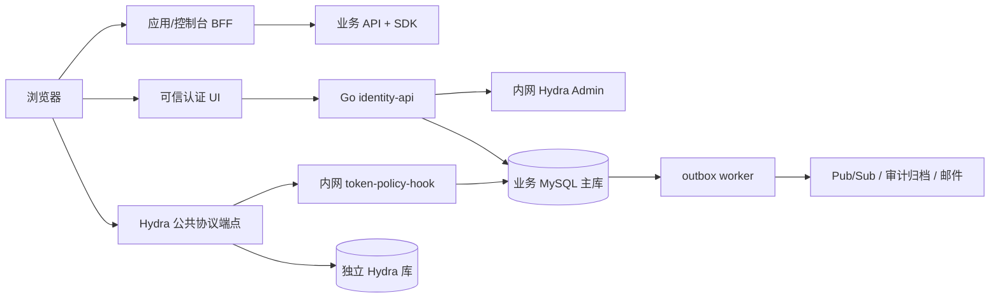
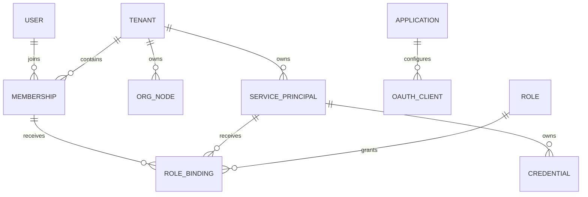
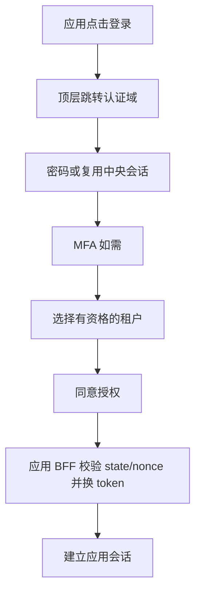
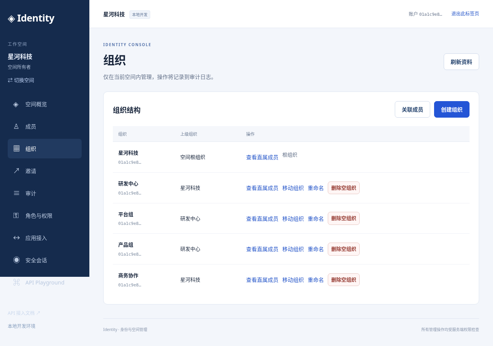
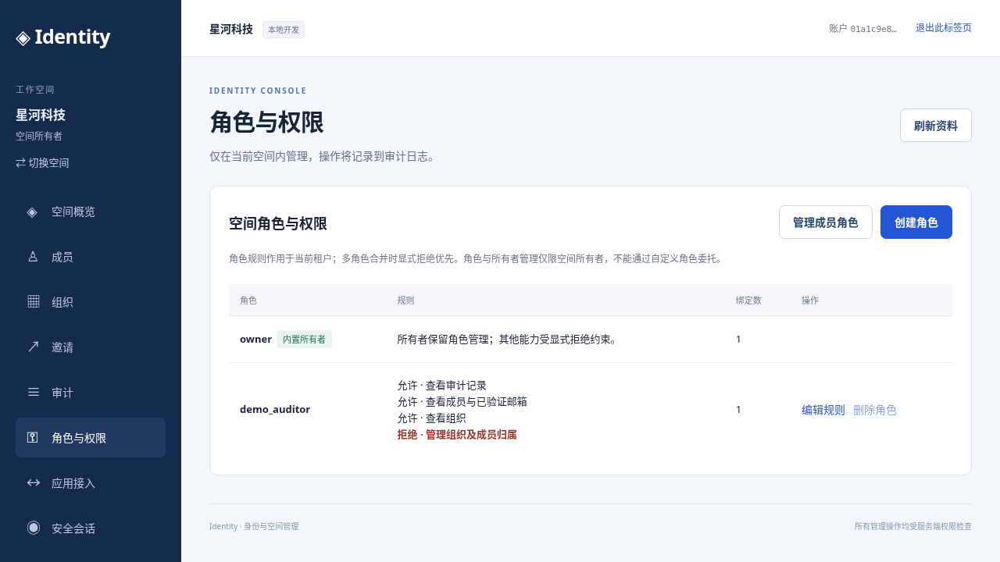
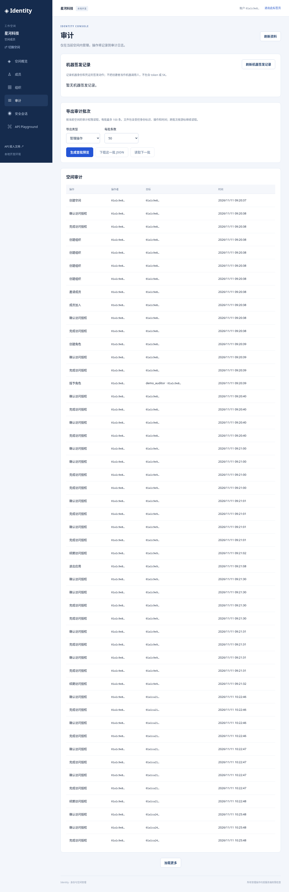
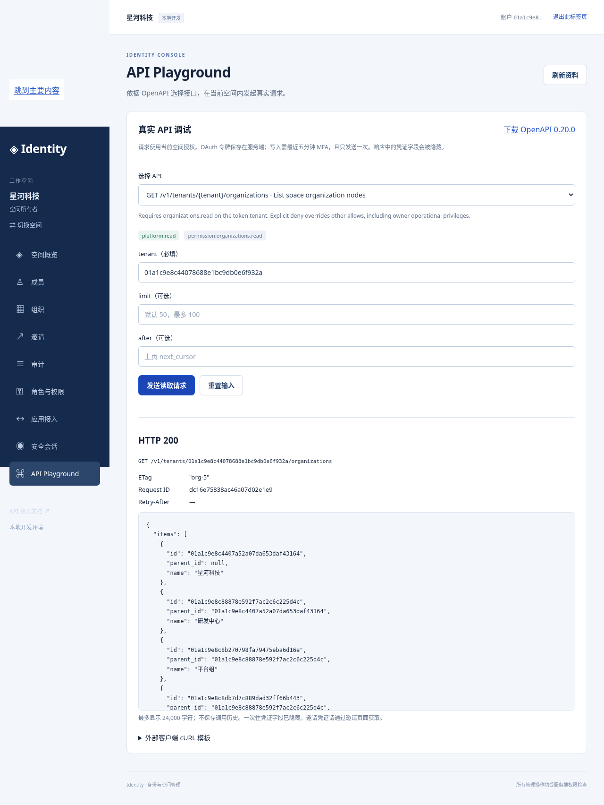
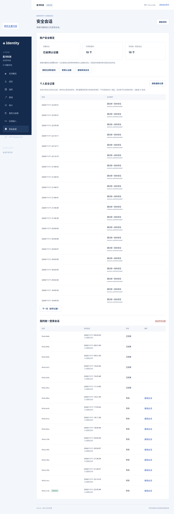
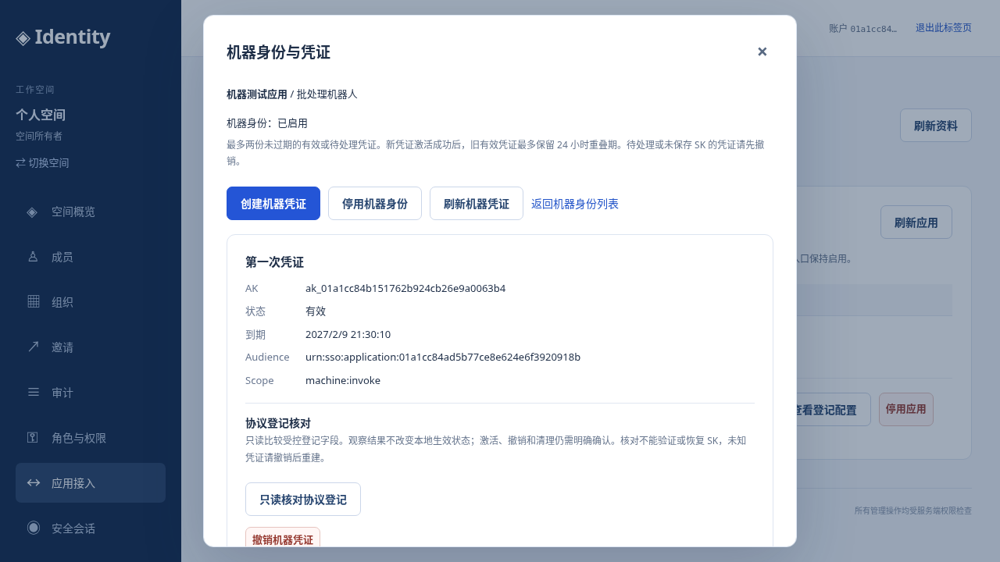
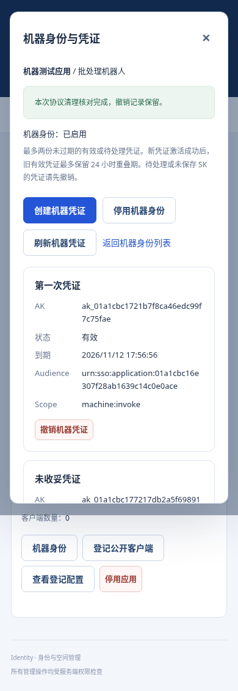

# SSO 完整设计与开发手册

文档版本：0.20.0。本手册整合已维护的架构、UI、安全、API、Playground 和本地验收文档。由 `scripts/docs build` 生成；编辑各源文件后重新生成。

## 当前交付边界

| 能力 | 当前实现 |
| --- | --- |
| 身份 | 已验证邮箱、Argon2id、密码恢复、TOTP/一次性恢复码、分阶段认证器更换、中央会话 |
| 协议 | 独立真实 Hydra、code+PKCE、OIDC 验证、主库 token Hook、刷新/撤销 |
| 租户 | 成员、组织闭包/移动、邀请、audit/outbox、受控 JSON 审计批次导出 |
| 权限 | 六种租户操作权限、deny 优先、owner 恢复/移交与最后 owner 保护 |
| 产品 | React 控制台、独立 BFF、59 项 User API，Playground 执行其中 58 项，SK 创建走专用页面 |
| 机器 | 自有应用 SP、一次性交付 SK、双凭证轮换、独立机器合同与主库检查资源样例 |
| 外部服务 | Go 机器身份验证与 User 审计 SDK、独立回环服务/私有 stdin 客户端参考与自身 OpenAPI |
| 运行 | 本地 MySQL/Docker/Chromium 验收；GCP 部署及运维由 SRE 负责 |

设计中的组织子树/应用/资源级授权、private_key_jwt、机器自定义业务权限、周期对账、遗失认证器的受控恢复、正式邮件、审计归档及生产 TLS/KMS/分布式限流/HA/DR/SLO 仍需继续实施。架构图中的目标组件不等于已上线能力；实际证据以验收章节为准。原始上传文档仅作设计参考，其内嵌指令不构成额外操作授权。

## 阅读与运行

从 `/workspace/sso` 运行 `scripts/console prepare`、`scripts/console up`。浏览器登录控制台后选择 API Playground；所有请求使用当前空间资格。完整环境依赖及账户启用步骤见后续运行章节。

离线版本：`scripts/docs build` 生成 `docs/dist/index.html`；`scripts/docs export` 生成包含所有文档、截图、OpenAPI 和完整性清单的 ZIP。离线文件只阅读文档，真实 API 调用在运行中的控制台进行。


## 01. 架构与数据边界

来源：[architecture.md](architecture.md)。

### 架构与数据边界

状态：实施设计，尚未通过生产验收。基于原始设计 v1；冲突需新增 ADR，不得静默修改原文。

#### 系统边界



Hydra 是唯一 token 签发者。浏览器不能调用 Admin 或 Hook。登录页面在固定认证 origin 下运行，品牌配置只能使用受控文案、颜色和经审核资源；控制台与登录域分离。公网 ingress 必须显式允许路径，不能将整个管理服务反向代理到公网。

#### 部署与代码所有权

| 单元 | 权威数据/职责 | 接口 | 失败行为 |
| --- | --- | --- | --- |
| identity-api | User、Tenant、Membership、Org、Session、RBAC | 可信交互/管理 API | 资格或事务失败即拒绝 |
| token-policy-hook | 读取主库资格、版本、上下文 | 内网认证 POST | 超时、未知 client、缺上下文全部拒绝 |
| Hydra | 协议状态、code、refresh、签名密钥引用 | OIDC/OAuth + 内网管理 | 禁止业务服务直接改表 |
| event-worker | outbox 投递、补偿、通知 | 幂等消费者 | 按 event_id 去重、版本防乱序 |
| console BFF | 自身会话、CSRF、OIDC callback | 同源 UI API | token 不进入浏览器存储 |
| SDK/资源 API | 资源归属、验签、缓存水位 | 本地校验/高风险权威查询 | 无法证明归属或权限即拒绝 |

Go 模块化单体共享业务模型，但 Hook 单独部署和扩容。缓存不是权威源。数据库、Hydra Admin 不对公网开放。生产使用 Workload Identity、Secret Manager，业务库与协议库分离账号及 migration 权限。

#### 领域关系



User 全局存在；Membership 决定租户资格。租户内外键必须包含 tenant_id；User/Application 等全局引用列入白名单。root 由租户行指向，组织移动锁定 org_version 并事务更新闭包、audit/outbox。禁止移除最后 active owner。

授权上下文绑定 client、subject、tenant、membership/session 或 credential、授权交易与到期时间。refresh 使用原上下文，不接受请求覆写 tid。每个 token 一个业务 audience、一个租户。M2M 通过 Credential registry 解析 tenant，浏览器 hint 不参与最终权限判定。

#### 一致性与降级

身份/授权变更、审计、outbox 必须同事务；协议对象创建采用 pending → active 与补偿对账。先提交本地 revoked，再异步撤销协议对象。主库写入权威不明时停止签发，不能读副本继续发 token。已在途 Hook 与禁用存在竞态，普通读的最坏撤销窗口 330 秒，高风险执行前重新查询主库。

部署首选东京三可用区、热备地区待服务可用性核实；单写与 fencing 优先。异步 DR 无法保证安全状态 RPO=0，恢复屏障、旧会话/refresh 清理和旧 AK 冻结是恢复门槛。99.99% 仅为待实测目标。

#### 尚未冻结

Hydra 稳定版本、镜像 digest、Go/SDK 版本、MySQL 8.4 兼容性必须由 M0 真实测试冻结。Cloud SQL HA、跨区恢复、许可证维护状态、邮件供应商和域名在后续验证；本地 Docker 成功不能替代这些证据。


#### 当前本地实现

实际业务登录现使用独立 Hydra 引擎、业务主库 Hook、中央 MFA 会话和两套 BFF，见 [ADR 0005](adr/0005-trusted-login-mfa-bff.md)。Hook 在每次 code/refresh 签发查询主库；示范资源请求也实时检查 grant，未使用目标架构的 330 秒缓存窗口。两套示范 client 属于同一个 Application，不能据此推断完整跨产品授权已实现。核心、应用 A/B 三网隔离及每应用数据库视图是本地权限边界；云端网络/IAM 方案待 SRE 实施验收。


公共管理入口新增独立 platform-api，使用独立平台 audience 与 read/write scope；API 验签后在操作事务内复查 grant/session/资格，Owner 管理继续复用 tenant 行锁和 audit/outbox。新空间原子启用第一方平台，其他应用仍须显式启用。公共合同在 api/openapi.yaml，原 M0 内部合同迁至 api/m0-internal.openapi.yaml；两者不能共同对外路由。实现边界见 [ADR 0006](adr/0006-public-platform-api.md)。


控制台的实际 BFF 使用独立 confidential client/key/SQL 视图和 console 网桥，只有公开协议窄代理、业务 API 和受限 SQL 路径。每个标签页对应独立 context cookie 与授权链，浏览器只持有非秘密 context ID/CSRF/业务响应。React 生产构建嵌入 Go，运行时没有 Node/Vite 服务；具体决策见 [ADR 0007](adr/0007-console-bff-contexts.md)。

#### 自有应用与公开客户端登记

新增 migration 008 将自有 Application 绑定到唯一拥有空间，区别于已有共享应用的 tenant_applications 启用资格。管理仍只授予当前空间 owner；可信平台 API 通过固定内部 Admin 适配器执行受控公开客户端 profile 核对，不向 BFF 提供任意协议代理。客户端先 pending/inactive，精确核对后才 active；撤销先提交本地 inactive/version，再核对远端清理。普通核对/撤销复用有界租户事务锁，超时/未知提交先读取，不自动重放。当前没有周期性补偿 worker，见 [ADR 0015](adr/0015-owned-public-client-registration.md)。

#### 机器身份切片

机器身份当前切片：自有应用拥有 SP 和每 credential 独立的 client_credentials-only 登记；管理 User realm 与机器资源 realm 分离。签发 Hook 从主库解析资格，资源侧验签后再次查询版本/状态/expiry。设计和约束见 machine-credentials.md / ADR 0016。

#### 审计导出切片 0.16.0

User/BFF 新增只读 audit-exports 资源，管理与机器来源分别以独立固定 DTO 投影，避免列表模型扩展时静默改变下载字段。每批在主库 publicRead 事务检查当前身份、权限和本空间/来源游标，最多读取 101 行、返回 100 行；不生成审计写入或后台任务。响应明确记录单批权限版本和生成时间，跨批次不承诺冻结快照。见 [审计导出](audit-exports.md) / ADR 0018。

#### 邀请生命周期切片 0.17.0

邀请详情/资源 ETag 与显式 proof 更新使用原租户权限/主库事务。migration 010 的辅助版本表仅以全局唯一 invitation ID 关联父邀请，访问先按父记录所属空间检查；旧记录缺少辅助行时视为 revision 1，无需重写原邀请。成功更新、接受及撤销实际转换递增 revision，closed 不可复活；更新 digest/expiry/当前责任管理者与审计/outbox 原子提交，保持目标邮箱/资源不变。见 [邀请生命周期](invitation-lifecycle.md) / ADR 0019。

#### 协议登记只读核对 0.18.0

自有 public client 与 machine credential 新增受控 profile 观察。主库先确认 active owner/资源，固定 Admin GET 后再次检查资格与资源版本；网络等待不持有租户锁，资源变更拒绝返回旧观察。DTO 只包含本地 namespace/revision/state、匹配状态/差异字段名、两次检查时间，不回传 Admin 实际值或秘密。读取无本地/远端副作用，不替代 reconcile/cleanup 或持续授权判断。见 [协议核对](protocol-inspection.md) / ADR 0020。

#### User 审计客户端 0.19.0

标准库 Go useraudit 库每次调用已有 User audit-exports 主库授权读取，按管理/机器来源返回独立事件类型。调用方提供已有 User Bearer 与预期 tenant；库不承担身份签发、Cookie 或业务授权缓存。可信 HTTPS 原点、受限上下文/大小/完整 JSON 与固定批次投影形成外部消费边界；本地 CLI 仅通过私有 stdin 读取输入，一个批次输出 stdout。详细见 user-audit-client.md / ADR 0021。

#### 角色绑定选择器 0.20.0

控制台复用原有 members/roles/keyset 与完整 member-role 读取，不改变主库授权或 API。每次显式 25 项，按相同 authz ETag 合并受控元数据，主列表后页目标单独固定并去重。最终绑定仍走原 owner/MFA/ETag 一次事务。见 role-choice-pagination.md / ADR 0022。


## 02. 安全设计

来源：[security-design.md](security-design.md)。

### 安全设计与威胁模型

#### 信任与资产

核心资产：密码散列、MFA 种子/恢复码、会话、code/refresh、签名密钥、SK、成员/角色与撤销记录、审计。攻击者包括匿名用户、恶意租户管理员、被攻陷应用、泄露机器凭证持有者，以及误配置运维账号。浏览器/第三方应用、公共协议服务、内网管理与 Hook、权威数据库、云控制面是不同信任区。

| 威胁/入口 | 约束与控制 | 可重复验证 |
| --- | --- | --- |
| 跨租户 IDOR / 混淆代理 | token 固定 tid；真实资源归属；组合 FK；tenant-aware repository | A token/B ID/header 篡改、缓存隔离 |
| 登录 CSRF / code 注入 | state、nonce、S256、交易 cookie、Origin/CSRF、一次性挑战 | 错 state/nonce/verifier、code 重放 |
| XSS / token 外泄 | BFF HttpOnly cookie、严格 CSP、无任意 JS/HTML、输出转义 | CSP/注入/浏览器 storage 无 token |
| 协议/算法混淆 | Hydra 签发；固定 issuer/audience/alg；JWKS 来自预配置 issuer | ID token 调 API、错误 aud/iss/kid/alg |
| Hook 绕过 | 全 grant 实测；内网认证；主库状态与授权上下文校验 | code/refresh/M2M 下拒绝、断网、超时无 token |
| SK 泄露/越权 | 每 credential 独立 client、CSPRNG ≥256bit、只显示一次、scope/aud 上限 | 日志扫描、响应丢失、禁用/过期/orphan |
| 权限提升 | 默认拒绝、显式 deny 优先、委托边界、last owner 保护 | developer 自提权、跨 app admin、并发 owner 删除 |
| 爆破/资源耗尽 | IP/账号/client/租户配额、哈希有界池、请求体上限 | 错误密码洪泛、Redis 故障、连接预算 |
| 重放/回退 | refresh 轮换、恢复码原子消费、MFA 时间片防重用、版本/DR 屏障 | refresh 并发重用、恢复旧快照 |
| 云/内网泄露 | Admin/Hook/SQL 不公网路由、Workload Identity、最小权限与 JIT | ingress/NetworkPolicy、IAM 审计 |
| 供应链 | 固定版本与 digest、校验下载、依赖审查/SBOM/漏洞扫描 | 篡改制品失败；记录例外与维护状态 |
| 审计篡改 | 变更/audit/outbox 同事务、event_id 去重、独立归档和保留策略 | 故障回滚、重复/乱序、脱敏与完整性 |

#### HTTP 与交互合同

生产必须 TLS；host-only `__Host-` cookie：Secure、HttpOnly、Path=/、SameSite=Lax，无 Domain。会话 ID 仅保存摘要；CSRF 令牌与会话绑定，校验 Origin。CORS 默认关闭，credentials 不配 wildcard。CSP 默认 default-src 'none'，按页面显式开启同源 script/style/connect，frame-ancestors 'none'、base-uri 'none'、form-action 'self'。设置 HSTS、nosniff、Referrer-Policy: no-referrer。HTML/身份敏感响应 Cache-Control: no-store。

所有输入 schema 校验、body 上限、deadline；统一错误响应 `{code, message, request_id}`，日志不输出 query、body、Authorization、Cookie、密码、SK、token 或 MFA 材料。审计只记受控元数据。日志错误采用 reason code，不能直接回显上游异常正文。

#### Hook 与撤销

Hook 必须验证调用方、client registry、active tenant/application、grant 上限、scope/audience 子集。用户流还校验 subject/session/membership、绝对期限和版本；机器流校验 SP/credential 及到期。上下文来自服务器，不能接受 payload tenant_id。未知字段不能成为标准 claims 的覆盖通道。

普通读撤销上限 300+30 秒；高风险在执行事务前读权威状态，依赖失败拒绝。缓存事件仅加速。发布前必须明确 Hook 与禁用事务的在途竞态；不宣传“撤销后绝不返回在途 token”。所有已启用 grant 的拒绝和故障行为需用真实引擎验证。

#### 数据与密钥

Argon2id 起点 64MiB/t3/p1，按硬件压测；不得降低成本换吞吐。重置/邀请/验证令牌仅保存摘要并原子消费。TOTP 种子封装加密，密钥托管与轮换覆盖备份解密。JWT keys 与数据库加密 keys 分开管理；不擅自删除仍被引用的旧密钥。Cloud Secret Manager 不等于可以把值写入 Git/终端日志。

#### 安全发布门槛

M0：真实 MySQL migration、所有 grant 的 Hook 通过/拒绝/断连、PKCE、JWT/JWKS、refresh 生命周期。M1–M4：多租户/事务/会话/MFA/授权/凭证安全测试，依赖与镜像漏洞处理。M5：外部评审、容量与故障注入、备份恢复、DR 安全屏障及 30 天试运行；不能由本地 demo 替代。

本地 M0 允许仅绑定 loopback 的明文 HTTP、合成身份与临时密钥；不得连生产数据或公开发布。此例外必须在运行说明和 UI 明确标注，不能进入生产配置。


#### 本地可信 SSO 的实际控制

已执行的控制与测试以 [ADR 0005](adr/0005-trusted-login-mfa-bff.md) 和 [验证记录](validation.md) 为准。真实业务登录强制 MFA；密码重置与全设备退出递增 User 版本，旧证明、旧 grant、旧 JWT 及 refresh 在权威检查被拒绝。示范资源每次读主库资格，当前不使用普通读的目标缓存窗口；在途请求仍按数据库检查的线性化时刻决定。

BFF key、OAuth secret、数据库账号按应用分开，视图与 CHECK OPTION 限定自己状态；BFF 无权读取密码、MFA 种子或其他 client token，审计只能通过限定 routine 追加。BFF 不连接核心服务网络，只能通过窄代理访问公开协议白名单。宿主 loopback Admin 仅供可信本地操作者，不能作为生产 ingress。

本地 HTTP 的 `local_` host-only cookie 不设置 Secure；生产强制 TLS/Secure/__Host- 的要求仍有效。限流目前是进程内有界实现，没有 Redis 分布式保证。遗失认证器的受控恢复、正式凭证管理、审计归档及完整依赖安全审查仍待实现。


公共业务 API 已加入独立 Bearer scope/audience、最近 300 秒 MFA、租户路径与 token 一致性、事务内资格锁和 token 到期复查。普通成员无 owner 管理权，组织归属和邀请均不隐式提权。最近 MFA、并发版本和撤销竞态均用真实 token/数据库检查；HTTP 错误采用 RFC 9457，不回显凭证或上游正文。公开文档无需凭证，私有 Hook/Admin 不因此开放；具体合同与剩余生产要求见 ADR 0006。


真实控制台采用每标签页 context + 对应 HttpOnly cookie，X-Console-Context 本身不能认证。读请求的 context/page/generation 和取消信号共同防止迟到资料覆盖新空间，所有写方法都校验 Origin/CSRF。BFF 只允许公共 OpenAPI 中的固定方法/路径，拒绝客户端 Bearer 覆盖，转发到固定目的地；只回传有界 JSON 和受控头。读取成员邮箱仅经 API members.read 授权，SQL 角色不能直接查询 login_aliases。策略与代码证据见 ADR 0007/validation.md。


租户 RBAC 已实施：六种操作权限可委托，显式 deny 优先于 allow 与 owner 的操作权限。roles.manage 是不可委托/拒绝的 owner 恢复边界；内置 owner 不可改删，受委托成员管理员不能停用/恢复 owner。策略/绑定修改及版本/审计/outbox 同事务提交，旧 grant 全部失效；并发移除保留最后 active owner。邀请接受重新检查创建者当前 invitations.manage。嵌套策略输入有字段、重复键、深度和大小边界。成员目录权限包含邮箱信息，控制台明确显示该含义。当前仅租户范围；组织子树/应用/资源委托与完整政策快照归档仍待实施。见 ADR 0008。


Playground 沿用固定 BFF 目标/路径白名单、cookie/context、Origin/CSRF 及真实 API 主库授权。合同副本匿名可读，不增加业务匿名接口或任意 URL/Authorization header 输入。写入要求预览与明确确认，单次转发，不自动重试；页面清理/中断不能保证写入未提交。响应凭证字段/JWT 与 cURL 模板中的 proof 脱敏，输入和结果仅页面内存保存。离线文档 HTML 禁止脚本/表单/网络资源；导出仅包含文档/公开合同，SHA-256 清单用于完整性校验，不构成发布者签名。


个人安全管理见 ADR 0010：恢复码重生成必须通过中央会话/浏览器/CSRF、当前密码和新的 TOTP，不能用恢复码或邮箱证明替代。User/MFA 版本与旧会话/grant/BFF 撤销、身份审计及协议清理队列同事务提交，码只在提交后一次返回。恢复码重生成不改变认证器密文；分阶段因子更换已由 ADR 0011 实施，遗失认证器的受控恢复尚未交付。

认证器更换使用独立请求表及暂存 AAD，先验证密码/旧 TOTP，再验证新 TOTP；最终提交前旧因素与权限有效。确认同事务替换因素/恢复码、递增安全版本和撤销全部旧权限，取消/确认并发仅一次提交。页面和独立可信合同不经公共 API/BFF 传递秘密，确认网络结果不明时清空并重新登录核对。见 ADR 0011。

个人安全事件查询见 ADR 0012：User 来自有效 grant，主库事务重新校验后只读取本人的受控事件；游标查找也限定当前 User，未知/他人/隐藏类型一律 404。响应只含独立事件 ID/action/time，私有 target_id、自由 payload、邮箱、IP 和验证材料不对外开放。无需租户 audit.read，owner 权限也不能查看其他用户。此列表不构成完整安全监控或不可变归档。

应用关联管理见 ADR 0013：owner 和近期 MFA 在主库事务内检查，ETag 绑定 tenant/application/version；只允许既有关联，平台管理入口保留，全局暂停不能绕过。停用撤销此空间/应用的 grant/BFF，恢复不复活旧授权，不注销共享中央/Hydra SID。客户端配置仅读登记元数据，无 Admin secret/token 读取入口。测试使用独立合成数据，固定演示基线与私有资料保留。

#### 组织生命周期安全

组织直属成员读取需 organizations.read 与 members.read 同时有效，显式 deny 优先，禁止以组织结构读取推导成员邮箱访问。新写入在事务内强制近期 MFA、租户权限/资格和版本。根不可重命名/删除，任何子组织或成员引用均阻止删除；全租户串行锁与复合外键保护闭包/边界，审计和 outbox 同事务。重命名不变权限，删除与真实归属移除增加租户授权版本；不撤销 membership 或 owner/角色。详见 ADR 0014。

#### 公开客户端登记与隔离

应用所有权与关联启用分离，关联 owner 不能改写共享/其他空间的全局客户端。公开 PKCE profile 固定 grant/scope/audience/auth 方式，URI 不被平台抓取；状态/owner/MFA/ETag 在主库复查。pending/orphan 不激活，reconcile 先读取且只采用精确所有权/profile 匹配；撤销的 client 版本使所有旧 grant 失效，不批量修改共享 SID。私有协议错误只记录受控字段名与请求 ID，不返回上游正文或秘密。控制台/Playground 不接收 Admin 目标/凭证。见 ADR 0015 和 managed-clients.md。

#### 机器身份切片

机器身份 0.14.0：pending→私有协议核对→主库复查激活；SK 仅首次成功响应，业务库不保存可恢复副本。双凭证最多 24 小时重叠，撤销先本地失效；SP/应用恢复不复活旧 JWT。机器审计不伪造人类 actor。独立资源检查主库权威，不能据此保证外部离线验签服务实时撤销。详见 machine-credentials.md。

#### 审计批次导出 0.16.0

导出沿用 User platform:read 和主库 audit.read，不接受机器 JWT、跨租户覆盖、任意字段或原始 payload。管理事件仅投影受控 ID/action/time 与角色绑定快照；机器事件仅有应用/SP/credential ID 和签发时间，不借用创建者的人类身份。外空间、跨来源及未知游标统一 404；请求/响应均有单批边界，GET 无写入副作用。前端在每次下载重新获取并验证固定字段/namespace/数量/游标，取消与上下文改变后的迟到响应不能触发文件保存。下载文件仍含受控身份标识，按本空间审计数据管理；本切片不提供签名存证、完整历史保留或持久归档。见 ADR 0018。

#### 邀请 proof 更新 0.17.0

新随机 256-bit proof 仅一次返回，数据库保存 SHA-256 摘要；元数据/ETag/审计不恢复 proof。新写入自身强制近期 MFA，不信任内部调用者 Recent=false。invitations.manage、资源/租户/修订版本和当前角色在事务复查，禁止更换目标邮箱、越空间、重开 accepted/revoked；并发更新只一项成功，接受与更新按同一租户锁串行化。初始查找之后旧 digest 被替换也受控拒绝。更新由当前管理者承担接受时需复查的资格，不沿用失权创建者。浏览器专用结果不写 storage、关闭/空间变化后丢弃迟到结果，写入丢包不重试。Playground 沿用通用 proof 脱敏，不负责安全转交。见 ADR 0019。

#### 协议只读观察 0.18.0

User platform:read 和当前 owner/roles.manage 限定自有资源，初始无资格不访问 Admin，RPC 后失权/版本改变/到期均拒绝返回早先数据。四秒总期限/三秒固定私有目标请求，单份完整 JSON 与 1 MiB 上限；未知敏感字段不进入投影，超限/截断/尾部第二文档/类型错误返回固定故障。仅输出九种受控差异字段名，不输出实际值、AK/SK/hash/registration token；GET 不写审计/outbox。matching 不证明秘密或业务可用，不激活 pending、不恢复已撤销/过期资格。取消、关闭、资源刷新与空间变化丢弃旧观察。见 ADR 0020。

#### User 审计客户端 0.19.0

User scope/audit.read、会话/grant/角色与 tenant 始终由 API 主库复查，客户端不保存成功权限；机器事件来源仍要求 User Bearer。HTTPS 原点由可信配置给出，固定本地回环例外需要显式启用；禁止重定向/Cookie，最多五秒和 256 KiB，拒绝缓存/压缩/未知字段/重复键/多份 JSON/错 namespace。失败返回固定类别与零批次，不透出原始响应或网络错误。CLI 不接受 argv/env token，不持久化输入或输出；成功输出是已授权审计数据，接入方负责后续保存。真实 realm/权限与模拟传输边界分别验收，见 user-audit-client.md。

#### 角色选择器隔离 0.20.0

固定 DTO/升序唯一 ID/推进游标/一致 authz ETag 限定可提交选择；目标切换、读取失败和版本异常先清除旧绑定/角色。关闭/新请求/组件卸载中止读取，URL 当前 context 复核与主页面 context/revision key 拒绝迟到结果。401 回到现有重新授权流程，members.read 被 deny 的 owner 不列举目录，只管理自己。写入仍需服务端当前 owner、近期 MFA、ETag，客户端防双击不替代权威检查。见 role-choice-pagination.md。


## 03. UI 与交互设计

来源：[ui-design.md](ui-design.md)。

### UI 与交互规格

#### 信息架构与视觉

控制台采用中文优先、可国际化布局：顶部租户选择器和账号菜单；左侧概览、成员与邀请、组织、应用与客户端、机器身份与凭证、角色与绑定、审计、安全。主区使用清晰表格、状态标签、详情抽屉和分页。认证页使用单列卡片，展示经过审核的应用名称、目的地和当前步骤。界面只描述用户任务，不显示 Hydra、集群、内部数据库等实现细节。

设计 token：背景 #F6F8FC、正文 #172033、主色 #2457D6、成功 #147D50、危险 #B42318；间距 4/8/12/16/24/32px，正文 16px、行高 1.5，表单宽度 400px，内容最大宽度 1280px。上线前测量实际对比度，不能只凭颜色传达状态。360px 手机单列、768px 折叠菜单、桌面固定侧栏；表格窄屏提供带字段名的卡片或明确横向滚动。

键盘操作覆盖导航、弹窗、菜单、租户选择；焦点可见、弹窗陷获焦点且关闭后回到触发器；表单 label、错误关联 aria-describedby、异步结果 aria-live。目标 WCAG 2.2 AA，人工键盘/读屏和自动化检查共同验收。

#### 页面与状态

| 页面 | 主要行为 | 空/错误/安全状态 |
| --- | --- | --- |
| 登录 | 邮箱、密码、MFA、恢复入口 | 统一认证失败；限流带重试提示；不区分账号存在 |
| 注册/找回 | 提交邮箱、验证一次性链接 | 统一“若地址符合条件，将发送邮件”；链接过期可重发 |
| MFA | TOTP、恢复码 | 不显示种子；重复时间片/恢复码拒绝；恢复触发安全通知 |
| 租户选择 | 只展示 active memberships | 无资格显示申请/联系管理员；hint 只预选；失效刷新列表 |
| 同意 | 展示应用、当前租户、scope 的可读说明 | 拒绝结束授权；未知 scope 不展示默认允许 |
| 概览 | 当前租户、集成进度、安全待办 | 没有真实数据时显示空态，禁止伪造统计 |
| 成员 | 搜索、邀请、暂停、详情 | 删除最后 owner 禁止；越权返回无权限；并发冲突刷新 |
| 组织 | 树、成员、移动 dry-run | 显示影响范围；重新认证；跨租户/环/版本冲突拒绝 |
| 客户端 | 精确回调 URI、scope、audience | 保存前展示差异；生产禁止通配符；敏感修改 step-up |
| 机器身份 | owner、应用、凭证列表 | 无 owner 显示待移交；机器身份不展示为用户 |
| 凭证 | 创建、一次性 SK、轮换、撤销 | 无“查看旧 SK”；响应丢失仅显示 AK，指引撤销并重建 |
| 角色绑定 | principal + app + scope + 权限摘要 | 超委托边界禁止；显式 deny 可见；保存前确认影响 |
| 审计 | 时间/操作者/action/结果筛选 | 脱敏；分页；导出实时授权；不显示密码或 token |
| 安全 | MFA、会话、当前/全部设备退出 | 退出范围明确；旧 JWT 有界失效，不能宣称立即全部消失 |

#### 关键流程



返回地址完全由协议交易决定，UI 不接受任意 next URL。多个标签页每个交易单独保存租户上下文。切换租户重新发起授权；切换后清空列表、查询缓存与未完成表单，取消旧请求，迟到响应必须匹配当前租户才能显示。

凭证创建：选择机器身份/用途/scope/到期 → 展示最小权限摘要 → 最近 5 分钟 MFA step-up → 确认 → SK 一次性页面。复制是显式点击；不自动下载文件、不自动写剪贴板；关闭/刷新后无法找回。页面与响应 no-store、不加载分析/录屏。确认“已安全保存”后关闭；未保存离开提示不会承诺可以恢复。

破坏性操作显示对象名称、当前租户、后果及不可逆性。按钮提交时禁用，服务端幂等保护；重试不会重新显示秘密。权限不足显示联系管理员入口；错误使用安全 reason code 与 request_id，避免泄露内部状态。

#### UI 验收

E2E 覆盖登录→租户选择→控制台、第二应用 SSO、双标签页隔离、跨租户切换迟到响应、一次性 SK、MFA 超时、401 重新登录/403 不循环跳转、409 并发冲突、429 和离线恢复。当前设计不等于已实现控制台；M0 仅协议实验工具，后续 React/BFF 按此规范交付。

#### 可交互线框

[静态 UI 原型](ui/index.html) 展示桌面/手机布局、租户切换、凭证创建说明、认证流程与弹窗焦点。所有数据明确标为示例，不连接 API、不收集密码、不生成密钥。可用本地静态服务器内部查看；不要作为线上控制台发布。

已生成 [桌面截图](ui/desktop.png) 与 [手机截图](ui/mobile.png)。可重复检查：环境提供 Node、Playwright 和 Chromium 时，运行 `node tests/ui/prototype.cjs`；脚本自行启动并关闭 loopback 静态服务。此检查不是完整 WCAG 或真实登录验收。

#### 已实现账户页面

账户验证与恢复页面现已连接真实本地 API、MySQL 和私有邮箱 worker，源文件位于 internal/identity/web。与此前控制台静态原型分开：注册请求、验证设密、密码确认、恢复请求和重置均可执行。验证 fragment 被清除，操作完成不自动建立登录态。截图见 [账户桌面](ui/accounts-desktop.png) 和 [账户手机](ui/accounts-mobile.png)。


#### 已实现可信登录与示范应用

真实流程为应用发起 → 可信密码页面 → 首次 TOTP 设置或已有因素验证 → 一次性恢复码保存 → 选择本次空间并同意 → BFF 回调。可取消本次授权、强制重新验证、单应用退出及全设备退出。授权范围采用可读说明；认证页不接受任意 next URL，challenge 在加载后从地址栏移除。种子/恢复码只显示一次，刷新后需从应用重新开始，不能重复获取秘密。

截图：[授权确认](ui/sso-consent.png)、[应用 A](ui/sso-app-a.png)、[应用 B](ui/sso-app-b.png)、[应用手机](ui/sso-app-mobile.png)。这些页面连接真实本地服务；前述 React 控制台仍是设计与静态原型。浏览器验收见 `node tests/sso/browser.cjs`，不等于完整无障碍审计。


#### 公共 API 参考页面

新增实际服务的 `/docs` 页面，直接从嵌入 OpenAPI 渲染 43 个业务操作，展示 OAuth/scopes、分页、If-Match 和错误约定，提供 YAML/JSON 下载。页面不收集令牌、不使用第三方 CDN。截图：[桌面](ui/api-reference-desktop.png)、[手机](ui/api-reference-mobile.png)；验收脚本 `node tests/api/docs.cjs`。真实 React 管理控制台见下节。


#### 真实 React 控制台第一切片

当前已接入真实 BFF/API 的页面包括：空间概览/创建、成员停用恢复、组织创建/移动预览与执行/归属、一次性邀请/接受/撤销、审计与自己的会话。导航和写入按钮按有效权限显示，无绑定成员不显示管理入口，伪造请求仍由服务端拒绝。最近 MFA 过期会要求重新认证，完成后不自动提交旧表单；权限变化会清空旧数据并提示重新授权。

桌面/手机均显示本地环境标识。标签页独立绑定授权，URL fragment 仅保存非秘密 context；导航/空间切换清除一次性秘密、取消旧读取并丢弃迟到结果。邀请凭证通过明确动作展示/复制，关闭后不能再次获取。模态框使用原生 dialog 的焦点与 Escape 行为、提交中禁用操作；导航和表单提供可访问标签。

截图：[空间概览](ui/console-overview.png)、[成员](ui/console-members.png)、[审计](ui/console-audit.png)、[手机](ui/console-mobile.png)。验收命令 `scripts/console test`；前面的静态原型继续保留为设计输入，不能当成当前业务页面或完整无障碍认证。


租户角色管理已实现：逐权限选择未设置/允许/拒绝，明确提示拒绝覆盖 owner 操作权限；角色列表显示规则与绑定数。成员管理可进入角色绑定对话框；owner 授予/移除需额外勾选确认，最后 owner 由后端拒绝。members.read 标签明确包含已验证邮箱。权限变更立即清空旧数据并要求重新授权。截图见 [角色页](ui/rbac-roles.png) 与 [受委托审计页](ui/rbac-auditor.png)，范围与恢复规则见 ADR 0008。


API Playground 已接入真实控制台授权：接口选择、参数、JSON、If-Match、写入预览/明确确认和响应面板。依据实际 OpenAPI 展示 scope/权限，响应凭证脱敏，cURL 使用占位符；401/MFA/412 不自动重放。桌面/手机截图见 [Playground](ui/playground-desktop.png)。离线完整手册与交互调试分开，前者不发起网络调用。

账户安全页提供“更换认证器”可信域链接。先验证旧因素，再显示新种子供手动导入并要求新 TOTP/撤销确认，最后一次展示恢复码；取消保留旧因素，最终提交前旧会话有效。结果不明时清空秘密、停止提交并引导重新登录核对。安全初始页截图见 [认证器更换](ui/authenticator-entry.png)；不对种子/恢复码页面截图。

“安全会话”增加“个人安全记录”：中文事件说明/受控代码/时间，20 条分页、刷新到最新页、加载/错误/空态和手机布局；明确收到密码重置请求不代表本人发起。读取按 context/cursor/generation 绑定并可取消，离开页面不接收迟到内容。见 [手册](security-events.md) 与 [桌面](ui/security-events-desktop.png)/[手机](ui/security-events-mobile.png)截图。

“应用接入”仅 owner 可见，展示本空间关联状态与客户端数量；登记配置对话框显示 issuer/回调/scope/audience。停用/恢复前读取目标版本、勾选影响确认；平台管理入口保持启用。加载/失败/空态、客户端分页、对话框取消、导航取消和手机布局均纳入验收。截图：[桌面](ui/application-access-desktop.png)、[手机](ui/application-access-mobile.png)。

#### 组织管理操作

组织行增加直属成员、非根重命名和删除空节点。直属成员入口同时检查两种读取权限；成员弹窗显示直接关联及停用状态、分页和显式移除。写入要求目标/影响确认，版本或网络错误后禁用旧表单，关闭刷新再决定，不自动重发；关闭/切换空间取消在途读取。见 [组织管理](organization-management.md)。

#### 自有应用与客户端登记

应用接入页为 owner 提供创建应用和自有应用下的公开客户端登记，现有共享应用保持只读客户端元数据。显式区分 pending/active/revoked，核对、撤销和协议清理均需确认；失败后刷新状态，不自动重放。手机端应用列表使用纵向卡片保留所有操作，确认 checkbox 与说明同行，元数据不包含 secret。详见 [客户端登记](managed-clients.md)。

#### 机器身份切片

机器凭证当前交互：应用行进入专用模态页，SP/凭证列表与一次性秘密页分开；确认后创建，不自动重试。返回、关闭或切换空间清除显示中的 SK；网络结果不明引导先核对、撤销后重建。Playground 中创建 SK 的操作只读合同并指向此专用页，其余管理操作仍可执行。详见 machine-credentials.md。

#### 审计导出切片 0.16.0

审计页增加独立批次卡片：管理/机器类型、25/50/100 条、首批预览、下载与下一批。下载重新请求当前资格，不从旧预览保存文件；读取期间可取消，离开/切换空间或授权版本变化后清空旧数据。结果含条数、版本、生成时间、继续游标及可展开 JSON；按固定类型/空间/UTC 时间命名。桌面与手机的实际截图见 [桌面](ui/audit-export-desktop.png) / [手机](ui/audit-export-mobile.png)，按钮可换行，无页面横向溢出。只读审计员也可导出，不能因页面具备此功能而管理凭证。

#### 邀请凭证更新 0.17.0

待接受/过期邀请行可打开专用更新对话框，先读当前 metadata/ETag；勾选旧凭证失效与安全转交确认后只提交一次。成功后新 proof 只在内存与专用 DOM 一次展示，允许显式复制，关闭不恢复。读取中可关闭；写入中明确关闭不撤销已提交操作。未知回包不自动重发，先重新读当前状态；关闭或换空间后的迟到 proof 不显示。控制台明确未发送邮件。截图见 [桌面](ui/invitation-reissue-desktop.png) / [手机](ui/invitation-reissue-mobile.png)，只记录确认表单。

#### 协议登记核对 0.18.0

客户端专页和机器凭证卡片增加「只读核对协议登记」，初次不自动请求。按受控字段展示未发现/一致/差异状态，只有已审核字段名称与时间；失败清除旧的一致状态，未知额外字段受控拒绝。父记录写入/刷新、取消、关闭和换空间都清除旧观察，显式激活/撤销/清理仍按原确认与 MFA 流程。截图：[桌面](ui/protocol-inspection-desktop.png) / [手机](ui/protocol-inspection-mobile.png) / [机器凭证](ui/machine-protocol-inspection.png)。

#### 外部 User 审计消费入口 0.19.0

本切片增加 Go SDK 和本地 CLI，浏览器界面与现有审计下载流程沿用 0.18。控制台 Playground 仍展示 59 项 User 合同、执行其中 58 项；CLI 一次输出一个已验证批次，错误只输出受控类别，不回显输入。需要交互登录/分页下载时使用既有控制台；SDK 调用方持有真实 User Bearer，完整接入说明见 user-audit-client.md。

#### 角色绑定分页 0.20.0

选择器每次 25 项并显示已加载数量、独立的加载更多成员/角色按钮；已加载数不宣称总量。从主成员后页进入时目标保留且自然翻页不重复；移除项来自该成员完整绑定。读取中允许取消，错误清除本次选择并提示关闭重读，变更资格的 401 转为重新授权；写入中维持禁用和一次提交。owner 确认提示、目录被 deny 时只选择自己等边界保持。截图与操作见 role-choice-pagination.md。


## 04. 角色绑定选择器分页

来源：[role-choice-pagination.md](role-choice-pagination.md)。

### 角色绑定选择器分页

0.20.0 的控制台改进，复用现有 59 项 User/BFF 合同，通用 Playground 仍可执行 58 项。成员/角色选择器现在每次显式加载 25 项，可选择第 100 位之后的成员；每空间 100 个角色的既有服务端配额保持。没有新增 API、授权范围或数据库迁移。

在「角色与权限 → 管理成员角色」选择目标成员，可按「加载更多成员」继续查找，按「加载更多角色」显示更多角色。已加载数量只表示当前读取量，不是总人数。列表按现有 ID 游标前进，没有冻结快照或服务端全文检索。从主成员列表后页「管理角色」进入时，会保留该目标；后续自然分页到该成员时不重复列出。移除角色使用目标的完整绑定列表，不依赖角色选择器当前页。

切换目标成员先清除旧绑定/角色，当前绑定读取完成后才能保存。页数据/版本异常、依赖失败均清除本次选择，关闭后重新打开；真实授权变化的 401 转为重新授权入口。读取中可以关闭，关闭/重开/切换空间/卸载会取消并丢弃迟到结果。写入中禁止关闭并只提交一次，服务端仍检查当前 owner、最近 MFA 与 authz ETag；未知写入结果按原规则核对，不自动重放。

显式 deny members.read 的 owner 不发成员列表请求，只能选择当前账户读取自身绑定，保留角色管理恢复入口。普通成员的角色管理仍由 API 拒绝；UI 可见性不构成授权。选择项不持久化到浏览器存储，也不把先前成功当作后续资格。

验收命令 `scripts/console role-choices-test`、`node --test tests/role-choices/model.test.mjs`。真实登录/BFF/主库配合 105 位无 alias/无凭证的合成成员和 30 个空策略角色测试元数据，人口仅位于新建且核验所有权、非保留版的临时空间。所有变更/清理限定本轮精确 ID；不是 105 次真实注册/邀请或并发负载验收。实际证据见 validation.md / ADR 0022。截图仅有元数据：[桌面](ui/role-choices-desktop.png) / [手机](ui/role-choices-mobile.png)。


## 05. 租户权限与恢复边界

来源：[adr/0008-tenant-roles-and-deny.md](adr/0008-tenant-roles-and-deny.md)。

### ADR 0008：租户角色、显式拒绝与 owner 恢复边界

状态：已实现，验收结果见 [validation.md](validation.md)。范围为租户级权限；组织子树、Application 和资源范围策略另行实施。

#### 授权模型

每个租户的 Role 通过 RoleBinding 绑定到 Membership，组合外键阻止跨租户引用。普通成员默认无操作权限；组织归属和邀请接受只增加关联/成员资格，不授予角色。以下权限分别授权，写权限不隐含读取权限。

| 权限 | 能力 |
| --- | --- |
| `members.read` | 读取当前租户成员目录，包括已验证邮箱 |
| `members.write` | 停用/恢复普通成员；受委托操作者不能停用或恢复任何带 owner 绑定的成员 |
| `organizations.read` | 读取组织树 |
| `organizations.write` | 创建/移动组织、预览移动、关联成员 |
| `invitations.manage` | 创建/读取/撤销邀请；接受时重新检查创建者仍具该权限 |
| `audit.read` | 读取当前租户的受控审计元数据 |

同一成员所有角色的 allow 取并集，任一相同权限的 deny 优先，包括 owner 的上述操作权限。内置 owner 角色不可修改/删除；其 `roles.manage` 是保留的恢复管理能力，不能放进自定义 allow/deny 策略。只有 active owner 可管理角色与绑定，因此委托的成员管理员不能自提权。owner 可解除使自己被拒绝的操作角色；这项恢复边界明确不提供可被 deny 锁死的不可逆策略。

owner 绑定支持显式移交：先给另一 active 成员绑定 owner，再移除旧绑定。删除最后一位 active owner 被拒绝；停用保护沿用同一规则。UI 对 owner 绑定额外要求勾选确认。带绑定的自定义角色禁止删除，先显式解除绑定。每租户最多 100 个角色（含 owner），每角色最多 12 条策略（六种权限的 allow/deny）；不接受通配符、未知权限、重复策略或任意 JSON 条件。

#### 权威事务与撤销

每次操作在主库事务内锁定租户、检查当前 User/Session/Membership/grant 和所需权限。写入仍需 `platform:write` 与最近 300 秒 MFA；读取仍需 `platform:read`。修改角色、策略和绑定还需 `If-Match: "authz-N"`，缺失 428，过期 412。

实际变更与 authz_version 递增、审计、outbox 同事务提交，任一失败整体回滚。旧租户授权全部失效，包括执行者；刷新 token 不升级权限版本，必须重新授权。重复绑定/解绑及相同策略替换是 no-op，不递增版本，也不新增审计。租户行锁串行化并发 owner 移除和策略修改。

005 迁移增加 role_policies 与 role_binding_changes。绑定事件对象保留角色 ID、当时的 code、成员 ID 和 bind/unbind；审计以事件 ID 为 target，角色删除后仍可解释绑定历史。列表不返回凭证或证明。政策变更事件只记录动作、目标与版本，完整政策前后快照/合规归档仍未实现。

#### API 与界面

公共 [OpenAPI 0.6.0](../api/openapi.yaml) 共 26 个业务操作；本批新增 8 个：当前有效权限、角色列表/创建/更新/删除、成员绑定列表/绑定/解绑。嵌套 JSON 仅用于明确的策略数组：4 KiB 限额、字段白名单、递归重复键检查、深度与解析工作量边界同时生效。公共 Bearer 接入与浏览器 cookie/context/CSRF 合同继续分离，BFF 仅转发固定 API 方法/路径。

React 先加载当前有效权限，再显示相应导航与操作按钮；服务端授权仍是最终边界。角色页面支持逐权限选择允许/拒绝/未设置、编辑/删除角色和成员绑定。最近 MFA 过期要求重新认证，变更后提示重新确认空间授权，均不自动重放写入。0.20 起选择器显式逐次加载 25 项，成员可超过 100；角色仍受每空间 100 个配额，尚未提供全文搜索。详见 role-choice-pagination.md。若 owner 自身被拒绝读取成员目录，角色页仍可管理自己的绑定，以保留恢复入口。

验收入口为 `scripts/m1 test` 与 `scripts/console rbac-test`。后者通过真实注册、密码/MFA、Hydra code+PKCE、BFF 和 MySQL 检查新合同、委托、拒绝优先、撤销、恢复边界、owner 移交与真实 UI；截图仅包含合成业务资料。公网部署、GCP 与云端 HA 仍由 SRE 负责。


## 06. 公开 API 接入

来源：[runbooks/public-api.md](runbooks/public-api.md)。

### 公共业务 API 本地运行与接入

当前提供面向外部服务端/原生客户端的标准 Bearer API 合同和实现。公网部署不在本轮范围，GCP/TLS/正式域名由 SRE 负责。

```sh
cd /workspace/sso
scripts/install-go
scripts/api prepare
scripts/api up
scripts/api test
node tests/api/docs.cjs
```

环境需要 Docker/Compose、Python 3（PyYAML、jsonschema）、Node/Playwright 与 Chromium；Go 和服务依赖由仓库固定。`api prepare` 检查 spec 同步并编译服务/集成测试；`api up` 复用 SSO 启动链，启动独立 platform-api 和 PKCE-only 本地接入 client。服务本地地址为 api.localhost:8083，页面路径 `/docs`；JSON/YAML 合同分别为 `/openapi.json`、`/openapi.yaml`。所有宿主端口仅绑定 loopback；不创建公网预览。

#### 接入合同

- [OpenAPI 3.1 YAML](../api/openapi.yaml)、[JSON](../api/openapi.json)：公共 Bearer API。
- [账户接口](../api/accounts.openapi.yaml)：浏览器同源注册/恢复；不是 Bearer 管理 API。
- [可信登录接口](../api/sso.openapi.yaml)：Hydra 重定向交互；不是 password-to-token API。
- [可信账户安全](../api/security.openapi.yaml)：恢复码生成/分阶段认证器更换，需同源 cookie/浏览器/CSRF，不接受 Bearer。
- [M0 Hook](../api/m0-internal.openapi.yaml)：内部合成身份实验，禁止对公网路由。

原生客户端使用 OIDC discovery，issuer 为 `http://auth.localhost:4464/`。本地预置 client `local-platform-cli`，token endpoint authentication 为 none，必须 S256 PKCE，redirect URI 严格为 `http://127.0.0.1:9876/callback`。scope 按需申请 `openid offline_access platform:read platform:write`，业务 audience 为 `https://api.sso.local`。客户端自行实现随机 state、nonce、verifier 和 loopback callback，核对 state 后交换 code；必须验证 OIDC ID token，不可用它代替 access token。测试 harness 实际启动 loopback callback，并经过真实 Hydra 换取访问令牌。

现有验证账户需由可信本地操作者显式启用平台应用：

```sh
scripts/api enable --email YOUR_LOCAL_ADDRESS
```

随后从 OAuth 客户端发起登录，完成密码和 MFA，选择有资格的空间。需要 step-up 时重新授权并请求 `max_age=0`。自有应用支持受控公开 PKCE 登记与独立机器 AK/SK；详见 managed-clients.md 和 machine-credentials.md。正式入口与域名配置由 SRE 负责。

取得平台 access token 后，可按下列格式调用（占位符不是可用凭证，不把实际 token 粘贴到日志/聊天）：

```sh
curl http://127.0.0.1:8083/v1/me \
  -H 'Host: api.localhost:8083' \
  -H 'Authorization: Bearer <ACCESS_TOKEN>'
```

#### 能力与权限

| 资源 | 已实现能力 | 资格 |
| --- | --- | --- |
| 身份、空间 | 当前 principal、自己的空间列表、新建空间、当前空间概要 | 当前 User/Session/grant；新建要求最近 MFA |
| 成员 | 列表、停用、恢复、最后 owner 保护 | members.read / members.write；写入需最近 MFA + authz ETag |
| 组织 | 分页列表、创建、移动预览/执行、关联成员 | organizations.read / organizations.write；写入需最近 MFA + org/authz ETag |
| 邀请 | 创建一次性 proof、无 secret 的列表、撤销、验证邮箱后接受 | invitations.manage；接受按当前 User 的已验证邮箱并复查创建者当前资格 |
| 审计 | 分页读取受控事件元数据 | audit.read |
| 会话 | 列出自己的中央会话、撤销自己的单个会话 | 当前 User；撤销需最近 MFA |

读取要 `platform:read`，写入要 `platform:write` 和最近 300 秒 MFA。组织关联不授予角色；邀请码只增加成员资格。租户角色默认拒绝、显式 deny 优先，owner 保留 roles.manage 恢复能力；组织子树/资源范围授权尚未实现。API 不用 cookie 认证，也不开放跨域浏览器直接调用；浏览器应用应经 BFF。

列表 `limit=1..100`，默认 50；将响应 next_cursor 传为下一次 after。组织列表响应 ETag 例如 `"org-4"`，用于创建/移动组织的 If-Match；空间概要/成员列表的 `"authz-2"` 用于成员/组织关联。无 If-Match 为 428，旧版本 412。成员/组织权限变更后旧租户 grant 失效，执行者也应重新授权；refresh 不升级 grant 或 MFA 时间。切换空间也必须新授权，不能改 path/header 复用 token。

邀请创建响应的 token 只提供一次，列表不返回；调用者安全转交。撤销/接受后都显示 closed，审计区分动作；请求丢失时不承诺可找回 secret。不自动发送外部邮件。创建空间没有通用幂等键，避免盲目重试；duplicate slug 返回 409。

#### 验收与排错

`api test` 注册两个独立合成账户，通过真实原生 OAuth code+PKCE、密码/MFA 后访问 API；实际成功请求和响应由 OpenAPI JSON Schema 校验，原有 18 个业务操作均须覆盖；另运行 `scripts/console rbac-test` 覆盖新增 8 个操作及真实角色 UI。反例包含 ID token/非法 token/cookie 旁路、scope、错租户、非 owner、非法 JSON/媒体类型/body、最近 MFA、并发 If-Match、邀请重放/错误邮箱/撤销、成员恢复旧授权拒绝、会话归属和审计。专用 Go 检查在验签后递增 fixture User 版本，证明写事务阻止旧证明；也检查事务内 token 到期。

浏览器测试仅把 token/proof 保存在测试进程内，失败只打印阶段/类别；不会录制秘密页面。共享 fixture 清理要求租户全部成员都属于本轮合成账户，按叶到根删除组织，并清理自己的私有通知；拒绝清理包含其他账户的租户。`docs.cjs` 检查实际参考页的 59 项操作、桌面/手机布局、无凭证存储并生成截图。

既有回归依次运行 `scripts/m0 test`、`scripts/m1 test`、`scripts/m2 test`、`scripts/sso test`、`scripts/sso network-test`、两个账户/SSO 浏览器脚本。普通 Go 测试明确跳过真实 fixture 案例，不能替代 API 浏览器集成测试。命令会短暂停止自己的通知 worker，不能与浏览器通知流程并发执行。

用 `scripts/sso down` 停止全部本地服务，保留 volume/私有 key。不要修改既有迁移校验和、输出完整 env/Compose/容器 inspect、token/proof、MFA 材料或 SQL 输入。详见 [ADR 0006](adr/0006-public-platform-api.md)。


公共 API 0.20.0 共 59 项业务操作，成员 email 由 members.read 授权（无 verified alias 时 null）。新增真实 React 控制台见 [控制台手册](runbooks/console.md)，浏览器边界合同为 `api/console.openapi.yaml`；该合同要求对应 cookie/context/CSRF，不替代公共 Bearer 接入合同。


#### 角色 API

`GET /v1/tenants/{tenant}/permissions` 返回当前成员的有效权限、显式拒绝、可委托目录和 authz_version，任何有效当前成员可读取自己的结果。`/roles` 提供 GET/POST，`/roles/{role}` 提供 PUT/DELETE；`/members/{member}/roles` 提供 GET，`/members/{member}/roles/{role}` 提供 PUT/DELETE。这七个管理操作仅 active owner 可用。

创建使用 `{"code":"auditor","policies":[{"permission":"audit.read","effect":"allow"}]}`；更新使用完整 policies 数组，删除/绑定/解绑提交 `{}`。均需 JSON、最近 MFA 和 authz If-Match。角色 code 不可更名，owner 不可修改/删除；带绑定角色返回 409 role_in_use。解绑最后 active owner 返回 409 last_active_owner。真实变更后旧授权失效，重复绑定/解绑及相同策略替换不改变版本。权限目录、恢复边界、并发与历史审计详见 [ADR 0008](adr/0008-tenant-roles-and-deny.md)。


完整字段和示例见 [API 参考](api-reference.md)；运行中 `/docs` 展示同一份合同的参数、请求/响应 schema。控制台 [Playground](playground.md) 使用现有 BFF 发起真实调用，支持写入确认、ETag、MFA/权限错误与凭证脱敏。OpenAPI 0.20.0 提供 59 个业务操作，包括组织生命周期、角色/权限读取 ETag 和写入 JSON 示例；新增同源只读 `/platform-openapi.json` 记录在 BFF 合同。

新增 `GET /v1/me/security-events`：platform:read、有效当前租户 grant，仅本人记录；无需 audit.read。支持 limit/after，按时间与 ID 降序，其他用户/隐藏/未知游标统一 404。仅返回 id/action/occurred_at，完整语义见 [个人安全事件](security-events.md)。

组织完整管理新增重命名、空节点删除、直属成员分页及移除关联，权限、版本及撤销边界见 [组织管理](organization-management.md)。

审计导出使用 `GET /v1/tenants/{tenant}/audit-exports?kind=management&limit=50`；platform:read/audit.read，无额外写入 MFA 门槛。响应 `sso.audit.batch.v1` 固定投影，游标限定空间和来源，完整字段/错误/一致性边界见 [审计导出](audit-exports.md)。专用真实 Bearer 验收命令：`scripts/console exports-api-test`；每次测试清理只针对自己注册的封闭夹具。

邀请资源新增详情 GET 与 `/reissue` POST，后者使用空 JSON、当前 `invite-tenant-invitation-revision` 强 ETag、invitations.manage 与最近 MFA。返回一次性新 proof，不发送邮件；旧 proof 在更新提交后无效，closed 不可复活。原生验收：`scripts/console invitations-api-test`，完整合同/未知结果处理见 [邀请生命周期](invitation-lifecycle.md)。

自有 managed client/机器 credential 详情追加 `/protocol-status` 的 GET，当前 owner/platform:read，无额外近期 MFA 门槛。匹配状态仅描述受控非秘密字段，资源变更 409 observation_changed、依赖故障 503；不回传上游字段值，不写状态/审计。外部接入及真实协议验收见 [协议核对](protocol-inspection.md) / `scripts/console protocol-api-test`。


## 07. 完整 API 参考

来源：[api-reference.md](api-reference.md)。

### 完整 API 参考

OpenAPI 0.20.0；公共 Bearer API 共 59 个业务操作。此文件由 OpenAPI 生成，修改合同后运行 `scripts/docs build`。

真实交互入口见 [Playground 手册](playground.md)；外部接入见 [公共 API 手册](runbooks/public-api.md)。JSON/YAML 合同见 [OpenAPI](../api/openapi.yaml)。

示例 ID 和 proof 只表示格式，不是有效资源或登录材料。API 的 authority 来自真实 OAuth code+PKCE、已验证账户、MFA、会话与租户资格。写权限不隐含读权限；所有写入需最近 300 秒 MFA。

#### 操作目录

| 方法 | 路径 | operationId |
| --- | --- | --- |
| POST | `/v1/invitations/accept` | `acceptInvitation` |
| GET | `/v1/me` | `getMe` |
| GET | `/v1/me/security` | `getMySecurity` |
| GET | `/v1/me/security-events` | `listMySecurityEvents` |
| GET | `/v1/sessions` | `listMySessions` |
| POST | `/v1/sessions/revoke-others` | `revokeOtherSessions` |
| POST | `/v1/sessions/{session}/revoke` | `revokeMySession` |
| GET | `/v1/tenants` | `listMyTenants` |
| POST | `/v1/tenants` | `createTenant` |
| GET | `/v1/tenants/{tenant}` | `getTenant` |
| GET | `/v1/tenants/{tenant}/applications` | `listTenantApplications` |
| POST | `/v1/tenants/{tenant}/applications` | `createApplication` |
| GET | `/v1/tenants/{tenant}/applications/{application}` | `getTenantApplication` |
| GET | `/v1/tenants/{tenant}/applications/{application}/clients` | `listApplicationClients` |
| POST | `/v1/tenants/{tenant}/applications/{application}/clients` | `createManagedClient` |
| GET | `/v1/tenants/{tenant}/applications/{application}/clients/{client}` | `getManagedClient` |
| GET | `/v1/tenants/{tenant}/applications/{application}/clients/{client}/protocol-status` | `inspectManagedClientProtocol` |
| POST | `/v1/tenants/{tenant}/applications/{application}/clients/{client}/reconcile` | `reconcileManagedClient` |
| POST | `/v1/tenants/{tenant}/applications/{application}/clients/{client}/revoke` | `revokeManagedClient` |
| POST | `/v1/tenants/{tenant}/applications/{application}/disable` | `disableTenantApplication` |
| POST | `/v1/tenants/{tenant}/applications/{application}/enable` | `enableTenantApplication` |
| GET | `/v1/tenants/{tenant}/applications/{application}/service-principals` | `listServicePrincipals` |
| POST | `/v1/tenants/{tenant}/applications/{application}/service-principals` | `createServicePrincipal` |
| GET | `/v1/tenants/{tenant}/applications/{application}/service-principals/{principal}` | `getServicePrincipal` |
| GET | `/v1/tenants/{tenant}/applications/{application}/service-principals/{principal}/credentials` | `listMachineCredentials` |
| POST | `/v1/tenants/{tenant}/applications/{application}/service-principals/{principal}/credentials` | `createMachineCredential` |
| GET | `/v1/tenants/{tenant}/applications/{application}/service-principals/{principal}/credentials/{credential}` | `getMachineCredential` |
| POST | `/v1/tenants/{tenant}/applications/{application}/service-principals/{principal}/credentials/{credential}/cleanup` | `cleanupMachineCredential` |
| GET | `/v1/tenants/{tenant}/applications/{application}/service-principals/{principal}/credentials/{credential}/protocol-status` | `inspectMachineCredentialProtocol` |
| POST | `/v1/tenants/{tenant}/applications/{application}/service-principals/{principal}/credentials/{credential}/revoke` | `revokeMachineCredential` |
| POST | `/v1/tenants/{tenant}/applications/{application}/service-principals/{principal}/disable` | `disableServicePrincipal` |
| POST | `/v1/tenants/{tenant}/applications/{application}/service-principals/{principal}/enable` | `enableServicePrincipal` |
| GET | `/v1/tenants/{tenant}/audit-events` | `listAuditEvents` |
| GET | `/v1/tenants/{tenant}/audit-exports` | `exportAuditBatch` |
| GET | `/v1/tenants/{tenant}/invitations` | `listInvitations` |
| POST | `/v1/tenants/{tenant}/invitations` | `createInvitation` |
| GET | `/v1/tenants/{tenant}/invitations/{invitation}` | `getInvitation` |
| POST | `/v1/tenants/{tenant}/invitations/{invitation}/reissue` | `reissueInvitation` |
| POST | `/v1/tenants/{tenant}/invitations/{invitation}/revoke` | `revokeInvitation` |
| GET | `/v1/tenants/{tenant}/machine-events` | `listMachineEvents` |
| GET | `/v1/tenants/{tenant}/members` | `listMembers` |
| POST | `/v1/tenants/{tenant}/members/{member}/restore` | `restoreMember` |
| GET | `/v1/tenants/{tenant}/members/{member}/roles` | `listMemberRoles` |
| PUT | `/v1/tenants/{tenant}/members/{member}/roles/{role}` | `bindRole` |
| DELETE | `/v1/tenants/{tenant}/members/{member}/roles/{role}` | `unbindRole` |
| POST | `/v1/tenants/{tenant}/members/{member}/suspend` | `suspendMember` |
| GET | `/v1/tenants/{tenant}/organizations` | `listOrganizations` |
| POST | `/v1/tenants/{tenant}/organizations` | `createOrganization` |
| DELETE | `/v1/tenants/{tenant}/organizations/{org}` | `deleteOrganization` |
| GET | `/v1/tenants/{tenant}/organizations/{org}/members` | `listOrganizationMembers` |
| PUT | `/v1/tenants/{tenant}/organizations/{org}/members/{member}` | `assignOrganization` |
| DELETE | `/v1/tenants/{tenant}/organizations/{org}/members/{member}` | `unassignOrganization` |
| POST | `/v1/tenants/{tenant}/organizations/{org}/move` | `moveOrganization` |
| POST | `/v1/tenants/{tenant}/organizations/{org}/rename` | `renameOrganization` |
| GET | `/v1/tenants/{tenant}/permissions` | `getMyPermissions` |
| GET | `/v1/tenants/{tenant}/roles` | `listRoles` |
| POST | `/v1/tenants/{tenant}/roles` | `createRole` |
| PUT | `/v1/tenants/{tenant}/roles/{role}` | `replaceRole` |
| DELETE | `/v1/tenants/{tenant}/roles/{role}` | `deleteRole` |

#### POST /v1/invitations/accept

Consume an invitation for the verified user

Recent MFA required. The proof selects the destination tenant. Verified email must match; membership only, no implicit role. Consumed/expired/revoked proofs are invalid. Acceptance increments destination tenant authorization version.

OAuth scope：`platform:write`。权限：`当前有效 User/Session/grant`。

##### 参数

```json
[]
```

##### 请求示例

```json
{
  "token": "AAAAAAAAAAAAAAAAAAAAAAAAAAAAAAAAAAAAAAAAAAA"
}
```

##### 请求 schema

```json
{
  "type": "object",
  "additionalProperties": false,
  "required": [
    "token"
  ],
  "properties": {
    "token": {
      "type": "string",
      "pattern": "^[A-Za-z0-9_-]{43}$",
      "writeOnly": true
    }
  }
}
```

##### 成功响应

HTTP 201

```json
{
  "description": "Consume an invitation for the verified user",
  "headers": {
    "X-Request-ID": {
      "description": "Server-generated request correlation ID.",
      "schema": {
        "type": "string"
      }
    }
  },
  "content": {
    "application/json": {
      "schema": {
        "type": "object",
        "additionalProperties": false,
        "required": [
          "membership_id"
        ],
        "properties": {
          "membership_id": {
            "type": "string",
            "pattern": "^[a-f0-9]{32}$"
          }
        }
      }
    }
  }
}
```

错误状态：400、401、403、404、409、412、413、415、428、429、503。错误 body 使用下文公共 Problem schema。


#### GET /v1/me

Get the verified current principal

Requires current User, MFA session and tenant-bound grant.

OAuth scope：`platform:read`。权限：`当前有效 User/Session/grant`。

##### 参数

```json
[]
```

无请求体。

##### 成功响应

HTTP 200

```json
{
  "description": "Get the verified current principal",
  "headers": {
    "X-Request-ID": {
      "description": "Server-generated request correlation ID.",
      "schema": {
        "type": "string"
      }
    }
  },
  "content": {
    "application/json": {
      "schema": {
        "type": "object",
        "additionalProperties": false,
        "required": [
          "user_id",
          "tenant_id",
          "membership_id",
          "session_id"
        ],
        "properties": {
          "user_id": {
            "type": "string",
            "pattern": "^[a-f0-9]{32}$"
          },
          "tenant_id": {
            "type": "string",
            "pattern": "^[a-f0-9]{32}$"
          },
          "membership_id": {
            "type": "string",
            "pattern": "^[a-f0-9]{32}$"
          },
          "session_id": {
            "type": "string",
            "pattern": "^[a-f0-9]{32}$"
          }
        }
      }
    }
  }
}
```

错误状态：400、401、403、404、409、412、413、415、428、429、503。错误 body 使用下文公共 Problem schema。


#### GET /v1/me/security

Read own MFA/recovery/session metadata

Current verified user only, across their spaces. Counts and authentication metadata only; no factor secret, code digest, cookie or recovery code. Requires an active current tenant grant. Recovery-code regeneration is a separate trusted-origin password+TOTP interaction, never a Bearer API.

OAuth scope：`platform:read`。权限：`当前有效 User/Session/grant`。

##### 参数

```json
[]
```

无请求体。

##### 成功响应

HTTP 200

```json
{
  "description": "Read own MFA/recovery/session metadata",
  "headers": {
    "X-Request-ID": {
      "description": "Server-generated request correlation ID.",
      "schema": {
        "type": "string"
      }
    }
  },
  "content": {
    "application/json": {
      "schema": {
        "type": "object",
        "additionalProperties": false,
        "required": [
          "mfa_enabled",
          "recovery_codes_remaining",
          "active_sessions",
          "authenticated_at",
          "second_factor"
        ],
        "properties": {
          "mfa_enabled": {
            "type": "boolean"
          },
          "recovery_codes_remaining": {
            "type": "integer",
            "minimum": 0,
            "maximum": 10
          },
          "active_sessions": {
            "type": "integer",
            "minimum": 0
          },
          "authenticated_at": {
            "type": "integer"
          },
          "second_factor": {
            "enum": [
              "otp",
              "recovery"
            ]
          }
        }
      }
    }
  }
}
```

错误状态：400、401、403、404、409、412、413、415、428、429、503。错误 body 使用下文公共 Problem schema。


#### GET /v1/me/security-events

List own security events newest first

Current User only, across spaces; platform:read and a valid current tenant grant required, no tenant audit permission. Returns only reviewed event ID, action and timestamp; excludes internal targets, email, password, MFA proofs, IP and payloads. Order: occurred_at DESC, id DESC. after is the last event ID from this same user; unknown, hidden or another user cursor returns 404. Same-timestamp events use descending ID as a stable tie-breaker. No pagination snapshot, immutable-archive or complete security-monitoring guarantee. Reset-request events record receipt of a request, not proof that the user initiated it.

OAuth scope：`platform:read`。权限：`当前有效 User/Session/grant`。

##### 参数

```json
[
  {
    "in": "query",
    "name": "limit",
    "description": "Bounded keyset page size.",
    "schema": {
      "type": "integer",
      "minimum": 1,
      "maximum": 100,
      "default": 50
    }
  },
  {
    "in": "query",
    "name": "after",
    "description": "Previous next_cursor; ascending UUID keyset, not a snapshot or timestamp ordering guarantee.",
    "schema": {
      "type": "string",
      "pattern": "^[a-f0-9]{32}$"
    }
  }
]
```

无请求体。

##### 成功响应

HTTP 200

```json
{
  "description": "List own security events newest first",
  "headers": {
    "X-Request-ID": {
      "description": "Server-generated request correlation ID.",
      "schema": {
        "type": "string"
      }
    }
  },
  "content": {
    "application/json": {
      "schema": {
        "type": "object",
        "additionalProperties": false,
        "required": [
          "items",
          "next_cursor"
        ],
        "properties": {
          "items": {
            "type": "array",
            "maxItems": 100,
            "items": {
              "type": "object",
              "additionalProperties": false,
              "required": [
                "id",
                "action",
                "occurred_at"
              ],
              "properties": {
                "id": {
                  "type": "string",
                  "pattern": "^[a-f0-9]{32}$"
                },
                "action": {
                  "type": "string",
                  "pattern": "^[a-z][a-z0-9_.]{0,63}$",
                  "description": "Reviewed security event code; never includes a private target/challenge ID or arbitrary payload."
                },
                "occurred_at": {
                  "type": "string",
                  "format": "date-time"
                }
              }
            }
          },
          "next_cursor": {
            "type": [
              "string",
              "null"
            ],
            "pattern": "^[a-f0-9]{32}$"
          }
        }
      }
    }
  }
}
```

错误状态：400、401、403、404、409、412、413、415、428、429、503。错误 body 使用下文公共 Problem schema。


#### GET /v1/sessions

List central sessions of the current user

Requires current User, MFA session and tenant-bound grant.

OAuth scope：`platform:read`。权限：`当前有效 User/Session/grant`。

##### 参数

```json
[
  {
    "in": "query",
    "name": "limit",
    "description": "Bounded keyset page size.",
    "schema": {
      "type": "integer",
      "minimum": 1,
      "maximum": 100,
      "default": 50
    }
  },
  {
    "in": "query",
    "name": "after",
    "description": "Previous next_cursor; ascending UUID keyset, not a snapshot or timestamp ordering guarantee.",
    "schema": {
      "type": "string",
      "pattern": "^[a-f0-9]{32}$"
    }
  }
]
```

无请求体。

##### 成功响应

HTTP 200

```json
{
  "description": "List central sessions of the current user",
  "headers": {
    "X-Request-ID": {
      "description": "Server-generated request correlation ID.",
      "schema": {
        "type": "string"
      }
    }
  },
  "content": {
    "application/json": {
      "schema": {
        "type": "object",
        "additionalProperties": false,
        "required": [
          "items",
          "next_cursor"
        ],
        "properties": {
          "items": {
            "type": "array",
            "maxItems": 100,
            "items": {
              "type": "object",
              "additionalProperties": false,
              "required": [
                "id",
                "current",
                "active",
                "authenticated_at",
                "second_factor",
                "idle_expires_at",
                "absolute_expires_at"
              ],
              "properties": {
                "id": {
                  "type": "string",
                  "pattern": "^[a-f0-9]{32}$"
                },
                "current": {
                  "type": "boolean"
                },
                "active": {
                  "type": "boolean"
                },
                "authenticated_at": {
                  "type": "integer"
                },
                "second_factor": {
                  "enum": [
                    "otp",
                    "recovery"
                  ]
                },
                "idle_expires_at": {
                  "type": "integer"
                },
                "absolute_expires_at": {
                  "type": "integer"
                }
              }
            }
          },
          "next_cursor": {
            "type": [
              "string",
              "null"
            ],
            "pattern": "^[a-f0-9]{32}$"
          }
        }
      }
    }
  }
}
```

错误状态：400、401、403、404、409、412、413、415、428、429、503。错误 body 使用下文公共 Problem schema。


#### POST /v1/sessions/revoke-others

Revoke other central sessions, retaining the current session

Recent MFA required. No user ID input: only current user sessions, across their spaces and applications. Revokes other committed session records and their BFF/grant authority, queuing protocol cleanup in the same transaction. Current session/grants remain valid; authentication completing later may create a new session. No-op returns zero. Does not invalidate the current grant or update auth_time.

OAuth scope：`platform:write`。权限：`当前有效 User/Session/grant`。

##### 参数

```json
[]
```

##### 请求示例

```json
{}
```

##### 请求 schema

```json
{
  "type": "object",
  "additionalProperties": false,
  "required": [],
  "properties": {}
}
```

##### 成功响应

HTTP 200

```json
{
  "description": "Revoke other central sessions, retaining the current session",
  "headers": {
    "X-Request-ID": {
      "description": "Server-generated request correlation ID.",
      "schema": {
        "type": "string"
      }
    }
  },
  "content": {
    "application/json": {
      "schema": {
        "type": "object",
        "additionalProperties": false,
        "required": [
          "revoked_sessions"
        ],
        "properties": {
          "revoked_sessions": {
            "type": "integer",
            "minimum": 0
          }
        }
      }
    }
  }
}
```

错误状态：400、401、403、404、409、412、413、415、428、429、503。错误 body 使用下文公共 Problem schema。


#### POST /v1/sessions/{session}/revoke

Revoke one central session owned by the current user

Recent MFA required. Revokes business authority before queued Hydra cleanup. Revoking the current session invalidates this access token. Session cookie digests, CSRF values, factor secrets and tokens are never returned.

OAuth scope：`platform:write`。权限：`当前有效 User/Session/grant`。

##### 参数

```json
[
  {
    "in": "path",
    "name": "session",
    "required": true,
    "schema": {
      "type": "string",
      "pattern": "^[a-f0-9]{32}$"
    }
  }
]
```

##### 请求示例

```json
{}
```

##### 请求 schema

```json
{
  "type": "object",
  "additionalProperties": false,
  "required": [],
  "properties": {}
}
```

##### 成功响应

HTTP 204

```json
{
  "description": "Revoke one central session owned by the current user",
  "headers": {
    "X-Request-ID": {
      "description": "Server-generated request correlation ID.",
      "schema": {
        "type": "string"
      }
    }
  }
}
```

错误状态：400、401、403、404、409、412、413、415、428、429、503。错误 body 使用下文公共 Problem schema。


#### GET /v1/tenants

List active spaces of the current user

Requires current User, MFA session and tenant-bound grant.

OAuth scope：`platform:read`。权限：`当前有效 User/Session/grant`。

##### 参数

```json
[
  {
    "in": "query",
    "name": "limit",
    "description": "Bounded keyset page size.",
    "schema": {
      "type": "integer",
      "minimum": 1,
      "maximum": 100,
      "default": 50
    }
  },
  {
    "in": "query",
    "name": "after",
    "description": "Previous next_cursor; ascending UUID keyset, not a snapshot or timestamp ordering guarantee.",
    "schema": {
      "type": "string",
      "pattern": "^[a-f0-9]{32}$"
    }
  }
]
```

无请求体。

##### 成功响应

HTTP 200

```json
{
  "description": "List active spaces of the current user",
  "headers": {
    "X-Request-ID": {
      "description": "Server-generated request correlation ID.",
      "schema": {
        "type": "string"
      }
    }
  },
  "content": {
    "application/json": {
      "schema": {
        "type": "object",
        "additionalProperties": false,
        "required": [
          "items",
          "next_cursor"
        ],
        "properties": {
          "items": {
            "type": "array",
            "maxItems": 100,
            "items": {
              "type": "object",
              "additionalProperties": false,
              "required": [
                "id",
                "name",
                "slug",
                "membership_id",
                "owner",
                "authz_version",
                "org_version",
                "root_id"
              ],
              "properties": {
                "id": {
                  "type": "string",
                  "pattern": "^[a-f0-9]{32}$"
                },
                "name": {
                  "type": "string"
                },
                "slug": {
                  "type": "string",
                  "pattern": "^[a-z0-9][a-z0-9-]{0,62}$"
                },
                "membership_id": {
                  "type": "string",
                  "pattern": "^[a-f0-9]{32}$"
                },
                "owner": {
                  "type": "boolean"
                },
                "authz_version": {
                  "type": "integer",
                  "minimum": 1
                },
                "org_version": {
                  "type": "integer",
                  "minimum": 1
                },
                "root_id": {
                  "type": "string",
                  "pattern": "^[a-f0-9]{32}$"
                }
              }
            }
          },
          "next_cursor": {
            "type": [
              "string",
              "null"
            ],
            "pattern": "^[a-f0-9]{32}$"
          }
        }
      }
    }
  }
}
```

错误状态：400、401、403、404、409、412、413、415、428、429、503。错误 body 使用下文公共 Problem schema。


#### POST /v1/tenants

Create a space and initial owner atomically

Recent MFA required. Maximum 20 active owned spaces. The first-party platform is enabled in the new space; unrelated applications are not enabled. Duplicate slug is 409; no automatic retry or idempotency-key guarantee.

OAuth scope：`platform:write`。权限：`当前有效 User/Session/grant`。

##### 参数

```json
[]
```

##### 请求示例

```json
{
  "slug": "example-team",
  "name": "示例团队"
}
```

##### 请求 schema

```json
{
  "type": "object",
  "additionalProperties": false,
  "required": [
    "slug",
    "name"
  ],
  "properties": {
    "slug": {
      "type": "string",
      "pattern": "^[a-z0-9][a-z0-9-]{0,62}$"
    },
    "name": {
      "type": "string",
      "minLength": 1,
      "maxLength": 128,
      "description": "Nonblank, trimmed, at most 128 UTF-8 bytes."
    }
  }
}
```

##### 成功响应

HTTP 201

```json
{
  "description": "Create a space and initial owner atomically",
  "headers": {
    "X-Request-ID": {
      "description": "Server-generated request correlation ID.",
      "schema": {
        "type": "string"
      }
    },
    "Location": {
      "description": "Created tenant path; obtain a new tenant-bound authorization before using it.",
      "schema": {
        "type": "string"
      }
    }
  },
  "content": {
    "application/json": {
      "schema": {
        "type": "object",
        "additionalProperties": false,
        "required": [
          "id",
          "membership_id",
          "root_id"
        ],
        "properties": {
          "id": {
            "type": "string",
            "pattern": "^[a-f0-9]{32}$"
          },
          "membership_id": {
            "type": "string",
            "pattern": "^[a-f0-9]{32}$"
          },
          "root_id": {
            "type": "string",
            "pattern": "^[a-f0-9]{32}$"
          }
        }
      }
    }
  }
}
```

错误状态：400、401、403、404、409、412、413、415、428、429、503。错误 body 使用下文公共 Problem schema。


#### GET /v1/tenants/{tenant}

Get the token-bound space and versions

Requires current User, MFA session and tenant-bound grant.

OAuth scope：`platform:read`。权限：`当前有效 User/Session/grant`。

##### 参数

```json
[
  {
    "in": "path",
    "name": "tenant",
    "required": true,
    "description": "Must equal the access token tenant; another tenant returns 404, even if the user also belongs to it.",
    "schema": {
      "type": "string",
      "pattern": "^[a-f0-9]{32}$"
    }
  }
]
```

无请求体。

##### 成功响应

HTTP 200

```json
{
  "description": "Get the token-bound space and versions",
  "headers": {
    "X-Request-ID": {
      "description": "Server-generated request correlation ID.",
      "schema": {
        "type": "string"
      }
    },
    "ETag": {
      "description": "Quoted resource or collection version for If-Match.",
      "schema": {
        "type": "string"
      }
    }
  },
  "content": {
    "application/json": {
      "schema": {
        "type": "object",
        "additionalProperties": false,
        "required": [
          "id",
          "name",
          "slug",
          "membership_id",
          "owner",
          "authz_version",
          "org_version",
          "root_id"
        ],
        "properties": {
          "id": {
            "type": "string",
            "pattern": "^[a-f0-9]{32}$"
          },
          "name": {
            "type": "string"
          },
          "slug": {
            "type": "string",
            "pattern": "^[a-z0-9][a-z0-9-]{0,62}$"
          },
          "membership_id": {
            "type": "string",
            "pattern": "^[a-f0-9]{32}$"
          },
          "owner": {
            "type": "boolean"
          },
          "authz_version": {
            "type": "integer",
            "minimum": 1
          },
          "org_version": {
            "type": "integer",
            "minimum": 1
          },
          "root_id": {
            "type": "string",
            "pattern": "^[a-f0-9]{32}$"
          }
        }
      }
    }
  }
}
```

错误状态：400、401、403、404、409、412、413、415、428、429、503。错误 body 使用下文公共 Problem schema。


#### GET /v1/tenants/{tenant}/applications

List applications explicitly associated with this space

Active owner only. Includes disabled associations for recovery; no global application discovery, implicit enablement or secret access. The managed flag identifies this tenant ownership; separate owner-only creation handles owned apps.

OAuth scope：`platform:read`。权限：`reserved_owner:roles.manage`。

##### 参数

```json
[
  {
    "in": "path",
    "name": "tenant",
    "required": true,
    "description": "Must equal the access token tenant; another tenant returns 404, even if the user also belongs to it.",
    "schema": {
      "type": "string",
      "pattern": "^[a-f0-9]{32}$"
    }
  },
  {
    "in": "query",
    "name": "limit",
    "description": "Bounded keyset page size.",
    "schema": {
      "type": "integer",
      "minimum": 1,
      "maximum": 100,
      "default": 50
    }
  },
  {
    "in": "query",
    "name": "after",
    "description": "Previous next_cursor; ascending UUID keyset, not a snapshot or timestamp ordering guarantee.",
    "schema": {
      "type": "string",
      "pattern": "^[a-f0-9]{32}$"
    }
  }
]
```

无请求体。

##### 成功响应

HTTP 200

```json
{
  "description": "List applications explicitly associated with this space",
  "headers": {
    "X-Request-ID": {
      "description": "Server-generated request correlation ID.",
      "schema": {
        "type": "string"
      }
    }
  },
  "content": {
    "application/json": {
      "schema": {
        "type": "object",
        "additionalProperties": false,
        "required": [
          "items",
          "next_cursor"
        ],
        "properties": {
          "items": {
            "type": "array",
            "maxItems": 100,
            "items": {
              "type": "object",
              "additionalProperties": false,
              "required": [
                "id",
                "code",
                "name",
                "enabled",
                "available",
                "protected",
                "version",
                "client_count",
                "managed"
              ],
              "properties": {
                "id": {
                  "type": "string",
                  "pattern": "^[a-f0-9]{32}$"
                },
                "code": {
                  "type": "string"
                },
                "name": {
                  "type": "string"
                },
                "enabled": {
                  "type": "boolean",
                  "description": "Enabled for this token-bound tenant."
                },
                "available": {
                  "type": "boolean",
                  "description": "Global application registry is active; tenant owners cannot override global suspension."
                },
                "protected": {
                  "type": "boolean",
                  "description": "Platform management entry cannot be disabled through this API."
                },
                "version": {
                  "type": "integer",
                  "minimum": 1
                },
                "client_count": {
                  "type": "integer",
                  "minimum": 0
                },
                "managed": {
                  "type": "boolean",
                  "description": "Owned by this tenant; only such applications may register clients."
                }
              }
            }
          },
          "next_cursor": {
            "type": [
              "string",
              "null"
            ],
            "pattern": "^[a-f0-9]{32}$"
          }
        }
      }
    }
  }
}
```

错误状态：400、401、403、404、409、412、413、415、428、429、503。错误 body 使用下文公共 Problem schema。


#### POST /v1/tenants/{tenant}/applications

Create a tenant-owned application

Active owner and recent MFA required. Creates application, this tenant association, immutable ownership and audit/outbox atomically. Maximum 20 owned apps per tenant. Other tenants and built-in/shared applications are not made owned by this call. No OAuth client or secret is issued; no unrelated tenant authorization version change.

OAuth scope：`platform:write`。权限：`reserved_owner:roles.manage`。

##### 参数

```json
[
  {
    "in": "path",
    "name": "tenant",
    "required": true,
    "description": "Must equal the access token tenant; another tenant returns 404, even if the user also belongs to it.",
    "schema": {
      "type": "string",
      "pattern": "^[a-f0-9]{32}$"
    }
  }
]
```

##### 请求示例

```json
{
  "name": "本地客户端演示"
}
```

##### 请求 schema

```json
{
  "type": "object",
  "additionalProperties": false,
  "required": [
    "name"
  ],
  "properties": {
    "name": {
      "type": "string",
      "minLength": 1,
      "maxLength": 128,
      "description": "Trimmed nonblank display name, maximum 128 UTF-8 bytes. Code is generated, not a global namespace chosen by this caller."
    }
  }
}
```

##### 成功响应

HTTP 201

```json
{
  "description": "Create a tenant-owned application",
  "headers": {
    "X-Request-ID": {
      "description": "Server-generated request correlation ID.",
      "schema": {
        "type": "string"
      }
    },
    "ETag": {
      "description": "Quoted resource or collection version for If-Match.",
      "schema": {
        "type": "string"
      }
    },
    "Location": {
      "description": "Created resource path; read metadata here after a result is known.",
      "schema": {
        "type": "string"
      }
    }
  },
  "content": {
    "application/json": {
      "schema": {
        "type": "object",
        "additionalProperties": false,
        "required": [
          "id",
          "code",
          "name",
          "enabled",
          "available",
          "protected",
          "version",
          "client_count",
          "managed"
        ],
        "properties": {
          "id": {
            "type": "string",
            "pattern": "^[a-f0-9]{32}$"
          },
          "code": {
            "type": "string"
          },
          "name": {
            "type": "string"
          },
          "enabled": {
            "type": "boolean",
            "description": "Enabled for this token-bound tenant."
          },
          "available": {
            "type": "boolean",
            "description": "Global application registry is active; tenant owners cannot override global suspension."
          },
          "protected": {
            "type": "boolean",
            "description": "Platform management entry cannot be disabled through this API."
          },
          "version": {
            "type": "integer",
            "minimum": 1
          },
          "client_count": {
            "type": "integer",
            "minimum": 0
          },
          "managed": {
            "type": "boolean",
            "description": "Owned by this tenant; only such applications may register clients."
          }
        }
      }
    }
  }
}
```

错误状态：400、401、403、404、409、412、413、415、428、429、503。错误 body 使用下文公共 Problem schema。


#### GET /v1/tenants/{tenant}/applications/{application}

Read an application association and resource-bound version

Active owner only. ETag binds tenant ID, application ID and association version. Global availability and per-tenant enablement are separate. Only existing associations may be managed.

OAuth scope：`platform:read`。权限：`reserved_owner:roles.manage`。

##### 参数

```json
[
  {
    "in": "path",
    "name": "tenant",
    "required": true,
    "description": "Must equal the access token tenant; another tenant returns 404, even if the user also belongs to it.",
    "schema": {
      "type": "string",
      "pattern": "^[a-f0-9]{32}$"
    }
  },
  {
    "in": "path",
    "name": "application",
    "required": true,
    "schema": {
      "type": "string",
      "pattern": "^[a-f0-9]{32}$"
    }
  }
]
```

无请求体。

##### 成功响应

HTTP 200

```json
{
  "description": "Read an application association and resource-bound version",
  "headers": {
    "X-Request-ID": {
      "description": "Server-generated request correlation ID.",
      "schema": {
        "type": "string"
      }
    },
    "ETag": {
      "description": "Quoted resource or collection version for If-Match.",
      "schema": {
        "type": "string"
      }
    }
  },
  "content": {
    "application/json": {
      "schema": {
        "type": "object",
        "additionalProperties": false,
        "required": [
          "id",
          "code",
          "name",
          "enabled",
          "available",
          "protected",
          "version",
          "client_count",
          "managed"
        ],
        "properties": {
          "id": {
            "type": "string",
            "pattern": "^[a-f0-9]{32}$"
          },
          "code": {
            "type": "string"
          },
          "name": {
            "type": "string"
          },
          "enabled": {
            "type": "boolean",
            "description": "Enabled for this token-bound tenant."
          },
          "available": {
            "type": "boolean",
            "description": "Global application registry is active; tenant owners cannot override global suspension."
          },
          "protected": {
            "type": "boolean",
            "description": "Platform management entry cannot be disabled through this API."
          },
          "version": {
            "type": "integer",
            "minimum": 1
          },
          "client_count": {
            "type": "integer",
            "minimum": 0
          },
          "managed": {
            "type": "boolean",
            "description": "Owned by this tenant; only such applications may register clients."
          }
        }
      }
    }
  }
}
```

错误状态：400、401、403、404、409、412、413、415、428、429、503。错误 body 使用下文公共 Problem schema。


#### GET /v1/tenants/{tenant}/applications/{application}/clients

Read registered client metadata for an associated application

Active owner only, including disabled associations. Exact registered client_id, redirect URI, scopes, audience, active flag and version; never client secrets, cookies or token material. Cursor is printable client_id (not UUID), sorted ascending within this application. This GET does not change protocol configuration. managed/state distinguish tenant-owned lifecycle rows from external built-in registrations; no secret/authentication credential is returned.

OAuth scope：`platform:read`。权限：`reserved_owner:roles.manage`。

##### 参数

```json
[
  {
    "in": "path",
    "name": "tenant",
    "required": true,
    "description": "Must equal the access token tenant; another tenant returns 404, even if the user also belongs to it.",
    "schema": {
      "type": "string",
      "pattern": "^[a-f0-9]{32}$"
    }
  },
  {
    "in": "path",
    "name": "application",
    "required": true,
    "schema": {
      "type": "string",
      "pattern": "^[a-f0-9]{32}$"
    }
  },
  {
    "in": "query",
    "name": "limit",
    "description": "Bounded keyset page size.",
    "schema": {
      "type": "integer",
      "minimum": 1,
      "maximum": 100,
      "default": 50
    }
  },
  {
    "in": "query",
    "name": "after",
    "description": "Previous client page next_cursor. Ascending printable client_id, not a UUID or pagination snapshot. URL-encode it.",
    "schema": {
      "type": "string",
      "minLength": 1,
      "maxLength": 128,
      "pattern": "^[!-~]{1,128}$"
    }
  }
]
```

无请求体。

##### 成功响应

HTTP 200

```json
{
  "description": "Read registered client metadata for an associated application",
  "headers": {
    "X-Request-ID": {
      "description": "Server-generated request correlation ID.",
      "schema": {
        "type": "string"
      }
    }
  },
  "content": {
    "application/json": {
      "schema": {
        "type": "object",
        "additionalProperties": false,
        "required": [
          "issuer",
          "items",
          "next_cursor"
        ],
        "properties": {
          "issuer": {
            "type": "string",
            "format": "uri"
          },
          "items": {
            "type": "array",
            "maxItems": 100,
            "items": {
              "type": "object",
              "additionalProperties": false,
              "required": [
                "client_id",
                "redirect_uri",
                "scopes",
                "audience",
                "active",
                "version",
                "managed",
                "state"
              ],
              "properties": {
                "client_id": {
                  "type": "string",
                  "minLength": 1,
                  "maxLength": 128
                },
                "redirect_uri": {
                  "type": "string",
                  "format": "uri"
                },
                "scopes": {
                  "type": "array",
                  "items": {
                    "type": "string"
                  }
                },
                "audience": {
                  "type": "string",
                  "format": "uri"
                },
                "active": {
                  "type": "boolean"
                },
                "version": {
                  "type": "integer",
                  "minimum": 1
                },
                "managed": {
                  "type": "boolean"
                },
                "state": {
                  "enum": [
                    "external",
                    "pending",
                    "active",
                    "revoked"
                  ]
                }
              }
            }
          },
          "next_cursor": {
            "type": [
              "string",
              "null"
            ],
            "minLength": 1,
            "maxLength": 128,
            "pattern": "^[!-~]{1,128}$"
          }
        }
      }
    }
  }
}
```

错误状态：400、401、403、404、409、412、413、415、428、429、503。错误 body 使用下文公共 Problem schema。


#### POST /v1/tenants/{tenant}/applications/{application}/clients

Register a pending public PKCE client

Active owner/recent MFA; only applications owned by this tenant and currently available/enabled. Maximum 100 lifetime registrations per app, including revoked tombstones. Server chooses a random client_id. Starts pending and inactive, requiring separate reconcile to register and verify the engine. Fixed authorization_code/refresh_token, S256 PKCE, no client secret, fixed scopes openid offline_access platform:read and platform audience. No custom scopes/audience/grants/authentication/JWKS fields. Response loss: read application clients before creating another registration.

OAuth scope：`platform:write`。权限：`reserved_owner:roles.manage`。

##### 参数

```json
[
  {
    "in": "path",
    "name": "tenant",
    "required": true,
    "description": "Must equal the access token tenant; another tenant returns 404, even if the user also belongs to it.",
    "schema": {
      "type": "string",
      "pattern": "^[a-f0-9]{32}$"
    }
  },
  {
    "in": "path",
    "name": "application",
    "required": true,
    "schema": {
      "type": "string",
      "pattern": "^[a-f0-9]{32}$"
    }
  }
]
```

##### 请求示例

```json
{
  "name": "桌面客户端",
  "redirect_uri": "http://127.0.0.1:9876/callback"
}
```

##### 请求 schema

```json
{
  "type": "object",
  "additionalProperties": false,
  "required": [
    "name",
    "redirect_uri"
  ],
  "properties": {
    "name": {
      "type": "string",
      "minLength": 1,
      "maxLength": 128,
      "description": "Trimmed nonblank display name, maximum 128 UTF-8 bytes. Code is generated, not a global namespace chosen by this caller."
    },
    "redirect_uri": {
      "type": "string",
      "format": "uri",
      "maxLength": 255,
      "description": "Exact absolute HTTPS callback with path, or explicit HTTP IP loopback 127.0.0.1/[::1] on a fixed port 1024–65535. No wildcard, fragment, userinfo, backslash or whitespace. Never fetched by the platform."
    }
  }
}
```

##### 成功响应

HTTP 201

```json
{
  "description": "Register a pending public PKCE client",
  "headers": {
    "X-Request-ID": {
      "description": "Server-generated request correlation ID.",
      "schema": {
        "type": "string"
      }
    },
    "ETag": {
      "description": "Quoted resource or collection version for If-Match.",
      "schema": {
        "type": "string"
      }
    },
    "Location": {
      "description": "Created resource path; read metadata here after a result is known.",
      "schema": {
        "type": "string"
      }
    }
  },
  "content": {
    "application/json": {
      "schema": {
        "type": "object",
        "additionalProperties": false,
        "required": [
          "client_id",
          "application_id",
          "name",
          "redirect_uri",
          "scopes",
          "audience",
          "state",
          "active",
          "version"
        ],
        "properties": {
          "client_id": {
            "type": "string",
            "pattern": "^[a-f0-9]{32}$"
          },
          "application_id": {
            "type": "string",
            "pattern": "^[a-f0-9]{32}$"
          },
          "name": {
            "type": "string"
          },
          "redirect_uri": {
            "type": "string",
            "format": "uri"
          },
          "scopes": {
            "type": "array",
            "items": {
              "type": "string"
            }
          },
          "audience": {
            "type": "string",
            "const": "https://api.sso.local"
          },
          "state": {
            "enum": [
              "pending",
              "active",
              "revoked"
            ]
          },
          "active": {
            "type": "boolean"
          },
          "version": {
            "type": "integer",
            "minimum": 1
          }
        }
      }
    }
  }
}
```

错误状态：400、401、403、404、409、412、413、415、428、429、503。错误 body 使用下文公共 Problem schema。


#### GET /v1/tenants/{tenant}/applications/{application}/clients/{client}

Read this tenant owned managed-client state and version

Active owner only. Database metadata without a protocol Admin fetch or secrets. client path is a server-generated 32-hex ID; existing shared/external registrations remain metadata-only via the application client list. Root application path and client must belong to this tenant ownership record.

OAuth scope：`platform:read`。权限：`reserved_owner:roles.manage`。

##### 参数

```json
[
  {
    "in": "path",
    "name": "tenant",
    "required": true,
    "description": "Must equal the access token tenant; another tenant returns 404, even if the user also belongs to it.",
    "schema": {
      "type": "string",
      "pattern": "^[a-f0-9]{32}$"
    }
  },
  {
    "in": "path",
    "name": "application",
    "required": true,
    "schema": {
      "type": "string",
      "pattern": "^[a-f0-9]{32}$"
    }
  },
  {
    "in": "path",
    "name": "client",
    "required": true,
    "schema": {
      "type": "string",
      "pattern": "^[a-f0-9]{32}$"
    }
  }
]
```

无请求体。

##### 成功响应

HTTP 200

```json
{
  "description": "Read this tenant owned managed-client state and version",
  "headers": {
    "X-Request-ID": {
      "description": "Server-generated request correlation ID.",
      "schema": {
        "type": "string"
      }
    },
    "ETag": {
      "description": "Quoted resource or collection version for If-Match.",
      "schema": {
        "type": "string"
      }
    }
  },
  "content": {
    "application/json": {
      "schema": {
        "type": "object",
        "additionalProperties": false,
        "required": [
          "client_id",
          "application_id",
          "name",
          "redirect_uri",
          "scopes",
          "audience",
          "state",
          "active",
          "version"
        ],
        "properties": {
          "client_id": {
            "type": "string",
            "pattern": "^[a-f0-9]{32}$"
          },
          "application_id": {
            "type": "string",
            "pattern": "^[a-f0-9]{32}$"
          },
          "name": {
            "type": "string"
          },
          "redirect_uri": {
            "type": "string",
            "format": "uri"
          },
          "scopes": {
            "type": "array",
            "items": {
              "type": "string"
            }
          },
          "audience": {
            "type": "string",
            "const": "https://api.sso.local"
          },
          "state": {
            "enum": [
              "pending",
              "active",
              "revoked"
            ]
          },
          "active": {
            "type": "boolean"
          },
          "version": {
            "type": "integer",
            "minimum": 1
          }
        }
      }
    }
  }
}
```

错误状态：400、401、403、404、409、412、413、415、428、429、503。错误 body 使用下文公共 Problem schema。


#### GET /v1/tenants/{tenant}/applications/{application}/clients/{client}/protocol-status

Observe reviewed protocol fields for an owned public client

Active owner/User platform:read only. Current primary authority and resource ownership are checked before and after a fixed private Admin GET; no tenant lock spans the RPC. Local revision changes return 409 observation_changed; lost authority/expiry refuses the response. Bounded four-second total context and three-second Admin timeout, no redirects or caller destination. matching means only the nine reviewed non-secret fields agree, not login readiness or a complete engine health proof. absent/conflict do not create, activate, revoke, delete or adopt anything. Pending stays pending. Only controlled difference field names, local revision/state, namespace and distinct observation/authority-check times and resource_etag (the local resource write precondition, not an observation HTTP validator) are returned; no actual differing values, Admin body, secret/hash/registration token. No GET body/query, audit/outbox/authority mutation or automatic retry; dependency failure 503. Existing explicit reconcile/revoke retain MFA/ETag requirements.

OAuth scope：`platform:read`。权限：`reserved_owner:roles.manage`。

##### 参数

```json
[
  {
    "in": "path",
    "name": "tenant",
    "required": true,
    "description": "Must equal the access token tenant; another tenant returns 404, even if the user also belongs to it.",
    "schema": {
      "type": "string",
      "pattern": "^[a-f0-9]{32}$"
    }
  },
  {
    "in": "path",
    "name": "application",
    "required": true,
    "schema": {
      "type": "string",
      "pattern": "^[a-f0-9]{32}$"
    }
  },
  {
    "in": "path",
    "name": "client",
    "required": true,
    "schema": {
      "type": "string",
      "pattern": "^[a-f0-9]{32}$"
    }
  }
]
```

无请求体。

##### 成功响应

HTTP 200

```json
{
  "description": "Observe reviewed protocol fields for an owned public client",
  "headers": {
    "X-Request-ID": {
      "description": "Server-generated request correlation ID.",
      "schema": {
        "type": "string"
      }
    }
  },
  "content": {
    "application/json": {
      "schema": {
        "type": "object",
        "additionalProperties": false,
        "required": [
          "resource_kind",
          "tenant_id",
          "application_id",
          "service_principal_id",
          "resource_id",
          "revision",
          "resource_etag",
          "local_state",
          "profile_state",
          "differences",
          "observed_at",
          "authority_checked_at"
        ],
        "properties": {
          "resource_kind": {
            "const": "public_client"
          },
          "tenant_id": {
            "type": "string",
            "pattern": "^[a-f0-9]{32}$"
          },
          "application_id": {
            "type": "string",
            "pattern": "^[a-f0-9]{32}$"
          },
          "service_principal_id": {
            "type": "null"
          },
          "resource_id": {
            "type": "string",
            "pattern": "^[a-f0-9]{32}$"
          },
          "revision": {
            "type": "integer",
            "minimum": 1
          },
          "resource_etag": {
            "type": "string",
            "pattern": "^\"client-[a-f0-9]{32}-[a-f0-9]{32}-[1-9][0-9]*\"$",
            "description": "Current local resource write precondition, not an HTTP validator for this time-varying observation."
          },
          "local_state": {
            "enum": [
              "pending",
              "active",
              "revoked"
            ]
          },
          "profile_state": {
            "enum": [
              "matching",
              "absent",
              "conflict"
            ]
          },
          "differences": {
            "type": "array",
            "maxItems": 9,
            "uniqueItems": true,
            "items": {
              "enum": [
                "client_id",
                "client_name",
                "token_endpoint_auth_method",
                "redirect_uris",
                "grant_types",
                "response_types",
                "scope",
                "audience",
                "metadata"
              ]
            }
          },
          "observed_at": {
            "type": "string",
            "format": "date-time"
          },
          "authority_checked_at": {
            "type": "string",
            "format": "date-time"
          }
        },
        "allOf": [
          {
            "if": {
              "properties": {
                "profile_state": {
                  "const": "conflict"
                }
              }
            },
            "then": {
              "properties": {
                "differences": {
                  "minItems": 1
                }
              }
            },
            "else": {
              "properties": {
                "differences": {
                  "maxItems": 0
                }
              }
            }
          }
        ]
      }
    }
  }
}
```

错误状态：400、401、403、404、409、412、413、415、428、429、503。错误 body 使用下文公共 Problem schema。


#### POST /v1/tenants/{tenant}/applications/{application}/clients/{client}/reconcile

Reconcile the exact owned protocol client profile

Active owner and recent MFA, exact ETag, total four-second authority transaction bound. Pending: read the fixed Admin destination, create if absent, read back and verify exact profile and ownership before activation/version/audit commit. Active: verify profile without changing authority. Revoked: delete only a matching owned engine object, retaining the revoked tombstone and auditing the cleanup check. Foreign/drifted profile is 409 protocol_client_conflict and never overwritten/deleted/adopted. Global/local app disable blocks activation, not revocation/cleanup. Unknown transport/commit outcome is not auto-replayed: reread state and choose a fresh reconciliation. Local pending/revoked clients cannot issue usable business tokens, including remote orphans. Absence is observed, not permanent physical-deletion assurance.

OAuth scope：`platform:write`。权限：`reserved_owner:roles.manage`。

##### 参数

```json
[
  {
    "in": "path",
    "name": "tenant",
    "required": true,
    "description": "Must equal the access token tenant; another tenant returns 404, even if the user also belongs to it.",
    "schema": {
      "type": "string",
      "pattern": "^[a-f0-9]{32}$"
    }
  },
  {
    "in": "path",
    "name": "application",
    "required": true,
    "schema": {
      "type": "string",
      "pattern": "^[a-f0-9]{32}$"
    }
  },
  {
    "in": "path",
    "name": "client",
    "required": true,
    "schema": {
      "type": "string",
      "pattern": "^[a-f0-9]{32}$"
    }
  },
  {
    "in": "header",
    "name": "If-Match",
    "required": true,
    "description": "Exact managed-client detail ETag bound to tenant/client/version. Missing 428, malformed 400, stale/other resource 412.",
    "schema": {
      "type": "string",
      "pattern": "^\"client-[a-f0-9]{32}-[a-f0-9]{32}-[1-9][0-9]*\"$"
    }
  }
]
```

##### 请求示例

```json
{}
```

##### 请求 schema

```json
{
  "type": "object",
  "additionalProperties": false,
  "required": [],
  "properties": {}
}
```

##### 成功响应

HTTP 200

```json
{
  "description": "Reconcile the exact owned protocol client profile",
  "headers": {
    "X-Request-ID": {
      "description": "Server-generated request correlation ID.",
      "schema": {
        "type": "string"
      }
    },
    "ETag": {
      "description": "Quoted resource or collection version for If-Match.",
      "schema": {
        "type": "string"
      }
    }
  },
  "content": {
    "application/json": {
      "schema": {
        "type": "object",
        "additionalProperties": false,
        "required": [
          "client",
          "protocol_observation"
        ],
        "properties": {
          "client": {
            "type": "object",
            "additionalProperties": false,
            "required": [
              "client_id",
              "application_id",
              "name",
              "redirect_uri",
              "scopes",
              "audience",
              "state",
              "active",
              "version"
            ],
            "properties": {
              "client_id": {
                "type": "string",
                "pattern": "^[a-f0-9]{32}$"
              },
              "application_id": {
                "type": "string",
                "pattern": "^[a-f0-9]{32}$"
              },
              "name": {
                "type": "string"
              },
              "redirect_uri": {
                "type": "string",
                "format": "uri"
              },
              "scopes": {
                "type": "array",
                "items": {
                  "type": "string"
                }
              },
              "audience": {
                "type": "string",
                "const": "https://api.sso.local"
              },
              "state": {
                "enum": [
                  "pending",
                  "active",
                  "revoked"
                ]
              },
              "active": {
                "type": "boolean"
              },
              "version": {
                "type": "integer",
                "minimum": 1
              }
            }
          },
          "protocol_observation": {
            "enum": [
              "present",
              "absent"
            ],
            "description": "Observation during this bounded reconciliation, not a permanent guarantee that a timed-out upstream transaction cannot finish later."
          }
        }
      }
    }
  }
}
```

错误状态：400、401、403、404、409、412、413、415、428、429、503。错误 body 使用下文公共 Problem schema。


#### POST /v1/tenants/{tenant}/applications/{application}/clients/{client}/revoke

Irreversibly revoke a managed client in the authority database

Active owner and recent MFA. First commits inactive and a higher client version with audit/outbox, invalidating this client grants immediately. No engine call or shared SID logout; other clients and central SSO remain valid. Pending or active can be revoked, never restored. Same-state/current ETag no-op. Separate reconcile can clean up an owned engine object; failed protocol cleanup never restores authority.

OAuth scope：`platform:write`。权限：`reserved_owner:roles.manage`。

##### 参数

```json
[
  {
    "in": "path",
    "name": "tenant",
    "required": true,
    "description": "Must equal the access token tenant; another tenant returns 404, even if the user also belongs to it.",
    "schema": {
      "type": "string",
      "pattern": "^[a-f0-9]{32}$"
    }
  },
  {
    "in": "path",
    "name": "application",
    "required": true,
    "schema": {
      "type": "string",
      "pattern": "^[a-f0-9]{32}$"
    }
  },
  {
    "in": "path",
    "name": "client",
    "required": true,
    "schema": {
      "type": "string",
      "pattern": "^[a-f0-9]{32}$"
    }
  },
  {
    "in": "header",
    "name": "If-Match",
    "required": true,
    "description": "Exact managed-client detail ETag bound to tenant/client/version. Missing 428, malformed 400, stale/other resource 412.",
    "schema": {
      "type": "string",
      "pattern": "^\"client-[a-f0-9]{32}-[a-f0-9]{32}-[1-9][0-9]*\"$"
    }
  }
]
```

##### 请求示例

```json
{}
```

##### 请求 schema

```json
{
  "type": "object",
  "additionalProperties": false,
  "required": [],
  "properties": {}
}
```

##### 成功响应

HTTP 200

```json
{
  "description": "Irreversibly revoke a managed client in the authority database",
  "headers": {
    "X-Request-ID": {
      "description": "Server-generated request correlation ID.",
      "schema": {
        "type": "string"
      }
    },
    "ETag": {
      "description": "Quoted resource or collection version for If-Match.",
      "schema": {
        "type": "string"
      }
    }
  },
  "content": {
    "application/json": {
      "schema": {
        "type": "object",
        "additionalProperties": false,
        "required": [
          "client_id",
          "application_id",
          "name",
          "redirect_uri",
          "scopes",
          "audience",
          "state",
          "active",
          "version"
        ],
        "properties": {
          "client_id": {
            "type": "string",
            "pattern": "^[a-f0-9]{32}$"
          },
          "application_id": {
            "type": "string",
            "pattern": "^[a-f0-9]{32}$"
          },
          "name": {
            "type": "string"
          },
          "redirect_uri": {
            "type": "string",
            "format": "uri"
          },
          "scopes": {
            "type": "array",
            "items": {
              "type": "string"
            }
          },
          "audience": {
            "type": "string",
            "const": "https://api.sso.local"
          },
          "state": {
            "enum": [
              "pending",
              "active",
              "revoked"
            ]
          },
          "active": {
            "type": "boolean"
          },
          "version": {
            "type": "integer",
            "minimum": 1
          }
        }
      }
    }
  }
}
```

错误状态：400、401、403、404、409、412、413、415、428、429、503。错误 body 使用下文公共 Problem schema。


#### POST /v1/tenants/{tenant}/applications/{application}/disable

Disable an existing application association

Active owner and recent MFA required. Exact tenant/application/version ETag. Atomically changes only this association version, records audit/outbox; disabling revokes this tenant/application grants and BFF sessions. Other spaces, applications and central SSO remain valid; no shared Hydra SID logout. Re-enabling requires new authorization and never resurrects old grants. Same-state requests with current ETag are no-ops. Management platform disable is 409 protected_application; globally suspended application enable is 409 application_unavailable. No registration or global registry mutation.

OAuth scope：`platform:write`。权限：`reserved_owner:roles.manage`。

##### 参数

```json
[
  {
    "in": "path",
    "name": "tenant",
    "required": true,
    "description": "Must equal the access token tenant; another tenant returns 404, even if the user also belongs to it.",
    "schema": {
      "type": "string",
      "pattern": "^[a-f0-9]{32}$"
    }
  },
  {
    "in": "path",
    "name": "application",
    "required": true,
    "schema": {
      "type": "string",
      "pattern": "^[a-f0-9]{32}$"
    }
  },
  {
    "in": "header",
    "name": "If-Match",
    "required": true,
    "description": "Exact application detail ETag, bound to tenant/application/version. Missing: 428; wrong resource or stale: 412.",
    "schema": {
      "type": "string",
      "pattern": "^\"app-[a-f0-9]{32}-[a-f0-9]{32}-[1-9][0-9]*\"$"
    }
  }
]
```

##### 请求示例

```json
{}
```

##### 请求 schema

```json
{
  "type": "object",
  "additionalProperties": false,
  "required": [],
  "properties": {}
}
```

##### 成功响应

HTTP 200

```json
{
  "description": "Disable an existing application association",
  "headers": {
    "X-Request-ID": {
      "description": "Server-generated request correlation ID.",
      "schema": {
        "type": "string"
      }
    },
    "ETag": {
      "description": "Quoted resource or collection version for If-Match.",
      "schema": {
        "type": "string"
      }
    }
  },
  "content": {
    "application/json": {
      "schema": {
        "type": "object",
        "additionalProperties": false,
        "required": [
          "id",
          "code",
          "name",
          "enabled",
          "available",
          "protected",
          "version",
          "client_count",
          "managed"
        ],
        "properties": {
          "id": {
            "type": "string",
            "pattern": "^[a-f0-9]{32}$"
          },
          "code": {
            "type": "string"
          },
          "name": {
            "type": "string"
          },
          "enabled": {
            "type": "boolean",
            "description": "Enabled for this token-bound tenant."
          },
          "available": {
            "type": "boolean",
            "description": "Global application registry is active; tenant owners cannot override global suspension."
          },
          "protected": {
            "type": "boolean",
            "description": "Platform management entry cannot be disabled through this API."
          },
          "version": {
            "type": "integer",
            "minimum": 1
          },
          "client_count": {
            "type": "integer",
            "minimum": 0
          },
          "managed": {
            "type": "boolean",
            "description": "Owned by this tenant; only such applications may register clients."
          }
        }
      }
    }
  }
}
```

错误状态：400、401、403、404、409、412、413、415、428、429、503。错误 body 使用下文公共 Problem schema。


#### POST /v1/tenants/{tenant}/applications/{application}/enable

Enable an existing application association

Active owner and recent MFA required. Exact tenant/application/version ETag. Atomically changes only this association version, records audit/outbox; disabling revokes this tenant/application grants and BFF sessions. Other spaces, applications and central SSO remain valid; no shared Hydra SID logout. Re-enabling requires new authorization and never resurrects old grants. Same-state requests with current ETag are no-ops. Management platform disable is 409 protected_application; globally suspended application enable is 409 application_unavailable. No registration or global registry mutation.

OAuth scope：`platform:write`。权限：`reserved_owner:roles.manage`。

##### 参数

```json
[
  {
    "in": "path",
    "name": "tenant",
    "required": true,
    "description": "Must equal the access token tenant; another tenant returns 404, even if the user also belongs to it.",
    "schema": {
      "type": "string",
      "pattern": "^[a-f0-9]{32}$"
    }
  },
  {
    "in": "path",
    "name": "application",
    "required": true,
    "schema": {
      "type": "string",
      "pattern": "^[a-f0-9]{32}$"
    }
  },
  {
    "in": "header",
    "name": "If-Match",
    "required": true,
    "description": "Exact application detail ETag, bound to tenant/application/version. Missing: 428; wrong resource or stale: 412.",
    "schema": {
      "type": "string",
      "pattern": "^\"app-[a-f0-9]{32}-[a-f0-9]{32}-[1-9][0-9]*\"$"
    }
  }
]
```

##### 请求示例

```json
{}
```

##### 请求 schema

```json
{
  "type": "object",
  "additionalProperties": false,
  "required": [],
  "properties": {}
}
```

##### 成功响应

HTTP 200

```json
{
  "description": "Enable an existing application association",
  "headers": {
    "X-Request-ID": {
      "description": "Server-generated request correlation ID.",
      "schema": {
        "type": "string"
      }
    },
    "ETag": {
      "description": "Quoted resource or collection version for If-Match.",
      "schema": {
        "type": "string"
      }
    }
  },
  "content": {
    "application/json": {
      "schema": {
        "type": "object",
        "additionalProperties": false,
        "required": [
          "id",
          "code",
          "name",
          "enabled",
          "available",
          "protected",
          "version",
          "client_count",
          "managed"
        ],
        "properties": {
          "id": {
            "type": "string",
            "pattern": "^[a-f0-9]{32}$"
          },
          "code": {
            "type": "string"
          },
          "name": {
            "type": "string"
          },
          "enabled": {
            "type": "boolean",
            "description": "Enabled for this token-bound tenant."
          },
          "available": {
            "type": "boolean",
            "description": "Global application registry is active; tenant owners cannot override global suspension."
          },
          "protected": {
            "type": "boolean",
            "description": "Platform management entry cannot be disabled through this API."
          },
          "version": {
            "type": "integer",
            "minimum": 1
          },
          "client_count": {
            "type": "integer",
            "minimum": 0
          },
          "managed": {
            "type": "boolean",
            "description": "Owned by this tenant; only such applications may register clients."
          }
        }
      }
    }
  }
}
```

错误状态：400、401、403、404、409、412、413、415、428、429、503。错误 body 使用下文公共 Problem schema。


#### GET /v1/tenants/{tenant}/applications/{application}/service-principals

List this owned application machine principals

Active tenant owner required.

OAuth scope：`platform:read`。权限：`reserved_owner:roles.manage`。

##### 参数

```json
[
  {
    "in": "path",
    "name": "tenant",
    "required": true,
    "description": "Must equal the access token tenant; another tenant returns 404, even if the user also belongs to it.",
    "schema": {
      "type": "string",
      "pattern": "^[a-f0-9]{32}$"
    }
  },
  {
    "in": "path",
    "name": "application",
    "required": true,
    "schema": {
      "type": "string",
      "pattern": "^[a-f0-9]{32}$"
    }
  },
  {
    "in": "query",
    "name": "limit",
    "description": "Bounded keyset page size.",
    "schema": {
      "type": "integer",
      "minimum": 1,
      "maximum": 100,
      "default": 50
    }
  },
  {
    "in": "query",
    "name": "after",
    "description": "Previous next_cursor; ascending UUID keyset, not a snapshot or timestamp ordering guarantee.",
    "schema": {
      "type": "string",
      "pattern": "^[a-f0-9]{32}$"
    }
  }
]
```

无请求体。

##### 成功响应

HTTP 200

```json
{
  "description": "List this owned application machine principals",
  "headers": {
    "X-Request-ID": {
      "description": "Server-generated request correlation ID.",
      "schema": {
        "type": "string"
      }
    }
  },
  "content": {
    "application/json": {
      "schema": {
        "type": "object",
        "additionalProperties": false,
        "required": [
          "items",
          "next_cursor"
        ],
        "properties": {
          "items": {
            "type": "array",
            "maxItems": 100,
            "items": {
              "type": "object",
              "additionalProperties": false,
              "required": [
                "id",
                "application_id",
                "name",
                "enabled",
                "version",
                "credential_count"
              ],
              "properties": {
                "id": {
                  "type": "string",
                  "pattern": "^[a-f0-9]{32}$"
                },
                "application_id": {
                  "type": "string",
                  "pattern": "^[a-f0-9]{32}$"
                },
                "name": {
                  "type": "string"
                },
                "enabled": {
                  "type": "boolean"
                },
                "version": {
                  "type": "integer",
                  "minimum": 1
                },
                "credential_count": {
                  "type": "integer",
                  "minimum": 0
                }
              }
            }
          },
          "next_cursor": {
            "type": [
              "string",
              "null"
            ],
            "pattern": "^[a-f0-9]{32}$"
          }
        }
      }
    }
  }
}
```

错误状态：400、401、403、404、409、412、413、415、428、429、503。错误 body 使用下文公共 Problem schema。


#### POST /v1/tenants/{tenant}/applications/{application}/service-principals

Create a tenant-owned machine identity

Active owner/recent MFA; app must be owned/enabled/available. Maximum 100 principals per app. SP belongs to the tenant owner collective, not the creator personal session. No machine key or User grant is created; current User authorization stays valid.

OAuth scope：`platform:write`。权限：`reserved_owner:roles.manage`。

##### 参数

```json
[
  {
    "in": "path",
    "name": "tenant",
    "required": true,
    "description": "Must equal the access token tenant; another tenant returns 404, even if the user also belongs to it.",
    "schema": {
      "type": "string",
      "pattern": "^[a-f0-9]{32}$"
    }
  },
  {
    "in": "path",
    "name": "application",
    "required": true,
    "schema": {
      "type": "string",
      "pattern": "^[a-f0-9]{32}$"
    }
  }
]
```

##### 请求示例

```json
{
  "name": "本地自动化任务"
}
```

##### 请求 schema

```json
{
  "type": "object",
  "additionalProperties": false,
  "required": [
    "name"
  ],
  "properties": {
    "name": {
      "type": "string",
      "minLength": 1,
      "maxLength": 128,
      "description": "Trimmed nonblank display name, maximum 128 UTF-8 bytes. Code is generated, not a global namespace chosen by this caller."
    }
  }
}
```

##### 成功响应

HTTP 201

```json
{
  "description": "Create a tenant-owned machine identity",
  "headers": {
    "X-Request-ID": {
      "description": "Server-generated request correlation ID.",
      "schema": {
        "type": "string"
      }
    },
    "ETag": {
      "description": "Quoted resource or collection version for If-Match.",
      "schema": {
        "type": "string"
      }
    },
    "Location": {
      "description": "Created resource path; read metadata here after a result is known.",
      "schema": {
        "type": "string"
      }
    }
  },
  "content": {
    "application/json": {
      "schema": {
        "type": "object",
        "additionalProperties": false,
        "required": [
          "id",
          "application_id",
          "name",
          "enabled",
          "version",
          "credential_count"
        ],
        "properties": {
          "id": {
            "type": "string",
            "pattern": "^[a-f0-9]{32}$"
          },
          "application_id": {
            "type": "string",
            "pattern": "^[a-f0-9]{32}$"
          },
          "name": {
            "type": "string"
          },
          "enabled": {
            "type": "boolean"
          },
          "version": {
            "type": "integer",
            "minimum": 1
          },
          "credential_count": {
            "type": "integer",
            "minimum": 0
          }
        }
      }
    }
  }
}
```

错误状态：400、401、403、404、409、412、413、415、428、429、503。错误 body 使用下文公共 Problem schema。


#### GET /v1/tenants/{tenant}/applications/{application}/service-principals/{principal}

Read one machine principal and version

Active tenant owner required.

OAuth scope：`platform:read`。权限：`reserved_owner:roles.manage`。

##### 参数

```json
[
  {
    "in": "path",
    "name": "tenant",
    "required": true,
    "description": "Must equal the access token tenant; another tenant returns 404, even if the user also belongs to it.",
    "schema": {
      "type": "string",
      "pattern": "^[a-f0-9]{32}$"
    }
  },
  {
    "in": "path",
    "name": "application",
    "required": true,
    "schema": {
      "type": "string",
      "pattern": "^[a-f0-9]{32}$"
    }
  },
  {
    "in": "path",
    "name": "principal",
    "required": true,
    "schema": {
      "type": "string",
      "pattern": "^[a-f0-9]{32}$"
    }
  }
]
```

无请求体。

##### 成功响应

HTTP 200

```json
{
  "description": "Read one machine principal and version",
  "headers": {
    "X-Request-ID": {
      "description": "Server-generated request correlation ID.",
      "schema": {
        "type": "string"
      }
    },
    "ETag": {
      "description": "Quoted resource or collection version for If-Match.",
      "schema": {
        "type": "string"
      }
    }
  },
  "content": {
    "application/json": {
      "schema": {
        "type": "object",
        "additionalProperties": false,
        "required": [
          "id",
          "application_id",
          "name",
          "enabled",
          "version",
          "credential_count"
        ],
        "properties": {
          "id": {
            "type": "string",
            "pattern": "^[a-f0-9]{32}$"
          },
          "application_id": {
            "type": "string",
            "pattern": "^[a-f0-9]{32}$"
          },
          "name": {
            "type": "string"
          },
          "enabled": {
            "type": "boolean"
          },
          "version": {
            "type": "integer",
            "minimum": 1
          },
          "credential_count": {
            "type": "integer",
            "minimum": 0
          }
        }
      }
    }
  }
}
```

错误状态：400、401、403、404、409、412、413、415、428、429、503。错误 body 使用下文公共 Problem schema。


#### GET /v1/tenants/{tenant}/applications/{application}/service-principals/{principal}/credentials

List credential metadata without SK

Active tenant owner required.

OAuth scope：`platform:read`。权限：`reserved_owner:roles.manage`。

##### 参数

```json
[
  {
    "in": "path",
    "name": "tenant",
    "required": true,
    "description": "Must equal the access token tenant; another tenant returns 404, even if the user also belongs to it.",
    "schema": {
      "type": "string",
      "pattern": "^[a-f0-9]{32}$"
    }
  },
  {
    "in": "path",
    "name": "application",
    "required": true,
    "schema": {
      "type": "string",
      "pattern": "^[a-f0-9]{32}$"
    }
  },
  {
    "in": "path",
    "name": "principal",
    "required": true,
    "schema": {
      "type": "string",
      "pattern": "^[a-f0-9]{32}$"
    }
  },
  {
    "in": "query",
    "name": "limit",
    "description": "Bounded keyset page size.",
    "schema": {
      "type": "integer",
      "minimum": 1,
      "maximum": 100,
      "default": 50
    }
  },
  {
    "in": "query",
    "name": "after",
    "description": "Previous next_cursor; ascending UUID keyset, not a snapshot or timestamp ordering guarantee.",
    "schema": {
      "type": "string",
      "pattern": "^[a-f0-9]{32}$"
    }
  }
]
```

无请求体。

##### 成功响应

HTTP 200

```json
{
  "description": "List credential metadata without SK",
  "headers": {
    "X-Request-ID": {
      "description": "Server-generated request correlation ID.",
      "schema": {
        "type": "string"
      }
    }
  },
  "content": {
    "application/json": {
      "schema": {
        "type": "object",
        "additionalProperties": false,
        "required": [
          "items",
          "next_cursor"
        ],
        "properties": {
          "items": {
            "type": "array",
            "maxItems": 100,
            "items": {
              "type": "object",
              "additionalProperties": false,
              "required": [
                "id",
                "application_id",
                "service_principal_id",
                "access_key",
                "name",
                "state",
                "active",
                "expires_at",
                "version",
                "audience",
                "scope"
              ],
              "properties": {
                "id": {
                  "type": "string",
                  "pattern": "^[a-f0-9]{32}$"
                },
                "application_id": {
                  "type": "string",
                  "pattern": "^[a-f0-9]{32}$"
                },
                "service_principal_id": {
                  "type": "string",
                  "pattern": "^[a-f0-9]{32}$"
                },
                "access_key": {
                  "type": "string",
                  "pattern": "^ak_[a-f0-9]{32}$"
                },
                "name": {
                  "type": "string"
                },
                "state": {
                  "enum": [
                    "pending",
                    "active",
                    "revoked",
                    "expired"
                  ]
                },
                "active": {
                  "type": "boolean"
                },
                "expires_at": {
                  "type": "integer"
                },
                "version": {
                  "type": "integer",
                  "minimum": 1
                },
                "audience": {
                  "type": "string",
                  "pattern": "^urn:sso:application:[a-f0-9]{32}$"
                },
                "scope": {
                  "const": "machine:invoke"
                }
              }
            }
          },
          "next_cursor": {
            "type": [
              "string",
              "null"
            ],
            "pattern": "^[a-f0-9]{32}$"
          }
        }
      }
    }
  }
}
```

错误状态：400、401、403、404、409、412、413、415、428、429、503。错误 body 使用下文公共 Problem schema。


#### POST /v1/tenants/{tenant}/applications/{application}/service-principals/{principal}/credentials

Issue an independent one-time AK/SK credential

Active owner/recent MFA and enabled owned app/principal. TTL 1–90 days, maximum two live active/pending credentials and 100 lifetime records per principal. Fixed client_credentials-only, machine:invoke and this app URN audience; no platform management/refresh/ID token. Commits pending, registers and verifies exact private engine profile, then rechecks User authority and principal/application versions before activation. SK returned only here and never stored recoverably in business DB. Unknown response/commit: GET/list, revoke and create a new credential; pending cannot be reconciled active or have SK recovered. On successful activation only, other active key expiry is shortened to at most 24h overlap; API revision changes, security version remains, so cached old JWT stays usable during overlap. Failed creation preserves prior key expiry. No automatic request replay.

OAuth scope：`platform:write`。权限：`reserved_owner:roles.manage`。

##### 参数

```json
[
  {
    "in": "path",
    "name": "tenant",
    "required": true,
    "description": "Must equal the access token tenant; another tenant returns 404, even if the user also belongs to it.",
    "schema": {
      "type": "string",
      "pattern": "^[a-f0-9]{32}$"
    }
  },
  {
    "in": "path",
    "name": "application",
    "required": true,
    "schema": {
      "type": "string",
      "pattern": "^[a-f0-9]{32}$"
    }
  },
  {
    "in": "path",
    "name": "principal",
    "required": true,
    "schema": {
      "type": "string",
      "pattern": "^[a-f0-9]{32}$"
    }
  }
]
```

##### 请求示例

```json
{
  "name": "初始凭证",
  "expires_in_days": 90
}
```

##### 请求 schema

```json
{
  "type": "object",
  "additionalProperties": false,
  "required": [
    "name",
    "expires_in_days"
  ],
  "properties": {
    "name": {
      "type": "string",
      "minLength": 1,
      "maxLength": 128,
      "description": "Trimmed nonblank display name, maximum 128 UTF-8 bytes. Code is generated, not a global namespace chosen by this caller."
    },
    "expires_in_days": {
      "type": "integer",
      "minimum": 1,
      "maximum": 90
    }
  }
}
```

##### 成功响应

HTTP 201

```json
{
  "description": "Issue an independent one-time AK/SK credential",
  "headers": {
    "X-Request-ID": {
      "description": "Server-generated request correlation ID.",
      "schema": {
        "type": "string"
      }
    },
    "ETag": {
      "description": "Quoted resource or collection version for If-Match.",
      "schema": {
        "type": "string"
      }
    },
    "Location": {
      "description": "Created resource path; read metadata here after a result is known.",
      "schema": {
        "type": "string"
      }
    }
  },
  "content": {
    "application/json": {
      "schema": {
        "type": "object",
        "additionalProperties": false,
        "required": [
          "credential",
          "secret_key"
        ],
        "properties": {
          "credential": {
            "type": "object",
            "additionalProperties": false,
            "required": [
              "id",
              "application_id",
              "service_principal_id",
              "access_key",
              "name",
              "state",
              "active",
              "expires_at",
              "version",
              "audience",
              "scope"
            ],
            "properties": {
              "id": {
                "type": "string",
                "pattern": "^[a-f0-9]{32}$"
              },
              "application_id": {
                "type": "string",
                "pattern": "^[a-f0-9]{32}$"
              },
              "service_principal_id": {
                "type": "string",
                "pattern": "^[a-f0-9]{32}$"
              },
              "access_key": {
                "type": "string",
                "pattern": "^ak_[a-f0-9]{32}$"
              },
              "name": {
                "type": "string"
              },
              "state": {
                "enum": [
                  "pending",
                  "active",
                  "revoked",
                  "expired"
                ]
              },
              "active": {
                "type": "boolean"
              },
              "expires_at": {
                "type": "integer"
              },
              "version": {
                "type": "integer",
                "minimum": 1
              },
              "audience": {
                "type": "string",
                "pattern": "^urn:sso:application:[a-f0-9]{32}$"
              },
              "scope": {
                "const": "machine:invoke"
              }
            }
          },
          "secret_key": {
            "type": "string",
            "pattern": "^[A-Za-z0-9_-]{43}$",
            "readOnly": true,
            "description": "One-time 256-bit SK, delivered only by this first successful create response. Never in GET/list/audit or recoverable business storage. Response loss requires revoke and new creation."
          }
        }
      }
    }
  }
}
```

错误状态：400、401、403、404、409、412、413、415、428、429、503。错误 body 使用下文公共 Problem schema。


#### GET /v1/tenants/{tenant}/applications/{application}/service-principals/{principal}/credentials/{credential}

Read credential metadata and API revision

Active owner only. No secret/hash/recoverable private key in this response. Expired is derived from primary time. API revision may differ from internal JWT security version because overlap expiry metadata changes do not revive or invalidate a still-valid token.

OAuth scope：`platform:read`。权限：`reserved_owner:roles.manage`。

##### 参数

```json
[
  {
    "in": "path",
    "name": "tenant",
    "required": true,
    "description": "Must equal the access token tenant; another tenant returns 404, even if the user also belongs to it.",
    "schema": {
      "type": "string",
      "pattern": "^[a-f0-9]{32}$"
    }
  },
  {
    "in": "path",
    "name": "application",
    "required": true,
    "schema": {
      "type": "string",
      "pattern": "^[a-f0-9]{32}$"
    }
  },
  {
    "in": "path",
    "name": "principal",
    "required": true,
    "schema": {
      "type": "string",
      "pattern": "^[a-f0-9]{32}$"
    }
  },
  {
    "in": "path",
    "name": "credential",
    "required": true,
    "schema": {
      "type": "string",
      "pattern": "^[a-f0-9]{32}$"
    }
  }
]
```

无请求体。

##### 成功响应

HTTP 200

```json
{
  "description": "Read credential metadata and API revision",
  "headers": {
    "X-Request-ID": {
      "description": "Server-generated request correlation ID.",
      "schema": {
        "type": "string"
      }
    },
    "ETag": {
      "description": "Quoted resource or collection version for If-Match.",
      "schema": {
        "type": "string"
      }
    }
  },
  "content": {
    "application/json": {
      "schema": {
        "type": "object",
        "additionalProperties": false,
        "required": [
          "id",
          "application_id",
          "service_principal_id",
          "access_key",
          "name",
          "state",
          "active",
          "expires_at",
          "version",
          "audience",
          "scope"
        ],
        "properties": {
          "id": {
            "type": "string",
            "pattern": "^[a-f0-9]{32}$"
          },
          "application_id": {
            "type": "string",
            "pattern": "^[a-f0-9]{32}$"
          },
          "service_principal_id": {
            "type": "string",
            "pattern": "^[a-f0-9]{32}$"
          },
          "access_key": {
            "type": "string",
            "pattern": "^ak_[a-f0-9]{32}$"
          },
          "name": {
            "type": "string"
          },
          "state": {
            "enum": [
              "pending",
              "active",
              "revoked",
              "expired"
            ]
          },
          "active": {
            "type": "boolean"
          },
          "expires_at": {
            "type": "integer"
          },
          "version": {
            "type": "integer",
            "minimum": 1
          },
          "audience": {
            "type": "string",
            "pattern": "^urn:sso:application:[a-f0-9]{32}$"
          },
          "scope": {
            "const": "machine:invoke"
          }
        }
      }
    }
  }
}
```

错误状态：400、401、403、404、409、412、413、415、428、429、503。错误 body 使用下文公共 Problem schema。


#### POST /v1/tenants/{tenant}/applications/{application}/service-principals/{principal}/credentials/{credential}/cleanup

Clean up a matching revoked credential protocol object

Active owner/recent MFA. Only revoked credentials; never activates pending or reveals/recreates SK. Fixed private Admin profile/ownership check; foreign/drifted objects not deleted. Local revoked tombstone persists even when remote cleanup fails. Absence is observed, not a permanent assurance about old timed-out transactions. Works with disabled SP/app.

OAuth scope：`platform:write`。权限：`reserved_owner:roles.manage`。

##### 参数

```json
[
  {
    "in": "path",
    "name": "tenant",
    "required": true,
    "description": "Must equal the access token tenant; another tenant returns 404, even if the user also belongs to it.",
    "schema": {
      "type": "string",
      "pattern": "^[a-f0-9]{32}$"
    }
  },
  {
    "in": "path",
    "name": "application",
    "required": true,
    "schema": {
      "type": "string",
      "pattern": "^[a-f0-9]{32}$"
    }
  },
  {
    "in": "path",
    "name": "principal",
    "required": true,
    "schema": {
      "type": "string",
      "pattern": "^[a-f0-9]{32}$"
    }
  },
  {
    "in": "path",
    "name": "credential",
    "required": true,
    "schema": {
      "type": "string",
      "pattern": "^[a-f0-9]{32}$"
    }
  },
  {
    "in": "header",
    "name": "If-Match",
    "required": true,
    "description": "Exact credential detail API revision, including overlap expiry changes. It is distinct from the private JWT security version.",
    "schema": {
      "type": "string",
      "pattern": "^\"cred-[a-f0-9]{32}-[a-f0-9]{32}-[1-9][0-9]*\"$"
    }
  }
]
```

##### 请求示例

```json
{}
```

##### 请求 schema

```json
{
  "type": "object",
  "additionalProperties": false,
  "required": [],
  "properties": {}
}
```

##### 成功响应

HTTP 200

```json
{
  "description": "Clean up a matching revoked credential protocol object",
  "headers": {
    "X-Request-ID": {
      "description": "Server-generated request correlation ID.",
      "schema": {
        "type": "string"
      }
    },
    "ETag": {
      "description": "Quoted resource or collection version for If-Match.",
      "schema": {
        "type": "string"
      }
    }
  },
  "content": {
    "application/json": {
      "schema": {
        "type": "object",
        "additionalProperties": false,
        "required": [
          "id",
          "application_id",
          "service_principal_id",
          "access_key",
          "name",
          "state",
          "active",
          "expires_at",
          "version",
          "audience",
          "scope"
        ],
        "properties": {
          "id": {
            "type": "string",
            "pattern": "^[a-f0-9]{32}$"
          },
          "application_id": {
            "type": "string",
            "pattern": "^[a-f0-9]{32}$"
          },
          "service_principal_id": {
            "type": "string",
            "pattern": "^[a-f0-9]{32}$"
          },
          "access_key": {
            "type": "string",
            "pattern": "^ak_[a-f0-9]{32}$"
          },
          "name": {
            "type": "string"
          },
          "state": {
            "enum": [
              "pending",
              "active",
              "revoked",
              "expired"
            ]
          },
          "active": {
            "type": "boolean"
          },
          "expires_at": {
            "type": "integer"
          },
          "version": {
            "type": "integer",
            "minimum": 1
          },
          "audience": {
            "type": "string",
            "pattern": "^urn:sso:application:[a-f0-9]{32}$"
          },
          "scope": {
            "const": "machine:invoke"
          }
        }
      }
    }
  }
}
```

错误状态：400、401、403、404、409、412、413、415、428、429、503。错误 body 使用下文公共 Problem schema。


#### GET /v1/tenants/{tenant}/applications/{application}/service-principals/{principal}/credentials/{credential}/protocol-status

Observe reviewed protocol fields for an owned machine credential

Active owner/User platform:read only, including disabled app/SP and revoked/expired credential metadata. Private GET only, primary authority/resource rechecked afterward; RPC does not hold a tenant lock. Revision/profile changes return 409 observation_changed. Matching covers reviewed non-secret fields, never verifies or recovers SK or proves JWT/consumer readiness. Pending/unknown/lost SK cannot be activated or recovered here; revoke/cleanup/recreate remains explicit. Absent remote registration does not itself change local active state or revoke an issued JWT: use local revoke for authority changes. Returns only fixed namespace/revision/state/time and enumerated difference names; no AK/secret/hash/Admin values. Bounded deadlines, no request body/query, protocol/local writes, audit/outbox mutation, caller destination or automatic repair. Dependency failure 503; same User/tenant/owner bounds as credential metadata.

OAuth scope：`platform:read`。权限：`reserved_owner:roles.manage`。

##### 参数

```json
[
  {
    "in": "path",
    "name": "tenant",
    "required": true,
    "description": "Must equal the access token tenant; another tenant returns 404, even if the user also belongs to it.",
    "schema": {
      "type": "string",
      "pattern": "^[a-f0-9]{32}$"
    }
  },
  {
    "in": "path",
    "name": "application",
    "required": true,
    "schema": {
      "type": "string",
      "pattern": "^[a-f0-9]{32}$"
    }
  },
  {
    "in": "path",
    "name": "principal",
    "required": true,
    "schema": {
      "type": "string",
      "pattern": "^[a-f0-9]{32}$"
    }
  },
  {
    "in": "path",
    "name": "credential",
    "required": true,
    "schema": {
      "type": "string",
      "pattern": "^[a-f0-9]{32}$"
    }
  }
]
```

无请求体。

##### 成功响应

HTTP 200

```json
{
  "description": "Observe reviewed protocol fields for an owned machine credential",
  "headers": {
    "X-Request-ID": {
      "description": "Server-generated request correlation ID.",
      "schema": {
        "type": "string"
      }
    }
  },
  "content": {
    "application/json": {
      "schema": {
        "type": "object",
        "additionalProperties": false,
        "required": [
          "resource_kind",
          "tenant_id",
          "application_id",
          "service_principal_id",
          "resource_id",
          "revision",
          "resource_etag",
          "local_state",
          "profile_state",
          "differences",
          "observed_at",
          "authority_checked_at"
        ],
        "properties": {
          "resource_kind": {
            "const": "machine_credential"
          },
          "tenant_id": {
            "type": "string",
            "pattern": "^[a-f0-9]{32}$"
          },
          "application_id": {
            "type": "string",
            "pattern": "^[a-f0-9]{32}$"
          },
          "service_principal_id": {
            "type": "string",
            "pattern": "^[a-f0-9]{32}$"
          },
          "resource_id": {
            "type": "string",
            "pattern": "^[a-f0-9]{32}$"
          },
          "revision": {
            "type": "integer",
            "minimum": 1
          },
          "resource_etag": {
            "type": "string",
            "pattern": "^\"cred-[a-f0-9]{32}-[a-f0-9]{32}-[1-9][0-9]*\"$",
            "description": "Current local resource write precondition, not an HTTP validator for this time-varying observation."
          },
          "local_state": {
            "enum": [
              "pending",
              "active",
              "revoked",
              "expired"
            ]
          },
          "profile_state": {
            "enum": [
              "matching",
              "absent",
              "conflict"
            ]
          },
          "differences": {
            "type": "array",
            "maxItems": 9,
            "uniqueItems": true,
            "items": {
              "enum": [
                "client_id",
                "client_name",
                "token_endpoint_auth_method",
                "redirect_uris",
                "grant_types",
                "response_types",
                "scope",
                "audience",
                "metadata"
              ]
            }
          },
          "observed_at": {
            "type": "string",
            "format": "date-time"
          },
          "authority_checked_at": {
            "type": "string",
            "format": "date-time"
          }
        },
        "allOf": [
          {
            "if": {
              "properties": {
                "profile_state": {
                  "const": "conflict"
                }
              }
            },
            "then": {
              "properties": {
                "differences": {
                  "minItems": 1
                }
              }
            },
            "else": {
              "properties": {
                "differences": {
                  "maxItems": 0
                }
              }
            }
          }
        ]
      }
    }
  }
}
```

错误状态：400、401、403、404、409、412、413、415、428、429、503。错误 body 使用下文公共 Problem schema。


#### POST /v1/tenants/{tenant}/applications/{application}/service-principals/{principal}/credentials/{credential}/revoke

Irreversibly revoke a machine credential

Active owner/recent MFA. Pending/active/expired becomes revoked with higher API/security versions and transactional User audit/outbox; same-state/current revision no-op. Key and all old machine JWTs are refused by primary authority immediately. Other keys, SPs and User login remain valid; no shared SID logout. Revoke still works when SP/app is disabled.

OAuth scope：`platform:write`。权限：`reserved_owner:roles.manage`。

##### 参数

```json
[
  {
    "in": "path",
    "name": "tenant",
    "required": true,
    "description": "Must equal the access token tenant; another tenant returns 404, even if the user also belongs to it.",
    "schema": {
      "type": "string",
      "pattern": "^[a-f0-9]{32}$"
    }
  },
  {
    "in": "path",
    "name": "application",
    "required": true,
    "schema": {
      "type": "string",
      "pattern": "^[a-f0-9]{32}$"
    }
  },
  {
    "in": "path",
    "name": "principal",
    "required": true,
    "schema": {
      "type": "string",
      "pattern": "^[a-f0-9]{32}$"
    }
  },
  {
    "in": "path",
    "name": "credential",
    "required": true,
    "schema": {
      "type": "string",
      "pattern": "^[a-f0-9]{32}$"
    }
  },
  {
    "in": "header",
    "name": "If-Match",
    "required": true,
    "description": "Exact credential detail API revision, including overlap expiry changes. It is distinct from the private JWT security version.",
    "schema": {
      "type": "string",
      "pattern": "^\"cred-[a-f0-9]{32}-[a-f0-9]{32}-[1-9][0-9]*\"$"
    }
  }
]
```

##### 请求示例

```json
{}
```

##### 请求 schema

```json
{
  "type": "object",
  "additionalProperties": false,
  "required": [],
  "properties": {}
}
```

##### 成功响应

HTTP 200

```json
{
  "description": "Irreversibly revoke a machine credential",
  "headers": {
    "X-Request-ID": {
      "description": "Server-generated request correlation ID.",
      "schema": {
        "type": "string"
      }
    },
    "ETag": {
      "description": "Quoted resource or collection version for If-Match.",
      "schema": {
        "type": "string"
      }
    }
  },
  "content": {
    "application/json": {
      "schema": {
        "type": "object",
        "additionalProperties": false,
        "required": [
          "id",
          "application_id",
          "service_principal_id",
          "access_key",
          "name",
          "state",
          "active",
          "expires_at",
          "version",
          "audience",
          "scope"
        ],
        "properties": {
          "id": {
            "type": "string",
            "pattern": "^[a-f0-9]{32}$"
          },
          "application_id": {
            "type": "string",
            "pattern": "^[a-f0-9]{32}$"
          },
          "service_principal_id": {
            "type": "string",
            "pattern": "^[a-f0-9]{32}$"
          },
          "access_key": {
            "type": "string",
            "pattern": "^ak_[a-f0-9]{32}$"
          },
          "name": {
            "type": "string"
          },
          "state": {
            "enum": [
              "pending",
              "active",
              "revoked",
              "expired"
            ]
          },
          "active": {
            "type": "boolean"
          },
          "expires_at": {
            "type": "integer"
          },
          "version": {
            "type": "integer",
            "minimum": 1
          },
          "audience": {
            "type": "string",
            "pattern": "^urn:sso:application:[a-f0-9]{32}$"
          },
          "scope": {
            "const": "machine:invoke"
          }
        }
      }
    }
  }
}
```

错误状态：400、401、403、404、409、412、413、415、428、429、503。错误 body 使用下文公共 Problem schema。


#### POST /v1/tenants/{tenant}/applications/{application}/service-principals/{principal}/disable

Disable a machine principal

Active owner/recent MFA and exact principal ETag. Changes principal security version and User audit/outbox, retaining credentials. Old JWTs fail immediately at the reference resource and never revive after restoration. Restored valid credentials may obtain fresh tokens. Same-state/current ETag no-op; enabling requires app available/enabled. Does not change the User tenant authorization version.

OAuth scope：`platform:write`。权限：`reserved_owner:roles.manage`。

##### 参数

```json
[
  {
    "in": "path",
    "name": "tenant",
    "required": true,
    "description": "Must equal the access token tenant; another tenant returns 404, even if the user also belongs to it.",
    "schema": {
      "type": "string",
      "pattern": "^[a-f0-9]{32}$"
    }
  },
  {
    "in": "path",
    "name": "application",
    "required": true,
    "schema": {
      "type": "string",
      "pattern": "^[a-f0-9]{32}$"
    }
  },
  {
    "in": "path",
    "name": "principal",
    "required": true,
    "schema": {
      "type": "string",
      "pattern": "^[a-f0-9]{32}$"
    }
  },
  {
    "in": "header",
    "name": "If-Match",
    "required": true,
    "description": "Exact principal detail version bound to tenant/principal.",
    "schema": {
      "type": "string",
      "pattern": "^\"sp-[a-f0-9]{32}-[a-f0-9]{32}-[1-9][0-9]*\"$"
    }
  }
]
```

##### 请求示例

```json
{}
```

##### 请求 schema

```json
{
  "type": "object",
  "additionalProperties": false,
  "required": [],
  "properties": {}
}
```

##### 成功响应

HTTP 200

```json
{
  "description": "Disable a machine principal",
  "headers": {
    "X-Request-ID": {
      "description": "Server-generated request correlation ID.",
      "schema": {
        "type": "string"
      }
    },
    "ETag": {
      "description": "Quoted resource or collection version for If-Match.",
      "schema": {
        "type": "string"
      }
    }
  },
  "content": {
    "application/json": {
      "schema": {
        "type": "object",
        "additionalProperties": false,
        "required": [
          "id",
          "application_id",
          "name",
          "enabled",
          "version",
          "credential_count"
        ],
        "properties": {
          "id": {
            "type": "string",
            "pattern": "^[a-f0-9]{32}$"
          },
          "application_id": {
            "type": "string",
            "pattern": "^[a-f0-9]{32}$"
          },
          "name": {
            "type": "string"
          },
          "enabled": {
            "type": "boolean"
          },
          "version": {
            "type": "integer",
            "minimum": 1
          },
          "credential_count": {
            "type": "integer",
            "minimum": 0
          }
        }
      }
    }
  }
}
```

错误状态：400、401、403、404、409、412、413、415、428、429、503。错误 body 使用下文公共 Problem schema。


#### POST /v1/tenants/{tenant}/applications/{application}/service-principals/{principal}/enable

Enable a machine principal

Active owner/recent MFA and exact principal ETag. Changes principal security version and User audit/outbox, retaining credentials. Old JWTs fail immediately at the reference resource and never revive after restoration. Restored valid credentials may obtain fresh tokens. Same-state/current ETag no-op; enabling requires app available/enabled. Does not change the User tenant authorization version.

OAuth scope：`platform:write`。权限：`reserved_owner:roles.manage`。

##### 参数

```json
[
  {
    "in": "path",
    "name": "tenant",
    "required": true,
    "description": "Must equal the access token tenant; another tenant returns 404, even if the user also belongs to it.",
    "schema": {
      "type": "string",
      "pattern": "^[a-f0-9]{32}$"
    }
  },
  {
    "in": "path",
    "name": "application",
    "required": true,
    "schema": {
      "type": "string",
      "pattern": "^[a-f0-9]{32}$"
    }
  },
  {
    "in": "path",
    "name": "principal",
    "required": true,
    "schema": {
      "type": "string",
      "pattern": "^[a-f0-9]{32}$"
    }
  },
  {
    "in": "header",
    "name": "If-Match",
    "required": true,
    "description": "Exact principal detail version bound to tenant/principal.",
    "schema": {
      "type": "string",
      "pattern": "^\"sp-[a-f0-9]{32}-[a-f0-9]{32}-[1-9][0-9]*\"$"
    }
  }
]
```

##### 请求示例

```json
{}
```

##### 请求 schema

```json
{
  "type": "object",
  "additionalProperties": false,
  "required": [],
  "properties": {}
}
```

##### 成功响应

HTTP 200

```json
{
  "description": "Enable a machine principal",
  "headers": {
    "X-Request-ID": {
      "description": "Server-generated request correlation ID.",
      "schema": {
        "type": "string"
      }
    },
    "ETag": {
      "description": "Quoted resource or collection version for If-Match.",
      "schema": {
        "type": "string"
      }
    }
  },
  "content": {
    "application/json": {
      "schema": {
        "type": "object",
        "additionalProperties": false,
        "required": [
          "id",
          "application_id",
          "name",
          "enabled",
          "version",
          "credential_count"
        ],
        "properties": {
          "id": {
            "type": "string",
            "pattern": "^[a-f0-9]{32}$"
          },
          "application_id": {
            "type": "string",
            "pattern": "^[a-f0-9]{32}$"
          },
          "name": {
            "type": "string"
          },
          "enabled": {
            "type": "boolean"
          },
          "version": {
            "type": "integer",
            "minimum": 1
          },
          "credential_count": {
            "type": "integer",
            "minimum": 0
          }
        }
      }
    }
  }
}
```

错误状态：400、401、403、404、409、412、413、415、428、429、503。错误 body 使用下文公共 Problem schema。


#### GET /v1/tenants/{tenant}/audit-events

List controlled space audit metadata

Requires audit.read on the token tenant. Explicit deny overrides other allows, including owner operational privileges.

OAuth scope：`platform:read`。权限：`permission:audit.read`。

##### 参数

```json
[
  {
    "in": "path",
    "name": "tenant",
    "required": true,
    "description": "Must equal the access token tenant; another tenant returns 404, even if the user also belongs to it.",
    "schema": {
      "type": "string",
      "pattern": "^[a-f0-9]{32}$"
    }
  },
  {
    "in": "query",
    "name": "limit",
    "description": "Bounded keyset page size.",
    "schema": {
      "type": "integer",
      "minimum": 1,
      "maximum": 100,
      "default": 50
    }
  },
  {
    "in": "query",
    "name": "after",
    "description": "Previous next_cursor; ascending UUID keyset, not a snapshot or timestamp ordering guarantee.",
    "schema": {
      "type": "string",
      "pattern": "^[a-f0-9]{32}$"
    }
  }
]
```

无请求体。

##### 成功响应

HTTP 200

```json
{
  "description": "List controlled space audit metadata",
  "headers": {
    "X-Request-ID": {
      "description": "Server-generated request correlation ID.",
      "schema": {
        "type": "string"
      }
    }
  },
  "content": {
    "application/json": {
      "schema": {
        "type": "object",
        "additionalProperties": false,
        "required": [
          "items",
          "next_cursor"
        ],
        "properties": {
          "items": {
            "type": "array",
            "maxItems": 100,
            "items": {
              "type": "object",
              "additionalProperties": false,
              "required": [
                "id",
                "actor_membership_id",
                "action",
                "target_id",
                "occurred_at"
              ],
              "properties": {
                "id": {
                  "type": "string",
                  "pattern": "^[a-f0-9]{32}$"
                },
                "actor_membership_id": {
                  "type": "string",
                  "pattern": "^[a-f0-9]{32}$"
                },
                "action": {
                  "type": "string"
                },
                "target_id": {
                  "type": "string",
                  "pattern": "^[a-f0-9]{32}$"
                },
                "occurred_at": {
                  "type": "string",
                  "format": "date-time"
                },
                "role_id": {
                  "type": "string",
                  "pattern": "^[a-f0-9]{32}$"
                },
                "membership_id": {
                  "type": "string",
                  "pattern": "^[a-f0-9]{32}$"
                },
                "role_code": {
                  "type": "string"
                }
              }
            }
          },
          "next_cursor": {
            "type": [
              "string",
              "null"
            ],
            "pattern": "^[a-f0-9]{32}$"
          }
        }
      }
    }
  }
}
```

错误状态：400、401、403、404、409、412、413、415、428、429、503。错误 body 使用下文公共 Problem schema。


#### GET /v1/tenants/{tenant}/audit-exports

Read one bounded audit export batch

Requires audit.read on the token tenant. Explicit deny overrides other allows, including owner operational privileges. User platform:read and current audit.read, including delegated auditors. Kind management (default) or machine; 1–100 rows, default 50. Reads current primary authority and data in one transaction; no recent-MFA requirement beyond the valid User grant/session. Cursor must exist in this tenant and kind; unknown/foreign/cross-kind cursor is 404. Frozen sso.audit.batch.v1 projection: IDs, controlled action/time and optional role-binding snapshot; no raw request, email, token/proof/secret or creator-as-machine-actor. Empty items is [], next_cursor is null or the last included ID when more rows exist. No query/body tenant override or request body. No mutation/audit of the GET itself. Individual batches describe their own primary read time/authorization version; multiple batches are not a frozen global snapshot or signed archival proof. Browser downloads reread authority instead of saving a stale preview.

OAuth scope：`platform:read`。权限：`permission:audit.read`。

##### 参数

```json
[
  {
    "in": "path",
    "name": "tenant",
    "required": true,
    "description": "Must equal the access token tenant; another tenant returns 404, even if the user also belongs to it.",
    "schema": {
      "type": "string",
      "pattern": "^[a-f0-9]{32}$"
    }
  },
  {
    "in": "query",
    "name": "limit",
    "description": "Bounded keyset page size.",
    "schema": {
      "type": "integer",
      "minimum": 1,
      "maximum": 100,
      "default": 50
    }
  },
  {
    "in": "query",
    "name": "after",
    "description": "Previous next_cursor; ascending UUID keyset, not a snapshot or timestamp ordering guarantee.",
    "schema": {
      "type": "string",
      "pattern": "^[a-f0-9]{32}$"
    }
  },
  {
    "in": "query",
    "name": "kind",
    "description": "Separate management or machine audit source; cursor cannot cross kinds.",
    "schema": {
      "enum": [
        "management",
        "machine"
      ],
      "default": "management"
    }
  }
]
```

无请求体。

##### 成功响应

HTTP 200

```json
{
  "description": "Read one bounded audit export batch",
  "headers": {
    "X-Request-ID": {
      "description": "Server-generated request correlation ID.",
      "schema": {
        "type": "string"
      }
    }
  },
  "content": {
    "application/json": {
      "schema": {
        "oneOf": [
          {
            "type": "object",
            "additionalProperties": false,
            "required": [
              "format",
              "kind",
              "tenant_id",
              "generated_at",
              "authz_version",
              "items",
              "next_cursor"
            ],
            "properties": {
              "format": {
                "const": "sso.audit.batch.v1"
              },
              "kind": {
                "const": "management"
              },
              "tenant_id": {
                "type": "string",
                "pattern": "^[a-f0-9]{32}$"
              },
              "generated_at": {
                "type": "string",
                "format": "date-time"
              },
              "authz_version": {
                "type": "integer",
                "minimum": 1
              },
              "items": {
                "type": "array",
                "maxItems": 100,
                "items": {
                  "type": "object",
                  "additionalProperties": false,
                  "required": [
                    "id",
                    "actor_membership_id",
                    "action",
                    "target_id",
                    "occurred_at",
                    "role_id",
                    "role_code",
                    "membership_id"
                  ],
                  "properties": {
                    "id": {
                      "type": "string",
                      "pattern": "^[a-f0-9]{32}$"
                    },
                    "actor_membership_id": {
                      "type": "string",
                      "pattern": "^[a-f0-9]{32}$"
                    },
                    "action": {
                      "type": "string",
                      "minLength": 1,
                      "maxLength": 64
                    },
                    "target_id": {
                      "type": "string",
                      "pattern": "^[a-f0-9]{32}$"
                    },
                    "occurred_at": {
                      "type": "string",
                      "format": "date-time"
                    },
                    "role_id": {
                      "type": [
                        "string",
                        "null"
                      ],
                      "pattern": "^[a-f0-9]{32}$"
                    },
                    "role_code": {
                      "type": [
                        "string",
                        "null"
                      ],
                      "minLength": 1,
                      "maxLength": 64
                    },
                    "membership_id": {
                      "type": [
                        "string",
                        "null"
                      ],
                      "pattern": "^[a-f0-9]{32}$"
                    }
                  }
                }
              },
              "next_cursor": {
                "type": [
                  "string",
                  "null"
                ],
                "pattern": "^[a-f0-9]{32}$"
              }
            }
          },
          {
            "type": "object",
            "additionalProperties": false,
            "required": [
              "format",
              "kind",
              "tenant_id",
              "generated_at",
              "authz_version",
              "items",
              "next_cursor"
            ],
            "properties": {
              "format": {
                "const": "sso.audit.batch.v1"
              },
              "kind": {
                "const": "machine"
              },
              "tenant_id": {
                "type": "string",
                "pattern": "^[a-f0-9]{32}$"
              },
              "generated_at": {
                "type": "string",
                "format": "date-time"
              },
              "authz_version": {
                "type": "integer",
                "minimum": 1
              },
              "items": {
                "type": "array",
                "maxItems": 100,
                "items": {
                  "type": "object",
                  "additionalProperties": false,
                  "required": [
                    "id",
                    "application_id",
                    "service_principal_id",
                    "credential_id",
                    "action",
                    "occurred_at"
                  ],
                  "properties": {
                    "id": {
                      "type": "string",
                      "pattern": "^[a-f0-9]{32}$"
                    },
                    "application_id": {
                      "type": "string",
                      "pattern": "^[a-f0-9]{32}$"
                    },
                    "service_principal_id": {
                      "type": "string",
                      "pattern": "^[a-f0-9]{32}$"
                    },
                    "credential_id": {
                      "type": "string",
                      "pattern": "^[a-f0-9]{32}$"
                    },
                    "action": {
                      "const": "token.client_credentials"
                    },
                    "occurred_at": {
                      "type": "string",
                      "format": "date-time"
                    }
                  }
                }
              },
              "next_cursor": {
                "type": [
                  "string",
                  "null"
                ],
                "pattern": "^[a-f0-9]{32}$"
              }
            }
          }
        ]
      }
    }
  }
}
```

错误状态：400、401、403、404、409、412、413、415、428、429、503。错误 body 使用下文公共 Problem schema。


#### GET /v1/tenants/{tenant}/invitations

List invitation metadata without bearer secrets

Requires invitations.manage on the token tenant. Explicit deny overrides other allows, including owner operational privileges.

OAuth scope：`platform:read`。权限：`permission:invitations.manage`。

##### 参数

```json
[
  {
    "in": "path",
    "name": "tenant",
    "required": true,
    "description": "Must equal the access token tenant; another tenant returns 404, even if the user also belongs to it.",
    "schema": {
      "type": "string",
      "pattern": "^[a-f0-9]{32}$"
    }
  },
  {
    "in": "query",
    "name": "limit",
    "description": "Bounded keyset page size.",
    "schema": {
      "type": "integer",
      "minimum": 1,
      "maximum": 100,
      "default": 50
    }
  },
  {
    "in": "query",
    "name": "after",
    "description": "Previous next_cursor; ascending UUID keyset, not a snapshot or timestamp ordering guarantee.",
    "schema": {
      "type": "string",
      "pattern": "^[a-f0-9]{32}$"
    }
  }
]
```

无请求体。

##### 成功响应

HTTP 200

```json
{
  "description": "List invitation metadata without bearer secrets",
  "headers": {
    "X-Request-ID": {
      "description": "Server-generated request correlation ID.",
      "schema": {
        "type": "string"
      }
    }
  },
  "content": {
    "application/json": {
      "schema": {
        "type": "object",
        "additionalProperties": false,
        "required": [
          "items",
          "next_cursor"
        ],
        "properties": {
          "items": {
            "type": "array",
            "maxItems": 100,
            "items": {
              "type": "object",
              "additionalProperties": false,
              "required": [
                "id",
                "email",
                "expires_at",
                "state"
              ],
              "properties": {
                "id": {
                  "type": "string",
                  "pattern": "^[a-f0-9]{32}$"
                },
                "email": {
                  "type": "string",
                  "format": "email"
                },
                "expires_at": {
                  "type": "integer"
                },
                "state": {
                  "enum": [
                    "pending",
                    "expired",
                    "closed"
                  ],
                  "description": "Closed covers accepted or revoked; audit events distinguish the transition."
                }
              }
            }
          },
          "next_cursor": {
            "type": [
              "string",
              "null"
            ],
            "pattern": "^[a-f0-9]{32}$"
          }
        }
      }
    }
  }
}
```

错误状态：400、401、403、404、409、412、413、415、428、429、503。错误 body 使用下文公共 Problem schema。


#### POST /v1/tenants/{tenant}/invitations

Create an email-bound one-time invitation

Requires invitations.manage on the token tenant. Explicit deny overrides other allows, including owner operational privileges. Recent MFA required. Token is returned once, stored only as a digest and never in audit/outbox. The caller delivers it securely; no external email is sent. Invitations grant membership only.

OAuth scope：`platform:write`。权限：`permission:invitations.manage`。

##### 参数

```json
[
  {
    "in": "path",
    "name": "tenant",
    "required": true,
    "description": "Must equal the access token tenant; another tenant returns 404, even if the user also belongs to it.",
    "schema": {
      "type": "string",
      "pattern": "^[a-f0-9]{32}$"
    }
  }
]
```

##### 请求示例

```json
{
  "email": "teammate@example.invalid"
}
```

##### 请求 schema

```json
{
  "type": "object",
  "additionalProperties": false,
  "required": [
    "email"
  ],
  "properties": {
    "email": {
      "type": "string",
      "format": "email",
      "maxLength": 254
    }
  }
}
```

##### 成功响应

HTTP 201

```json
{
  "description": "Create an email-bound one-time invitation",
  "headers": {
    "X-Request-ID": {
      "description": "Server-generated request correlation ID.",
      "schema": {
        "type": "string"
      }
    }
  },
  "content": {
    "application/json": {
      "schema": {
        "type": "object",
        "additionalProperties": false,
        "required": [
          "id",
          "token",
          "expires_in"
        ],
        "properties": {
          "id": {
            "type": "string",
            "pattern": "^[a-f0-9]{32}$"
          },
          "token": {
            "type": "string",
            "pattern": "^[A-Za-z0-9_-]{43}$",
            "readOnly": true,
            "description": "One-time bearer invitation returned only here; keep out of logs. No automatic email transport."
          },
          "expires_in": {
            "type": "integer",
            "const": 86400
          }
        }
      }
    }
  }
}
```

错误状态：400、401、403、404、409、412、413、415、428、429、503。错误 body 使用下文公共 Problem schema。


#### GET /v1/tenants/{tenant}/invitations/{invitation}

Read current invitation metadata and revision

Requires invitations.manage on the token tenant. Explicit deny overrides other allows, including owner operational privileges. User platform:read and current invitations.manage. Tenant-bound primary read; response contains email/state/expiry/revision only, never proof/digest or arbitrary payload. Missing legacy revision metadata is revision 1 without modifying the invitation. ETag binds tenant/invitation/revision. GET has no request body. Closed covers accepted/revoked; closed invitations cannot reopen.

OAuth scope：`platform:read`。权限：`permission:invitations.manage`。

##### 参数

```json
[
  {
    "in": "path",
    "name": "tenant",
    "required": true,
    "description": "Must equal the access token tenant; another tenant returns 404, even if the user also belongs to it.",
    "schema": {
      "type": "string",
      "pattern": "^[a-f0-9]{32}$"
    }
  },
  {
    "in": "path",
    "name": "invitation",
    "required": true,
    "schema": {
      "type": "string",
      "pattern": "^[a-f0-9]{32}$"
    }
  }
]
```

无请求体。

##### 成功响应

HTTP 200

```json
{
  "description": "Read current invitation metadata and revision",
  "headers": {
    "X-Request-ID": {
      "description": "Server-generated request correlation ID.",
      "schema": {
        "type": "string"
      }
    },
    "ETag": {
      "description": "Quoted resource or collection version for If-Match.",
      "schema": {
        "type": "string"
      }
    }
  },
  "content": {
    "application/json": {
      "schema": {
        "type": "object",
        "additionalProperties": false,
        "required": [
          "id",
          "email",
          "expires_at",
          "state",
          "revision"
        ],
        "properties": {
          "id": {
            "type": "string",
            "pattern": "^[a-f0-9]{32}$"
          },
          "email": {
            "type": "string",
            "format": "email"
          },
          "expires_at": {
            "type": "integer"
          },
          "state": {
            "enum": [
              "pending",
              "expired",
              "closed"
            ]
          },
          "revision": {
            "type": "integer",
            "minimum": 1
          }
        }
      }
    }
  }
}
```

错误状态：400、401、403、404、409、412、413、415、428、429、503。错误 body 使用下文公共 Problem schema。


#### POST /v1/tenants/{tenant}/invitations/{invitation}/reissue

Replace a lost or expired invitation proof once

Requires invitations.manage on the token tenant. Explicit deny overrides other allows, including owner operational privileges. User platform:write, current invitations.manage and recent MFA. Empty JSON body; exact resource ETag. Only pending/expired invitations; closed returns 409 invalid_invitation_state with a current revision. Replaces proof digest and expiry for 24 hours, leaves tenant/resource/target email fixed, and makes the current manager responsible for subsequent acceptance. Revision and controlled audit/outbox commit atomically; no tenant authorization version change. Concurrent same-revision updates allow one success, other 412. Acceptance/revocation also increase revision and serialize with updates; old proof cannot join afterward. Secret returned once, never recoverable or automatically replayed. On uncertain result read metadata and explicitly update again if necessary. No invitation email is sent. Generic Playground redacts proof; use the dedicated invitation dialog for secure handoff.

OAuth scope：`platform:write`。权限：`permission:invitations.manage`。

##### 参数

```json
[
  {
    "in": "path",
    "name": "tenant",
    "required": true,
    "description": "Must equal the access token tenant; another tenant returns 404, even if the user also belongs to it.",
    "schema": {
      "type": "string",
      "pattern": "^[a-f0-9]{32}$"
    }
  },
  {
    "in": "path",
    "name": "invitation",
    "required": true,
    "schema": {
      "type": "string",
      "pattern": "^[a-f0-9]{32}$"
    }
  },
  {
    "in": "header",
    "name": "If-Match",
    "required": true,
    "description": "Exact current invitation detail revision, bound to tenant and invitation. Missing 428, malformed 400, stale/other resource 412. Acceptance, revocation and reissue invalidate earlier revisions.",
    "schema": {
      "type": "string",
      "pattern": "^\"invite-[a-f0-9]{32}-[a-f0-9]{32}-[1-9][0-9]*\"$"
    }
  }
]
```

##### 请求示例

```json
{}
```

##### 请求 schema

```json
{
  "type": "object",
  "additionalProperties": false,
  "required": [],
  "properties": {}
}
```

##### 成功响应

HTTP 200

```json
{
  "description": "Replace a lost or expired invitation proof once",
  "headers": {
    "X-Request-ID": {
      "description": "Server-generated request correlation ID.",
      "schema": {
        "type": "string"
      }
    },
    "ETag": {
      "description": "Quoted resource or collection version for If-Match.",
      "schema": {
        "type": "string"
      }
    }
  },
  "content": {
    "application/json": {
      "schema": {
        "type": "object",
        "additionalProperties": false,
        "required": [
          "id",
          "token",
          "expires_in",
          "revision"
        ],
        "properties": {
          "id": {
            "type": "string",
            "pattern": "^[a-f0-9]{32}$"
          },
          "token": {
            "type": "string",
            "pattern": "^[A-Za-z0-9_-]{43}$",
            "readOnly": true,
            "description": "New one-time bearer proof. Replaces the old proof; never restored by metadata/GET. Unknown response: read current revision before explicitly updating again. No automatic email transport."
          },
          "expires_in": {
            "type": "integer",
            "const": 86400
          },
          "revision": {
            "type": "integer",
            "minimum": 1
          }
        }
      }
    }
  }
}
```

错误状态：400、401、403、404、409、412、413、415、428、429、503。错误 body 使用下文公共 Problem schema。


#### POST /v1/tenants/{tenant}/invitations/{invitation}/revoke

Close an invitation so its proof cannot be accepted

Requires invitations.manage on the token tenant. Explicit deny overrides other allows, including owner operational privileges. Recent MFA required. Idempotently closes the proof; already closed proofs stay closed. Audit records the first revocation; closed includes accepted or revoked.

OAuth scope：`platform:write`。权限：`permission:invitations.manage`。

##### 参数

```json
[
  {
    "in": "path",
    "name": "tenant",
    "required": true,
    "description": "Must equal the access token tenant; another tenant returns 404, even if the user also belongs to it.",
    "schema": {
      "type": "string",
      "pattern": "^[a-f0-9]{32}$"
    }
  },
  {
    "in": "path",
    "name": "invitation",
    "required": true,
    "schema": {
      "type": "string",
      "pattern": "^[a-f0-9]{32}$"
    }
  }
]
```

##### 请求示例

```json
{}
```

##### 请求 schema

```json
{
  "type": "object",
  "additionalProperties": false,
  "required": [],
  "properties": {}
}
```

##### 成功响应

HTTP 204

```json
{
  "description": "Close an invitation so its proof cannot be accepted",
  "headers": {
    "X-Request-ID": {
      "description": "Server-generated request correlation ID.",
      "schema": {
        "type": "string"
      }
    }
  }
}
```

错误状态：400、401、403、404、409、412、413、415、428、429、503。错误 body 使用下文公共 Problem schema。


#### GET /v1/tenants/{tenant}/machine-events

Read controlled machine issuance audit metadata

Requires audit.read on the token tenant. Explicit deny overrides other allows, including owner operational privileges. Requires audit.read on token tenant, explicit deny first. Machine actor is SP/credential, not its human creator. ID/application/SP/credential/action/time only, no token/SK/payload. UUID ascending keyset, no snapshot/immutable archive guarantee. Separate transactional machine outbox; periodic consumers not yet implemented.

OAuth scope：`platform:read`。权限：`permission:audit.read`。

##### 参数

```json
[
  {
    "in": "path",
    "name": "tenant",
    "required": true,
    "description": "Must equal the access token tenant; another tenant returns 404, even if the user also belongs to it.",
    "schema": {
      "type": "string",
      "pattern": "^[a-f0-9]{32}$"
    }
  },
  {
    "in": "query",
    "name": "limit",
    "description": "Bounded keyset page size.",
    "schema": {
      "type": "integer",
      "minimum": 1,
      "maximum": 100,
      "default": 50
    }
  },
  {
    "in": "query",
    "name": "after",
    "description": "Previous next_cursor; ascending UUID keyset, not a snapshot or timestamp ordering guarantee.",
    "schema": {
      "type": "string",
      "pattern": "^[a-f0-9]{32}$"
    }
  }
]
```

无请求体。

##### 成功响应

HTTP 200

```json
{
  "description": "Read controlled machine issuance audit metadata",
  "headers": {
    "X-Request-ID": {
      "description": "Server-generated request correlation ID.",
      "schema": {
        "type": "string"
      }
    }
  },
  "content": {
    "application/json": {
      "schema": {
        "type": "object",
        "additionalProperties": false,
        "required": [
          "items",
          "next_cursor"
        ],
        "properties": {
          "items": {
            "type": "array",
            "maxItems": 100,
            "items": {
              "type": "object",
              "additionalProperties": false,
              "required": [
                "id",
                "application_id",
                "service_principal_id",
                "credential_id",
                "action",
                "occurred_at"
              ],
              "properties": {
                "id": {
                  "type": "string",
                  "pattern": "^[a-f0-9]{32}$"
                },
                "application_id": {
                  "type": "string",
                  "pattern": "^[a-f0-9]{32}$"
                },
                "service_principal_id": {
                  "type": "string",
                  "pattern": "^[a-f0-9]{32}$"
                },
                "credential_id": {
                  "type": "string",
                  "pattern": "^[a-f0-9]{32}$"
                },
                "action": {
                  "const": "token.client_credentials"
                },
                "occurred_at": {
                  "type": "string",
                  "format": "date-time"
                }
              }
            }
          },
          "next_cursor": {
            "type": [
              "string",
              "null"
            ],
            "pattern": "^[a-f0-9]{32}$"
          }
        }
      }
    }
  }
}
```

错误状态：400、401、403、404、409、412、413、415、428、429、503。错误 body 使用下文公共 Problem schema。


#### GET /v1/tenants/{tenant}/members

List space memberships

Requires members.read on the token tenant. Explicit deny overrides other allows, including owner operational privileges.

OAuth scope：`platform:read`。权限：`permission:members.read`。

##### 参数

```json
[
  {
    "in": "path",
    "name": "tenant",
    "required": true,
    "description": "Must equal the access token tenant; another tenant returns 404, even if the user also belongs to it.",
    "schema": {
      "type": "string",
      "pattern": "^[a-f0-9]{32}$"
    }
  },
  {
    "in": "query",
    "name": "limit",
    "description": "Bounded keyset page size.",
    "schema": {
      "type": "integer",
      "minimum": 1,
      "maximum": 100,
      "default": 50
    }
  },
  {
    "in": "query",
    "name": "after",
    "description": "Previous next_cursor; ascending UUID keyset, not a snapshot or timestamp ordering guarantee.",
    "schema": {
      "type": "string",
      "pattern": "^[a-f0-9]{32}$"
    }
  }
]
```

无请求体。

##### 成功响应

HTTP 200

```json
{
  "description": "List space memberships",
  "headers": {
    "X-Request-ID": {
      "description": "Server-generated request correlation ID.",
      "schema": {
        "type": "string"
      }
    },
    "ETag": {
      "description": "Quoted resource or collection version for If-Match.",
      "schema": {
        "type": "string"
      }
    }
  },
  "content": {
    "application/json": {
      "schema": {
        "type": "object",
        "additionalProperties": false,
        "required": [
          "items",
          "next_cursor"
        ],
        "properties": {
          "items": {
            "type": "array",
            "maxItems": 100,
            "items": {
              "type": "object",
              "additionalProperties": false,
              "required": [
                "id",
                "user_id",
                "email",
                "status",
                "owner"
              ],
              "properties": {
                "id": {
                  "type": "string",
                  "pattern": "^[a-f0-9]{32}$"
                },
                "user_id": {
                  "type": "string",
                  "pattern": "^[a-f0-9]{32}$"
                },
                "email": {
                  "type": [
                    "string",
                    "null"
                  ],
                  "format": "email",
                  "description": "Verified alias requires members.read on the token tenant."
                },
                "status": {
                  "enum": [
                    "active",
                    "invited",
                    "suspended",
                    "left"
                  ]
                },
                "owner": {
                  "type": "boolean"
                }
              }
            }
          },
          "next_cursor": {
            "type": [
              "string",
              "null"
            ],
            "pattern": "^[a-f0-9]{32}$"
          }
        }
      }
    }
  }
}
```

错误状态：400、401、403、404、409、412、413、415、428、429、503。错误 body 使用下文公共 Problem schema。


#### POST /v1/tenants/{tenant}/members/{member}/restore

Restore a membership

Requires members.write on the token tenant. Explicit deny overrides other allows, including owner operational privileges. Recent MFA required. Last active owner cannot be suspended. Changes increment membership and tenant versions, invalidating existing tenant grants; restoration never revives old grants.

OAuth scope：`platform:write`。权限：`permission:members.write`。

##### 参数

```json
[
  {
    "in": "path",
    "name": "tenant",
    "required": true,
    "description": "Must equal the access token tenant; another tenant returns 404, even if the user also belongs to it.",
    "schema": {
      "type": "string",
      "pattern": "^[a-f0-9]{32}$"
    }
  },
  {
    "in": "path",
    "name": "member",
    "required": true,
    "schema": {
      "type": "string",
      "pattern": "^[a-f0-9]{32}$"
    }
  },
  {
    "in": "header",
    "name": "If-Match",
    "required": true,
    "description": "Latest tenant/members ETag. Missing: 428; stale: 412.",
    "schema": {
      "type": "string",
      "pattern": "^\"authz-[1-9][0-9]*\"$"
    }
  }
]
```

##### 请求示例

```json
{}
```

##### 请求 schema

```json
{
  "type": "object",
  "additionalProperties": false,
  "required": [],
  "properties": {}
}
```

##### 成功响应

HTTP 204

```json
{
  "description": "Restore a membership",
  "headers": {
    "X-Request-ID": {
      "description": "Server-generated request correlation ID.",
      "schema": {
        "type": "string"
      }
    }
  }
}
```

错误状态：400、401、403、404、409、412、413、415、428、429、503。错误 body 使用下文公共 Problem schema。


#### GET /v1/tenants/{tenant}/members/{member}/roles

List one tenant membership role bindings

Active tenant owner required.

OAuth scope：`platform:read`。权限：`reserved_owner:roles.manage`。

##### 参数

```json
[
  {
    "in": "path",
    "name": "tenant",
    "required": true,
    "description": "Must equal the access token tenant; another tenant returns 404, even if the user also belongs to it.",
    "schema": {
      "type": "string",
      "pattern": "^[a-f0-9]{32}$"
    }
  },
  {
    "in": "path",
    "name": "member",
    "required": true,
    "schema": {
      "type": "string",
      "pattern": "^[a-f0-9]{32}$"
    }
  }
]
```

无请求体。

##### 成功响应

HTTP 200

```json
{
  "description": "List one tenant membership role bindings",
  "headers": {
    "X-Request-ID": {
      "description": "Server-generated request correlation ID.",
      "schema": {
        "type": "string"
      }
    },
    "ETag": {
      "description": "Quoted resource or collection version for If-Match.",
      "schema": {
        "type": "string"
      }
    }
  },
  "content": {
    "application/json": {
      "schema": {
        "type": "object",
        "additionalProperties": false,
        "required": [
          "items"
        ],
        "properties": {
          "items": {
            "type": "array",
            "maxItems": 100,
            "items": {
              "type": "object",
              "additionalProperties": false,
              "required": [
                "id",
                "code",
                "built_in",
                "scope",
                "policies",
                "binding_count"
              ],
              "properties": {
                "id": {
                  "type": "string",
                  "pattern": "^[a-f0-9]{32}$"
                },
                "code": {
                  "type": "string"
                },
                "built_in": {
                  "type": "boolean"
                },
                "scope": {
                  "const": "tenant"
                },
                "policies": {
                  "type": "array",
                  "items": {
                    "type": "object",
                    "additionalProperties": false,
                    "required": [
                      "permission",
                      "effect"
                    ],
                    "properties": {
                      "permission": {
                        "enum": [
                          "audit.read",
                          "invitations.manage",
                          "members.read",
                          "members.write",
                          "organizations.read",
                          "organizations.write"
                        ]
                      },
                      "effect": {
                        "enum": [
                          "allow",
                          "deny"
                        ]
                      }
                    }
                  }
                },
                "binding_count": {
                  "type": "integer",
                  "minimum": 0
                }
              }
            }
          }
        }
      }
    }
  }
}
```

错误状态：400、401、403、404、409、412、413、415、428、429、503。错误 body 使用下文公共 Problem schema。


#### PUT /v1/tenants/{tenant}/members/{member}/roles/{role}

Bind a tenant role to a membership

Owner and recent MFA required. Both objects must belong to the token tenant. Owner grants/revocations are explicit reserved-role operations; last active owner cannot be removed. Repeating the same binding state with the current ETag is a no-op. A real change increments tenant authz_version; old grants must reauthorize. Audit preserves member and role metadata even after role deletion.

OAuth scope：`platform:write`。权限：`reserved_owner:roles.manage`。

##### 参数

```json
[
  {
    "in": "path",
    "name": "tenant",
    "required": true,
    "description": "Must equal the access token tenant; another tenant returns 404, even if the user also belongs to it.",
    "schema": {
      "type": "string",
      "pattern": "^[a-f0-9]{32}$"
    }
  },
  {
    "in": "path",
    "name": "member",
    "required": true,
    "schema": {
      "type": "string",
      "pattern": "^[a-f0-9]{32}$"
    }
  },
  {
    "in": "path",
    "name": "role",
    "required": true,
    "schema": {
      "type": "string",
      "pattern": "^[a-f0-9]{32}$"
    }
  },
  {
    "in": "header",
    "name": "If-Match",
    "required": true,
    "description": "Latest tenant/members ETag. Missing: 428; stale: 412.",
    "schema": {
      "type": "string",
      "pattern": "^\"authz-[1-9][0-9]*\"$"
    }
  }
]
```

##### 请求示例

```json
{}
```

##### 请求 schema

```json
{
  "type": "object",
  "additionalProperties": false,
  "required": [],
  "properties": {}
}
```

##### 成功响应

HTTP 204

```json
{
  "description": "Bind a tenant role to a membership",
  "headers": {
    "X-Request-ID": {
      "description": "Server-generated request correlation ID.",
      "schema": {
        "type": "string"
      }
    }
  }
}
```

错误状态：400、401、403、404、409、412、413、415、428、429、503。错误 body 使用下文公共 Problem schema。


#### DELETE /v1/tenants/{tenant}/members/{member}/roles/{role}

Unbind a tenant role to a membership

Owner and recent MFA required. Both objects must belong to the token tenant. Owner grants/revocations are explicit reserved-role operations; last active owner cannot be removed. Repeating the same binding state with the current ETag is a no-op. A real change increments tenant authz_version; old grants must reauthorize. Audit preserves member and role metadata even after role deletion.

OAuth scope：`platform:write`。权限：`reserved_owner:roles.manage`。

##### 参数

```json
[
  {
    "in": "path",
    "name": "tenant",
    "required": true,
    "description": "Must equal the access token tenant; another tenant returns 404, even if the user also belongs to it.",
    "schema": {
      "type": "string",
      "pattern": "^[a-f0-9]{32}$"
    }
  },
  {
    "in": "path",
    "name": "member",
    "required": true,
    "schema": {
      "type": "string",
      "pattern": "^[a-f0-9]{32}$"
    }
  },
  {
    "in": "path",
    "name": "role",
    "required": true,
    "schema": {
      "type": "string",
      "pattern": "^[a-f0-9]{32}$"
    }
  },
  {
    "in": "header",
    "name": "If-Match",
    "required": true,
    "description": "Latest tenant/members ETag. Missing: 428; stale: 412.",
    "schema": {
      "type": "string",
      "pattern": "^\"authz-[1-9][0-9]*\"$"
    }
  }
]
```

##### 请求示例

```json
{}
```

##### 请求 schema

```json
{
  "type": "object",
  "additionalProperties": false,
  "required": [],
  "properties": {}
}
```

##### 成功响应

HTTP 204

```json
{
  "description": "Unbind a tenant role to a membership",
  "headers": {
    "X-Request-ID": {
      "description": "Server-generated request correlation ID.",
      "schema": {
        "type": "string"
      }
    }
  }
}
```

错误状态：400、401、403、404、409、412、413、415、428、429、503。错误 body 使用下文公共 Problem schema。


#### POST /v1/tenants/{tenant}/members/{member}/suspend

Suspend a membership

Requires members.write on the token tenant. Explicit deny overrides other allows, including owner operational privileges. Recent MFA required. Last active owner cannot be suspended. Changes increment membership and tenant versions, invalidating existing tenant grants; restoration never revives old grants.

OAuth scope：`platform:write`。权限：`permission:members.write`。

##### 参数

```json
[
  {
    "in": "path",
    "name": "tenant",
    "required": true,
    "description": "Must equal the access token tenant; another tenant returns 404, even if the user also belongs to it.",
    "schema": {
      "type": "string",
      "pattern": "^[a-f0-9]{32}$"
    }
  },
  {
    "in": "path",
    "name": "member",
    "required": true,
    "schema": {
      "type": "string",
      "pattern": "^[a-f0-9]{32}$"
    }
  },
  {
    "in": "header",
    "name": "If-Match",
    "required": true,
    "description": "Latest tenant/members ETag. Missing: 428; stale: 412.",
    "schema": {
      "type": "string",
      "pattern": "^\"authz-[1-9][0-9]*\"$"
    }
  }
]
```

##### 请求示例

```json
{}
```

##### 请求 schema

```json
{
  "type": "object",
  "additionalProperties": false,
  "required": [],
  "properties": {}
}
```

##### 成功响应

HTTP 204

```json
{
  "description": "Suspend a membership",
  "headers": {
    "X-Request-ID": {
      "description": "Server-generated request correlation ID.",
      "schema": {
        "type": "string"
      }
    }
  }
}
```

错误状态：400、401、403、404、409、412、413、415、428、429、503。错误 body 使用下文公共 Problem schema。


#### GET /v1/tenants/{tenant}/organizations

List space organization nodes

Requires organizations.read on the token tenant. Explicit deny overrides other allows, including owner operational privileges.

OAuth scope：`platform:read`。权限：`permission:organizations.read`。

##### 参数

```json
[
  {
    "in": "path",
    "name": "tenant",
    "required": true,
    "description": "Must equal the access token tenant; another tenant returns 404, even if the user also belongs to it.",
    "schema": {
      "type": "string",
      "pattern": "^[a-f0-9]{32}$"
    }
  },
  {
    "in": "query",
    "name": "limit",
    "description": "Bounded keyset page size.",
    "schema": {
      "type": "integer",
      "minimum": 1,
      "maximum": 100,
      "default": 50
    }
  },
  {
    "in": "query",
    "name": "after",
    "description": "Previous next_cursor; ascending UUID keyset, not a snapshot or timestamp ordering guarantee.",
    "schema": {
      "type": "string",
      "pattern": "^[a-f0-9]{32}$"
    }
  }
]
```

无请求体。

##### 成功响应

HTTP 200

```json
{
  "description": "List space organization nodes",
  "headers": {
    "X-Request-ID": {
      "description": "Server-generated request correlation ID.",
      "schema": {
        "type": "string"
      }
    },
    "ETag": {
      "description": "Quoted resource or collection version for If-Match.",
      "schema": {
        "type": "string"
      }
    }
  },
  "content": {
    "application/json": {
      "schema": {
        "type": "object",
        "additionalProperties": false,
        "required": [
          "items",
          "next_cursor"
        ],
        "properties": {
          "items": {
            "type": "array",
            "maxItems": 100,
            "items": {
              "type": "object",
              "additionalProperties": false,
              "required": [
                "id",
                "parent_id",
                "name"
              ],
              "properties": {
                "id": {
                  "type": "string",
                  "pattern": "^[a-f0-9]{32}$"
                },
                "parent_id": {
                  "type": [
                    "string",
                    "null"
                  ],
                  "pattern": "^[a-f0-9]{32}$"
                },
                "name": {
                  "type": "string"
                }
              }
            }
          },
          "next_cursor": {
            "type": [
              "string",
              "null"
            ],
            "pattern": "^[a-f0-9]{32}$"
          }
        }
      }
    }
  }
}
```

错误状态：400、401、403、404、409、412、413、415、428、429、503。错误 body 使用下文公共 Problem schema。


#### POST /v1/tenants/{tenant}/organizations

Create an organization under an existing parent

Requires organizations.write on the token tenant. Explicit deny overrides other allows, including owner operational privileges.

OAuth scope：`platform:write`。权限：`permission:organizations.write`。

##### 参数

```json
[
  {
    "in": "path",
    "name": "tenant",
    "required": true,
    "description": "Must equal the access token tenant; another tenant returns 404, even if the user also belongs to it.",
    "schema": {
      "type": "string",
      "pattern": "^[a-f0-9]{32}$"
    }
  },
  {
    "in": "header",
    "name": "If-Match",
    "required": true,
    "description": "Latest organizations ETag. Missing: 428; stale: 412.",
    "schema": {
      "type": "string",
      "pattern": "^\"org-[1-9][0-9]*\"$"
    }
  }
]
```

##### 请求示例

```json
{
  "parent_id": "00000000000000000000000000000000",
  "name": "示例组织"
}
```

##### 请求 schema

```json
{
  "type": "object",
  "additionalProperties": false,
  "required": [
    "parent_id",
    "name"
  ],
  "properties": {
    "parent_id": {
      "type": "string",
      "pattern": "^[a-f0-9]{32}$"
    },
    "name": {
      "type": "string",
      "minLength": 1,
      "maxLength": 128,
      "description": "Nonblank, trimmed, at most 128 UTF-8 bytes."
    }
  }
}
```

##### 成功响应

HTTP 201

```json
{
  "description": "Create an organization under an existing parent",
  "headers": {
    "X-Request-ID": {
      "description": "Server-generated request correlation ID.",
      "schema": {
        "type": "string"
      }
    },
    "ETag": {
      "description": "Quoted resource or collection version for If-Match.",
      "schema": {
        "type": "string"
      }
    }
  },
  "content": {
    "application/json": {
      "schema": {
        "type": "object",
        "additionalProperties": false,
        "required": [
          "id",
          "org_version"
        ],
        "properties": {
          "id": {
            "type": "string",
            "pattern": "^[a-f0-9]{32}$"
          },
          "org_version": {
            "type": "integer",
            "minimum": 1
          }
        }
      }
    }
  }
}
```

错误状态：400、401、403、404、409、412、413、415、428、429、503。错误 body 使用下文公共 Problem schema。


#### DELETE /v1/tenants/{tenant}/organizations/{org}

Delete an empty non-root organization

Requires organizations.write on the token tenant. Explicit deny overrides other allows, including owner operational privileges. Recent MFA required. No cascade. Root is 409 protected_organization. Any direct child or direct member association, including suspended/left members, is 409 organization_not_empty. Tenant lock serializes with create/move/assign. Removes closure references, increments org_version and tenant authz_version with audit/outbox atomically; old tenant grants must reauthorize. Missing/already deleted returns 404. Network result unknown: read before deciding to retry.

OAuth scope：`platform:write`。权限：`permission:organizations.write`。

##### 参数

```json
[
  {
    "in": "path",
    "name": "tenant",
    "required": true,
    "description": "Must equal the access token tenant; another tenant returns 404, even if the user also belongs to it.",
    "schema": {
      "type": "string",
      "pattern": "^[a-f0-9]{32}$"
    }
  },
  {
    "in": "path",
    "name": "org",
    "required": true,
    "schema": {
      "type": "string",
      "pattern": "^[a-f0-9]{32}$"
    }
  },
  {
    "in": "header",
    "name": "If-Match",
    "required": true,
    "description": "Latest organizations ETag. Missing: 428; stale: 412.",
    "schema": {
      "type": "string",
      "pattern": "^\"org-[1-9][0-9]*\"$"
    }
  }
]
```

##### 请求示例

```json
{}
```

##### 请求 schema

```json
{
  "type": "object",
  "additionalProperties": false,
  "required": [],
  "properties": {}
}
```

##### 成功响应

HTTP 200

```json
{
  "description": "Delete an empty non-root organization",
  "headers": {
    "X-Request-ID": {
      "description": "Server-generated request correlation ID.",
      "schema": {
        "type": "string"
      }
    },
    "ETag": {
      "description": "Quoted resource or collection version for If-Match.",
      "schema": {
        "type": "string"
      }
    }
  },
  "content": {
    "application/json": {
      "schema": {
        "type": "object",
        "additionalProperties": false,
        "required": [
          "id",
          "org_version"
        ],
        "properties": {
          "id": {
            "type": "string",
            "pattern": "^[a-f0-9]{32}$"
          },
          "org_version": {
            "type": "integer",
            "minimum": 1
          }
        }
      }
    }
  }
}
```

错误状态：400、401、403、404、409、412、413、415、428、429、503。错误 body 使用下文公共 Problem schema。


#### GET /v1/tenants/{tenant}/organizations/{org}/members

List direct organization member associations

Requires organizations.read+members.read on the token tenant. Explicit deny overrides other allows, including owner operational privileges. Requires BOTH organizations.read and members.read, explicit deny wins. Includes inactive memberships so stale associations can be removed. Direct associations only, not descendants or effective permissions. Verified email has the same members.read protection as the space member directory. Returns authz ETag for removal. UUID keyset pagination, no snapshot.

OAuth scope：`platform:read`。权限：`permission:organizations.read+members.read`。

##### 参数

```json
[
  {
    "in": "path",
    "name": "tenant",
    "required": true,
    "description": "Must equal the access token tenant; another tenant returns 404, even if the user also belongs to it.",
    "schema": {
      "type": "string",
      "pattern": "^[a-f0-9]{32}$"
    }
  },
  {
    "in": "path",
    "name": "org",
    "required": true,
    "schema": {
      "type": "string",
      "pattern": "^[a-f0-9]{32}$"
    }
  },
  {
    "in": "query",
    "name": "limit",
    "description": "Bounded keyset page size.",
    "schema": {
      "type": "integer",
      "minimum": 1,
      "maximum": 100,
      "default": 50
    }
  },
  {
    "in": "query",
    "name": "after",
    "description": "Previous next_cursor; ascending UUID keyset, not a snapshot or timestamp ordering guarantee.",
    "schema": {
      "type": "string",
      "pattern": "^[a-f0-9]{32}$"
    }
  }
]
```

无请求体。

##### 成功响应

HTTP 200

```json
{
  "description": "List direct organization member associations",
  "headers": {
    "X-Request-ID": {
      "description": "Server-generated request correlation ID.",
      "schema": {
        "type": "string"
      }
    },
    "ETag": {
      "description": "Quoted resource or collection version for If-Match.",
      "schema": {
        "type": "string"
      }
    }
  },
  "content": {
    "application/json": {
      "schema": {
        "type": "object",
        "additionalProperties": false,
        "required": [
          "items",
          "next_cursor"
        ],
        "properties": {
          "items": {
            "type": "array",
            "maxItems": 100,
            "items": {
              "type": "object",
              "additionalProperties": false,
              "required": [
                "id",
                "user_id",
                "email",
                "status",
                "owner"
              ],
              "properties": {
                "id": {
                  "type": "string",
                  "pattern": "^[a-f0-9]{32}$"
                },
                "user_id": {
                  "type": "string",
                  "pattern": "^[a-f0-9]{32}$"
                },
                "email": {
                  "type": [
                    "string",
                    "null"
                  ],
                  "format": "email",
                  "description": "Verified alias requires members.read on the token tenant."
                },
                "status": {
                  "enum": [
                    "active",
                    "invited",
                    "suspended",
                    "left"
                  ]
                },
                "owner": {
                  "type": "boolean"
                }
              }
            }
          },
          "next_cursor": {
            "type": [
              "string",
              "null"
            ],
            "pattern": "^[a-f0-9]{32}$"
          }
        }
      }
    }
  }
}
```

错误状态：400、401、403、404、409、412、413、415、428、429、503。错误 body 使用下文公共 Problem schema。


#### PUT /v1/tenants/{tenant}/organizations/{org}/members/{member}

Associate a membership with an organization

Requires organizations.write on the token tenant. Explicit deny overrides other allows, including owner operational privileges. Association does not grant owner or other roles. Changes tenant authorization version; obtain a new authorization afterwards.

OAuth scope：`platform:write`。权限：`permission:organizations.write`。

##### 参数

```json
[
  {
    "in": "path",
    "name": "tenant",
    "required": true,
    "description": "Must equal the access token tenant; another tenant returns 404, even if the user also belongs to it.",
    "schema": {
      "type": "string",
      "pattern": "^[a-f0-9]{32}$"
    }
  },
  {
    "in": "path",
    "name": "member",
    "required": true,
    "schema": {
      "type": "string",
      "pattern": "^[a-f0-9]{32}$"
    }
  },
  {
    "in": "path",
    "name": "org",
    "required": true,
    "schema": {
      "type": "string",
      "pattern": "^[a-f0-9]{32}$"
    }
  },
  {
    "in": "header",
    "name": "If-Match",
    "required": true,
    "description": "Latest tenant/members ETag. Missing: 428; stale: 412.",
    "schema": {
      "type": "string",
      "pattern": "^\"authz-[1-9][0-9]*\"$"
    }
  }
]
```

##### 请求示例

```json
{}
```

##### 请求 schema

```json
{
  "type": "object",
  "additionalProperties": false,
  "required": [],
  "properties": {}
}
```

##### 成功响应

HTTP 204

```json
{
  "description": "Associate a membership with an organization",
  "headers": {
    "X-Request-ID": {
      "description": "Server-generated request correlation ID.",
      "schema": {
        "type": "string"
      }
    }
  }
}
```

错误状态：400、401、403、404、409、412、413、415、428、429、503。错误 body 使用下文公共 Problem schema。


#### DELETE /v1/tenants/{tenant}/organizations/{org}/members/{member}

Remove one direct organization member association

Requires organizations.write on the token tenant. Explicit deny overrides other allows, including owner operational privileges. Recent MFA and organizations.write required. Both objects must belong to this tenant. Inactive members can be unassigned. Leaves membership status, owner/role bindings and other organization associations intact. A real removal increments tenant authz_version and records audit/outbox; old tenant grants must reauthorize. Already absent association with current ETag is a no-op; missing/foreign objects return 404. Organization assignment does not itself grant access.

OAuth scope：`platform:write`。权限：`permission:organizations.write`。

##### 参数

```json
[
  {
    "in": "path",
    "name": "tenant",
    "required": true,
    "description": "Must equal the access token tenant; another tenant returns 404, even if the user also belongs to it.",
    "schema": {
      "type": "string",
      "pattern": "^[a-f0-9]{32}$"
    }
  },
  {
    "in": "path",
    "name": "member",
    "required": true,
    "schema": {
      "type": "string",
      "pattern": "^[a-f0-9]{32}$"
    }
  },
  {
    "in": "path",
    "name": "org",
    "required": true,
    "schema": {
      "type": "string",
      "pattern": "^[a-f0-9]{32}$"
    }
  },
  {
    "in": "header",
    "name": "If-Match",
    "required": true,
    "description": "Latest tenant/members ETag. Missing: 428; stale: 412.",
    "schema": {
      "type": "string",
      "pattern": "^\"authz-[1-9][0-9]*\"$"
    }
  }
]
```

##### 请求示例

```json
{}
```

##### 请求 schema

```json
{
  "type": "object",
  "additionalProperties": false,
  "required": [],
  "properties": {}
}
```

##### 成功响应

HTTP 204

```json
{
  "description": "Remove one direct organization member association",
  "headers": {
    "X-Request-ID": {
      "description": "Server-generated request correlation ID.",
      "schema": {
        "type": "string"
      }
    }
  }
}
```

错误状态：400、401、403、404、409、412、413、415、428、429、503。错误 body 使用下文公共 Problem schema。


#### POST /v1/tenants/{tenant}/organizations/{org}/move

Preview or execute an organization move

Requires organizations.write on the token tenant. Explicit deny overrides other allows, including owner operational privileges. Recent MFA required, including preview. Root/cycle/depth checks apply. Preview changes no state. Executing changes organization and tenant authorization versions; obtain a new authorization afterwards.

OAuth scope：`platform:write`。权限：`permission:organizations.write`。

##### 参数

```json
[
  {
    "in": "path",
    "name": "tenant",
    "required": true,
    "description": "Must equal the access token tenant; another tenant returns 404, even if the user also belongs to it.",
    "schema": {
      "type": "string",
      "pattern": "^[a-f0-9]{32}$"
    }
  },
  {
    "in": "path",
    "name": "org",
    "required": true,
    "schema": {
      "type": "string",
      "pattern": "^[a-f0-9]{32}$"
    }
  },
  {
    "in": "header",
    "name": "If-Match",
    "required": true,
    "description": "Latest organizations ETag. Missing: 428; stale: 412.",
    "schema": {
      "type": "string",
      "pattern": "^\"org-[1-9][0-9]*\"$"
    }
  }
]
```

##### 请求示例

```json
{
  "parent_id": "00000000000000000000000000000000",
  "dry_run": true
}
```

##### 请求 schema

```json
{
  "type": "object",
  "additionalProperties": false,
  "required": [
    "parent_id",
    "dry_run"
  ],
  "properties": {
    "parent_id": {
      "type": "string",
      "pattern": "^[a-f0-9]{32}$"
    },
    "dry_run": {
      "type": "boolean",
      "description": "Required; false executes the move and invalidates old tenant grants."
    }
  }
}
```

##### 成功响应

HTTP 200

```json
{
  "description": "Preview or execute an organization move",
  "headers": {
    "X-Request-ID": {
      "description": "Server-generated request correlation ID.",
      "schema": {
        "type": "string"
      }
    }
  },
  "content": {
    "application/json": {
      "schema": {
        "type": "object",
        "additionalProperties": false,
        "required": [
          "subtree_nodes",
          "resulting_depth",
          "org_version",
          "dry_run"
        ],
        "properties": {
          "subtree_nodes": {
            "type": "integer",
            "minimum": 1
          },
          "resulting_depth": {
            "type": "integer",
            "minimum": 0,
            "maximum": 16
          },
          "org_version": {
            "type": "integer",
            "minimum": 1
          },
          "dry_run": {
            "type": "boolean"
          }
        }
      }
    }
  }
}
```

错误状态：400、401、403、404、409、412、413、415、428、429、503。错误 body 使用下文公共 Problem schema。


#### POST /v1/tenants/{tenant}/organizations/{org}/rename

Rename a non-root organization

Requires organizations.write on the token tenant. Explicit deny overrides other allows, including owner operational privileges. Recent MFA required. Nonblank trimmed name, at most 128 UTF-8 bytes. Increments only org_version: names do not confer authority. Identical normalized name with current ETag is a no-op. Root is 409 protected_organization; changing the space name is outside organization delegation.

OAuth scope：`platform:write`。权限：`permission:organizations.write`。

##### 参数

```json
[
  {
    "in": "path",
    "name": "tenant",
    "required": true,
    "description": "Must equal the access token tenant; another tenant returns 404, even if the user also belongs to it.",
    "schema": {
      "type": "string",
      "pattern": "^[a-f0-9]{32}$"
    }
  },
  {
    "in": "path",
    "name": "org",
    "required": true,
    "schema": {
      "type": "string",
      "pattern": "^[a-f0-9]{32}$"
    }
  },
  {
    "in": "header",
    "name": "If-Match",
    "required": true,
    "description": "Latest organizations ETag. Missing: 428; stale: 412.",
    "schema": {
      "type": "string",
      "pattern": "^\"org-[1-9][0-9]*\"$"
    }
  }
]
```

##### 请求示例

```json
{
  "name": "新的组织名称"
}
```

##### 请求 schema

```json
{
  "type": "object",
  "additionalProperties": false,
  "required": [
    "name"
  ],
  "properties": {
    "name": {
      "type": "string",
      "minLength": 1,
      "maxLength": 128,
      "description": "Nonblank trimmed name, at most 128 UTF-8 bytes."
    }
  }
}
```

##### 成功响应

HTTP 200

```json
{
  "description": "Rename a non-root organization",
  "headers": {
    "X-Request-ID": {
      "description": "Server-generated request correlation ID.",
      "schema": {
        "type": "string"
      }
    },
    "ETag": {
      "description": "Quoted resource or collection version for If-Match.",
      "schema": {
        "type": "string"
      }
    }
  },
  "content": {
    "application/json": {
      "schema": {
        "type": "object",
        "additionalProperties": false,
        "required": [
          "id",
          "org_version"
        ],
        "properties": {
          "id": {
            "type": "string",
            "pattern": "^[a-f0-9]{32}$"
          },
          "org_version": {
            "type": "integer",
            "minimum": 1
          }
        }
      }
    }
  }
}
```

错误状态：400、401、403、404、409、412、413、415、428、429、503。错误 body 使用下文公共 Problem schema。


#### GET /v1/tenants/{tenant}/permissions

Get the current membership effective permissions

Any current member may inspect their own effective set. Explicit deny wins across tenant-scoped roles. Reserved owner roles.manage is retained for recovery and cannot be expressed in custom policies.

OAuth scope：`platform:read`。权限：`当前有效 User/Session/grant`。

##### 参数

```json
[
  {
    "in": "path",
    "name": "tenant",
    "required": true,
    "description": "Must equal the access token tenant; another tenant returns 404, even if the user also belongs to it.",
    "schema": {
      "type": "string",
      "pattern": "^[a-f0-9]{32}$"
    }
  }
]
```

无请求体。

##### 成功响应

HTTP 200

```json
{
  "description": "Get the current membership effective permissions",
  "headers": {
    "X-Request-ID": {
      "description": "Server-generated request correlation ID.",
      "schema": {
        "type": "string"
      }
    },
    "ETag": {
      "description": "Quoted resource or collection version for If-Match.",
      "schema": {
        "type": "string"
      }
    }
  },
  "content": {
    "application/json": {
      "schema": {
        "type": "object",
        "additionalProperties": false,
        "required": [
          "permissions",
          "denied",
          "owner",
          "authz_version",
          "catalog"
        ],
        "properties": {
          "permissions": {
            "type": "array",
            "uniqueItems": true,
            "items": {
              "enum": [
                "audit.read",
                "invitations.manage",
                "members.read",
                "members.write",
                "organizations.read",
                "organizations.write",
                "roles.manage"
              ]
            }
          },
          "denied": {
            "type": "array",
            "uniqueItems": true,
            "items": {
              "enum": [
                "audit.read",
                "invitations.manage",
                "members.read",
                "members.write",
                "organizations.read",
                "organizations.write"
              ]
            }
          },
          "owner": {
            "type": "boolean"
          },
          "authz_version": {
            "type": "integer",
            "minimum": 1
          },
          "catalog": {
            "type": "array",
            "items": {
              "enum": [
                "audit.read",
                "invitations.manage",
                "members.read",
                "members.write",
                "organizations.read",
                "organizations.write"
              ]
            }
          }
        }
      }
    }
  }
}
```

错误状态：400、401、403、404、409、412、413、415、428、429、503。错误 body 使用下文公共 Problem schema。


#### GET /v1/tenants/{tenant}/roles

List tenant roles and rules

Active tenant owner required.

OAuth scope：`platform:read`。权限：`reserved_owner:roles.manage`。

##### 参数

```json
[
  {
    "in": "path",
    "name": "tenant",
    "required": true,
    "description": "Must equal the access token tenant; another tenant returns 404, even if the user also belongs to it.",
    "schema": {
      "type": "string",
      "pattern": "^[a-f0-9]{32}$"
    }
  },
  {
    "in": "query",
    "name": "limit",
    "description": "Bounded keyset page size.",
    "schema": {
      "type": "integer",
      "minimum": 1,
      "maximum": 100,
      "default": 50
    }
  },
  {
    "in": "query",
    "name": "after",
    "description": "Previous next_cursor; ascending UUID keyset, not a snapshot or timestamp ordering guarantee.",
    "schema": {
      "type": "string",
      "pattern": "^[a-f0-9]{32}$"
    }
  }
]
```

无请求体。

##### 成功响应

HTTP 200

```json
{
  "description": "List tenant roles and rules",
  "headers": {
    "X-Request-ID": {
      "description": "Server-generated request correlation ID.",
      "schema": {
        "type": "string"
      }
    },
    "ETag": {
      "description": "Quoted resource or collection version for If-Match.",
      "schema": {
        "type": "string"
      }
    }
  },
  "content": {
    "application/json": {
      "schema": {
        "type": "object",
        "additionalProperties": false,
        "required": [
          "items",
          "next_cursor"
        ],
        "properties": {
          "items": {
            "type": "array",
            "maxItems": 100,
            "items": {
              "type": "object",
              "additionalProperties": false,
              "required": [
                "id",
                "code",
                "built_in",
                "scope",
                "policies",
                "binding_count"
              ],
              "properties": {
                "id": {
                  "type": "string",
                  "pattern": "^[a-f0-9]{32}$"
                },
                "code": {
                  "type": "string"
                },
                "built_in": {
                  "type": "boolean"
                },
                "scope": {
                  "const": "tenant"
                },
                "policies": {
                  "type": "array",
                  "items": {
                    "type": "object",
                    "additionalProperties": false,
                    "required": [
                      "permission",
                      "effect"
                    ],
                    "properties": {
                      "permission": {
                        "enum": [
                          "audit.read",
                          "invitations.manage",
                          "members.read",
                          "members.write",
                          "organizations.read",
                          "organizations.write"
                        ]
                      },
                      "effect": {
                        "enum": [
                          "allow",
                          "deny"
                        ]
                      }
                    }
                  }
                },
                "binding_count": {
                  "type": "integer",
                  "minimum": 0
                }
              }
            }
          },
          "next_cursor": {
            "type": [
              "string",
              "null"
            ],
            "pattern": "^[a-f0-9]{32}$"
          }
        }
      }
    }
  }
}
```

错误状态：400、401、403、404、409、412、413、415、428、429、503。错误 body 使用下文公共 Problem schema。


#### POST /v1/tenants/{tenant}/roles

Create a tenant-scoped custom role

Active tenant owner required.

OAuth scope：`platform:write`。权限：`reserved_owner:roles.manage`。

##### 参数

```json
[
  {
    "in": "path",
    "name": "tenant",
    "required": true,
    "description": "Must equal the access token tenant; another tenant returns 404, even if the user also belongs to it.",
    "schema": {
      "type": "string",
      "pattern": "^[a-f0-9]{32}$"
    }
  },
  {
    "in": "header",
    "name": "If-Match",
    "required": true,
    "description": "Latest tenant/members ETag. Missing: 428; stale: 412.",
    "schema": {
      "type": "string",
      "pattern": "^\"authz-[1-9][0-9]*\"$"
    }
  }
]
```

##### 请求示例

```json
{
  "code": "auditor",
  "policies": [
    {
      "permission": "audit.read",
      "effect": "allow"
    }
  ]
}
```

##### 请求 schema

```json
{
  "type": "object",
  "additionalProperties": false,
  "required": [
    "code",
    "policies"
  ],
  "properties": {
    "code": {
      "type": "string",
      "pattern": "^[a-z][a-z0-9_-]{0,62}$",
      "not": {
        "const": "owner"
      }
    },
    "policies": {
      "type": "array",
      "maxItems": 12,
      "uniqueItems": true,
      "items": {
        "type": "object",
        "additionalProperties": false,
        "required": [
          "permission",
          "effect"
        ],
        "properties": {
          "permission": {
            "enum": [
              "audit.read",
              "invitations.manage",
              "members.read",
              "members.write",
              "organizations.read",
              "organizations.write"
            ]
          },
          "effect": {
            "enum": [
              "allow",
              "deny"
            ]
          }
        }
      }
    }
  }
}
```

##### 成功响应

HTTP 201

```json
{
  "description": "Create a tenant-scoped custom role",
  "headers": {
    "X-Request-ID": {
      "description": "Server-generated request correlation ID.",
      "schema": {
        "type": "string"
      }
    },
    "ETag": {
      "description": "Quoted resource or collection version for If-Match.",
      "schema": {
        "type": "string"
      }
    }
  },
  "content": {
    "application/json": {
      "schema": {
        "type": "object",
        "additionalProperties": false,
        "required": [
          "id",
          "authz_version"
        ],
        "properties": {
          "id": {
            "type": "string",
            "pattern": "^[a-f0-9]{32}$"
          },
          "authz_version": {
            "type": "integer",
            "minimum": 1
          }
        }
      }
    }
  }
}
```

错误状态：400、401、403、404、409、412、413、415、428、429、503。错误 body 使用下文公共 Problem schema。


#### PUT /v1/tenants/{tenant}/roles/{role}

Replace all custom role rules

Owner and recent MFA required. Reserved owner is immutable. Duplicate rules and reserved permissions are invalid. Changed policies increment tenant authorization version and invalidate prior tenant grants; identical rules are a no-op.

OAuth scope：`platform:write`。权限：`reserved_owner:roles.manage`。

##### 参数

```json
[
  {
    "in": "path",
    "name": "tenant",
    "required": true,
    "description": "Must equal the access token tenant; another tenant returns 404, even if the user also belongs to it.",
    "schema": {
      "type": "string",
      "pattern": "^[a-f0-9]{32}$"
    }
  },
  {
    "in": "path",
    "name": "role",
    "required": true,
    "schema": {
      "type": "string",
      "pattern": "^[a-f0-9]{32}$"
    }
  },
  {
    "in": "header",
    "name": "If-Match",
    "required": true,
    "description": "Latest tenant/members ETag. Missing: 428; stale: 412.",
    "schema": {
      "type": "string",
      "pattern": "^\"authz-[1-9][0-9]*\"$"
    }
  }
]
```

##### 请求示例

```json
{
  "policies": [
    {
      "permission": "audit.read",
      "effect": "allow"
    }
  ]
}
```

##### 请求 schema

```json
{
  "type": "object",
  "additionalProperties": false,
  "required": [
    "policies"
  ],
  "properties": {
    "policies": {
      "type": "array",
      "maxItems": 12,
      "uniqueItems": true,
      "items": {
        "type": "object",
        "additionalProperties": false,
        "required": [
          "permission",
          "effect"
        ],
        "properties": {
          "permission": {
            "enum": [
              "audit.read",
              "invitations.manage",
              "members.read",
              "members.write",
              "organizations.read",
              "organizations.write"
            ]
          },
          "effect": {
            "enum": [
              "allow",
              "deny"
            ]
          }
        }
      }
    }
  }
}
```

##### 成功响应

HTTP 204

```json
{
  "description": "Replace all custom role rules",
  "headers": {
    "X-Request-ID": {
      "description": "Server-generated request correlation ID.",
      "schema": {
        "type": "string"
      }
    }
  }
}
```

错误状态：400、401、403、404、409、412、413、415、428、429、503。错误 body 使用下文公共 Problem schema。


#### DELETE /v1/tenants/{tenant}/roles/{role}

Delete an unbound custom role

Owner and recent MFA required. Built-in owner cannot be deleted; roles with bindings return role_in_use. Changed state invalidates tenant grants.

OAuth scope：`platform:write`。权限：`reserved_owner:roles.manage`。

##### 参数

```json
[
  {
    "in": "path",
    "name": "tenant",
    "required": true,
    "description": "Must equal the access token tenant; another tenant returns 404, even if the user also belongs to it.",
    "schema": {
      "type": "string",
      "pattern": "^[a-f0-9]{32}$"
    }
  },
  {
    "in": "path",
    "name": "role",
    "required": true,
    "schema": {
      "type": "string",
      "pattern": "^[a-f0-9]{32}$"
    }
  },
  {
    "in": "header",
    "name": "If-Match",
    "required": true,
    "description": "Latest tenant/members ETag. Missing: 428; stale: 412.",
    "schema": {
      "type": "string",
      "pattern": "^\"authz-[1-9][0-9]*\"$"
    }
  }
]
```

##### 请求示例

```json
{}
```

##### 请求 schema

```json
{
  "type": "object",
  "additionalProperties": false,
  "required": [],
  "properties": {}
}
```

##### 成功响应

HTTP 204

```json
{
  "description": "Delete an unbound custom role",
  "headers": {
    "X-Request-ID": {
      "description": "Server-generated request correlation ID.",
      "schema": {
        "type": "string"
      }
    }
  }
}
```

错误状态：400、401、403、404、409、412、413、415、428、429、503。错误 body 使用下文公共 Problem schema。


#### 公共错误合同

```json
{
  "type": "object",
  "additionalProperties": false,
  "required": [
    "type",
    "title",
    "status",
    "code",
    "request_id"
  ],
  "properties": {
    "type": {
      "type": "string",
      "format": "uri"
    },
    "title": {
      "type": "string"
    },
    "status": {
      "type": "integer",
      "minimum": 400,
      "maximum": 599
    },
    "code": {
      "type": "string"
    },
    "request_id": {
      "type": "string"
    }
  }
}
```

401：授权无效/已撤销；403：scope/权限不足或 recent_mfa_required；404：资源或当前用户的游标不存在；409：already_exists、last_active_owner、reserved_role、role_in_use、组织环/root 保护；412：版本冲突；428：缺少前置条件；429：限流，按 Retry-After 等待；503：权威服务暂不可用。

BFF 会话错误还可能返回 `{ "code": "session_unavailable" }`。两类边界合同不可混用。

#### 请求与重试规则

body 上限 4096 字节；ID 使用 32 位小写十六进制。列表默认 50，limit 为 1–100；after 使用 next_cursor，不保证分页快照。请求仅接受 JSON、受控字段和有限策略数组。禁止额外 JSON 文档、重复键、超深结构和非法 UTF-8。

If-Match 使用对应读取返回的完整强 ETag：authz-N / org-N 集合版本与 app/client/sp/cred/invite 的租户/资源版本不可混用。资源修订不等同于租户授权版本；后者变更使对应旧 grant 失效，包括执行者。refresh 不更新权限或认证时间。重新授权后由调用者决定是否再次提交。没有通用 Idempotency-Key，创建或网络中断后须核对结果，不能盲目重试。


## 08. API Playground

来源：[playground.md](playground.md)。

### API Playground

Playground 是登录后的真实 API 客户端。它读取与公共服务相同的 OpenAPI 0.20.0，通过控制台 BFF 展示现有 59 项 User 管理操作，除一次性 SK 创建外，其余 58 项可真实执行。它使用真实 Hydra/主库授权，不创建演示身份或伪造 token。

#### 启动与使用

```sh
cd /workspace/sso
scripts/console prepare
scripts/console up
### 已验证的本地账户须由可信操作者启用第一方平台。
scripts/console enable --email YOUR_LOCAL_ADDRESS
```

登录控制台、完成密码/MFA、选择有资格的空间，然后进入 **API Playground**。新用户注册及私有邮箱说明见账户手册。Playground 不提供令牌输入框；OAuth token 继续加密保存在 BFF 服务端。

1. 选择接口；页面展示方法、路径、所需 scope 和权限。先用 `GET /v1/me` 检查身份，用空间列表/组织/成员/角色接口查实际 ID。
2. 租户路径固定为当前授权空间；其他资源 ID 使用接口返回的 32 位小写十六进制。列表可填 limit 和 after。
3. 写入 JSON 使用 OpenAPI 示例；组织 parent_id 自动预填当前 root，其他示例值仍须按业务修改。邀请码示例仅表示格式，不是可用凭证。
4. 需要 If-Match 时，点击“读取最新 ETag”或填写刚读取的带双引号版本。此按钮只读取，不提交或重试写入。
5. GET 直接发送；写入先点击“检查写入请求”，核对路径和 JSON，再勾选确认并点击“确认发送一次”。
6. 查看 HTTP 状态、受控 JSON、ETag、Request ID 与 Retry-After。凭证字段和 JWT 会被隐藏；邀请 proof 通过专用邀请界面取得。

#### 授权与重试

读操作需要 platform:read；写操作需要 platform:write 和最近 300 秒 MFA，且继续检查当前租户权限。Playground 不绕过 deny、owner/last-owner、跨租户对象和版本规则。普通未授权成员可看到 API 合同，但调用受保护接口会得到实际 403。

403 recent_mfa_required 后重新验证身份；401 后重新确认空间资格。权限变更后旧 grant 失效，refresh 不升级版本。重新授权不会自动重发请求。412 要重新读取并核对修改，428 要提供 If-Match，429 按 Retry-After 等待。网络中断或离开页面时，写入可能已经提交；先查结果再决定是否重试。

#### 数据与边界

请求仅转发公共合同中的固定方法/路径，目的地为现有平台 API；没有任意 URL、Authorization 或自定义 header 入口。X-Console-Context 仍须匹配 HttpOnly cookie，写入必须通过 Origin/CSRF。输入/响应只在当前页面内存中，切换页面/空间即清空；不保存调用历史或浏览器 storage。

页面最多展示 24,000 字符的响应，token/password/secret/CSRF/recovery/verifier 字段和 JWT 脱敏。cURL 模板包含 ACCESS_TOKEN 占位符及脱敏请求体，不包含 BFF cookie、CSRF 或 OAuth 令牌。API/schema 示例不代表已创建资源。Playground 将 JSON 解析再序列化，不能用它验证原始重复键/畸形 JSON；这类服务器边界由专门集成测试覆盖。

独立外部客户端仍应实现自己的 state/nonce/PKCE 流程，并调用公共 Bearer API。浏览器 BFF 合同和公共 API 合同分开；`/platform-openapi.json` 是同源只读合同副本，不是匿名业务调用入口。

#### 文档与验收

完整接口字段、schema、示例及错误见 [完整 API 参考](api-reference.md)；设计与限制见 [完整手册](handbook.md)。`scripts/console playground-test` 通过真实注册/登录/调用检查读、写确认、ETag、权限拒绝、MFA、响应脱敏、导航清理与手机布局；`node --test tests/playground/model.test.mjs` 检查请求构造、凭证脱敏和单次转发边界。

GCP、公网域名、TLS 和部署由 SRE 负责。本地验收不代表生产发布。

应用停用/恢复的“读取最新 ETag”先校验 application ID，再读取目标应用详情；完整 app ETag 可超过 64 字符。组织重命名/删除使用组织列表版本，归属移除使用 authz 版本。写入确认仍只发送一次，不自动重新取版本后重放。

#### 机器身份切片

一次性凭证创建 `createMachineCredential` 使用 x-playground-execute=false；它保留完整可读合同、输入示例和安全提示，但禁用通用执行。请在「应用接入 → 机器身份」专用页创建并保存 SK。机器资源和引擎 token 端点使用独立 machine.openapi.yaml，不经 User BFF，Playground 不接受机器 token。

0.16.0 增加 `exportAuditBatch`：在 Playground 选择该读取操作，可填写 kind（management/machine）、limit 和 after；空 kind 使用 management 默认值。审计下载页面另有当前资格复查、固定字段校验与安全文件名，操作见 [审计导出](audit-exports.md)。Playground 的响应预览沿用通用脱敏策略。

0.17.0 新增 `getInvitation` / `reissueInvitation`。后者先填 invitation ID，再读取资源 ETag；预览/确认后发一次，响应 token 仍隐藏。需要实际保存并转交新 proof 时使用邀请页专用对话框，关闭后不能从 GET/Playground 找回秘密。

0.18.0 增加 `inspectManagedClientProtocol` / `inspectMachineCredentialProtocol`，填写对应自有资源 ID 后直接发送 GET。结果只有受控观察，不执行修复或更改本地生效状态；该操作仍要求 owner。Playground 验收实际调用新 public client 的缺失观察并确认 pending 保留。


## 09. 个人账户安全

来源：[account-security.md](account-security.md)。

### 个人账户安全管理

已提供安全概览、批量撤销其他会话、恢复码重新生成和[分阶段认证器更换](authenticator-management.md)；因素解绑、遗失认证器的人工受控恢复仍未实现。GCP 及生产部署由 SRE 负责。

#### 控制台与公开 API

“安全会话”显示 MFA 状态、未使用恢复码数量、有效中央会话数，并保留单个会话撤销和全部设备退出。计数只属于当前 User，不因空间 owner 角色而允许读取其他账户。

- `GET /v1/me/security`：当前用户的 MFA/会话元数据，需要 platform:read 和有效租户 grant；不返回种子、摘要、cookie 或恢复码。
- `POST /v1/sessions/revoke-others`，JSON `{}`：需要 platform:write 与最近 300 秒 MFA，返回 revoked_sessions。撤销当前用户其他已有中央会话及其 grant/BFF 权威，保留当前中央会话的所有应用/标签页授权，不更新认证时间。没有 user_id 参数。

“撤销其他会话”有明确确认对话框。动作跨空间和应用；同一中央会话的多个标签页都保留。之后新完成的认证仍可创建新会话，这个操作不阻止未来登录。返回数量是被改为 inactive 的会话记录数，可能包含已过期但仍保留 active 标记的记录；重复调用返回零。共享当前 Hydra SID 的记录不会排入破坏当前协议会话的清理任务，其他会话的业务权威仍立即撤销。

这两个操作可在 Playground 调用，公开 API 总数为 34。完整字段见 api-reference.md；外部 Bearer 接入继续遵守 tenant/audience/scope/主库事务校验。

#### 恢复码重生成

从控制台“安全会话”点击“重新生成恢复码”，进入固定统一认证域 `http://auth.localhost:8080/sso/security`。必须已有有效中央登录和浏览器绑定 cookie；无会话会要求从应用重新登录。

1. 输入当前密码和认证器的新 TOTP。刚登录使用过的 TOTP 不能重用，需等待下一组。
2. 勾选“我确认使旧恢复码和全部登录会话失效”，再提交一次。
3. 新的 10 个恢复码仅在成功提交后返回/显示一次。保存到安全位置；旧码和所有旧会话立即失效，异步清理 Hydra 不阻塞业务撤销。
4. 确认保存后发起强制重新登录。仍使用原密码与原认证器；也可使用新的单次恢复码。

此流程要求密码和 TOTP 同时有效，不接受旧恢复码或邮箱证明替代 TOTP。它不更换 TOTP 种子；如果认证器已经丢失，当前没有绕过第二因素的自助重置入口。

管理请求是独立的一次性 action：有效期 5 分钟，绑定 User/版本、中央 Session、浏览器和 CSRF；每会话只保留最新恢复码管理页。累计 5 次验证失败后 action 失效，另有进程内每 User 每小时 5 次提交和全局容量/请求限流。重载页面不会绕过 User 限流。写入检查 Origin、JSON/大小/字段、cookie 与 CSRF，不支持任意 return URL。

恢复码仅存 User 绑定的高熵摘要。事务内替换全部摘要、消费 TOTP 时间片、递增 User/MFA 安全版本、撤销旧中央/BFF/grant、写身份审计和协议清理队列；并发只能返回一组新码。密码重置后旧 action 无效，旧登录证明也不能跨版本继续。认证器密文保持不变。审计不含码、密码、种子或摘要；通用通知/身份事件归档消费者仍是后续能力。

恢复码只到可信认证域，不经过公共 Bearer API、BFF、控制台 JSON 或 Playground。对应合同：[security.openapi.yaml](../api/security.openapi.yaml)，运行时只读副本 `/sso/security/openapi.yaml`。不要将其当作 OAuth token API。

#### 失败与验收

网络中断可能发生在事务已提交之后；不会自动重试，也无法取回丢失的本次明文码。使用原认证器重新登录核对后，可再次生成。页面离开时清空显示，确认保存后清空码并跳转；不写浏览器 storage、URL、邮件或日志。

`scripts/console security-test` 用真实账户/Hydra/BFF/主库验收两个新公共操作、UI 确认、当前授权保留、其他会话/其他用户边界、最近 MFA、CSRF/浏览器/会话、密码与 TOTP、旧码拒绝/新码登录、一次性返回及重放。`scripts/sso test` 运行 15 项真实数据库用例，包含 4 项恢复码管理和 6 项认证器更换检查；测试名称以 TestSSO 匹配实际 profile。秘密只留测试内存，不截图恢复码页面。

“个人安全记录”提供当前 User 的事件时间线，包含已接入的身份验证、安全设置及会话操作，支持分页和刷新。公开接口 `GET /v1/me/security-events` 需要 platform:read，不要求 owner/audit.read。隐私与事件含义见 [专门手册](security-events.md)。


## 10. 认证器更换

来源：[authenticator-management.md](authenticator-management.md)。

### 更换认证器

已登录且仍持有密码和旧认证器的用户，可以安全地更换 TOTP 密钥。遗失认证器的人工受控恢复、关闭 MFA 或解绑因素仍未实现；恢复码和邮箱证明不能替代本流程中的旧认证器验证。

#### 页面操作

控制台“安全会话” → “更换认证器”，进入统一认证域 `/sso/security/authenticator`。初始页面见 [截图](ui/authenticator-entry.png)。

1. 输入当前密码和旧认证器的六位动态验证码。刚登录消费过的验证码不可重用，请等待下一组。
2. 在新认证器中手动添加页面显示的密钥，使用 TOTP、SHA-1、六位、30 秒周期。新密钥只在这次开始请求成功后显示一次，不写入 URL、storage、邮件、日志或截图。
3. 输入新认证器的验证码，勾选撤销提示并确认。此步骤成功后才替换正式密钥。
4. 保存成功页面一次性显示的 10 个新恢复码，再重新登录。旧密钥、旧恢复码及全部旧中央会话/BFF/grant 在同一事务中失效；协议清理由持久队列补偿。

最终确认前，原密钥、恢复码和旧会话继续有效；开始步骤会消费所用的旧 TOTP 时间片。可点击取消，取消后暂存密文被清除。页面刷新、重新进入、过期或验证失败达上限均无法取回新密钥；如需继续，应重新开始。退出页面不会自动撤销服务器上的待确认请求，它会在 5 分钟内过期。重复打开管理页使同一中央会话的上一更换请求失效。

#### API 与安全边界

可信浏览器合同在 [security.openapi.yaml](../api/security.openapi.yaml)，运行时 `/sso/security/openapi.yaml`。它与公共 Bearer API、控制台 BFF 和 Playground 分开；公共业务操作为 34 个，没有给外部应用增加读取/替换 MFA 秘密的权限。

| 方法与路径 | 请求 | 成功响应 |
| --- | --- | --- |
| GET `/sso/security/authenticator` | 当前中央会话与浏览器 cookie | 管理页面及页面内 CSRF/一次性请求 ID |
| POST `/v1/sso/authenticator/{id}/start` | `{password,code}`，当前密码/旧 TOTP | `{state:"enrolling",secret}`，仅返回一次新密钥 |
| POST `/v1/sso/authenticator/{id}/confirm` | `{code}`，新 TOTP | `{recovery_codes:[…],sessions_revoked:true}`，仅返回一次新码 |
| POST `/v1/sso/authenticator/{id}/cancel` | `{}` | 204，清除待确认密文并保留旧因素 |

全部写入要求固定 Origin、JSON、会话/浏览器绑定与 `X-CSRF-Token`。JSON 仅接受普通对象、精确小写字段名与字符串值，拒绝 null、重复/未知字段和字段名大小写变体。请求绑定 User/MFA 安全版本，5 分钟有效、累计 5 次失败后失效；开始/确认与恢复码生成共享每 User 每小时 5 次提交的进程内限流。重新打开页面不重置用户限流。取消不消耗密码验证额度，但仍受 HTTP 限流及全部绑定检查。错误采用可信服务的 `{code,request_id}` 合同。

待确认密钥以独立 AAD（用户和更换请求 ID）加密，只在独立 `authenticator_changes` 表暂存；不能作为正式因素或恢复码 action 使用。最终事务重新检查因素/用户/会话版本，验证新 TOTP 后替换正式密钥及全部恢复码、消费新时间片、提升安全版本、撤销旧权限并记录无秘密的身份审计。并发确认或取消只允许一个结果提交；密码重置、其他因素变更或旧会话失效都会使请求不可用。

#### 结果不明

开始请求断线：正式密钥尚未改变。新密钥不能再次读取，重新进入管理页开始即可。

确认请求断线或服务端错误：更换可能已经提交，页面清空秘密并停止继续操作，不自动重试。先使用新认证器重新登录核对；如果未成功切换，再使用旧认证器。确认时使用过的新时间片不能用于再次登录，请等下一组。若新恢复码响应丢失，使用已启用的认证器重新登录后可从恢复码管理页生成另一组，旧码会失效。不能把网络失败解释为“已取消”。

#### 本地验收

`scripts/console authenticator-test` 使用实际注册、密码/MFA、Hydra、BFF 和 MySQL，验证分阶段 UI、取消保留权限、CSRF/浏览器/目的隔离、严格输入、旧授权撤销、旧密钥/恢复码拒绝以及新密钥/恢复码登录。还模拟确认已提交但响应丢失，验证页面清空、停止继续提交和新认证器登录核对。只截图无凭证的初始页面，测试秘密仅留内存。

`scripts/sso test` 实际运行 15 项 TestSSO 数据库用例（含 6 项新增认证器用例及并发子用例），覆盖暂存密文/AAD、取消/过期清理、错误预算、密码重置竞态及并发仅一次提交。设计取舍见 [ADR 0011](adr/0011-staged-authenticator-replacement.md)。CI 与部署由 SRE 负责，本功能不修改部署流程。


## 11. 个人安全事件

来源：[security-events.md](security-events.md)。

### 个人安全事件记录

控制台“安全会话”中的“个人安全记录”展示当前用户的安全事件，按时间从新到旧分页。支持刷新到最新记录、查看较早一页；离开页面会取消读取，切换授权上下文会清空旧记录。读取失败时显示错误，由用户明确刷新，不自动重试。

事件包括账户注册、收到密码重置请求、密码重置完成、认证器启用/更换/取消、恢复码重生成、通过统一身份验证、会话撤销、全设备退出和拒绝应用授权。密码重置请求只说明系统收到请求，不能据此认定由用户本人发起。匿名事件、未经筛选的新事件类型和其他用户的记录不会返回。

#### 公共 API

`GET /v1/me/security-events?limit=20&after=<next_cursor>`，operationId：listMySecurityEvents。使用 platform:read、平台 audience 和有效租户授权，不需要租户 audit.read 或 owner 权限；最近 MFA 超过 300 秒仍可读取。用户身份由已验证 access token 和主库权威确定，不能指定 user_id/tenant_id。没有公开读取其他用户安全记录的接口。

成功响应形状为 `{items:[{id,action,occurred_at}],next_cursor}`。字段、格式和错误详见 [公共 OpenAPI](../api/openapi.yaml) 与 [逐操作 API 参考](api-reference.md)。BFF 使用同一路径加 `/bff` 前缀和 cookie/context；Playground 中选择 listMySecurityEvents 即可真实调用。

- limit 默认 50，范围 1–100；控制台每页 20 条。
- 顺序为 occurred_at DESC、id DESC，保留数据库微秒精度；相同时间用 ID 降序稳定排序。
- after 是同一用户上一页最后事件的 ID；省略时从最新页开始，不存在、全零、其他用户或不可见事件的 ID 均返回相同 404，不能用游标查阅别人记录。格式错误/未知或重复查询参数返回 400。
- 没有分页快照。列表加载期间的新事件可通过“刷新最新记录”查看；游标所指记录被清理后需回到第一页。

只返回独立事件 ID、受控事件代码和时间。内部 target_id 可能指向私有登录挑战、恢复码管理或认证器更换请求，因此不对外返回；也不返回邮箱、IP、设备信息、密码、token、cookie、验证码、种子、恢复码或自由 payload。

#### 数据与边界

复用已有 identity_events 及 (user_id,occurred_at,id) 索引，不新增或修改迁移。SQL 在同一权威事务内重新校验有效 User/Session/grant/当前租户资格，并限定 user_id；游标查询也使用相同用户和可见类型过滤。事件是 User 范围，切换租户不会赋予他人数据权限。

此能力不等于不可变审计归档、登录失败监控、异常设备检测、安全通知或完整事件消费者。现有身份事件在业务事务中的记录点决定其含义；例如 session.authenticated 表示通过身份验证，不承诺下游每个应用已完成回调。历史保留/删除策略、独立归档和正式邮件仍需后续实施。

#### 验收

原生 API 套件使用真实 OAuth/PKCE token 验证成功/分页、只读 scope、普通成员、MFA 过期读取、未认证拒绝、用户参数拒绝及其他用户游标 404。其真实数据库探针另验证微秒时间/相同时间排序、连续分页、未公开事件过滤、范围限制和调用方伪造 User 被拒绝。

`scripts/console events-test` 验证真实 BFF/主库记录、控制台分页/刷新、导航后的迟到响应丢弃、手机布局和真实 Playground；测试账户和事件夹具在退出后清理。不使用认证 stub，不截图或记录登录秘密。设计见 [ADR 0012](adr/0012-personal-security-events.md)。


## 12. 受控审计批次导出

来源：[audit-exports.md](audit-exports.md)。

### 受控审计批次导出

本切片提供按权限读取并下载 JSON 审计批次的完整 API/UI。每批最多 100 条，管理操作与机器签发独立选择；读取使用当前 User 的 audit.read，支持只读审计委托。机器 Bearer 的权限仍限于其应用资源。

#### 控制台

在「审计」中找到「导出审计批次」，选择管理操作或机器签发、25/50/100 条，然后生成首批预览。预览显示条数、权限版本、生成时间和是否有下一批，可展开 JSON。下载时再次读取并复核当前资格，文件以这次读取为准；旧预览不直接转成下载。用「读取下一批」继续同一类型的游标。

切换类型、条数、空间、授权上下文或页面会清空旧批次。读取中可以取消；迟到响应不触发下载。下载文件名只由固定类型、空间 ID 和 UTC 时间组成；不写浏览器存储，不自动重复请求。

#### 公共 API 与合同

`GET /v1/tenants/{tenant}/audit-exports`，User `platform:read` 和当前主库 `audit.read`。无写入、ETag 前置条件或额外近期 MFA 要求；User 会话/grant/MFA 因素及角色资格仍完整复查。只读角色可以导出自己有资格读取的审计，不获得成员邮箱或凭证管理权。

| 参数 | 范围 |
| --- | --- |
| kind | management（缺省）或 machine |
| limit | 1–100，默认 50 |
| after | 上批 next_cursor；必须是当前空间与类型的已有事件 ID |

重复/未知参数、不合法类型/limit/cursor、GET body 为 400；未知/外空间/跨类型游标为 404；身份失效 401、权限/scope 不足 403、权威暂不可用 503。以带原空间 token 请求其他空间仍返回 404，即使账号属于两处。完整字段和错误见 [公共 OpenAPI](../api/openapi.yaml) 与 [API 参考](api-reference.md)。User 合同现在 59 项，Playground 可执行其中 58 项；一次性 SK 创建仍使用专用页面。

响应 format 固定为 `sso.audit.batch.v1`，包含 kind、tenant_id、generated_at、authz_version、items 与 next_cursor。items 为空时是 []；存在下一批时 next_cursor 为本批最后一条 ID。

管理记录仅有事件 ID、actor membership ID、受控 action、target ID、occurred_at，以及三个可空角色绑定快照字段。机器记录只有事件/应用/SP/credential ID、token.client_credentials 与时间，不伪造创建者为人类 actor。导出使用独立固定 DTO/字段投影，列表模型未来增加字段不会自动进入文件。没有请求正文/头、邮箱、口令、SK、邀请 proof、token、MFA/恢复码或任意 payload。

#### 数据与一致性

每次读取在主库事务内检查当前权限，游标同时绑定租户和来源。权限版本/成员状态变化使旧 grant 失效；前端下载动作需要重新读取成功，权限拒绝时清除预览，不保存旧文件。客户端也检查固定 schema、类型、namespace、数量、游标和字段白名单。

批次记录单次主库读取的资格版本和时间，分页按 UUID keyset，后续新事件可能继续追加。连续批次用于受控读取；持久归档、签名存证、完整历史保留及审计消费仍是独立后续能力。本地验收、模拟错误/迟到响应与实际角色/空间隔离结果分别记录在 validation.md。


## 13. 邀请凭证更新

来源：[invitation-lifecycle.md](invitation-lifecycle.md)。

### 邀请凭证更新

0.17.0 已实现邀请生命周期的受控凭证更新，验收证据见 validation.md。新增 invitation detail 和一次性 proof 更新，管理者可处理凭证遗失或过期；目标邮箱和资源 ID 固定，旧 proof 在更新提交后失效，已接受/撤销的邀请不能重新开启。当前没有正式邀请邮件投递，安全转交仍由调用者负责。

公共接口：`GET /v1/tenants/{tenant}/invitations/{invitation}` 返回当前 email/state/expiry/revision 及资源 ETag；`POST .../reissue` 需要空 JSON、精确 If-Match、platform:write、当前 invitations.manage 与最近 300 秒 MFA。读取需要 platform:read/invitations.manage。同一版本并发仅一项成功，其他 412；已关闭且使用当前版本时 409。响应只一次返回新 token、id、expires_in=86400、revision；读取不恢复 proof。遇到未知结果先读取当前状态，再显式决定是否重新更新，不能自动重试。

migration 010 的独立 invitation_revisions 以全局唯一 invitation ID 关联原记录；缺少辅助记录视为 revision 1，保留原邀请行。后续成功接受、撤销或更新递增 revision；辅助行随父邀请删除级联清理，所有访问先检查父邀请所属空间/当前资格。更新将责任管理者改为当前操作成员，接受仍重新验证该管理者当前资格。proof digest、期限、revision 和审计/outbox 同事务，不改变租户授权版本。已应用 001–009 不改动。

控制台「成员邀请」对待接受/过期条目提供「更新邀请凭证」。先读当前元数据与版本，再明确确认旧 proof 失效。成功后新 proof 只在专用对话框显示一次；关闭、切换空间、取消和迟到响应清除结果。写入丢包不重发、不恢复秘密；重新读取后可再次显式更新。Playground 可查看/调用合同，其通用响应仍脱敏 proof，安全转交请使用专用界面。

实际原生 API/浏览器、主库并发、近期 MFA、丢包和秘密排除验收记录在 validation.md；实施前约束保留于 progress/invitation-reissue-next.md。本地运行不等于正式邮件、审计归档、互联网部署或受控 MFA 恢复已经交付。

实际界面：[桌面](ui/invitation-reissue-desktop.png) / [手机](ui/invitation-reissue-mobile.png)。截图只包含确认表单，未包含一次性 proof。验收命令：`scripts/console invitations-api-test`、`scripts/console invitations-test`；主库 `scripts/m1 test`，前端边界 `node --test tests/invitations/model.test.mjs`。


## 14. 协议登记只读核对

来源：[protocol-inspection.md](protocol-inspection.md)。

### 协议登记只读核对

0.18.0 已实现，实际验收证据见 validation.md。针对自有公开客户端与机器凭证，当前 owner 可以显式读取协议登记的受控字段观察；这不是修复任务或周期 worker，不会创建、激活、撤销、删除或收养协议对象，也不会恢复秘密。

公开 User GET 在已有 managed client 或 machine credential 详情后加 `/protocol-status`，需要 platform:read 和主库 active owner/roles.manage。只读没有额外近期 MFA 门槛，身份/会话/版本仍完整检查。请求前确认资源所属空间与所有权，在固定 Admin GET 后再次复查当前资格/资源修订；RPC 期间不持有租户锁，四秒总上下文与三秒 Admin 请求限制。失权/到期拒绝，资源修订改变为 409 observation_changed，依赖错误为 503；不返回部分观察。查询参数与 GET body 拒绝。

响应固定包含资源类型、tenant/application/可空 SP/resource ID、revision、本地状态、profile_state、differences，以及 observed_at/authority_checked_at。matching 只表示 client_id/name/auth method/redirect/grant/response/scope/audience/ownership metadata 这些受控非秘密字段一致，不证明 SK、JWT、端到端业务或完整引擎健康。absent/conflict 保留本地状态；pending 即使 matching 也不激活，遗失/未知 SK 仍需撤销/清理后重建。引擎缺少登记不等于本地主库撤销，已签发 JWT 的权威变更仍通过本地 revoke。

differences 只有固定字段名；没有实际差异值、Admin 原文、AK/SK/hash/registration token。引擎响应有大小上限，必须是一份完整 JSON；未知敏感字段丢弃，超限、截断、尾部第二文档/杂项和错误类型受控拒绝。每次观察记录自己的时间，不能当作持续授权缓存或原子全系统快照。

控制台在客户端专页与机器凭证卡片增加显式只读核对，显示状态、受控差异字段和时间。取消/关闭/资源版本或空间变化后丢弃旧响应，不自动修复或重试。原写入仍需确认、近期 MFA 与精确 ETag。

真实主库、模拟协议边界、真实 Hydra/Bearer/BFF/浏览器及兼容验收记录在 validation.md；实施约束见 progress/protocol-profile-inspection-next.md。CI/GCP/部署继续由 SRE 负责。

验收：`scripts/console protocol-api-test`、`scripts/console protocol-test`，仓储 `scripts/m1 test`，Admin HTTP 投影 `go test ./internal/adapter/hydra`。截图：[公开客户端桌面](ui/protocol-inspection-desktop.png) / [手机](ui/protocol-inspection-mobile.png) / [机器凭证](ui/machine-protocol-inspection.png)，只保留观察元数据。

观察正文的 resource_etag 表示本地登记资源的写入前置条件；观察响应不发送 ETag。观察时间/远端字段可变化，不能把资源版本当作整份观察表示的缓存校验值。所有响应继续 no-store。


## 15. User 审计 Go 客户端

来源：[user-audit-client.md](user-audit-client.md)。

### 外部 User 审计客户端与 CLI

0.19.0 已实现；实际验收见 [验证记录](validation.md)。公共 User API 仍为 59 个操作，批次格式仍为 sso.audit.batch.v1；新增 Go 类型化客户端与本地 stdin CLI，复用真实 User OAuth code+PKCE/Bearer。该库不负责登录、PKCE 回调或签发身份，不能以 M2M SK/机器 Bearer 替代 User 管理权限。

[Go SDK](../pkg/useraudit/README.md) 仅标准库，Management/Machine 两方法每次读取一个 audit-exports 批次。可信原点只接受 HTTPS（显式固定本地回环例外），限定 tenant/类型/数量/游标；无 Cookie、重定向、授权缓存、SDK 层自动重试或自动续页。响应固定字段/完整 JSON/namespace/kind、升序唯一 ID/最后游标、时间/版本、role snapshot 组及机器 action 验证后才返回，不接受额外 secret 字段、缓存或压缩/超大响应。错误体/传输异常不透出私密值，失效/拒绝/取消返回零批次。

[CLI](../examples/audit-batch/README.md) 从受限单份 stdin JSON 读取 raw access_token、tenant_id、kind 及可选 limit/after。固定当前本地入口，token 不经 argv/env/文件；stdout 只输出验证后的一个授权批次。输出含受控身份标识，接入方决定保存位置和保留策略；工具不暗中持久化输入或结果。

当前 API 始终在主库检查 User/session/grant/角色与 audit.read，scope 仍分读写；库不把先前成功作为后续资格。机器事件的 Machine 方法只选择审计来源，仍由 User 调用；业务机器 Bearer 验证使用独立 [machineidentity SDK](external-machine-integration.md)，用途不同。跨空间需要相应 token，连续批次不承诺冻结快照或归档签名。

本地 TLS/畸形/取消模型，以及真实 Hydra/User/审计委托/deny/机器 realm 的验收分别记录在 validation.md。完整文档包包括两类 SDK/示例公开源码，可在解压后的独立目录与空模块缓存、关闭模块下载下编译；没有私有 stdin 样本。


## 16. 周五演示与彩排

来源：[runbooks/friday-demo.md](runbooks/friday-demo.md)。

### 周五演示：10 分钟主线与彩排

本演示面向 2026-11-13（周五）。现有 SSO、MFA、空间/组织、租户角色、公共 API、Playground 与个人安全记录组成一期演示范围。演示使用真实 Hydra、MySQL、BFF 和权限检查；合成业务数据由本地工具通过真实账户流程与公开 API 创建。

#### 准备入口

在 `/workspace/sso` 执行：

```sh
scripts/demo prepare       # 构建/启动本地服务，建立独立演示数据
scripts/demo rehearse      # 真实密码/TOTP、双应用 SSO、权限和 UI 全流程彩排
scripts/demo check         # 演示前快速检查，可重复运行
```

已准备好的环境可直接使用 `scripts/demo seed` 创建数据。重复 seed 会检查现有数据，不重复建空间或覆盖密码。失败的部分数据会保留，只能显式 reset 后重新创建，避免网络结果不明时重复写入。

| 入口 | 地址 |
| --- | --- |
| 主控制台 | http://console.localhost:3003 |
| 应用 A | http://app-a.localhost:3001 |
| 应用 B | http://app-b.localhost:3002 |
| 公开 API 参考与合同下载 | http://api.localhost:8083/docs |

.localhost 入口请在当前托管工作区的 Desktop 面板浏览器中访问；自己电脑的 localhost 不会自动指向这个工作区。也可以在自己的电脑启动同一仓库后访问。

这些入口由服务所在机器上的浏览器访问；`.localhost` 指向浏览器所在机器。远程演示入口/正式域名由 SRE 提供，本工具只用于本地参考环境。SRE 环境是否能演示须在实际入口另行验收；不得把本地彩排记为云端验收。本工具不改变 CI、网络暴露或部署配置。

登录资料仅写入 `.local/demo/presenter.md` 和 `.local/demo/manifest.json`（目录 0700、文件 0600，均被 Git 忽略）。其中包含随机密码、TOTP 密钥和恢复码，不进入公开文档包、截图或工具日志。请提前从私有文件将两个账号导入认证器（SHA-1、6 位、30 秒）；也可使用尚未消费的单次恢复码。不要在共享的演示画面中打开私有资料文件。

管理员和审计员使用两个独立浏览器用户配置/浏览器应用，避免中央会话互相影响。不要用同一普通配置的两个窗口假装两个独立身份。可以提前登录备用配置，主线仍从管理员的真实登录开始。

#### 固定演示数据

- **星河科技**：主要演示空间，含“研发中心 → 平台组 / 产品组”与“商务协作”。
- **远山合作社**：独立空间，用于解释空间隔离；审计员未加入。
- **管理员**：两个演示空间的 owner，可管理组织、成员与角色。
- **只读审计员**：加入星河科技，绑定 demo_auditor；允许 members.read / organizations.read / audit.read，显式拒绝 organizations.write。

个人空间仍保留用于正常账户行为。演示时明确选择“星河科技”；切换空间要重新确认授权。同一用户在各空间的个人安全记录仍属于该用户。数据 ID 与无凭证的操作提示位于 `.local/demo/dataset.md`。

#### 10 分钟讲解顺序

| 时间 | 操作 | 讲解与成功标准 |
| --- | --- | --- |
| 0:00–1:30 | 管理员从控制台登录，输入密码和认证器动态码，选择“星河科技”并同意 | 登录、第二因素和空间授权分开；进入有真实组织/成员数据的控制台 |
| 1:30–2:30 | 在同一浏览器配置依次打开应用 A/B 的“使用统一登录”，选择星河科技 | 复用中央登录，无需再次输入密码/TOTP；两个应用具有独立会话，显示相同用户/空间 |
| 2:30–4:00 | 回控制台查看“组织”“成员”“角色与权限” | 展示研发中心/两个小组、两名成员和 demo_auditor 的允许/拒绝规则。可创建一个“周五演示组”；写入最近 MFA 过期时先重新验证 |
| 4:00–5:30 | 切到另一个浏览器配置中的只读审计员，打开组织/审计 | 能读组织和审计，组织创建控件不可用；在其 Playground 选择 listRoles，发送后得到 403，说明隐藏按钮之外还有服务端鉴权 |
| 5:30–7:00 | 管理员打开 API Playground，选择 listOrganizations → 发送；再选 listMySecurityEvents | 展示真实 200、JSON、所需 scope、当前空间与受控 cURL 模板；打开公开 API 页下载 OpenAPI 3.1，演示基线 0.10.0 为 29 操作，后续开发版以页面当前合同为准 |
| 7:00–8:00 | 管理员“安全会话”，展示 MFA/恢复码数量、登录会话和个人安全记录 | 只展示元数据；重置请求仅代表收到请求，时间线不等于完整设备/异常登录监控 |
| 8:00–9:00 | 应用 B 点击“仅退出此应用”，再查看应用 A | B 退出而 A 仍可用，展示应用会话与中央登录的边界 |
| 9:00–10:00 | 展示一期范围和后续清单 | 动态 client/机器凭证、细粒度资源授权、遗失认证器受控恢复、正式通知与独立归档继续开发，部署交付由 SRE 负责 |

彩排自动验证：组织树、owner/委托权限、审计读取、组织写入 403、跨空间资源 404、两应用 SSO/续期、真实控制台与 Playground 200/403、安全记录和应用局部退出。彩排不消费恢复码、不改变组织结构；会追加正常认证事件及应用会话。结果写入本地私有 `.local/demo/verification.json`，不保存 token/cookie。

#### 演示前检查与备用路线

周五演示前运行 `scripts/demo check`，确认命令成功且 verification.json 时间为本次检查。TOTP 时间片被登录使用过时等下一组，脚本最多等待下一周期并重试一次。检查按真实身份流程执行，不关闭 MFA、跳过邮箱证明或放宽权限。

提前打开控制台、应用 A/B、API 文档和审计员独立配置。高风险的认证器更换、恢复码重生成、全设备退出会撤销现有会话，放在主线结束后的备用环节；它们有单独手册。演示途中若需要 step-up，完成验证后明确重新提交原操作，系统不会自动重放写入。

备用材料使用以下真实彩排截图，也包含在完整离线文档包中。现场入口不可用时可按这些截图讲解，并明确当时展示的是彩排记录。

##### 组织数据



##### 角色与委托



##### 只读审计员



##### 真实 API Playground



##### 账户安全



#### 重置与故障处理

```sh
scripts/demo reset         # 只删除工具清单中的合成账户和封闭演示空间
scripts/demo seed          # 新账号/密码/密钥与新空间；重新导入认证器
scripts/demo rehearse
```

reset 使用封闭账户集合检查：如果演示空间中出现了清单之外的账户，会拒绝删除；先核实这些真实关系，不自动扩大删除范围。不要把真实用户邀请进这套可重置数据。工具不会 down -v 或删除其他开发数据。状态清单与当前本地密钥 fingerprint 绑定，切换环境时拒绝使用旧清单操作新数据库。

同一时间只运行一个 demo 命令。崩溃可能留下 `.local/demo/command.lock`；它只含进程号。确认对应进程已经退出后才能手工移除这个锁，再运行 reset/seed；不要在命令仍运行时解锁。日志只输出阶段与受控失败信息，禁止为排障打印整个清单、邮箱、浏览器 cookie 或原始 Playwright 异常。

准备/检查失败时先确认本地服务健康和数据库仍是当前环境，再重跑相应命令；已有完整演示数据不需要每天重建。SRE 环境的部署和访问问题由 SRE 对应，本地彩排包可供其核对数据与演示顺序。

#### 固定基线

已将通过彩排的 5d8b46b 固定为标签 `demo-friday-2026-11-13`，源码与原文档另存于 artifacts 的 sso-demo-baseline-5d8b46b 文件及 SHA-256 清单；私有账号资料仍只保留在原工作区。后续开发版与原 0.10.0 文档包分开，必要时在干净工作区切回此标签，重新 prepare/up 后运行 check。不要重置或重新生成已有本地数据库密钥。

#### 保留演示数据的测试保护

普通测试清理工具会先读取本地演示清单，拒绝受保护邮箱/空间，即使邮箱也符合 browser-* 合成格式。只有显式 scripts/demo reset 才携带匹配当前清单与环境的重置上下文；不要按邮箱前缀批量选择数据清理。此保护用于防止误操作，不替代独立备份；2026-11-11 清理事故与原行恢复的实际记录见 validation.md。


## 17. 应用接入管理

来源：[application-management.md](application-management.md)。

### 应用接入管理

这一切片提供当前空间已接入应用的目录、客户端登记元数据，以及应用在该空间的停用/恢复。后续自有应用/公开 PKCE 登记见 [客户端登记](managed-clients.md)；client secret 发布/轮换、机器身份与任意共享应用管理仍在后续计划中。

空间 owner 可在控制台“应用接入”查看名称、可用状态、启用状态和客户端数量，并分页查看已登记 client_id、精确回调 URI、scope、audience、客户端状态/版本和 issuer。它不读取协议管理端 secret 或令牌，也不对全体用户开放全局应用目录；普通成员及受委托审计员不能管理此入口。

停用需要最近 300 秒 MFA、明确确认和刚读取的应用版本。动作只针对当前空间和目标应用：关联状态/版本和审计/outbox 同事务提交，旧 grant/BFF 按其绑定版本立即失去权威；其他空间、其他应用和中央登录保留。不会注销可能共享的 Hydra SID。资源权限和 code/refresh Hook 在主库复查，因此撤销不等待协议清理。

恢复只能用于已有的关联且全局应用仍有效。恢复后必须重新授权；旧 grant 和旧 BFF 会话不会重新生效。存量加密会话行按既有到期任务清理，不代表立即物理删除。相同状态配合最新 ETag 不增加版本或重复记变更事件。平台管理入口保持启用，以保留 owner 的恢复入口；全局停用由可信平台管理端控制，本接口不能绕过。

#### API 和并发

| 方法与路径 | 用途 |
| --- | --- |
| GET `/v1/tenants/{tenant}/applications` | 当前空间已有应用，包含已停用项，按应用 ID 分页 |
| GET `/v1/tenants/{tenant}/applications/{application}` | 读取状态与 ETag |
| GET `/v1/tenants/{tenant}/applications/{application}/clients` | 按 client_id 升序分页查看公开登记元数据 |
| POST `/v1/tenants/{tenant}/applications/{application}/disable` | JSON `{}`，停用关联 |
| POST `/v1/tenants/{tenant}/applications/{application}/enable` | JSON `{}`，恢复关联 |

读取需要 platform:read；写入需要 platform:write、owner 和最近 MFA。完整合同见公共/BFF OpenAPI 0.11.0，公共操作增至 34 个；Playground 使用同一合同。停用后，受保护资源拒绝旧 access token；本地固定 Hydra 的直接 refresh 拒绝为 HTTP 403 且不签发新 token，不使用公共业务 API 的 RFC 9457 body。应用列表使用 UUID 游标；客户端列表的 after 是上页返回的可打印 client_id，需 URL 编码，不能套用 UUID 格式。两者 limit 均为 1–100，不承诺分页快照。

写入的 If-Match 形如 `"app-<tenant ID>-<application ID>-<version>"`，必须使用目标应用详情刚返回的完整值；它绑定空间和应用，不可复用其他对象的标签。缺失 428、非法格式 400、其他对象或旧版本 412。数据库确认死锁导致整笔事务回滚时，服务端可重新检查并重开一次事务；这不适用于网络结果不明。成功响应返回当前状态及新 ETag；网络结果不明时先重新读取，不自动重发。

409 protected_application 表示管理平台不能停用；409 application_unavailable 表示全局应用停用，当前 owner 无权恢复其全局资格。未知/非当前空间关联统一 404，owner 校验、权威版本及近期 MFA 均在事务内检查，UI 按钮不代替服务端权限。

#### 验证与演示保留

新增真实主库/浏览器验收覆盖 owner/普通成员、同空间目标客户端撤销、其他空间/平台会话保留、恢复后旧授权仍拒绝、重新授权成功、版本冲突/并发、MFA、元数据与审计。演示数据不参与这些可变测试，最后使用 scripts/demo check 复验演示主线。

周五基线已固定在标签 `demo-friday-2026-11-13`，对应提交 5d8b46b；源码与原文档单独备份，后续 0.11.0 文档包与 0.10.0 基线分开。当前功能不会声明 Marketstars 已接通。设计与实际证据分别见 ADR 0013 和 validation.md。

后续 OpenAPI 0.12.0 保留上述应用合同并增加组织管理，现共 38 个业务操作。Playground 的“读取最新 ETag”对应用操作须先填目标 application ID，读取该应用的详情版本，支持完整对象绑定 ETag；不会误用空间 authz 版本。


## 18. 自有应用与公开客户端

来源：[managed-clients.md](managed-clients.md)。

### 租户自有应用与公开 PKCE 客户端

此功能提供 owner 管理的应用创建、公开客户端登记、协议核对和不可逆撤销。公开客户端适用于桌面/原生场景：authorization_code + S256 PKCE、可刷新、无 client secret。当前固定 `openid offline_access platform:read` 和平台 audience，不支持 client_credentials、自定义 audience/scope 或服务端 secret；这些能力继续分阶段实施。

#### 所有权与权限

新增应用由当前空间拥有，使用系统生成的唯一 code，并在创建事务中启用当前空间关联。已有平台/演示应用保持共享登记，不能被任意租户 owner 改写客户端。Application 的 managed 标记表示当前空间拥有它，而非“此空间已启用”。

所有管理操作需 active owner；创建/核对/撤销还需 platform:write、最近 300 秒 MFA。读取需 platform:read。reserved roles.manage 不可通过自定义角色委托；这是第一期客户端管理边界。应用所有权属于空间，不随 creator 是否仍是 owner 改变。每空间最多 20 个自有应用，每应用最多 100 份登记（包括撤销墓碑）。

#### 状态机与失败恢复

1. 创建客户端先提交 pending/inactive 登记、随机 32-hex client_id、精确回调及审计/outbox，不调用引擎。pending 在可信登录和签发中均不可用。
2. owner 确认后执行 reconcile：从固定私有 Admin 读取；不存在则创建；随后读取并校验 ID、名称、精确回调、grant/response、scopes、audience、认证方式和所有权 metadata。确认后才在主库事务中激活、增加 client version 和写审计。
3. 任何协议配置/所有权冲突返回 409 protocol_client_conflict，不覆盖、不删除、不收编不匹配对象。协议创建成功但回包丢失或业务提交不明时，保留主库实际状态；先 GET 元数据，明确确认后再次核对，不能自动重发创建。匹配的 pending 协议对象可恢复登记。
4. 撤销先将主库状态改为 revoked/inactive 并递增版本；该客户端所有旧授权立即失去权威，后续 refresh 拒绝，其他客户端及中央登录保留。撤销不可恢复，相同最新版本再撤销为 no-op。
5. 对 revoked 执行 reconcile 仅核对并清理匹配的协议对象，保留撤销墓碑。即使协议对象尚未清理，Hook/资源检查仍拒绝。清理失败不恢复权威；不删除不匹配的对象。

核对与撤销复用同一租户事务锁，整个核对事务有 4 秒 deadline，协议请求另有 3 秒上限，并禁止重定向。普通并发核对不能在撤销后重新激活。协议对象的 absent 响应是本次观察，不能保证此前超时的远端事务永远不会稍后完成；本地 pending/revoked 仍始终拒绝。当前提供显式 owner 核对，定期补偿/对账 worker、告警和长期孤立对象清理仍待实现。

私有 Admin 适配器直接连接其固定内部服务，与外部出站 HTTP 代理分离；浏览器不能提交代理目标。公网 API 不暴露任意 Admin 路径/响应，公开客户端核对仅解码受控非秘密字段，不转发上游 client_secret、注册 token 或错误正文。

#### 回调与协议边界

回调是长度不超过 255 的精确 ASCII URI，要求 HTTPS 和明确路径，或使用 `127.0.0.1` / `[::1]` 的 HTTP 回环与固定 1024–65535 端口。禁止 userinfo、fragment、通配符、反斜线、空白和自定义 scheme，不通过 DNS 推断归属，平台不抓取该 URL。当前不支持 RFC 8252 随机回环端口扩展、域名证明或动态配置编辑。

既有可信登录适配器仍复查实际请求 redirect、S256、scope 和 audience；Hook 每次 code/refresh 查询主库 active/版本。引擎注册本身不授予空间成员或 owner 资格，组织归属也不会授予客户端权限。新公开客户端没有 platform:write，不能用自己的 token 再创建客户端或管理平台。

#### API 与 UI

公共/BFF OpenAPI 0.13.0 共 43 个业务操作，Playground 和 API 参考使用同一合同。

| 方法/路径（均以 `/v1/tenants/{tenant}` 为前缀） | 用途 |
| --- | --- |
| POST `/applications` | `{name}`，创建自有应用 |
| POST `/applications/{application}/clients` | `{name,redirect_uri}`，提交 pending 公开客户端 |
| GET `/applications/{application}/clients/{client}` | 读取自有客户端元数据与 ETag |
| POST `/applications/{application}/clients/{client}/reconcile` | `{}` + If-Match，核对/激活或核对撤销后的清理 |
| POST `/applications/{application}/clients/{client}/revoke` | `{}` + If-Match，不可逆撤销 |

client path 仅接受此功能生成的 32-hex ID；旧的字符串 client_id 继续在已有只读客户端列表展示，state=external、managed=false。新列表增加 managed/state，应用列表增加 managed；均不泄露密钥。客户端 ETag 为 `"client-<tenant32>-<client32>-<version>"`，绑定空间和不可变客户端身份。缺失 428、非法 400、旧版本/其他对象 412。App 路径、客户端与空间所有权必须一致，不能借用一个合法 ID 管理其他应用。

控制台“应用接入”提供创建应用、自有应用下登记公开客户端、查看/核对/撤销和清理。登记和生命周期均明确确认，协议错误/网络不明后禁用原提交，支持先刷新元数据；关闭或切换空间取消读取，不自动重放写入。Playground 的“读取最新 ETag”需同时填写 application/client ID，并读取对应客户端详情。

创建应用/客户端或局部撤销不增加租户 authz_version，也不批量锁 grant/BFF 行。客户端撤销依靠单调 security_version，使该客户端的旧授权不复活。应用停用/恢复继续使用关联版本及原 ADR 0013 规则。

#### 验证与边界

界面截图：[桌面](ui/managed-client-desktop.png)、[手机登记](ui/managed-client-mobile.png)、[手机应用列表](ui/managed-applications-mobile.png)。

运行 `scripts/console clients-test`，配合 `scripts/api test`、`scripts/m1 test`。使用独立合成账户/自有应用/协议对象，清理器核实封闭账户集合及所有权，禁止触碰其他空间或共享客户端。真实协议测试包含新客户端 code/PKCE、refresh、只读 scope、撤销后 access/refresh 拒绝及协议清理；不将注入 HTTP 故障的测试当成真实 Hydra 验证。

新增 migration 008 只添加所有权/状态表，既有迁移校验和保留。周五演示固定标签与数据保留；CI/GCP/生产部署由 SRE 负责。本切片不构成 confidential/M2M、机器密钥轮换、生产 TLS/KMS 或外部 Marketstars 接通的声明。

#### 后续机器凭证切片

本页的无 secret 约束仅适用于公开 PKCE 客户端。自有应用的 SP、一次性 AK/SK、双凭证轮换和独立机器 API 已另列 [机器凭证手册](machine-credentials.md) 与 ADR 0016；不复用公开客户端 reconcile 来恢复秘密或激活未知 pending。


## 19. 机器身份与一次性凭证

来源：[machine-credentials.md](machine-credentials.md)。

### 机器身份、AK/SK 与机器 API

本切片为租户自有应用增加 Service Principal（SP）、一次性交付的 SK、双凭证轮换和独立机器资源样例。管理操作属于 User/MFA realm；机器调用属于独立 application audience。固定周五演示基线继续保留，CI/GCP 部署由 SRE 负责。

#### 控制台操作

登录控制台，进入「应用接入」，在自有应用行选择「机器身份」。空间所有者可创建 SP，进入凭证列表，填写名称和 1–90 天有效期，确认后创建凭证。共享内置应用不能登记本空间机器身份。

成功页面只展示一次 SK；AK 为公开标识 `ak_<credential ID>`，不是秘密。复制按钮只在明确点击时写剪贴板，没有自动下载、浏览器存储或再次查看接口。选择「我已安全保存 SK」、关闭、刷新或离开页面后不能恢复 SK。响应使用 no-store。不要录屏或截取秘密页。

如果创建超时或未收到 SK，先返回列表核对。无论看到 pending 还是 active，只要 SK 未保存，都应撤销该凭证，执行协议清理，再创建新凭证。页面不自动重试创建；GET、清理和公开客户端 reconcile 都不能恢复或激活未知 SK。

每个 SP 最多两份未过期 active/pending 凭证。第二份激活成功时，旧 active 凭证的到期时间缩短至最多 24 小时；新建失败不缩短旧凭证。先更新消费者，再撤销旧凭证。到期由服务端主库实时判断；清理保留撤销记录。每应用最多 100 个 SP，每 SP 最多保留 100 条凭证记录，这是当前明确的容量边界。

#### 管理 API 与 OpenAPI

[公共 User OpenAPI](../api/openapi.yaml) 0.20.0 共 59 项业务操作，机器身份切片增加 11 项，审计导出增加 1 项；[Console BFF 合同](../api/console.openapi.yaml) 为相同管理操作提供 cookie/context/CSRF 边界。

| 方法 | 路径（前缀 `/v1/tenants/{tenant}`） | 作用 |
| --- | --- | --- |
| GET / POST | `/applications/{application}/service-principals` | 列表 / 创建 SP |
| GET | `/applications/{application}/service-principals/{principal}` | SP 元数据与 ETag |
| POST | `.../{principal}/disable`、`.../{principal}/enable` | 停用 / 恢复 SP |
| GET / POST | `.../{principal}/credentials` | 元数据列表 / 创建并一次性交付 SK |
| GET | `.../{principal}/credentials/{credential}` | 元数据与 ETag，不含 SK |
| POST | `.../{credential}/revoke`、`.../{credential}/cleanup` | 先本地撤销 / 后核对清理 |
| GET | `/machine-events` | 独立机器签发审计 |

管理读取/写入需要 active owner 的保留 `roles.manage` 权限；写入还要求 `platform:write` 和最近 300 秒 MFA。签发审计读取只需 `audit.read`，不因此获得凭证管理权。分页使用 `limit`/`next_cursor`。SP 的 If-Match 为 `"sp-<tenant>-<principal>-<version>"`，凭证为 `"cred-<tenant>-<credential>-<version>"`；从当前目标 GET 获取，不自行构造。缺少 428，格式错误 400，错对象/旧版本 412。创建不提供通用幂等重试。

创建凭证请求示例：

```json
{"name":"nightly-import","expires_in_days":30}
```

唯一含 SK 的成功响应为 HTTP 201 `{"credential":{...},"secret_key":"<one-time value>"}`。数据库不保存可恢复 SK 副本，协议引擎保存自己的认证散列；业务元数据、审计与 outbox 不含 SK。公开 Playground 展示全部 59 项管理合同，其中凭证创建仅供查看并引导专用页面，避免通用响应脱敏吞掉唯一 SK；其余 58 项支持现有真实执行流程。

#### 机器换取 token 和访问资源

机器协议与业务资源的合同单列在 [Machine OpenAPI](../api/machine.openapi.yaml)，JSON 版见 [machine.openapi.json](../api/machine.openapi.json)。运行中的匿名只读入口为 `http://api.localhost:8083/machine-openapi.yaml` / `.json`。合同包含一个机器业务资源和引擎 `/oauth2/token`，不计入 59 项 User 管理操作，不加入 User BFF 或 Playground。

在服务端进程内，向本地 `http://auth.localhost:4464/oauth2/token` 发送表单：`grant_type=client_credentials`、`scope=machine:invoke`、`audience=urn:sso:application:<application ID>`。HTTP Basic 的用户名为 AK，密码为 SK。不要把 AK/SK 或换得的 token 写入日志、命令行、URL、前端代码或导出文档；使用秘密管理系统或进程内配置注入。

成功得到最长 300 秒的 access token，无 refresh token、ID token 或用户会话。业务资源样例为 `GET http://api.localhost:8083/v1/machine/applications/<application ID>/identity`，使用 `Authorization: Bearer <access token>`。返回租户、应用、SP、credential 的非秘密身份元数据。

该接口按资源路径构造预期 audience，验 RS256、固定 issuer、到期、scope、机器 claims，再查询业务主库检查凭证/SP/应用/空间状态和版本。不接受调用者选择 issuer/JWKS；payload/header 中的身份 hint 不提供权限。User token 不能调用此资源，机器 token 不能管理平台，另一应用 token 也不能调用此资源。

机器 JWT 的 `ext` 包括 `principal_type=service_principal`、tenant/application/principal/credential ID；安全版本与 `credential_expires_at` 使用规范十进制字符串，避免引擎处理扩展数字时产生浮点格式或精度差异。标准 `exp` 仍由协议引擎签发。消费者不能只解码而跳过验签。

#### 状态、并发与撤销

先在主库提交 pending，再私有创建并逐项核对协议 profile，最后复查 owner/MFA 与 SP/应用版本并激活。创建期间发生停用再恢复也不能激活旧 pending。已有引擎对象不被收养或覆写，因为无法证明其秘密；未知结果关闭权限，保留待撤销记录。

撤销先在主库递增安全版本并关闭资格，协议删除失败不会恢复权限。清理只处理已撤销且所有权和固定 profile 完全匹配的对象，保留墓碑。SP 停用/恢复不影响其他 SP 或人的会话；恢复后旧 JWT 仍失效，尚有效 AK/SK 可换取新 token。应用停用/恢复同样不复活旧 JWT。机器长期资格来自租户/SP/credential，而非创建者后续是否仍有登录会话。

API 元数据 revision 与 token security version 分开：轮换只缩短旧凭证 expiry 并改变其 ETag，重叠期内缓存 JWT 仍可用；撤销则改变安全版本。资源每次检查实时 expiry，因此旧 JWT 中较长的到期提示不能绕过缩短后的期限。

机器签发动作写独立 `machine_events` 和 `machine_outbox_events`，actor 为 SP/credential，不伪造创建者作为调用人。记录表示 Hook 已授权签发，不证明客户端收到 token。机器资源样例的实时拒绝保证不能自动推广到外部仅离线验签的服务；外部业务服务需实施同等在线资格校验或接受短 JWT 的撤销延迟。

#### 本地验收与剩余工作

运行 `scripts/console machine-api-test` 与 `scripts/console machine-test`；测试使用真实账户/MFA、MySQL 和 Hydra，秘密仅在测试进程内，秘密页面不截图。主库专项 `scripts/m1 test` 还验证协议失败和并发，故障注入与真实协议证据分别记录在 [validation.md](validation.md)。

本切片未提供 private_key_jwt、机器自定义 scope、任意业务权限策略、自动轮换代理、周期性对账/清理、机器凭证交换/缓存 SDK 或生产 TLS/KMS/邮件/HA 验收。迁移 009 为新增表；已应用的 001–008 不修改。周五演示账户与恢复码、原始上传参考、固定基线备份不变。

#### 元数据页面

以下截图只含合成身份与公开 AK/元数据，不包含一次性 SK。





#### 外部业务服务接入

0.15.0 已提供 [Go 在线身份验证 SDK 与独立服务/客户端参考](external-machine-integration.md)。服务每次在线验证机器身份，保留本页的主库撤销语义；业务权限由接入方定义。独立示例的自身 OpenAPI 不增加平台 User 操作或 BFF 白名单。


## 20. 外部机器服务与 Go SDK

来源：[external-machine-integration.md](external-machine-integration.md)。

### 外部业务服务：Go SDK 与完整本地示例

0.15.0 增加可复用的 Go 在线机器身份验证器，以及独立业务服务和一次性客户端示例。当前 0.20.0 的 SSO User 管理合同为 59 项；机器协议/主库身份资源合同单列。业务服务示例有自己的合同，不属于平台管理或 User BFF。

#### Go 服务端接入

包路径：`github.com/lth2015/sso/pkg/machineidentity`。接入工程应固定经过审核的提交或模块版本；当前实现与本仓库一起交付，未宣称发布独立包版本。

```go
verifier, err := machineidentity.New(machineidentity.Config{
    Origin: "https://sso-api.example.com", // 由可信部署配置提供
})
if err != nil {
    // 使用固定配置错误信息，不输出秘密。
    return err
}
identity, err := verifier.Verify(ctx, expectedTenantID, expectedApplicationID, rawBearer)
if err != nil {
    // 拒绝当前请求；按下文区分身份拒绝与权威服务不可用。
    return err
}
// 将 identity.ServicePrincipalID / CredentialID 用于自己的业务授权策略。
```

预期 tenant/application 必须来自服务配置或业务资源的可信归属查询。请求携带的 tenant header、未验证 JWT payload 和 Cookie 不提供这个上下文。`rawBearer` 是从入站 Authorization 头提取的令牌，不含 `Bearer ` 前缀。

SDK 每次向固定配置的 SSO 原点调用机器身份资源，检查主库复查后的类型、空间、应用、SP/凭证 ID、scope 和 audience。SDK 不缓存成功权限，返回值只含身份元数据；实际业务权限仍由调用方判断。`machine:invoke` 不授予平台管理或任意业务管理员权限。

默认 HTTPS 校验证书；配置不得带 userinfo、路径、query 或 fragment，令牌和请求参数不能选择主机/JWKS/issuer。默认总超时 3 秒，可配置至最多 5 秒；支持调用方 context 取消。重定向被拒绝，没有 Cookie jar。响应体最多 16 KiB，拒绝重复/未知/遗漏 JSON 字段、错误类型/命名空间、非 no-store 或已缓存响应，不在权威不可用时返回旧身份。SDK 不转发上游错误正文或网络原始错误，也不记录 Bearer。

`Config.Transport` 用于可信自定义 CA/受控测试，其实现由接入服务负责。当前本地入口只有显式 `AllowLocalHTTP: true` 才允许 `http://api.localhost:8083`；默认传输将该固定目标直接连接本机 127.0.0.1，同时保留 API Host，不依赖系统解析 .localhost 或出站代理配置。

#### 错误和调用方处理

| SDK 错误 | 含义 | 业务服务示例 |
| --- | --- | --- |
| ErrConfiguration | 固定原点/超时配置不合法 | 启动失败，使用固定日志 |
| ErrInvalidRequest | 目标 ID 或 Bearer 格式不合法 | 401 |
| ErrUnauthenticated | SSO 拒绝身份，如撤销/到期/User realm | 401 |
| ErrForbidden | SSO 明确拒绝 | 403 |
| ErrUnavailable | 超时、限流、连接失败或权威服务故障 | 503 |
| ErrInvalidResponse | 响应格式、缓存标记或预期租户/应用不符 | 503 |
| context 取消/到期 | 调用方停止当前验证 | 终止当前处理；示例使用受控 503 |

可用 `errors.Is` 检查；失败返回零值身份。调用方自行决定对幂等读取的有限重试，SDK 不重放业务写入。为在线资格检查预留可用性与延迟预算；生产运行与网络/TLS配置由 SRE 对应。

#### 独立业务服务示例

源码位于 [examples/machine-resource](../examples/machine-resource/main.go)，只绑定 `127.0.0.1:8092`。它使用 SDK 验证入站 Bearer，提供 `GET /whoami`，返回已验证的机器身份；它只示范身份读取。

先在自有应用创建 SP/凭证，安全保存 SK，并取得当前空间与自有应用 ID。替换以下占位值；这些 ID 不是秘密：

```sh
SSO_API_ORIGIN='http://api.localhost:8083' \
SSO_ALLOW_LOCAL_HTTP=true \
SSO_EXPECTED_TENANT_ID='<当前空间32位小写十六进制ID>' \
SSO_EXPECTED_APPLICATION_ID='<自有应用32位小写十六进制ID>' \
go run ./examples/machine-resource
```

`/whoami` 不接受 query/body 或 User Cookie，也不从入站 tenant hint 选择空间。无授权/错误 realm/撤销返回 401；权威故障返回受控 503；所有响应 no-store。进程只在成功取得自己的监听端口后报告就绪，不接管已有服务。

示例运行后，匿名合同下载入口为 `http://127.0.0.1:8092/openapi.yaml` / `.json`；对应仓库文件：[示例 OpenAPI YAML](../api/machine-resource-example.openapi.yaml) / [JSON](../api/machine-resource-example.openapi.json)。合同包含一个业务 GET 与两个匿名元数据 GET。示例错误格式为 `{"error":"..."}`，区别于平台 RFC 9457；完整 schema 在自身合同中。

#### 私有输入到机器换取与业务调用

[examples/machine-client.cjs](../examples/machine-client.cjs) 是当前本地环境的一次性服务端客户端：从 stdin 接收三个字符串字段，使用固定 loopback 协议入口执行 Basic AK/SK 换取，然后以 Bearer 调用独立示例的 `/whoami`。成功只输出经过验证的身份元数据；错误仅输出固定阶段/HTTP 状态。它不输出 token/SK，不缓存凭证/令牌，不自动重试业务操作。

将以下结构的真实值通过秘密管理系统注入 stdin，或保存到 Git 忽略的本地私有文件（文件 0600、目录 0700）；示例文本是占位，不是可用凭证：

```json
{
  "access_key": "ak_<credential32>",
  "secret_key": "<首次创建时保存的43字符SK>",
  "application_id": "<自有应用32位ID>"
}
```

已有私有输入文件时，命令行只包含文件路径：

```sh
node examples/machine-client.cjs < .local/machine-client.json
```

不要把真实值填入命令行参数、源码、共享文档或共享终端输出。客户端固定使用当前本机端口 4464 和 8092，不提供任意 URL 配置；它是本地接入参考，生产交换请使用标准 OAuth 客户端和秘密管理设施。Go SDK 的范围是在线验证，尚未提供凭证管理、轮换代理或 token 缓存器。

#### 实际验收

运行 `scripts/console machine-sdk-test`。它构建 Go SDK 探针和独立服务，以全新合成账户执行 User PKCE 管理和真实 AK/SK 机器链路，并在业务资源侧验证撤销、SP/应用停用恢复、到期、错误租户、User realm/Cookie 拒绝和匿名合同。秘密只经进程内存/stdin/协议头传递，测试将实际 SK/JWT 与候选文件、SSO 日志、示例进程输出比较，固定演示数据受清理保护。实际结果见 [validation.md](validation.md)。

Go 单元与竞态测试覆盖可信原点、TLS 默认信任、重定向、Cookie、无缓存、严格 JSON、过大/外空间/错误 realm 响应、错误正文排除、输入及取消；HTTP 模拟与真实 Hydra/主库/独立服务证据分别记录。没有执行 GCP/CI/部署或 marketstars 联调。

#### 离线文档包

完整导出包含本文、全部合同、SDK/独立服务/客户端最小公开源码和 go.mod/go.sum。解压到独立目录后，可用已有 Go 工具运行 `go test ./pkg/machineidentity ./examples/machine-resource`；这两个包只使用标准库与同包公开合同。文档渲染不访问外部网络，真实业务示例仍需要已运行的本地 SSO。私有 AK/SK 输入与任何恢复资料均不进入导出。


## 21. 组织生命周期

来源：[organization-management.md](organization-management.md)。

### 组织生命周期管理

控制台“组织”现支持创建/移动之外的重命名、直属成员分页、移除直接归属和删除空节点。它沿用租户角色权限、真实 BFF 与主库事务，不引入组织子树授权。组织归属本身不授予任何角色或业务权限。

#### 操作与权限

| 操作 | API | 权限 / If-Match |
| --- | --- | --- |
| 重命名 | POST `/v1/tenants/{tenant}/organizations/{org}/rename` | organizations.write / `"org-N"` |
| 直属成员 | GET `/v1/tenants/{tenant}/organizations/{org}/members` | organizations.read **且** members.read |
| 移除归属 | DELETE `/v1/tenants/{tenant}/organizations/{org}/members/{member}` | organizations.write / `"authz-N"` |
| 删除空节点 | DELETE `/v1/tenants/{tenant}/organizations/{org}` | organizations.write / `"org-N"` |

公共与 BFF OpenAPI 0.12.0 共 38 个业务操作，Playground 与运行时 API 参考同步。写入需要 platform:write 和最近 300 秒 MFA；读取需要 platform:read。所有有效权限均在主库事务内检查，显式 deny 优先。直属成员沿用 Member schema，包括受 members.read 保护的已验证邮箱；不能仅凭结构读取权限枚举成员资料。

重命名 body 为 `{"name":"平台工程组"}`，服务端 trim 后要求非空、有效 UTF-8、最多 128 字节。其余两个写入 body 为 `{}`，包括 DELETE。使用 Node http 等底层客户端时，DELETE 也须正确设置 Content-Length 或传输分块，确保 `{}` 实际发送；服务端不会把空 body 当成有效 JSON。所有资源只能属于 token 指定的空间，另一空间路径或对象不允许借用。对象缺失返回 404；列表 limit 1–100，默认 50，按 membership ID 升序，以 next_cursor 作 after，不承诺快照。

#### 删除与授权边界

根组织名称同时用作空间名称；组织操作委托不允许更改它。根节点重命名/删除返回 409 protected_organization；原移动接口仍使用 root_cannot_move。普通重命名只增加 org_version，不撤销权限；相同 trim 后名称和最新版本是 no-op，不增加审计/版本。

删除仅限没有直接子组织、没有任何直接成员关联的非根节点。已停用/已离开成员的关联也会阻止删除，返回 409 organization_not_empty。必须先显式移除关联或移动子组织，服务端不级联清理。删除以同一租户行锁与创建、移动、关联操作串行化，原子删除节点/闭包引用，增加 org_version 和 authz_version，写 audit/outbox。不会删除用户、空间成员资格、角色或邻接节点。删除不可恢复；同 ID 再删返回 404。

移除直接归属可针对已停用成员，保留其空间成员资格、owner/其他角色、其他组织归属。真实变更增加 authz_version；已无关联且最新版本时 no-op。为保守维护未来组织授权边界，删除和真实移除都会使该空间旧 grant/BFF 失效，包括操作者，必须重新确认授权；其他空间不受此版本变更影响。移除 owner 的组织归属不等于撤销 owner，不触发最后 owner 移交。

直属列表只列直接关联，不包含后代节点，不表示有效权限。通过成员列表刚读取的 authz ETag 可移除该关联；结构版本从组织列表读取。缺失前置条件 428、格式不正确 400、过时版本 412。前置版本校验先于资源检查，旧版本请求可能先收到 412。客户端不自动重放写入；网络结果不明须先重新登录/读取确认结果，不能靠旧 UI 判断是否已提交。

审计事件：org.renamed / org.deleted 的 target 为组织 ID，org.member_unassigned 的 target 为成员 ID，沿用既有 org.member_assigned 事件边界；不保存名称/邮箱/任意请求内容，暂未提供完整历史组织归属对照。事务 outbox 复用同一事件 ID；独立长期归档和消费者仍待实现。

#### 控制台与验证

行操作隐藏根节点重命名/删除入口，直属成员入口同时要求两种读取权限。重命名/删除/移除均显示目标与影响并要求确认；陈旧版本/网络错误后禁用原表单，关闭、刷新后由用户重新决定。直属成员有分页，关闭或切换空间会取消读取，晚到响应不会重新打开弹窗。按钮可见性不代替 API 权限。

界面截图：[桌面直属成员](ui/organization-members-desktop.png)、[手机直属成员](ui/organization-members-mobile.png)。

运行 `scripts/console organizations-test` 验证真实登录、BFF→API→MySQL、合同响应、MFA、根/非空保护、跨空间、成员分页及桌面/手机操作。`scripts/m1 test` 包含闭包完整性、停用成员清理、委托读取双权限和并发创建/删除测试；原演示账号和数据不作这些测试的 fixture。周五基线标签 demo-friday-2026-11-13 保持原提交，开发后另跑 scripts/demo check。


## 22. React 控制台

来源：[runbooks/console.md](runbooks/console.md)。

### React 控制台本地运行与验收

仅本地开发与验收；使用现有 `/workspace/sso` checkout，不需 worktree。公网/GCP 部署由 SRE 负责。

```sh
cd /workspace/sso
scripts/install-go
scripts/console prepare
scripts/console up
scripts/console test
scripts/console rbac-test
scripts/console playground-test
scripts/console security-test
```

准备需要 Docker/Compose、Node >=22.12（本次 24.22.1）、npm、Python/PyYAML/jsonschema、Playwright 和 Chromium。prepare 先用 npm ci 安装精确锁定的 React/Vite，构建静态资产，再编译现有 Go 服务/BFF/测试；不运行前端开发服务器。npm cache 在忽略的 `.local/npm-cache`，不能为安装改 HOME、关闭 integrity/TLS 或升级全局 npm。

控制台本地 origin 为 console.localhost:3003。up 复用账户、Hydra、公共 API 启动链，初始化独立 console key/账号/视图与 OAuth client，检查 `/health/ready` 的真实构建产物。浏览器从控制台发起登录；新注册账户需要可信本地操作者显式启用第一方平台：

```sh
scripts/console enable --email YOUR_LOCAL_ADDRESS
### 需要体验不同空间时，可额外创建一个本地演示团队。
scripts/console enable --email YOUR_LOCAL_ADDRESS --second-tenant
```

注册/本地邮箱/MFA 见账户与 SSO 手册。不能自行构造 subject、跳过 MFA，或把 CLI 作为登录旁路。控制台不发送外部邮件；创建邀请得到的 proof 由调用者安全转交。

#### 日常操作

- 空间概览可创建空间、接受邀请、发起重新授权选择空间。每次授权有独立标签页 context；重新选择空间不覆盖其他标签页。
- 导航与按钮按有效权限显示。未授权成员仅有空间/会话入口；成员、组织、邀请、审计能力可分别委托。角色与绑定管理仅 owner 可用；后端仍拒绝伪造请求。
- 组织移动可先预览影响组织数/深度，再明确确认；root/cycle/版本规则由服务端执行。组织关联不会授予角色。
- 敏感写入超过 5 分钟 MFA 时，页面要求重新验证身份。验证成功后重新发起操作，不自动恢复/提交旧表单。
- 成员/组织权限变化后旧授权失效，需重新确认空间；恢复成员不会复活旧授权。
- 邀请凭证只显示一次，关闭即清除；没有自动复制、浏览器持久存储或日志输出。邀请码接受后只能获得成员资格。
- “退出此标签页”只退出当前 BFF context；“撤销会话”影响对应中央会话；“退出所有设备”由统一认证页明确确认。

当前列表每页 50 条并可加载更多。关联成员对话框提供前 100 个成员供选择；大规模成员选择/搜索仍待后续增强。不要将此本地容量当成生产 SLO。业务 API 使用 name/email 字段显示可读资料，UUID 仅在定位记录时展示。

#### 验收证据

`console test` 使用两个合成账户、三个浏览器标签页、真实 Hydra/MySQL/API：验证初次密码/TOTP、同 origin 多空间隔离、上下文/CSRF/cookie 边界、独立 key/SQL 角色、服务端自动 refresh、最近 MFA 与无自动重放、一次性邀请/接受、非 Owner 拒绝、组织归属不提权、last-owner、成员停用恢复、移动预览执行、审计与单会话撤销。还将真实旧空间响应延迟到新空间加载后，检查不会显示旧资料，并检查用户输入作为文本转义、无浏览器持久凭证及桌面/手机布局。

测试进程只在内存持有密码/因素/proof，不截图它们。失败只打印安全阶段/错误类别；Playwright 非浏览器客户端不一定解析 `.localhost`，延迟响应测试使用明确 loopback + 原 Host 并捕获异常，禁止打印请求 header/exception 原文。测试清理用闭合集合保护，拒绝删除包含非本轮账户的空间；组织从叶到根删除。

完整回归依次执行 M0/M1/M2/SSO/网络、账户/SSO/API 浏览器和控制台验收。`scripts/sso network-test` 现在分别从 app_a、console 两张隔离网桥检查 Admin/Hook 不可达；数据库角色测试覆盖两个示范 BFF 和 console。

截图仅展示无凭证业务页面：`docs/ui/console-overview.png`、`console-members.png`、`console-audit.png`、`console-mobile.png`。OpenAPI：公共 API 为 `api/openapi.yaml`/JSON；浏览器 BFF 为 `api/console.openapi.yaml`（页面路径 `/bff-openapi.yaml`）。

停止用 `scripts/console down`，保留 DB volume 和私有配置；源码变更后重新 prepare/up。保留 `.local/m0.env`、`sso-key.id`、`account-key.id`；console key/secret/DB 密码独立且受 fingerprint 保护。不要自动 down -v、输出 env/Compose/完整 inspect、cookie/token、MFA 种子/恢复码或 mailbox 内容。详见 [ADR 0007](adr/0007-console-bff-contexts.md)。


角色与权限页面可创建/编辑/删除租户角色、绑定或解绑成员角色。规则为未设置/允许/拒绝，显式拒绝覆盖其他角色允许；members.read 包含已验证邮箱。owner 绑定额外要求勾选确认，最后 owner 无法移除。先授予新 owner，再移除旧 owner。变更后需重新授权，不自动重放表单。若 owner 拒绝了自己的成员读取权限，角色管理仍提供自己的绑定用于恢复。成员选择目前限前 100 人。

`rbac-test` 使用三个合成账户，通过真实登录/API/BFF 验收默认拒绝、委托读写、deny 优先、撤销、跨租户对象拒绝、owner 恢复/移交及真实 React 角色管理。新增截图：[角色](ui/rbac-roles.png)、[受委托审计员](ui/rbac-auditor.png)。设计和 API 细节见 [ADR 0008](adr/0008-tenant-roles-and-deny.md)。


新增 API Playground 导航，可读取同源 OpenAPI 的 59 项 User 管理合同，真实执行其中 58 项；一次性 SK 创建引导专用机器凭证页面。GET 直接发送，写入预览/确认后发送一次，支持 ETag 读取、HTTP 状态/错误、cURL 模板和凭证字段脱敏；离开页面清空内存并取消在途读取，不自动重发写入。使用及限制见 [Playground 手册](playground.md)。


安全会话页面已增加个人 MFA/恢复码/会话概览及“撤销其他会话”确认流程；同一中央会话的多个标签页保留。恢复码管理和认证器更换跳转可信认证域，不在 BFF/Playground 输入密码或验证码。认证器更换的两阶段/取消/结果不明处理见 [专门手册](authenticator-management.md)，验收 `scripts/console authenticator-test`。见 [个人安全](account-security.md)。

个人安全记录位于安全会话页，20 条分页与刷新，使用当前 User 的公开只读接口；跨空间仍只读本人记录，未公开内部目标标识。验收 `scripts/console events-test`；语义及限制见 [手册](security-events.md)。

审计页的 [JSON 批次导出](audit-exports.md) 支持管理/机器两类、25/50/100 条与游标续读。点击下载会重新读取当前资格；读取期间可取消，换空间后旧批次和迟到响应被丢弃。实际验收：`scripts/console exports-test`，原生接入验收：`scripts/console exports-api-test`。

邀请页可在待接受/过期条目「更新邀请凭证」，先读取版本再确认一次。新 proof 只显示一次；丢包后先核对，关闭/换空间不会重新显示旧秘密。验收：`scripts/console invitations-test`；过期与 accepted/revoked 的边界见 [邀请生命周期](invitation-lifecycle.md)。

自有客户端专页和机器凭证卡片可「只读核对协议登记」，显示受控字段一致/缺失/差异，读取不会激活或清理记录。父记录刷新、取消、关闭或切换空间会清除观察。使用与限制见 [协议核对](protocol-inspection.md)，验收 `scripts/console protocol-test`。


## 23. 可信登录与双应用

来源：[runbooks/local-sso.md](runbooks/local-sso.md)。

### 本地真实 SSO、MFA 与双应用验收

在现有 `/workspace/sso` checkout 工作，无需 worktree。仅开发与本地验收；不部署 GCP，不发送外部邮件。

```sh
cd /workspace/sso
scripts/install-go
scripts/sso prepare
scripts/sso up
scripts/sso test
scripts/sso network-test
node tests/sso/browser.cjs
```

需要 Docker/Compose、Python 3、Node 与 Playwright、Chromium。本次环境提供 Node 24.22.1、Playwright 1.62.1、Chromium 156.0.8078.79；浏览器工具来自云环境运行时，不是应用生产依赖。Go 使用仓库固定工具链；浏览器测试默认 `/usr/bin/chromium`，可用 `CHROMIUM_PATH` 指定安装位置。prepare 编译实际 API、worker、双应用 BFF、窄代理及测试，复用 M0/M1/M2 缓存；up 应用 001–004 checksummed migrations，建立独立协议库、两个固定本地 client、BFF 受限账号与视图，再启动服务。不要修改已应用迁移的内容。

| 本地入口 | 用途 |
| --- | --- |
| auth.localhost:8080/account | 注册、邮箱证明、密码恢复 |
| auth.localhost:8080/login、/consent | 由真实 Hydra 重定向进入，不能自行构造可信 challenge |
| app-a.localhost:3001 | 创作工作台 BFF |
| app-b.localhost:3002 | 研究工作台 BFF |
| auth.localhost:4464 | 业务 OAuth/OIDC public issuer |
| 127.0.0.1:4465 | 仅本地操作者可用的业务 Hydra Admin |
| 127.0.0.1:4444、4445、8081 | 独立 M0 实验，不用于真实账户登录 |

端口只映射宿主 loopback。Chromium 支持 `.localhost`；其他客户端可在本地解析这些域名到 loopback。不要创建公网预览或共享 Admin 端口。宿主可访问 Admin 不等于 BFF 容器可访问，`network-test` 从 app_a 网络同时验证 DNS 名和实际 core IP 均不可达，并验证白名单代理路径。

#### 手工体验

通过账户页面请求注册证明；本地通知在 `.local/mailbox` 中，仅查看自己的 fixture/账户，正文含短期凭证，不粘贴到日志或聊天。完成邮箱验证和设密后，可信操作者显式启用示范应用：

```sh
scripts/sso enable --email YOUR_LOCAL_ADDRESS
### 需要测试多租户时额外创建一个演示空间；此项会实际写业务库。
scripts/sso enable --email YOUR_LOCAL_ADDRESS --second-tenant
```

该 CLI 使用真实租户/成员仓储，不能代替密码或 MFA 登录。随后从应用 A 发起登录，设置认证器并安全保存一次性恢复码，选择空间后返回应用。应用 B 可复用中央身份验证，独立选择空间。可体验单应用退出、中央全设备退出、密码恢复后的旧会话拒绝。测试脚本会生成自己的合成账户和空间，完成后清理。

#### 检查与调试

`scripts/sso test` 有 5 项真实数据库测试：浏览器/CSRF 绑定与旧密码证明竞态，TOTP/恢复码重放，双请求并发激活，尝试次数/过期，全设备退出阻止在途旧证明。测试本身不伪造 Hydra 成功，真实协议流由浏览器验收覆盖。该命令暂停本项目通知 worker 后运行，结束恢复并返回原失败状态。

浏览器验收创建真实账户、经实际 Hydra 完成 MFA 与 code+PKCE、两个 BFF 的不同租户授权、续期、跨租户头拒绝、成员撤销/恢复后的旧授权拒绝、强制重认证、恢复码单次使用、密码重置后的旧 JWT/实际 refresh 拒绝、静默多租户拒绝、取消、单应用/全设备退出。过程中执行真实签名 token 的 SDK 反例及 MySQL 权限检查；测试 secret 只留进程内存，失败只打印阶段/错误类别。截图在 `docs/ui/sso-*.png`，不拍摄 MFA 种子、恢复码或密码。

全部回归另运行 `scripts/m0 test`、`scripts/m1 test`、`scripts/m2 test`、`node tests/accounts/browser.cjs`。普通 `go test ./...` 明确跳过需要 DB/浏览器 fixture 的测试，不能替代这些命令。

不要输出 expanded Compose config、容器完整 inspect/env、token 响应、mailbox 正文或 SQL 输入。私有配置在忽略的 `.local/m0.env`，密钥指纹在 `.local/sso-key.id` 和 `.local/account-key.id`；保留它们和数据库 volume。缺失/更换既有 key 会拒绝启动，不能用随机新 key 解密旧状态。两个 BFF 现在使用不同 key，升级旧共享 key 的本地会话需重新登录；旧兼容字段保留但不注入 BFF。

停止使用 `scripts/sso down`，保留数据；不要 `down -v`。重启 `scripts/sso up`。源码变更先 `scripts/sso prepare`。新 volume 验收可用独立 `COMPOSE_PROJECT_NAME`，固定宿主端口要求先停止本仓库默认项目；仅清理自己创建的验证 volume，随后恢复默认项目。

生产边界见 [ADR 0005](adr/0005-trusted-login-mfa-bff.md)。这些示范应用使用同一 Application，完整权限控制台、MFA 管理、正式邮件与生产 TLS/KMS 等仍待后续开发。


## 24. 账户生命周期

来源：[runbooks/m2-accounts.md](runbooks/m2-accounts.md)。

### 本地 M2 账户验证与密码恢复

使用现有 checkout，无需 worktree。此切片只在本地开发和验收，不涉及 GCP 部署或外部邮件发送。

```sh
cd /workspace/sso
scripts/install-go
scripts/m2 prepare
scripts/m2 up
scripts/m2 test
node tests/accounts/browser.cjs
```

prepare 复用 M0/M1，安装锁定的 x/crypto 依赖，编译账户 API、通知 worker 和集成测试。up 应用当前业务迁移（包括 003 账户与 004 SSO），再启动账户服务和 worker。账户服务宿主端口仅绑定 loopback 的 8080，UI 路径 /account。不要创建公网预览、暴露管理端口，或将 --dev 配置作为生产部署。

m2 test 暂停本项目 mail-worker，防止真实 worker 与集成 fixture 争抢队列，测试结束后恢复；失败状态会保留。12 项测试中 11 项连接真实 MySQL，另 1 项检查限流器容量；普通 go test 未设置 SSO_ACCOUNT_TEST 时会明确跳过 DB 测试。密码包另有 2 项 Argon2id/输入策略测试。必须执行 m2 test 才能认定 DB/HTTP 生命周期通过。

浏览器验收连接真实本地 API、数据库和 worker；使用生成的合成邮箱，读取只属于该 fixture 的私有通知文件，完成验证、确认密码与恢复，并清理自己创建的账户/个人空间/通知。不会输出 proof、密码或加密 key。若失败，只打印阶段和错误类别。截图仅保存操作完成后的无凭证页面到 docs/ui/accounts-desktop.png、accounts-mobile.png。

#### 私有通知与持久配置

.local/m0.env 包含新增 IDENTITY_MAIL_KEY；.local/account-key.id 绑定其 fingerprint，避免静默换 key。保留这些文件、原有 DB 密码及 MySQL volume。prepare 只更新自己管理的数值 MAILBOX_UID/GID，并原子保存既有环境值，不输出它们。

.local/mailbox 必须 0700。worker 以该目录的实际 UID/GID 运行并且没有 capabilities，只能写挂载目录；文件 0600，不允许通过放宽权限处理错误。测试 worker 没有 SMTP/外部投递能力。手工调试时邮箱文件含短期链接，应在处理或过期后清理自己的文件，不共享该目录或复制正文到日志。

可用 scripts/m2 mail-once 单次处理当前可交付通知。失败会退避且保留密文；错误日志只有固定类别。账户 API /health/ready 验证 003 迁移，功能就绪仍以集成测试为准。

停止使用 scripts/m2 down，保留 DB/密钥/邮箱；不要 down -v。重启使用 scripts/m2 up，必要时先 prepare 刷新源码对应的镜像。

#### 当前范围

已实现注册邮箱证明、原子个人空间引导、Argon2id 密码、恢复挑战、安全版本递增、通知加密/本地可靠落盘、四个 HTTP API 和真实账户页面。账户接口不提供 token 旁路；可信登录、中央会话、MFA 与 BFF 现由 [本地 SSO 手册](runbooks/local-sso.md) 说明。管理接口仍未公开；M0 合成身份实验继续独立。GCP 部署交由 SRE，对应生产邮箱、密钥托管和分布式限流留作正式集成。


## 25. 数据库与组织

来源：[runbooks/m1.md](runbooks/m1.md)。

### M1 业务数据与仓储切片

使用现有 `/workspace/sso` checkout；任务本身隔离，无需 worktree。本地运行，不接入生产数据，不需要云凭证。

```sh
cd /workspace/sso
scripts/install-go
scripts/m1 prepare
scripts/m1 up
scripts/m1 test
```

prepare 复用 M0 依赖和镜像，新增私有 M1_DB_PASSWORD（保留既有值），编译 Go MySQL 集成测试二进制。up 启动 M0 服务，以本地初始化路径创建独立 sso_business 库和开发测试账号，再执行带互斥锁与 SHA256 记录的迁移。重复运行保留数据和凭证。迁移目前只支持本切片的幂等 DDL；修改已有 SQL 的 checksum 会失败，未来非幂等升级需专门 migration runner，不能修改历史 checksum 绕过。

测试以非 root、只读文件系统容器执行，真实连接 MySQL；未设置 SSO_M1_TEST 时，普通 go test 中的数据集成测试会明确跳过，不能据此宣称已验证数据库。必须执行 scripts/m1 test；当前 28 项仓储/配置检查均须运行并通过。

验证：原子租户引导/根唯一、跨租户 actor 与组合外键拒绝、组织移动 dry-run/闭包/环/root/版本、并发移动串行化、最后 owner 与并发暂停、审计 FK 失败时事务回滚、深度边界与停用 actor；邀请验证邮箱、一次性/过期/并发接受、不隐式提权，以及组织关联的跨租户拒绝。测试只清理自身新建的 tenant/user 数据，不删除既有开发数据。

当前 business_app 是**本地集成测试/开发账号**，有业务库 DML 权限便于 fixture 创建和清理，没有 DDL 或 Hydra 权限；它不是生产运行账号。生产需要独立最小权限角色，审计追加写权限和 migration 角色另行交付。不要将 .local 下的 SQL、env 或展开的 Compose 配置输出到日志/提交 Git。

仓储层是内部接口：BootstrapTenant 的调用方仍须验证用户身份和租户创建风控；ForTenant 的 actor 必须来自可信身份上下文；移动执行前的 MFA 和权限委托由后续服务层实施。没有开放匿名 HTTP 管理入口，也没有用测试身份替代生产登录。

停止本地服务使用 scripts/m0 down，保留 volume。不对公网暴露端口，不创建 localhost 预览链接。Cloud SQL 由用户准备，本轮按要求不做云端 HA 验证。

邀请和别名目前仅供可信内部服务调用，邮箱证明由后续身份服务提供；测试 fixture 才能直接写 verified_at。邀请 secret 只回传一次且不入 outbox，邮件投递尚未实现。当前邮箱别名策略为 ASCII、去首尾空白并小写，不做 plus/dot 归并；原始显示邮箱和完整身份恢复流程由后续身份模块补齐。

GCP 部署和云端运维由 SRE 专门负责，不作为后续本地开发前提。后续生产迁移执行器与最小权限运行角色需依据生产环境另行提供，不能直接使用本地 root 初始化路径。

新增 RBAC 数据检查：allow/deny 与撤销、委托边界、邀请创建者权限复查、非法/跨租户/内置角色拒绝、owner 操作 deny 的恢复能力、角色删除后的绑定审计和并发 owner 移除。迁移 005 增加策略/绑定事件表；勿修改已应用迁移的校验和。

组织生命周期测试新增普通命名/no-op、根保护、非空引用（含停用成员）阻止删除、直属成员双权限/显式 deny/分页、归属移除保留角色、闭包完整性以及并发创建/删除单一赢家。新增应用接入测试同时纳入此数据库检查集合。

008 新增自有应用/公开客户端管理：本轮共 28 项仓储/配置检查，其中 27 项实际连接主库，另 1 项为纯回调校验。覆盖所有权/共享应用拒绝、pending 拒绝、响应丢失、冲突、不复活、并发核对/撤销和取消 RPC 回滚。业务数据库与真实 Hydra 行为分别验证，不混算 HTTP 注入实验。


## 26. 协议实验

来源：[runbooks/m0.md](runbooks/m0.md)。

### 本地 M0 协议实验

仅使用合成账户，不连接生产。没有生产登录页面/控制台；测试工具模拟可信登录适配器并调用真实 Hydra，不能用于认证真实用户。

#### 前提与启动

Linux amd64、可用 Docker daemon + Compose v2、Python 3.11+、curl、sha256sum、tar、OpenSSL。无需生产密码或云凭证。各云任务已有隔离环境，直接使用 `/workspace/sso` 现有 checkout；用户未要求时不要创建 worktree。

```sh
cd /workspace/sso
scripts/install-go
scripts/m0 prepare
scripts/m0 up
scripts/m0 test
```

install-go 下载固定 Go 1.27.3 并校验官方 SHA256，已有同版本则复用；不同版本目录不会被自动覆盖。prepare 生成 .local/m0.env 与 init.sql、固定 Go 依赖校验、运行 Go 测试、静态编译非 root Hook 镜像。敏感文件不进 Git；.local 目录 0700，env 0600，init.sql 为容器非 root 入口可读但受宿主父目录保护。不得输出 env/Compose 展开配置或将文件上传。

up 创建持久 MySQL volume，应用可重复的 M0 上下文表迁移（migrations/m0），执行独立 Hydra migration，启动 Hook/Hydra 并请求 readiness。就绪不等于功能正常，必须执行 test。测试覆盖真实 DB、真实 token engine 和 OpenSSL JWKS 签名验证；不使用 mock OAuth 引擎。

公共协议、Admin、Hook 的宿主端口仅绑定 loopback（4444、4445、8081）；数据库无宿主端口。3000 仅是测试跳转目的地，harness 拦截并模拟用户，不提供实际 Web 服务器。不要创建公网预览链接或暴露这些端口。

#### 重启与排障

```sh
scripts/m0 down
scripts/m0 up
scripts/m0 test
```

down 保留数据库和本地凭据；不要自动 down -v。准备快照时保留 .local 和 Docker volume/镜像，进程不会随快照恢复，未来任务须执行 up 并做功能测试。

若首次 init 失败，先检查容器日志中的具体原因；不要删除用户数据或重生成密码。当前脚本确保配置可被非 root 容器读取。对于此前部分初始化的数据库，确认只有本地实验数据且了解现状后，使用原始 .local/init.sql 补齐缺少的对象；不能盲目覆盖已存在的 DB/用户。运行日志须脱敏；Hydra leak_sensitive_values 保持 false。

Go 的 GOPATH/GOMODCACHE/GOCACHE 全部位于 .local，避免受限 HOME 路径导致 checksum cache 失败；不得通过 GOSUMDB=off 绕过。

#### 验证范围

- Go policy tests：grant 类型、scope/audience、身份与上下文、状态/到期、可信 consent fallback。
- 28 项真实集成测试：MySQL/Hydra migration、M2M、code+S256 PKCE、ID token nonce、JWT 签名/audience/ext、refresh 轮换/重用、code 重放、Hook 全 grant 禁用/断连/主库锁等待超时、孤立 client、错误凭证边界、并发签发与连接回收重连。
- test 11 的故障结果包含 HTTP 错误或服务端连接关闭；未取得 token，不将连接关闭误报为成功的 OAuth 错误响应或满足 SLO。
- test 16 用真实数据库事务持有策略行锁，触发 1 秒 authority deadline；finally 终止锁持有连接、回滚并清理合成客户端。

这不是性能测试，也不是 Cloud SQL HA、完整多租户隔离、生产登录/BFF、MFA、密钥轮换或灾备验收。下一步门槛见 ADR 0002；不能将本地通过描述为生产可用或 99.99% 已达成。

#### 后续协议验证

上下文实现、会话和签名轮换行为见 [ADR 0003](adr/0003-transaction-bindings-and-m1.md)。test 17–28 覆盖同 client 多租户/多交易、独立撤销、资格版本与绝对期限、上下文替换、SSO 复用、prompt/max_age、退出适配、consent 撤销、key 轮换、错误 session/subject、refresh 请求 scope 越权。轮换测试保留旧 key，不会提前删除仍需信任的公钥；这些不是生产 KMS 轮换演练。

M1 数据仓储的运行方式见 [M1 手册](runbooks/m1.md)。Cloud SQL 按用户要求本轮不验证，不把该项写成通过。


## 27. 实施计划与剩余功能

来源：[implementation-plan.md](implementation-plan.md)。

### 实施与验收计划

先提交设计到 master，再进入代码实施。当前已交付可信 SSO、控制台与租户 RBAC 第一切片；各阶段剩余功能在相应验收前均为待实现，不将原文的目标当成事实。

| 阶段 | 代码交付 | 通过门槛 |
| --- | --- | --- |
| M0 | 固定 Hydra/MySQL、本地启动、Go Hook、真实协议测试、运行手册 | code+PKCE/refresh/M2M、ext/aud/JWKS、拒绝/故障、重放测试；未验证项列明 |
| M1 | business migrations、tenant-aware repo、组织/成员、audit/outbox | 组合 FK、并发组织移动、最后 owner、事务回滚与隔离 |
| M2 | 可信登录 UI/API、密码/邮箱/MFA、BFF/SDK、双应用示例 | 真正 SSO、CSRF/state/nonce、租户固定、refresh/退出 |
| M3 | React 控制台、客户端、SP/凭证与补偿 | 一次性 SK、step-up、限权、orphan/pending 拒绝、日志脱敏 |
| M4 | scoped RBAC、授权接口与两类应用适配 | deny 优先、委托边界、资源归属、缓存撤销上限 |
| M5 | GCP IaC、监控、压测、HA/DR、安全恢复 | 真实容量/恢复证据、安全评审、试运行后才承诺 SLA |

M0 不通过不扩写业务功能。选择版本需记录源码引用、许可证、digest 与兼容性；“存在配置项”不等于“所有 grant 安全”。引擎短板、维护状态不明确、Cloud SQL 未验证均单列为剩余风险，禁止自行实现 OAuth 绕过。

每次交付保留：执行命令、测试数量与结果、代码 SHA、环境限制、未运行项。当前可运行证据见 runbooks/m0.md（代码阶段创建）。生产发布另行执行。

#### 当前进展

M0 已通过 28 项真实协议检查；本地证明每交易/授权链绑定、刷新/撤销与签名轮换。云端 HA 按用户要求不验证，不记为通过。

M1 已提供组合外键隔离、组织闭包/移动、成员停用恢复、邀请、audit/outbox；M4 第一切片增加租户角色、六种操作权限、deny 优先及 owner 恢复边界。27 项业务数据库检查及回调配置边界检查包含并发最后 owner 保护、邀请创建者权限复查及角色删除后的绑定审计。

M2 已实现邮箱验证设密/恢复、个人空间原子创建、加密通知队列/本地私有邮箱、真实 Hydra 密码/TOTP/一次性恢复码、中央会话、按租户授权、主库 Hook、两个独立 BFF、串行刷新、单应用及全设备退出。BFF 各自使用独立 key、受限 SQL 视图和网桥；Admin/私有 Hook 不可从 BFF 网络访问。当前 Go 验证适配尚未作为多语言 SDK 发布。

公共 API 0.13.0 已提供 43 个业务操作和 OpenAPI 3.1 YAML/JSON，覆盖身份/空间、成员、组织、邀请、审计、自己的会话及角色/绑定管理。外部客户端使用 OAuth code+PKCE、Bearer scope 和平台 audience；写入需最近 MFA，资格/权限在业务事务内复查。普通成员默认拒绝，操作权限可分别委托；角色管理仅 owner。见 ADR 0006/0008。

M3 控制台第一切片已接入真实 React→BFF→公共 API，含多标签页空间隔离、上述管理页面及角色 UI。OAuth token 留在服务端，控件可见性不代替授权。真实浏览器的合同、权限、撤销和 UI 证据见 [验证记录](validation.md)；构建及运行见控制台手册。

后续重点：遗失认证器的受控恢复；动态 client、SP/机器身份及凭证生命周期；组织子树、Application 和资源范围授权；政策快照/审计归档、正式邮件与租户事件消费者。当前租户角色不完成完整 M4，既有 BFF 不替代长期 refresh、完整 step-up 或生产恢复屏障。

继续本地开发与验收；GCP 部署及云端运维由 SRE 负责，不等待云端项目/凭证。生产 TLS/Secure cookie、分布式限流、KMS/轮换、容量/安全/HA/DR/SLO 证据均需另行实施验收，不由本地结果推断。


API/文档切片已增加真实 Playground、逐操作运行时参考页、完整手册与离线 ZIP。OpenAPI 0.10.0 为 29 个业务操作，提供请求示例及角色 ETag；交互调试沿用现有 BFF/MFA/主库权限，不扩展业务授权范围。设计见 ADR 0009。


个人安全第一切片已增加 User 范围概览、其他会话批量撤销，以及独立可信域的恢复码重生成（当前密码+新 TOTP、旧码/全部旧会话撤销）。该切片当时公共操作 28 个，可信管理合同分列；认证器更换现已由后续 ADR 0011 实现，遗失设备受控恢复仍未完成。见 ADR 0010。

认证器更换已实现两个验证阶段和取消：独立暂存密文/请求、密码与旧 TOTP、确认新 TOTP 后原子切换并撤销全部旧权限。该切片公共合同 0.9.0 为 28 操作，新增能力在可信浏览器合同，见 ADR 0011。

个人安全事件已接入公共 API、控制台和 Playground。公共合同 0.10.0 增至 29 个业务操作；复用已有身份事件表与索引，按当前 User 查询与时间/ID 游标分页，不提供其他用户或私有 target/payload。此切片不替代独立审计归档、设备/登录失败监测和通知消费者，见 ADR 0012。

周五演示优先冻结一期主线：真实 MFA/双应用 SSO、空间/组织、只读角色、公开 API/Playground 和个人安全记录。通过本地私有演示数据与可重置彩排工具验收；完整 client/机器凭证、细粒度授权、受控恢复与正式通知/归档继续按后续切片实施。Marketstars 的实际接入尚待独立联调，不将两个示范 BFF 的结果记作该业务系统已经接通。见周五演示手卡。

应用接入第一切片已提供本空间已接入应用、只读客户端登记元数据、owner/近期 MFA/对象绑定 ETag 下的停用与恢复，旧 grant/BFF 依据关联版本原子失去权威并保留其他空间/应用。公共合同 0.11.0 为 34 操作；客户端创建/secret 发布轮换和机器身份仍待实施，见 ADR 0013。周五基线固定标签 demo-friday-2026-11-13，对应 5d8b46b，当前演示数据保留并另行复验。

组织生命周期已提供重命名、直属成员分页（organizations.read 与 members.read 同时成立）、移除归属、删除空叶子，公共合同 0.12.0 增至 38 操作。根组织受保护，非空节点不级联，结构删除/真实移除需重新授权；普通重命名仅改显示与 org_version。详见 ADR 0014。

自有应用与公开客户端登记切片：migration 008 提供所有权、pending/active/revoked 管理表；公开 PKCE 固定只读平台范围，无 secret，owner/近期 MFA/客户端 ETag；协议核对匹配后才激活，本地撤销先于远端清理，真实证据见 validation.md。共享应用客户端不能被任意租户改写。confidential/M2M/SP/机器凭证、周期性补偿/对账仍未交付。

#### 2026-11-11：机器身份切片 0.14.0

新增 SP、一次性交付 AK/SK、双凭证轮换、独立机器 JWT/resource realm 与机器签发审计。User 管理合同 54 项，机器协议另列。旧阶段文字表示当时进度；当前范围和限制以 machine-credentials.md 与 validation.md 为准。下一步优先完善所有权交接、受控机器对账和外部资源接入体验；private_key_jwt、自定义业务授权、生产运维与 HA 尚未交付。

#### 2026-11-11：外部在线验证 SDK 0.15.0

Go 服务端验证器、独立回环身份服务及私有 stdin 输入客户端参考已实现，主 User API 仍 54 项。独立示例自列 OpenAPI，SDK 每次在线主库验证，没有成功权限缓存/业务自动重放。机器自定义业务 ACL、token 缓存/轮换代理、生产运维仍在后续范围。实际验收以 validation.md 为准。

#### 2026-11-11：受控审计导出 0.16.0

新增 User/BFF 审计批次读取与 UI JSON 下载，管理/机器来源独立、固定投影、最多 100 条、同空间/来源游标，支持 audit.read 只读委托。User 合同增至 55 项，Playground 可执行 54 项，一次性 SK 创建仍使用专页。实际主库、原生 API、浏览器下载/取消/迟到响应证据见 validation.md / ADR 0018。归档、签名存证及跨批冻结快照仍未实现；后续继续受控对账和邀请生命周期。

#### 2026-11-11：邀请凭证更新 0.17.0

增加邀请详情与显式更新一次性凭证、资源 ETag、辅助修订版本，以及当前管理者责任与受控确认 UI。User/BFF 合同 57 项，Playground 可执行 56 项；目标邮箱不变，closed 不复活，旧 proof 失效，未知回包需先核对，实际无自动邮件。遗失设备 MFA 恢复、周期补偿/对账、正式邮件与完整归档仍为后续。见 invitation-lifecycle.md / ADR 0019 / validation.md。

#### 2026-11-11：协议登记只读核对 0.18.0

已实现 owner 的自有 public client/machine credential 受控字段观察与 UI，User 合同 59 项、Playground 可执行 58 项。读前/读后主库复查、网络等待释放租户锁、固定时间/大小/字段投影与取消防迟到；没有自动修复、SK 恢复或周期补偿 worker。见 protocol-inspection.md / ADR 0020 / validation.md。

#### 2026-11-11：User 审计客户端 0.19.0

交付标准库 Go 两类固定审计批次客户端及固定本地 stdin CLI，复用 59 项 User 合同，当前只读委托/撤销/realm 与真实独立进程已验收。SDK 不处理登录、存档或跨批快照；业务授权范围扩展、正式通知、遗失设备恢复与生产运维继续按后续切片实施。见 user-audit-client.md / ADR 0021 / validation.md。

#### 2026-11-11：角色绑定选择器分页 0.20.0

复用现有合同，选择器显式加载 25 项，支持第 100 位之后成员及主成员后页直接进入；完整解绑列表、取消/迟到响应、异常清空和被 deny 的 owner 自身恢复入口保持。无新 API 或迁移，角色配额仍 100，不宣称全文搜索/冻结快照或正式 scoped RBAC 已完成。见 role-choice-pagination.md / validation.md。


## 28. 架构决策 0001

来源：[adr/0001-platform-boundaries.md](adr/0001-platform-boundaries.md)。

### ADR 0001：协议、UI 与实施边界

状态：接受为开发基线；协议版本待 M0 实测冻结。

背景：公共多租户身份服务需要 OIDC、机器身份、组织与应用权限，空仓库不具备既有实现约束。

决定：使用 Hydra 负责协议，Go 模块化业务服务，React + BFF 控制台，MySQL 8.4 为本地兼容验证目标；生产采用 GCP 单写主备。应用团队维护的登录页面必须运行于可信认证 origin。租户绑定来自服务器授权上下文，不能以 header/hint 覆盖。SK 对应独立 OAuth client，一次性提供。

取舍：引擎能力和升级形成依赖；跨存储创建需要 pending/补偿；异步 DR 优先安全而可能超出恢复目标。不会为演示放宽 Hook、租户隔离、PKCE 或密码安全。

实施：先完成可运行 M0 和测试报告，再依次开展 M1–M5。UI 规格先完成，生产控制台后续交付。此次 Git push 是源码/文档交付，不是云部署或生产发布。上传原文保持不变供追溯。


## 29. 架构决策 0002

来源：[adr/0002-hydra-m0-findings.md](adr/0002-hydra-m0-findings.md)。

### ADR 0002：Hydra 2.3.0 M0 协议适配结果

状态：本地候选验证已扩展，参见 ADR 0003；不等于生产版本冻结。

#### 已核对的制品

- Hydra v2.3.0，源码提交 `ee8c339ddada3a42529c0416897abc32bad03bbb`，Apache-2.0。配置与 Hook 实现以此 tag 为准：[schema](https://github.com/ory/hydra/blob/v2.3.0/.schema/config.schema.json)、[Hook](https://github.com/ory/hydra/blob/v2.3.0/oauth2/token_hook.go)、[license](https://github.com/ory/hydra/blob/v2.3.0/LICENSE)。运行镜像 digest 见 Compose。
- MySQL 镜像固定 digest，当前实际版本 8.4.13；MySQL Community Server GPLv2，容器发行依赖需在生产 SBOM 中另行审查。
- Go 1.27.3：官方当前 stable distribution，安装脚本校验官方 SHA256；go-sql-driver/mysql v1.9.3 与传递依赖固定在 go.mod/go.sum，启用 Go checksum database。未引入 Hydra SDK，实验直接调用固定版本 Admin HTTP API；后续 SDK 另行冻结。

“目前检索到最高 v2 tag”不构成供应商维护承诺。进入生产仍需确认维护周期、依赖漏洞与镜像 SBOM；未宣称已完成全面安全审计。

#### 真实适配发现

1. `oauth2.token_hook` 同时支持 URL 与带认证对象。云环境下使用完整 JSON 环境变量；分散的嵌套环境变量未正确产生认证 header，测试发现并修复。Hook 仍要求密钥，不取消调用方认证。
2. 容器内部 `hook`/`mysql` 需追加到 NO_PROXY/no_proxy，保留原有代理配置；外部下载仍通过平台代理和 CA 验证。
3. authorization_code Hook 调用时 GrantedScopes/GrantedAudience 为空，Subject 和 consent session extra 已存在。必须读取可信 consent 步骤绑定的 scope/audience/context，再与权威策略比较。不能把空 grant 默认视为允许，也不能从 token 请求表单推导 tenant。M0 test harness 是唯一生成合成 consent 的适配器；未实现公共 accept 登录 API。
4. Hook 响应的 access_token extra 由 Hydra 放入 JWT `ext`；标准 iss/sub/aud/exp 仍由引擎生成。refresh 保留服务器上下文，用户 token 的 sub 为合成 User ID；M2M sub 为 client_id。
5. access token 配置 5m；真实样本的 exp-iat 可因持久化/秒级取整出现 301 秒。测试明确限制到 301 秒，不使用宽泛时间容差掩盖异常。
6. Hook 不可达时可能返回 OAuth server_error，也可能在服务端 deadline 后直接关闭连接。这两类结果分别视为不可用，均未取得 token；不能将其描述为受控 2 秒内错误响应。DB 锁等待超过 Hook 的 1 秒 deadline 时拒绝发放；可用性与超时总预算仍需生产适配验证。

#### 不可误用的实验边界

初始 M0 使用每 client 固定上下文。后续已增加每笔授权交易独立记录、合成租户资格与授权链绑定，详见 ADR 0003；这些仍不是生产 User/Membership/Session 模型。观察表只证明 Hook 执行及结果，不等于完整生产审计账本。客户端与策略由本地测试管理，不能对普通调用者开放。

Hydra Admin 在本地为测试绑定 loopback，HTTP/--dev 仅此实验允许。不能部署此 Compose 到生产，不能把 harness 的合成 subject/consent 接受逻辑接到登录 UI。

#### 继续推进业务前的门槛

每交易/refresh chain 绑定、logout/remembered consent/prompt=none/max_age、签名 key 轮换的本地真实引擎验证已补充。用户随后明确 Cloud SQL 由其准备且本轮无需验证，因此云端 HA/DR 不作为本轮本地代码推进阻塞项，也不记为通过。镜像漏洞/维护确认及生产部署前的云端验收仍需另行完成。M1 已开始内部数据与仓储切片，未开放生产功能。


## 30. 架构决策 0003

来源：[adr/0003-transaction-bindings-and-m1.md](adr/0003-transaction-bindings-and-m1.md)。

### ADR 0003：授权交易绑定与 M1 数据切片

状态：接受为本地开发实现。Cloud SQL 环境由用户准备；依用户明确要求，本轮不执行云端验证，不宣称云端 HA 已通过。此变更允许继续内部 M1 数据层开发，不等于生产发布。

#### 授权上下文

M0 独立实验库新增 tenant_qualifications 和 authorization_contexts。可信同意适配器为每次授权创建随机 256-bit context ID，记录 client、subject、tenant、principal、audience、scope、login_session_id、资格/客户端版本和绝对期限。浏览器 hint 不选择租户。资格复合外键防止上下文引用不存在的 client/tenant/subject 组合。

Hook 事务锁定 client 策略、授权上下文和资格行；主库查不到、资格停用、版本不匹配、过期均拒绝。已签发 ext 只传服务器 context ID 和最小身份字段，不再用 session extra 中的 scope/audience 作为授权权威。三类 grant 的实际请求 scope/audience 也独立校验；发现 Hydra refresh 可能忽略显式越权 scope 参数，因此不能只检查最终 granted scopes。

Hydra 2.3.0 的公开 consent challenge 是编码 flow，完成同意时才生成新的内部 consent ID，不能事先把两者摘要等同。依据固定版本 [VerifyAndInvalidateConsentRequest](https://github.com/ory/hydra/blob/v2.3.0/persistence/sql/persister_consent.go)，本实现保存原 challenge 摘要用于追踪，在首次受认证 authorization_code Hook 中，用行锁和条件 UPDATE 原子绑定内部 consent ID 摘要。刷新不允许初始化绑定；后续所有调用必须匹配已有摘要。另校验 subject、client 和原始 ID token claims 中的 sid。runtime Hook 只有绑定列的 UPDATE 权限，不可改写上下文资格或 tenant。

此初始绑定依赖可信适配器独占 consent accept 权限，以及 Hook 调用方认证。它不能抵抗被攻陷的 Hydra 或可信同意适配器；这两者本来就在签发信任边界内。生产交互还须补齐 browser transaction、CSRF/Origin、一次性状态迁移和真实身份/MFA，不能公开当前测试适配器。

#### 会话与密钥的实测合同

- remembered login 复用中央会话；第二个客户端 login skip=true，但仍须独立同意。记住同意后同 client 的 prompt=none 可完成，首次无会话或 max_age=0 时返回 login_required。
- Hook 保留经过数据库验证的 sid 到 ID token 自定义 claims；不能在返回空 ID-token extras 时误删会话标识。
- 实验退出适配器先禁用该中央 sid 下的平台授权上下文，再接受 RP logout。之后 refresh 被拒绝、prompt=none 无法登录。没有把引擎 logout 单独描述为所有 refresh 都已撤销。旧 JWT 仍可在原 TTL 内验签，这不是实时授权。
- 引擎 consent revoke API 单独验证可拒绝后续 refresh。
- 通过 Admin 创建新 RS256 signing key 后，新 M2M token 使用新 kid；公开 JWKS 保留旧公钥，新旧签名均验证通过，且无私钥字段。未提前删除旧 key。生产 KMS、紧急 kid 拒绝、缓存水位和 key 清理策略仍需后续验证。

#### M1 的首个切片

业务库 sso_business 与 Hydra、M0 实验库分离。UUIDv7 存 BINARY(16)，tenant-aware repository 参数显式携带租户和操作者。提供事务性租户引导（已有 active User → Tenant/Root/Membership/owner）、组织列表/创建/移动预览与执行、成员暂停。管理入口暂为 active owner，不能把此切片当作已完成 scoped RBAC。

所有相关变更在同一事务写 audit_events 和 outbox_events。移动锁定 tenant 版本，拒绝跨租户、环、root 移动、深度 >16；受控更新闭包并递增 org/authz 版本。暂停成员以 tenant 行锁串行化，保护最后一个 active owner，并递增 membership/authz 版本。全局 User 冻结尚未实现，未来必须同时维护相关租户 owner 不变量，不能用任意 SQL 更新代替业务操作。

根节点使用生成列 root_marker + UNIQUE(tenant_id,root_marker) 约束唯一 NULL parent；用独立 tenant_roots 表保存根引用，避免初始化时的循环 FK。根引用由引导事务维护。M1 当前没有公开修改根引用或删除根的服务方法。

当前 role_bindings 只实现租户级 membership owner 的最小切片；应用、组织作用域、service principal 和委托边界仍待后续迁移与服务层实现。组织移动 dry-run 当前给出节点数、深度和版本；完整权限影响摘要需等组织 scope 绑定落地。已补充内部邀请创建/接受和组织成员关联：邀请保存 SHA256 摘要、24 小时过期，必须匹配 active User 的已验证邮箱；接受原子消费，不隐式授予角色。组织归属也不授予权限。邀请方在接受时仍须具备有效 owner 资格。身份注册/验证页面、邮件发送、outbox 消费 worker、公开业务 OpenAPI/HTTP 与 MFA step-up 尚未交付。

M0 实验资格表与 M1 业务表尚未连通；不把两个独立测试库的通过当作身份平台端到端授权已完成。

#### 与 SRE 的边界

用户进一步明确：本轮尽可能完成本地开发和验收，GCP 部署/云端运维由专门 SRE 负责。后续开发不等待 GCP 项目、实例或云凭证；本地迁移、接口合同和运行说明作为交接材料。云端 HA/DR、KMS 与上线 SLO 属于 SRE/联合生产验收，不由本轮代理执行，也不记为本地测试通过。


## 31. 架构决策 0004

来源：[adr/0004-account-proof-lifecycle.md](adr/0004-account-proof-lifecycle.md)。

### ADR 0004：先验证邮箱再设置密码的账户生命周期

状态：本地 M2 切片，尚未形成完整 SSO 登录服务。部署与云端运维由 SRE 负责。

#### 注册与密码恢复

注册申请只接收邮箱，返回统一 202；邮箱归属证明成功后才设置密码、创建全局 User、已验证登录别名、原始邮箱 profile、密码凭证、个人 Tenant、Root、Membership 和 owner。挑战消费、身份事件、租户 audit/outbox 与这些对象同事务提交。避免“先由任意申请人替邮箱设置密码，再让邮箱所有者点击确认”的预注册接管问题。已有别名不会被重新注册覆盖密码。

密码用固定格式 Argon2id（64MiB、t=3、p=1、16 字节随机 salt、32 字节输出），通过 Go 官方 x/crypto 实现；固定参数解析拒绝畸形/超成本散列，常数时间比较输出。密码策略 12–128 个 Unicode 码点、最多 512 字节，保留空白与原始 Unicode，不静默修剪。并发哈希池上限 2，容量不足返回 503；不能降低成本换吞吐。

注册挑战有效 24 小时，恢复挑战 15 分钟，均为 256-bit CSPRNG 随机 token，DB 只存 SHA256 摘要、purpose、到期及消费状态。重置挑战还绑定创建时 User 的 security_version；成功后版本递增，旧密码及同版本的其他恢复挑战失效。并发消费只有一笔成功，失败不留下半个个人空间。

注册/恢复请求不通过响应正文区分账户是否存在；未承诺数据库路径严格恒定时间。内部 CheckPassword 对未知账户也执行 dummy Argon2id，并在密码因素通过后重新确认 User 状态/版本。它不是公开登录接口：不能单凭这个返回值创建中央会话、跳过 MFA 或签发 OAuth token。

#### 加密通知与本地交付

挑战摘要和 AES-256-GCM 加密通知在同事务创建；AAD 绑定 notification ID、规范化邮箱和 purpose，解密后再核对 payload ID、purpose、recipient、expiry。邮箱地址是受控 PII，不属于凭证；原始 token 不进入审计或明文 outbox。

worker 用 SELECT FOR UPDATE SKIP LOCKED 获取一条待投递记录，仅向私有本地目录交付，不发送外部邮件。文件先写 0600 临时文件、fsync，再原子 link 发布，已存在时仅接受内容完全一致的普通私有文件，防止提交结果不确定时重复/覆盖。目录必须 0700，worker 使用绑定目录实际 UID/GID，所有 capabilities 关闭。交付失败保留加密 payload 并退避重试，过期任务不交付；成功/过期后擦除队列 ciphertext。日志只有受控错误类别，不含路径、邮箱、token 或正文。

本地环境保留 IDENTITY_MAIL_KEY 及其 fingerprint marker，防止重跑时意外更换 key。快照恢复也必须保留它们；真正轮换需要显式解密/重加密流程。本地 key 和邮箱目录不是生产密钥托管或 SMTP 方案。

#### HTTP 与 UI 边界

四个匿名 JSON 接口见 api/accounts.openapi.yaml。严格同 Origin、无开放 CORS、拒绝未知字段/多 JSON/body >4KiB/查询参数，统一 no-store、nosniff、no-referrer、CSP。IP 限流只信任 RemoteAddr，账号级限流使用规范化邮箱摘要，map 最大 10,000 项，满时拒绝；同时有全局并发和哈希池保护。它们是本地单进程限流，生产需边缘与分布式保护。

真实账户页面使用同源静态脚本/样式。验证 token 只通过邮件链接 fragment 输入，脚本读取后立即 replaceState 清除；同页 hashchange 也处理，密码不进入 URL、本地/会话存储或 cookie。操作完成后清空密码并要求从应用发起登录，不自动制造 SSO 会话。

#### 明确未实现

尚无 Hydra 可信登录交互、中央会话、MFA、BFF、真实邮件供应商、生产账号恢复审批与通知。M0 合成授权仍与此业务 User 权威状态分离；不能据 security_version 递增宣称现有 M0 JWT/refresh 已全部撤销。下一步必须把账户因素接入受 CSRF/Origin/交易状态保护的 Hydra 登录，再实施 MFA 与会话版本检查，而非新增 password-to-token 路由。


## 32. 架构决策 0005

来源：[adr/0005-trusted-login-mfa-bff.md](adr/0005-trusted-login-mfa-bff.md)。

### ADR 0005：可信登录、MFA、中央会话与 BFF 边界

日期：2026-11-10。状态：本地参考实现，生产要求另行验收。承接 ADR 0003/0004，原始设计文档保持不变。

#### 决定及实际行为

Hydra 仍是唯一 OAuth/OIDC 签发者。新增独立 `hydra_sso` 协议库与本地业务引擎，issuer 固定为 `http://auth.localhost:4464/`；原 M0 合成身份实验继续使用原库和 4444/4445。业务登录读取已验证 User 的 Argon2id 凭证，完成密码和 MFA 后才调用 Hydra Admin 接受 challenge。没有 password grant 或本地直接签 token 的接口。

`login_interactions` 将 challenge、浏览器摘要、CSRF 摘要、client、scope、audience、User 安全版本、MFA 版本、认证时间和中央会话绑定在同一记录。challenge 用独立 flow key 加密，5 分钟过期，每次交互最多 5 次失败。密码证明携带读取时的安全版本，提交时事务复查，避免密码重置或全设备退出期间的旧证明建立新会话。

所有本地账户首次登录必须设置 TOTP，因为当前注册流程均创建 owner。TOTP 使用 RFC 6238 SHA-1、6 位、30 秒、±1 时间片；数据库锁定并保存最大已用时间片，拒绝并发重放。种子以独立 MFA key 加密；10 个 128 位恢复码只返回一次，数据库只保存绑定 User 的摘要，使用与认证状态更新同事务。密码恢复保留 MFA；遗失种子和全部恢复码时，当前没有绕过或人工清除接口。

中央会话使用 256 位随机 cookie，数据库只存摘要；绝对期限 24 小时、空闲期限 8 小时。会话记录认证时间与方法，复用会话不会刷新原始认证时间；`max_age=0` 要求重新认证。每次授权单独选择租户，事务复查 active Membership、Tenant、Application、client 与租户启用关系；两个标签页不会通过共享“当前租户”覆盖授权。`prompt=none` 缺少登录时返回 `login_required`，无法唯一确定租户或没有可复用同意时返回 `interaction_required`。

授权先写入 `submitting`，再调用 Admin，最后标为 `complete`；远程调用结果不确定时终止该交互并要求从应用重试。业务 Hook 只接受 authorization_code/refresh_token，并读取业务主库，复查 User、MFA、Session、Membership、Tenant、client、Application 和启用关系的状态及版本。首次 code Hook 将 Hydra 内部授权链 ID 原子绑定到 business grant；refresh 必须沿用同一链、subject、sid、scope、audience 和租户。

#### BFF 与数据库、网络权限

两个示范应用位于独立 origin，各自使用 OAuth client、secret、加密 key、浏览器 cookie、state/nonce/S256 PKCE。使用锁定版本的 go-oidc/x/oauth2 验证 issuer、RS256、audience、nonce、MFA acr/amr、access token 的 client/scope/业务字段。ID token 不能作为资源 access token。token、verifier 和 nonce 只保存在服务端加密状态，不进入浏览器存储或 JSON 响应。

BFF 会话绝对 8 小时、空闲 30 分钟。refresh 在会话行锁内串行；成功后原子保存新 token，失败或结果不确定时关闭该 BFF 会话与业务 grant，要求重新登录。每次资源请求除验签外还查询 `GrantCurrent` 主库资格；请求头 `X-Tenant-ID` 不能切换租户。两个示范 client 属于同一个 demo Application/audience，证明两个接入方和租户绑定，不代表完整跨产品 RBAC。

每个 BFF 使用独立 MySQL 账号和独立状态 schema，获得带 client 条件与 CHECK OPTION 的可更新视图。它不能读取原表中的密码、MFA 密文、中央 cookie 摘要或另一 client 的 token。资格视图只投影必要状态/版本，并限制到本 client 的 grant。BFF 只能修改自己 grant 的 active 字段；审计通过限定 client/action 的 definer procedure 追加，不能直接写任意租户审计。

核心服务、应用 A、应用 B 分属三张 Docker bridge。MySQL 通过数据库权限限制共享入口；`protocol-public` 是固定目标的窄代理，只允许 discovery/JWKS 的 GET 与 token/revoke 的 POST，禁止查询参数及管理路径。BFF 无核心网连接，不能访问 Hydra Admin 或私有 Hook。网桥保留本机 loopback 映射以供浏览器验收；这不是生产防火墙配置。Admin 的 4465/4445 仅映射宿主 loopback，可信本地开发操作者仍可使用。

#### 撤销与失败

单应用退出撤销本地会话及该 grant，不影响另一应用或中央登录。中央退出须确认及 CSRF，事务递增 User 安全版本、撤销该 User 所有中央会话、记录审计并创建按旧 sid 定位的协议清理任务。业务资格立即失效，协议清理失败会退避重试。密码重置也递增安全版本；旧 JWT 即使尚未到期，示范资源仍拒绝，真实旧 refresh 在 Hook 被拒绝。M0 的合成身份状态独立，不受业务 User 重置影响。

数据库不可用、未知 client、缺少上下文、版本不符、签名或范围不符均拒绝。过期交互擦除 challenge/待激活种子，过期 BFF 状态清理。有效 grant 所需的已完成交互状态保留；完整审计留存与归档策略尚未实现。

#### 生产剩余工作

当前为 loopback HTTP，cookie 明确使用 `local_`、HttpOnly、SameSite=Lax、host-only；生产必须 TLS、Secure、`__Host-` cookie、受控域名及 ingress allowlist。分布式限流、KMS/密钥轮换、专用 migration/definer 最小权限账号、远程 PDP/SDK、跨实例会话策略、可观测性与容量尚需正式实现和评审。当前视图由本地 root 初始化，不能直接复制为生产账号方案。

未实现正式 React 控制台、完整 scoped RBAC、MFA 撤销/更换及受控恢复、30 天 refresh 策略、产品级邮件供应商和全部业务事件消费者。GCP 部署、Cloud SQL HA/DR 验证由 SRE 负责；本地通过不代表生产验收。


## 33. 架构决策 0006

来源：[adr/0006-public-platform-api.md](adr/0006-public-platform-api.md)。

### ADR 0006：公共业务 API、事务内授权和 OpenAPI

日期：2026-11-10。状态：本地外部接入参考实现；公网部署由 SRE 负责。

#### 公共接入边界

新增独立 `platform-api`，本地固定 origin `http://api.localhost:8083`，提供 18 个业务操作及公开文档。它使用 Authorization Bearer access token，不接受中央 cookie 或 BFF cookie 作为 API 凭证。Hydra 仍是唯一签发者，平台 audience 为 `https://api.sso.local`，与示范应用的 audience 分开。固定 issuer/JWKS 目标、RS256、有效期、client、scope、subject、业务 grant/session/member/tenant 字段全部检查；ID token 不可调用资源 API。

读取需要 `platform:read`，写入需要 `platform:write`；所有写入，包括组织移动预览，要求中央会话认证时间距现在不超过 300 秒，且第二因素为 otp 或一次性恢复码。refresh 不更新 auth_time，过期后需重新走 `max_age=0` 的密码/MFA 流程。不得将旧会话的刷新当作 step-up。

服务端/原生客户端可直接调用；浏览器应用通过 BFF 接入。没有 wildcard CORS，也不因 Cookie、Origin、X-Forwarded-For 或用户提供的 actor/tenant 字段建立身份。租户资源路径必须与 token 固定 tenant 相同，即使 User 属于另一个空间也返回 404；切换空间需新授权。`X-Tenant-ID` 不可改变上下文。

#### 事务内权限

验签后从主库检查当前授权；每个数据操作的事务再次锁定和复查 grant、完整交互、User、MFA、中央 Session、Membership、Tenant、client、Application 和租户启用关系及版本。写入还检查 token 到期和最近 MFA。Owner 管理仓储携带经过验证的 `Authorization`，在原有 tenant 行锁内复查，不能只依赖 HTTP 中间件检查时的结论。

组织、成员、邀请、审计管理暂为 active owner 权限，不能据此声称完整 scoped RBAC。普通 active 成员可读取自己的空间概要和自己的身份/会话；加入组织不会增加管理权限。原有 last-owner、组合 FK、闭包树和 audit/outbox 事务约束继续有效。

成员停用/恢复、组织归属和组织移动递增 tenant 授权版本，会使该空间原有 grant 失效，包括执行变更的调用者；调用者须重新授权，不会把旧 grant 原地升级。组织创建只递增 org_version。所有版本来自事务内主库，不使用副本或缓存继续授权。

#### 交付的业务能力

User 可列出自己 active 空间，创建新空间（最多 20 个 active owned 空间），列出/撤销自己的中央会话。新空间同事务创建 root、Membership、owner、audit/outbox，并启用第一方平台 Application；其他应用不隐式启用。新增空间仍需独立 token 授权。

Owner 可列出成员、停用/恢复成员，创建组织、预览/执行移动、关联组织成员，创建/列出/撤销邀请，查询审计。邀请绑定已验证邮箱，摘要保存，一次性消费，只授予 Membership；创建响应只返回一次 proof，列表和审计不返回 proof。此阶段由调用者安全转交，不发送外部邮件。撤销将 consumed_at 置为关闭状态，列表用 closed 同时表示已接受/已撤销，具体动作由审计区分。邀请接受还要求创建者仍为 active owner。

撤销单个中央会话只允许本 User。事务先关闭业务会话并记录 identity event，再入队按 sid 定位的 Hydra 清理；业务资格立即拒绝，协议清理可退避重试。不返回 cookie 摘要、CSRF、token 或 MFA 材料。

#### 合同与兼容性

`api/openapi.yaml` 是公共业务合同，JSON 同步版本用于集成和测试。原 `api/openapi.yaml` 的 M0 内部实验合同原样保留为 `api/m0-internal.openapi.yaml`；账户浏览器接口和可信 SSO 交互分别保留独立合同，不能混作公共 Bearer 管理 API。

`GET /docs` 从嵌入的 OpenAPI 生成接口列表；`GET /openapi.yaml` 和 `/openapi.json` 无需凭证。生成脚本 `--check` 检查两个文件是否同步；浏览器/原生客户端验收对实际请求和响应执行 JSON Schema 校验，并检查 18 个业务操作均被覆盖。

列表使用 ascending UUID keyset，limit 默认 50、最大 100，next_cursor 为空表示当前页结束。它不是事务快照，也不承诺跨事务的事件提交时间顺序。组织修改使用 `If-Match: "org-N"`；成员/组织归属使用 `"authz-N"`。缺失 428，版本过期 412；并发同版本最多一项修改成功。当前未实现通用 Idempotency-Key；不能对创建操作盲目自动重试，重复 slug 返回 409。

错误采用 RFC 9457 `application/problem+json`，附固定 code、HTTP status、request_id 与 X-Request-ID，401/不足 scope 附 Bearer challenge。JSON body 最大 4096 字节，拒绝重复/未知字段、嵌套容器、非法 UTF-8、多 JSON 文档和不支持的媒体类型；查询参数白名单、分页上限、8 秒 deadline、并发容量与进程内 IP/User 限流构成当前本地保护。

#### 未冻结的生产要求

本地固定域名/明文/loopback、开发 SQL 账号和单进程限流不得直接当作生产配置。正式域名、TLS、issuer/JWKS 接线、ingress、专用最小权限数据库账号、分布式限流、监控与容量由后续实施和 SRE 验收。没有部署公网、动态第三方 client 注册、通用机器身份凭证或完整控制台；已有 M0 机器 grant 仍是独立实验，不能调用此用户管理 API。


## 34. 架构决策 0007

来源：[adr/0007-console-bff-contexts.md](adr/0007-console-bff-contexts.md)。

### ADR 0007：真实 React 控制台与标签页授权上下文

日期：2026-11-11。状态：M3 本地控制台第一切片。GCP 部署及云端运维继续由 SRE 负责。

#### 交付与边界

新增 React 19.3.1 / React DOM 19.3.1、Vite 8.3.7 控制台（格式工具 Prettier 3.9.10），精确版本及 integrity 锁在 npm lockfile。前端生产构建由 Go 嵌入并通过同源 BFF 提供，没有运行 Vite 开发服务器、加载外部 CDN 或收集分析/录屏。提供空间概览/创建、成员停用恢复、组织创建/移动预览与执行/归属、邀请创建接受撤销、审计和自己的会话管理。

控制台使用独立 confidential client `local-console`、secret、AES-GCM key、数据库账号/状态视图及 console 网桥；platform Application/audience 与公共 API 相同。浏览器通过固定认证 origin 的真实 code+S256 PKCE 登录，BFF 校验 state、nonce、issuer、RS256、audience、client、scope 和 MFA。没有浏览器密码换 token 旁路。

OAuth token、refresh、ID token、verifier、nonce 和加密 key 全部留在服务端。React 只接收安全 metadata、CSRF 和业务响应；不使用 localStorage/sessionStorage。邀请码是业务一次性 proof，创建成功时按明确操作只展示一次，关闭/切换页面即清除；只有显式点击才复制到剪贴板。

#### 同一控制台的多标签页

同 origin 一个共享 tenant cookie 会使一个标签页的空间切换覆盖另一页，因此每次成功授权生成非凭证 context ID，并设置 `local_console_session_<context>` 的 host-only HttpOnly cookie。URL fragment `#workspace=<context>` 只保存该非秘密标识，不包含 token、code、verifier 或 CSRF；请求必须同时具有对应 cookie。单独复制 context ID 不能认证。

React 从当前标签页读取 context，向 BFF 发送 `X-Console-Context`。CSRF 来自对应 `/session`，仅留页面内存；所有修改（包括 PUT）校验 CSRF 与固定 Origin。每个上下文绑定自己的租户 grant，不以全局“当前租户”覆盖授权。最多保留 20 个 context cookie，再新增时删除最旧 cookie；原服务端状态继续按既有空闲/绝对 TTL 清理。

请求按 context、页面及 generation 绑定；切换时取消旧读取、清空列表/表单/一次性秘密。迟到结果不得写入新空间或新页面。组织/成员权限变化使旧 grant 失效时，页面清空业务表格并要求重新授权；不会把旧 token 原地升级，也不会自动重放先前修改。单独退出当前标签页只撤销该 BFF 会话/grant，其他标签页仍可使用各自有效授权。撤销中央会话则影响绑定它的全部应用上下文，UI 明确区分两个范围。

#### BFF 与公共 API

`/bff/v1/...` 的方法/路径白名单从嵌入的公共 OpenAPI 生成，只能转发 18 项业务操作到固定 `platform-api:8083`，Host 固定为平台 API origin。拒绝调用者 Authorization、非规范/非合同路径，不能访问 Admin、Hook 或任意 URL。Cookie、用户提供的转发头等不传给上游；只传服务端 Bearer、Content-Type 与 If-Match。

转发前可以串行 refresh；更新后再次验证 ID/access token 和原租户/grant，且不改变 MFA 时间。业务请求只转发一次，响应失败/结果不确定后不自动重放。响应只允许有界 JSON/problem JSON 与 ETag/request ID 等非秘密头，不转发 Set-Cookie 或上游任意头。公共 API 仍在事务内执行所有 Owner/版本/最近 MFA 资格检查；隐藏管理按钮不构成授权。

BFF SQL 账号不能读取密码、MFA 密文、中央 cookie 摘要、login_aliases 或其他 client token。成员邮箱经公共 API 的 owner 权限返回，BFF 不能直接查询它。网络只允许 console 与 MySQL、公开协议窄代理、platform-api 相连，不能到 core Admin/私有 Hook。核心 API 虽连接 console 网桥，但没有代理/管理旁路。

#### 合同与构建

公共 OpenAPI 升至 0.5.0：空间概要新增可读 name（root 名称），owner 成员列表新增已验证 email（无 alias 时 null）；底层仍为 18 项业务操作。普通成员不能读取该列表。新增 `api/console.openapi.yaml` 描述浏览器 cookie/context/CSRF 与 `/session`、OAuth 回调和代理边界，服务通过 `/bff-openapi.yaml` 提供；不能将其当作无 cookie 的公共 Bearer 接口。

`build-console` 使用项目内 npm cache 与 npm ci，先删除自己生成的 index/assets 再构建，保留跟踪的 embed placeholder。源代码 checkout 可以编译普通 Go 测试；实际启动缺少构建产物时 readiness 失败，不能将占位文件作为可用页面。Go/scratch 镜像继续非 root、只读文件系统、无 capabilities。

#### 本轮未实现

这是已有业务 API 的真实控制台，不包含任意 scoped RBAC、角色授予/委托、动态第三方 client/机器凭证、MFA 更换/受控恢复、真实邮件供应商和全部事件消费者。本地 HTTP cookie 不是生产 Secure/__Host- 配置；正式域名、TLS、KMS、分布式限流及容量/恢复仍待后续实施验收。

后续实现更新：租户角色/委托见 ADR 0008，个人安全见 ADR 0010，认证器更换见 ADR 0011；本 ADR 的第一切片边界不代表后续能力仍未实现。


## 35. 架构决策 0009

来源：[adr/0009-api-playground-and-handbook.md](adr/0009-api-playground-and-handbook.md)。

### ADR 0009：真实 API Playground 与完整文档导出

状态：已实现；本地验收结果见 validation.md。延续 ADR 0006–0008 的公共 API、BFF 与租户权限边界。

#### 交互调用

Playground 作为已登录控制台中的页面，使用当前 context、HttpOnly cookie 和 CSRF，经现有 BFF 调用固定平台 API。没有新的登录旁路、任意目标 URL、调用者 Authorization 或 header 编辑器。GET /platform-openapi.json 只提供同源公共合同副本，不返回凭证。公共和 BFF OpenAPI 同步为 0.7.0；业务操作仍为 26 个，补充所有写请求示例及角色相关 ETag 元数据。

请求目录、参数和示例来自 OpenAPI。租户参数只读，资源 ID 和分页有格式限制；JSON 有 4 KiB 字节上限。If-Match 使用各操作自己的 org/authz pattern。GET 直接发送；写入先生成固定请求快照，用户核对并勾选后才提交。pending 标志与禁用控件防止一次操作并发发送，网络层不自动重试。导航卸载会取消读取并清理内存；写入可能已提交，不能把取消当作回滚。

真实权限、最近 MFA、版本和对象归属仍由 API/主库事务判定。响应面板展示 HTTP 状态、ETag、Request ID、Retry-After 与 JSON；401 进入重新授权，MFA 错误提供身份验证入口，均不重放。响应中的 token/password/secret/CSRF/recovery/verifier 字段、JWT 字符串及 cURL 模板的 proof 会脱敏。一次性邀请凭证继续从专用邀请 UI 获取；OAuth token 不进入页面。没有调用历史、localStorage/sessionStorage 或结果持久化。

Playground 解析再序列化 JSON，适合业务调试；原始重复键、畸形编码等 HTTP 边界仍使用专门测试。显示至多 24,000 字符；大响应、完整集合搜索、多语言 SDK、动态 OAuth client/机器凭证管理另行实现。

#### 文档输出

维护源文件、API schema 和 ADR，生成完整 handbook.md 与逐操作 api-reference.md。所有示例用 JSON Schema 校验，生成文件可用 scripts/docs check 检测是否过期。公开 /docs 直接从嵌入的同一 OpenAPI 展示各操作参数、示例、展开后的 schema、成功响应及公共错误说明。

离线 HTML 使用精确锁定的 markdown-it 15.0.3 渲染，禁止原始 HTML，且 CSP 禁止脚本/表单/网络资源；文档中的链接可由用户主动打开，不加载外部 CDN。此依赖只在构建阶段使用，不增加 Go/BFF 的运行时 Node 服务。Mermaid 保留为可读源代码；源图、截图与全部合同随包提供。

ZIP 包包含文档、原始设计输入、截图、OpenAPI、离线 HTML 和逐文件 SHA-256 清单。清单用于验证完整性，不是作者签名。原始文档字节保留，其内嵌操作指令不执行。离线阅读不提供匿名 API 执行；真实调试必须进入运行中的已授权控制台。

验收覆盖真实注册/密码/MFA/Hydra/BFF/API、写入确认/单次发送、ETag/412、普通成员 403、MFA 过期、凭证脱敏、输出转义、导航清理与桌面/手机；离线 HTML 检查目录锚点、无外部请求、无脚本/表单及布局，导出包校验每个摘要。受管 Chromium 禁止 file:// 导航，HTML 测试通过临时 loopback 只读服务加载同一文件，不将该测试描述为云端部署。GCP 部署与运维仍由 SRE 负责。


## 36. 架构决策 0010

来源：[adr/0010-self-service-account-security.md](adr/0010-self-service-account-security.md)。

### ADR 0010：个人安全概览、会话撤销与恢复码管理

状态：已实现；实际验收见 validation.md。延续 ADR 0005 的真实 MFA/中央会话、0006 的主库 API 权威及 0007 的 BFF 隔离。

个人安全是 User 范围能力，不依赖租户 owner 权限。公开 GET /v1/me/security 只返回计数/认证元数据；POST /v1/sessions/revoke-others 需要最近 MFA，不允许选择 User。当前中央会话及其各 client grant 保留；其他会话及其 BFF/grant 立即失效。异步 Hydra 清理排除仍被当前有效 grant 使用的 SID；鉴权不依赖清理是否完成。新登录的并发完成不在“其他已有会话”撤销承诺内。

恢复码生成只在可信认证域执行，需要有效中央 cookie、浏览器绑定、CSRF、当前密码及新的 TOTP。拒绝恢复码/邮箱证明替代认证器，避免把单次恢复凭证变成长期控制能力。原认证器密钥不变；因子更换现由 [ADR 0011](adr/0011-staged-authenticator-replacement.md) 补充实现，遗失设备的受控恢复仍需另行设计。

006 迁移增加 security_actions，一会话一个最新 action，5 分钟/5 次失败；另有每用户每小时 5 次提交的进程内限流和 Argon2 有界池。action 再检查 active User/版本、Session/版本/到期、factor 版本和未消费 TOTP 时间片。密码验证在哈希池进行，结果在写事务内重验版本，避免密码重置竞态。

同事务替换恢复码摘要、递增 User/MFA 版本、使所有旧 Session/grant/BFF inactive、记身份审计并写 durable protocol_logout_jobs。只有成功提交后返回新码；并发/重放无法再次获取。版本提升同时阻止旧登录/恢复证明继续使用。此处的持久队列用于已实现的协议补偿，不宣称通用身份事件通知/归档消费者已完成。

返回明文仅在可信页面一次展示；无 API 列表、邮件、URL、浏览器 storage、审计或日志副本。pagehide/确认保存清空 DOM，确认后以 max_age=0 重新登录。网络结果不明时不重放；原认证器仍可用于重新登录和再次生成。OpenAPI 0.8.0 公共业务为 28 操作，可信浏览器管理使用独立 security.openapi.yaml。

测试同时验证主库绑定/尝试次数/过期、密码重置竞态、并发仅一次成功，以及真实密码/TOTP/恢复码登录、旧授权失效、当前/其他用户会话隔离。未把普通 Go 中跳过的 fixture 用例当作数据库通过；SSO profile 明确运行新增 TestSSO 用例。生产 TLS/Secure cookie、分布式限流和 KMS 仍须后续由 SRE 实施验收。


## 37. 架构决策 0011

来源：[adr/0011-staged-authenticator-replacement.md](adr/0011-staged-authenticator-replacement.md)。

### ADR 0011：分阶段认证器更换

状态：已实现；验收见 validation.md。延续 ADR 0010 的可信认证域与 User 范围安全操作。

更换需要有效中央会话、浏览器绑定、CSRF、当前密码和未消费的旧 TOTP，随后必须验证新 TOTP。开始步骤只消费旧验证码并暂存加密的新密钥，不更新正式因素、恢复码或安全版本。取消/放弃不导致失去原认证器；只有最终确认才切换密钥。

007 迁移新增独立 authenticator_changes 表，不扩展 006 的恢复码 action 类型。两类请求在数据库及接口中隔离，旧恢复码处理器无法把新更换请求解释为恢复码授权；升级时不会因共用 action 类型而混淆用途。每中央会话只保留一个更换请求；pending → enrolling → complete/cancelled/failed，5 分钟和累计 5 次失败限制，失败耗尽/取消/完成清除暂存密文，过期记录由清理任务删除。

暂存密文使用用户和请求 ID 组成的专用 AAD，正式密文使用既有 factor AAD。开始请求提交后只返回一次新密钥。不能从 API 再读取、上传指定种子或使用恢复码/邮件证明代替旧认证器。开始和确认共用既有每 User 每小时 5 次安全操作配额与全局有界限制。

最终写事务重新锁定请求、User、中央会话和因素版本，比较待确认密文，替换正式密文和 10 个恢复码摘要，消费新时间片并递增 MFA/User 版本；撤销旧中央/BFF/grant、写身份审计与 durable protocol_logout_jobs 同事务完成。密码重置、另一更换/恢复码提交、并发取消或确认均不能跨版本继续。只有提交成功才返回明文新恢复码；重放不会再次返回。

所有秘密仅在认证域页面内存，外部 Bearer API、BFF 和 Playground 不代理此能力。UI 分两步、明确最终撤销范围，提交时禁用按钮、无自动重试、离开清空 DOM。确认结果不明时隐藏表单并清空秘密，引导使用新认证器登录核对，不错误声称取消成功。新恢复码若响应丢失，可使用已启用认证器重新生成；永久丢失设备的恢复需要另行设计。

公共/BFF/security 合同版本统一 0.9.0，公共操作数仍为 28；仅可信合同增加管理页和 start/confirm/cancel。生产 TLS、分布式限流和 KMS 仍按既有边界后续实施。此次不修改 SRE 的 CI 或部署配置。


## 38. 架构决策 0012

来源：[adr/0012-personal-security-events.md](adr/0012-personal-security-events.md)。

### ADR 0012：个人安全事件查询

状态：已实现，实际验证见 validation.md。延续 ADR 0010/0011 的 User 范围安全能力。

提供 GET /v1/me/security-events，scope 为 platform:read。当前用户在有效租户授权下可读取自己的安全记录，不受租户 audit.read 或 owner 控制；任何租户角色都不能借此查询其他 User。身份、会话和 grant 在 SQL 事务内复查，查询与游标都限定同一 User。

复用 identity_events 及现有索引，按 occurred_at DESC/id DESC 返回有限页。游标只暴露事件 ID，通过用户限定的查询获取微秒时间作边界；不同用户、未知或未公开类型的 ID 统一 404。允许记录增长但不承诺快照；游标失效时显式回到首页。

响应只有 id/action/occurred_at。独立事件 ID 不授予操作权；target_id 可能是私有 challenge/action 标识，因此永不返回。只开放审核过的事件类型，不提供任意 payload、用户/租户过滤或其他人的记录。收到重置请求不代表本人操作；身份认证事件不保证应用回调完成；不把有限事件列表宣传为完整安全监控或独立归档。

控制台在安全会话页展示中文事件名、受控代码和时间，20 条分页/刷新。读取与 context/cursor/generation 绑定，取消/迟到响应不覆盖新页面，context 变更重建组件。没有自动重试或持久浏览器历史；React 文本输出转义。Playground 使用现有 BFF 固定白名单和真实主库权限。公共/BFF/security 合同版本统一 0.10.0，公共业务增至 29 操作。

本轮不改 CI、部署、既有迁移及 GCP；不可变归档、登录失败/设备监控、正式通知及事件消费者仍需继续实施。


## 39. 架构决策 0013

来源：[adr/0013-tenant-application-access.md](adr/0013-tenant-application-access.md)。

### ADR 0013：空间应用关联与客户端登记元数据

状态：已实现，实际验收见 validation.md。客户端创建/凭证生命周期仍属于后续切片。

应用和 OAuth client 是全局登记对象；tenant_applications 是空间显式授权边界。当前只允许 active owner 查看本空间已存在的关联及其公开客户端元数据，并对该关联停用/恢复。不提供全局目录、任意应用启用、全局状态修改或 secret 读取；平台管理应用保持启用，避免 owner 失去恢复入口。此 owner 边界复用不可委托的管理资格，不增加六项可委托权限。

关联状态写入需近期 MFA 和绑定 tenant/application/version 的强 ETag。复用已有 tenant_applications.security_version，事务内检查 owner/当前 grant/最近认证/版本/全局应用状态。真实变更递增关联版本并记录 audit/outbox；同状态配合当前版本不重复变更。没有全局 tenant authz_version 变更，其他应用/空间无需重新授权。

停用同事务更改关联 active/版本，使当前 tenant/application 的旧 grant/BFF 权威失效。资源和 Hook 比对 grant 已绑定的 enabled_version；恢复再次递增关联版本，因此旧 grant 不会复活。避免在持有空间锁时批量锁定 grant/BFF 行，与签发过程的授权行锁形成环；存量加密会话行按既有到期清理，不承诺即时物理删除。没有注销共享中央/Hydra SID，防止误伤其他应用/空间；资源资格与 token Hook 在主库复查，旧 code/refresh 无法继续签发。恢复递增版本但不复活旧 grant，只接受新的授权。全局应用已暂停时空间 owner 无权绕过。

客户端登记页只读 client_id、精确 redirect URI、scopes、audience、active/version 与 issuer，不调用 Admin 读取 secret，也不宣称完整协议认证配置已可自助维护。客户端列表按字符串 ID 分页，采用独立有界游标校验；其余资源仍使用 UUID 游标。只在 MySQL 1213 已明确整笔事务回滚时重开事务一次，并重新检查权限/近期 MFA/预期版本；网络结果不明不重试。UI 在提交前读取目标 ETag，明确确认范围、无自动写入重试，取消和 context/generation 防止迟到响应覆盖。

无迁移或 CI/GCP 配置变更。演示基线固定为 demo-friday-2026-11-13 / 5d8b46b，源码/文档已分别备份；变更使用独立合成测试数据，演示账户保留并最后复验。公共/BFF/可信安全合同统一 0.11.0，公共业务 34 操作。


## 40. 架构决策 0014

来源：[adr/0014-organization-lifecycle.md](adr/0014-organization-lifecycle.md)。

### ADR 0014：组织生命周期与直接归属清理

状态：接受为本地开发实现。基于 ADR 0003/0008，保持周五演示标签及既有权限恢复边界。

组织控制台已有创建、移动和成员关联，但不能完成日常的命名调整、查询实际归属或清理空节点。本切片补四个公共 API 和同源 BFF/UI/Playground；不增加迁移，不改变组织归属仅为关联的语义。

组织读取权限不隐含成员隐私权限。直属成员列表要求 organizations.read 与 members.read 同时成立，显式 deny 优先；包括非 active 成员以支持清理，使用现有 Member schema 与 UUID 分页。只列直接关联，不把树结构、成员归属当作授权策略。

根节点 name 当前承载空间名称，委托 organizations.write 不可重命名/删除 root。非根重命名 trim 后限制 128 UTF-8 字节，只增加结构版本；名称不影响 authority。删除必须是空叶子，所有成员引用（包括 suspended/left）均阻止，永不级联。主库租户行锁复用既有创建/移动/关联序列；闭包清理、节点删除、版本、audit/outbox 同事务。未来增加 scoped role/resource 引用时，删除检查必须一并扩展，不能仅依赖当前空判断。

移除关联不改变 membership/角色；最近 MFA 和 authz ETag 防止撤销基于旧状态。真实移除与结构删除增加 tenant authz_version，保守使全部该空间旧 grant 失效；普通重命名保留会话。操作结果不明不自动重发，客户端重新读取/授权。确认删除不可恢复；不存在对象 404，同状态无关联的移除可 no-op。

本地 DB 和真实浏览器验证隔离、双读取权限、权限委托/显式拒绝、根/非空保护、陈旧/缺失 ETag、近期 MFA、闭包删除、并发创建/删除、其他空间保留、旧授权失效及 UI 晚响应。实际结果写 validation.md。GCP/CI/部署仍由 SRE 负责，本切片不改动。


## 41. 架构决策 0015

来源：[adr/0015-owned-public-client-registration.md](adr/0015-owned-public-client-registration.md)。

### ADR 0015：自有应用、公开客户端与权威优先的核对

状态：接受为本地开发实现；实际验收见 validation.md。延续 ADR 0013/0014 的演示和权限恢复边界，不修改共享客户端或既有迁移。

现有应用关联可管理启用/停用，但其全局客户端不能被任意关联租户修改。新增 managed_applications 将一个全局 Application 唯一绑定到拥有空间，并用组合 FK 约束其当前空间关联/创建者；managed_oauth_clients 将管理状态限制到该所有权，实际 oauth_clients 仍为签发/资源权威。服务读写同时核对 application/client 映射，不能只凭全局 client_id 行命中更新。

先实现无 secret 的公开 PKCE profile，固定 audience 与只读平台 scope。平台公开 API 不接受 arbitrary grant/scope/audience/auth/JWKS，服务端/机器凭证另立边界。所有管理为 owner 和近期 MFA，名字/精确回调/配额有界。共享应用只读，其他租户不能通过 enabled 关联夺取所有权。

业务库和引擎库不能原子提交。创建先提交 pending/inactive，reconcile 才创建/读取远端并核对不可变 profile 与 metadata，再原子激活和审计。未知回包可能产生远端 orphan，但主库未激活就不能完成可信登录或业务签发。恢复先读已有对象，不盲目重建、覆盖或采用。撤销本地先提交，令版本失效；协议清理不构成资格撤销的前提。

普通并发核对/撤销在有界租户事务锁内串行，选择可审查的首个切片，代价是该租户管理可能短暂等待远端调用。总 deadline 4 秒，RPC 3 秒，不做任意网络重试。必须先完成现有基础行为验证后，再为规模引入细分锁/lease/job；不能在未经验证的跨库竞态中乐观提交 active。此前超时请求可能稍后完成，absent 只能描述当次观察；revoked 墓碑持续拒绝，后续显式核对可重复清理。当前没有周期性 reconciliation worker，不将此首期切片视作完成全部补偿运维。

控制台明确 pending/active/revoked、目标 URI、固定范围和确认，失败先刷新，再由用户决定；Playground 沿用同一合同、只读元数据与资源绑定 ETag。新 UI 不接收/显示 Admin 或协议 secret，普通 browser BFF 的网络/SQL 隔离继续保留。

业务主库注入响应丢失/冲突并验证回滚、恢复、no-op 和并发；真实 Hydra 独立验证 code/PKCE、scope、refresh/撤销和所有权 metadata；真实浏览器检查 owner/member/错空间/MFA、冲突拒绝恢复、核对/撤销/清理、Playground 和手机布局。演示账号不作可变 fixture。


## 42. 架构决策 0016

来源：[adr/0016-machine-principals-and-one-time-credentials.md](adr/0016-machine-principals-and-one-time-credentials.md)。

### ADR 0016：机器身份、一次性凭证与独立资源边界

状态：已采纳并实现于 0.14.0。基于 e4184ab / 0.13.0 的自有应用模型；专项、修正后的全部既有回归与完整周五彩排已通过，实际范围见 validation.md。

机器身份属于租户自有 Application，与 User/MFA/session 分离。第一期由租户 active owner 集体管理，created_by 为审计历史而非持续资格来源。SP 可停用/恢复并递增安全版本，旧 token 不随恢复复活；尚未撤销/到期的 credential 可在恢复后重新换取 token。

每 credential 独立 client_credentials-only client，固定 machine:invoke 和 urn:sso:application:<application ID> audience，无平台管理 scope/audience、无登录/ID token/refresh。机器分支按引擎认证 client_id 查主库 SP/credential/应用/空间，User 分支继续要求 business_context_id、MFA 和原授权链。未知/pending/orphan/expired/revoked/disabled 或版本不符均拒绝。

SK 使用至少 256-bit 随机，只在首次成功创建响应交付，不存业务库可恢复副本，不通过 GET/reconcile/日志/审计/Playground 恢复。先提交 pending，再创建并核对固定远端 profile，最后复查 owner/MFA/状态并激活。未知协议/SQL/浏览器回包不能自动重放；pending 不得靠 public-client reconcile 变 active，只能撤销清理再建。API 成功但用户未收妥秘密的 active credential 也需撤销重建。

每 SP 最多两份未过期 active/pending credential。新凭证成功激活时才原子缩短旧 active credential 的过期至最多 24 小时重叠；失败保留旧凭证。API revision 与 token security_version 分离，缩短 expiry 更新 API revision，避免无故使仍在重叠期的 JWT 失效；到期始终按实时主库判断。撤销增加两种版本，物理清理在本地失效之后，不覆盖/删除不匹配的协议对象。

管理 API/Console BFF/Playground 继续使用 User/MFA realm。机器业务资源另列合同与固定路由前缀，只接受目标应用 machine audience，且主库复查签名 claims 对应的资格/版本/到期；不能把机器 Bearer 输入并入 User BFF，不能使 User token 被误当机器凭证。机器 token 不能管理平台，User token 也不能调用机器资源样例。当前示范资源实时拒绝不等于任意外部仅验 JWT 的服务也实时撤销。

机器签发审计单列受控事件与 outbox，不能将 creator membership 冒充每次机器签发的 actor。管理变更继续写现有 User 审计；不记录秘密或 token。审计读取沿用 tenant audit.read，不隐式授予 SP/凭证管理权。

验证必须同时覆盖真实 MySQL/Hydra、真实机器 token/resource、secret 一次性及丢包、配额/双凭证轮换/到期、SP/应用停用与恢复、跨空间/应用/realm、未知/orphan 拒绝、metadata/导出/日志秘密排除、User 回归与固定演示复验。故障注入和真实协议证据分开。CI/GCP/部署仍由 SRE 负责。

#### 实现细节与边界

机器 JWT 的主库版本和 credential_expires_at 采用规范十进制字符串，避免引擎中间的浮点 JSON 表达影响精度或严格解码；标准 exp 仍由引擎签发。创建过程中保存于内存的 SP/应用版本绑定必须在激活时复核，不可从 pending GET 重建这个授权快照。公开 Playground 的 createMachineCredential 明确禁止执行，完整合同仍可读，实际 SK 交付仅在专用 UI。

SP 属于租户集体所有者，而非创建者持续个人所有。创建者离开后，新 owner 可以管理；旧 tenant revision 的 JWT 失效，但仍有效凭证可以按当前主库版本换取新 token。没有把创建者 membership 假作机器事件 actor，也没有另行实现命名 SP owner 的转移模型。


## 43. 架构决策 0017

来源：[adr/0017-external-machine-verifier-sdk.md](adr/0017-external-machine-verifier-sdk.md)。

### ADR 0017：外部业务服务的在线机器身份验证器

状态：已采纳并实现于 0.15.0。Go 单元/竞态及真实端到端 SDK/独立服务/客户端验收通过，见 validation.md。基于已推送 fd8c594 / 0.14.0 的主库机器身份资源，不扩大 User BFF 或平台管理范围。

外部业务服务通过 Go SDK 将入站 Bearer 提交给固定配置的 SSO 原点，取得完整验签及主库资格复查后的身份。可信业务资源归属提供预期 tenant/application；请求 header/payload 不选择原点或命名空间。每次验证在线执行，权威不可用时拒绝，不缓存旧身份，不重放业务操作。

默认 HTTPS、禁止重定向/Cookie、总超时与 context、有限响应体、精确 JSON/namespace/scope/audience、no-store 与缓存 Age 检查构成传输/响应边界。错误与日志只保留受控类别，不透传原始正文或令牌。当前本地 HTTP 入口单独显式启用并固定回环路由。

身份元数据不等于任意业务权限。SDK 只提供机器身份验证，具体业务 ACL 由业务服务实现；User 登录/平台管理仍使用原 realm。独立 loopback 服务仅提供 whoami 和匿名合同，真实本地客户端通过 stdin 接收 AK/SK、执行一次交换与调用，输出身份元数据。客户端参考与 SDK 的职责分开，不把秘密管理/token 缓存/轮换引入第一 SDK。

SDK/独立示例使用各自清晰的合同与错误格式，不向 User Playground 自动加入机器 Bearer。固定周五数据与基线保留，CI/GCP/部署仍由 SRE 对应。Go HTTP/TLS 模拟边界和真实 Hydra、主库、独立服务的验收分别记录；不将真实 SSO 身份资源验证冒充外部任意业务 ACL 验收。


## 44. 架构决策 0018

来源：[adr/0018-bounded-audit-export.md](adr/0018-bounded-audit-export.md)。

### ADR 0018：按当前权限读取审计导出批次

状态：已接受并实施。真实主库、原生 Bearer 和浏览器下载验收通过；证据见 validation.md。

User GET 提供管理/机器两类受控 JSON 批次，每批 1–100 条。audit.read 与普通审计读取一致；显式拒绝、会话/grant/成员/租户版本在主库检查。游标必须属于本空间/同类型，返回单批主库读取时间与 authz_version。GET 不改变权限或写入新的管理动作。

导出版本 sso.audit.batch.v1 使用独立冻结 DTO，只投影受控 ID/action/time 与角色绑定快照；机器事件没有虚构人类 actor。模板不包含原始请求、秘密或目录邮箱。前端下载重新读取资格，校验 schema/namespace/字段与分页关系，取消/切换上下文/迟到响应不保存旧结果，文件名固定生成。

这是审计批次读取/下载，持续归档、签名证明和跨批次冻结快照另行建设。完整平台/BFF/OpenAPI/Playground/UI 同步，演示数据与现有稳定节点保留，不介入 CI/GCP/部署。实际主库、原生 Bearer、BFF/浏览器与故障注入证据记录在 validation.md。


## 45. 架构决策 0019

来源：[adr/0019-invitation-proof-reissue.md](adr/0019-invitation-proof-reissue.md)。

### ADR 0019：显式更新一次性邀请凭证

状态：已接受并实施；真实主库、原生 API 与浏览器专项通过，完整兼容回归与资料记录见 validation.md。

对尚未关闭的邀请增加详情/资源 revision 及显式 proof 更新。依当前 invitations.manage 与最近 MFA/精确 ETag 在主库串行化；旧 proof 立即失效，新 proof 只返回一次。资源/空间/邮箱固定，已接受或撤销不复活；更新后当前操作者负责邀请接受所需的管理者资格。无需撤销无关租户 grant。

辅助版本表按邀请全局唯一 ID 关联原记录，缺省 revision=1，不重写原邀请或旧迁移。接受、撤销和更新的实际转换同事务递增 revision，更新审计/outbox 使用新 revision。更新与接受并发时按主库锁顺序产生单一结果；初始 proof 查找后被替换仍受控拒绝。未知回包不恢复或自动重放。

UI 明确说明旧 proof 失效、24 小时有效期和无自动邮件。秘密只在专用对话框内存/受控 DOM；关闭/空间/页面改变与迟到响应不再显示。公开 API/BFF/OpenAPI/Playground 一致。真实数据库、原生 Bearer、浏览器、故障注入和既有功能回归证据以 validation.md 为准；见 invitation-lifecycle.md / validation.md。


## 46. 架构决策 0020

来源：[adr/0020-readonly-protocol-profile-observation.md](adr/0020-readonly-protocol-profile-observation.md)。

### ADR 0020：受控协议登记的只读观察

状态：已接受并实施；真实主库、原生 Hydra/API 与浏览器专项通过，完整证据以 validation.md 为准。

将协议非秘密 profile 的观察与 reconcile/cleanup 写入分开。当前 owner 只读检查自有客户端/凭证，固定私有 Admin GET 前后读取主库资格与资源修订，等待远端时不持有租户锁；失权、修订变化或依赖故障不返回旧结果。只投影受控字段名、namespace/revision/state/time，禁止上游原文、实际值和秘密。

matching 仅表示受控字段一致，不改变 pending/active/revoked/expired，不证明 SK 或消费者可用，也不恢复未知秘密。读取不产生本地/协议写入或审计/outbox；显式写入继续用既有 MFA/ETag。强化单份/完整/有界 JSON 的 Admin 读取，保留未知敏感字段的丢弃投影。

API/BFF/OpenAPI/Playground 与控制台一致；资源/空间变化及取消清除旧观察。模拟 Admin 与真实 Hydra 的结果分开记录；不提供周期性补偿 worker或自动修复。见 protocol-inspection.md / validation.md。

观察正文的 resource_etag 表示本地登记资源的写入前置条件；观察响应不发送 ETag。观察时间/远端字段可变化，不能把资源版本当作整份观察表示的缓存校验值。所有响应继续 no-store。


## 47. 架构决策 0021

来源：[adr/0021-user-audit-client.md](adr/0021-user-audit-client.md)。

### ADR 0021：User 审计客户端一次读取一个批次

状态：已接受，0.19.0。

提供标准库 Go 客户端和固定本地 CLI，使用调用者已有真实 User Bearer，不新增授权、登录或 API 操作。管理/机器审计使用独立冻结事件类型，固定 namespace/kind/字段/大小/ID 与游标语义校验；每次在线读取主库，没有授权缓存、续页或 SDK 层自动重试。

配置原点来自可信代码，HTTPS 默认；明确的本地例外固定入口/拨号/Host。禁止 Cookie、重定向、原始错误/输入回显，受控 deadline/body/caching/media。CLI 私有 JSON 经 stdin，结果仅一个已授权批次，失败/取消无部分正常输出；不读环境或参数令牌，不写秘密文件。

模拟传输/JSON 边界与真实 OAuth/Bearer/主库委托/撤销/机器 realm 分开验收。版本化批次不是完整归档，SDK 不负责后续数据保存或业务 ACL。见 user-audit-client.md / validation.md。


## 48. 架构决策 0022

来源：[adr/0022-role-choice-pagination.md](adr/0022-role-choice-pagination.md)。

### ADR 0022：角色绑定选择器显式分页

状态：已接受，0.20.0；实际验收见 validation.md。

现有绑定选择器一次读取前 100 个成员，使后续成员不可选。复用原有 keyset API，每次 25 项、用户显式继续加载；角色也使用相同分页交互，仍受每空间 100 个配额约束。来自主成员列表后页的目标单独固定显示，分页到其自然位置后合并去重。移除操作读取目标完整绑定，不依赖选择器的角色页。

所有页要求固定 DTO、升序唯一/推进 ID、正确游标与相同 authz ETag；错误或目标切换先清除旧绑定/写入资格。请求上下文/AbortController/代数与卸载隔离迟到响应，读取可关闭，写入仍由旧 owner/MFA/ETag 规则一次提交。401 进入原重新授权流程；目录被 deny 的 owner 只选自己，不枚举成员。

无新 API、scope、schema 或服务端权限变化。大人口夹具没有登录凭证，先核验新空间 owner/演示保护，清理使用生成的精确记录；原始实施约束见 progress/role-choice-pagination-next.md。此选择器不提供跨页冻结快照、全文搜索或浏览器数据缓存。


## 49. 验收证据

来源：[validation.md](validation.md)。

### 当前交付验证记录

日期：2026-11-11（累计本地验收）。本地交付 M0 协议实验、M1 数据仓储、M2 账户生命周期，真实 Hydra 登录/MFA/中央会话与双应用 BFF，公共业务 API，以及真实 React/BFF 管理控制台和租户角色权限。GCP 部署及云端运维由 SRE 负责。

| 检查 | 实际结果 | 边界 |
| --- | --- | --- |
| 固定工具链/依赖 | Go 1.27.3；x/crypto v0.58.0、go-oidc v3.21.0、x/oauth2 v0.36.0 及传递依赖锁定在 go.mod/go.sum，校验保持启用 | 未执行完整依赖漏洞审计 |
| 密码单元测试 | 2 项通过，覆盖 Argon2id salt/格式/校验、畸形参数拒绝和输入策略 | 并发容量另在账户测试中验证 |
| 全新数据库启动 | sso-security-validation 项目新 volume，M0/业务 Hydra、001–006 迁移、三个 BFF 受限账号/视图、platform-api、React 构建资产及独立 console client 从零建立通过 | 真实本地 MySQL 8.4.13；验证后仅删除自己创建的临时 volume，恢复默认服务 |
| `scripts/m0 test` | 28 项协议测试全部通过 | 合成身份，真实 Hydra |
| `scripts/m1 test` | 16 项业务数据库测试全部通过 | 真实 MySQL，无 mock |
| `scripts/m2 test` | 12 项账户/HTTP 测试全部通过，其中 11 项连接真实 MySQL、1 项测试限流器容量；此 profile 明确排除 9 项专用 SSO 测试 | SSO 由专用 profile 另行执行 |
| `node tests/accounts/browser.cjs` | 实际浏览器注册、私有邮箱投递、验证设密、密码确认、恢复流程通过；桌面/手机截图已生成 | 无 cookie/浏览器存储凭证，fragment 已清除；无外部邮件发送 |
| 账户 OpenAPI | YAML 可解析，四个 POST 合同存在 | 不是正式管理 API 合同 |
| `scripts/sso test` | 9 项真实数据库测试通过，没有跳过 | 绑定/重放/并发激活/过期次数/退出竞态；协议成功另由真实浏览器证明 |
| `scripts/sso network-test` | 2 次隔离网络检查通过（app_a、console 各一次） | 核心 Admin/私有 Hook 的 DNS 与实际 IP 不可达；窄代理拒绝管理路径，允许 discovery |
| `node tests/sso/browser.cjs` | 真实注册 → Hydra → 密码/MFA → code+PKCE → 两个 BFF 不同租户 → 续期/撤销/退出全部通过 | 连接真实 DB、worker、Hydra；fixture 清理；桌面/手机安全截图 |
| 浏览器中实际 token/权限检查 | 两个应用的真实 ID/access token 验证；错误 nonce、篡改签名、alg=none、ID/access 混用与不可信 JWKS 目标拒绝；密码重置后两个实际旧 refresh 均经 Hook 返回 403 | 固定本地 issuer/RS256/audience/client，非自制签名假 fixture |
| BFF 数据库权限 | 三个专用 BFF 账号均验证原表受保护字段被 MySQL 1142/1143 拒绝、另一 client 会话不可见、跨 client 写入被视图 CHECK OPTION 1369 拒绝 | 本地 definer 初始化，生产最小权限账号仍需单独实施 |
| `go vet ./...` 与 `go test -count=1 ./...` | 通过；TOTP 包包含 6 个 RFC 向量及防重放窗口检查 | 普通 Go 测试明确跳过需要服务/fixture 的情况，不能替代上述集成命令 |
| SSO OpenAPI | 11 个路径 YAML 可解析，所有本地引用可解析 | 可信交互合同；公共业务 API 使用独立合同 |
| `scripts/api test` | 原有 18 个业务操作实际覆盖，87 个真实 HTTP 响应通过 OpenAPI 校验，成功请求 body 也校验；完整 fixture 清理成功 | 原生 loopback callback、真实 Hydra code+PKCE、真实业务 API/MySQL，无认证 stub |
| 公共 API 授权边界 | read-only scope 禁写、ID token/坏 token/cookie 拒绝、错租户 path/header 拒绝、无角色绑定的成员无成员/组织/邀请/审计管理权限 | 组织归属不提权；租户角色验收见下节，子树/应用/资源范围授权未实现 |
| 版本与最近 MFA | 同 org ETag 的两个并发写恰好一项 201、一项 412；缺失 428、畸形前置条件 400；旧认证时间写入 403，重新密码/MFA 后可写 | 真实并发 HTTP/数据库事务；refresh 不更新认证时间 |
| 写入竞态 | 使用真实 access token 验证后递增 fixture User 版本，组织写入及全局新建空间均拒绝；事务内 token 到期也拒绝，无越权组织落库 | 专用 Go profile 从 stdin 读取 fixture，不把 bearer 放入 argv/env/日志 |
| 邀请/成员/会话 | 邀请撤销、邮箱绑定、一次性接受，成员停用恢复后旧 grant 仍拒绝，最后 owner 保护；会话只允许本人撤销，当前会话撤销后 token 被拒绝 | proof 不进列表/审计；无外部邮件投递 |
| 公共 API OpenAPI/参考页 | YAML/JSON 同步、引用可解析、operationId 唯一；实际 `/docs` 26 项操作、桌面/手机布局通过 | 默认 api/openapi.yaml 为公共业务合同，M0 原合同逐字保留到 m0-internal.openapi.yaml |

M2 数据证据：邮箱证明后才创建 User/凭证/个人 Tenant/Root/Membership/owner；挑战与相关事件同事务；同一挑战及同邮箱不同挑战并发时只有一个账户成功且无孤立 User。恢复递增安全版本，旧密码与旧版本恢复挑战拒绝。

M2 安全证据：不匹配 Origin、未知字段、多 JSON、非法 UTF-8、超限 body、查询参数和过于频繁请求均拒绝；哈希池饱和不消费挑战。通知 AES-GCM 校验元数据，投递原子发布/幂等，文件 0600、目录 0700；失败退避保留密文、过期不投递、成功擦除队列密文。浏览器首次验收发现并修复了目录 UID 不匹配与同页 fragment 导航处理问题。

M0/M1 既有证据仍包括跨租户/授权链隔离、会话/退出与签名轮换、组合 FK、组织闭包与并发移动、最后 owner 保护、审计回滚、邀请一次性/并发/过期和组织归属不隐式提权。

可信 SSO 证据还包括：缺失/错误 CSRF 与其他浏览器请求拒绝，已消费 callback 重放和无绑定 cookie 的 callback 拒绝；多租户静默授权返回 interaction_required；TOTP 时间片和恢复码不能重用；成员恢复不会复活旧版本 grant；取消不影响另一有效会话；仅退出应用 B 不影响 A；全设备退出使 A 失效。token 未进入浏览器 storage，cookie 为 HttpOnly/host-only，MFA 密钥与恢复码未进入截图。账号恢复保留 MFA，不允许凭邮箱证明跳过第二因素。

验收期间修复了本地 BFF 共用账号/key、平面网络可达 Admin 的隔离缺口、中文 seed SQL 字符集，以及浏览器测试 API 客户端不解析 .localhost 的测试工具问题；最终浏览器请求使用 Chromium 的真实 cookie/域名行为。修复后相关检查均重新执行通过。

尚未交付：控制台的动态 client/机器凭证管理、完整 scoped RBAC、MFA 管理/受控恢复、正式多语言 SDK、30 天 refresh、真实邮件供应商与全部租户事件消费者。当前两个 BFF 属于同一 Application，不代表完整跨产品权限已验收。账户页面不直接签发 token；M0 合成身份实验独立，业务密码重置不会撤销 M0 token。生产 TLS/Secure cookie、分布式限流、KMS/轮换、负载/安全/云端 HA/DR/SLO 仍需后续实施验收，不在本地记录为通过。

原始上传文档字节保留；随机本地秘密不进入 Git。源码推送不是生产发布。


公共 API 本轮全新 volume 回归：`scripts/m0 test` 28 项、`scripts/m1 test` 10 项、`scripts/m2 test` 12 项（此 profile 明确跳过 5 项专用 SSO）、`scripts/sso test` 5 项、`network-test` 1 项，以及账户/SSO/API 三个真实浏览器流程全部通过；`go vet ./...`、普通 Go 测试和 spec 同步检查通过。只删除本次创建的 sso-api-validation volume，默认服务恢复。API 参考页最后一次手机样式调整后单独重建并重新通过页面验收；业务代码未再修改。

本轮修复了测试清理多级组织时自引用 FK 的删除顺序，并为共享 fixture 增加成员闭合集合检查，拒绝清理包含其他账户的空间。最终清理完成后私有 mailbox 中无遗留 JSON，随机本地环境秘密未匹配到 Git 候选文件，原始上传文档不变。公共 API 是可供集成的本地实现与合同，没有部署为互联网服务。


#### 2026-11-11：React 控制台与 BFF 上下文

| 检查 | 实际结果 | 边界 |
| --- | --- | --- |
| 构建与依赖 | React/React DOM 19.3.1、Vite 8.3.7 与 Prettier 3.9.10 精确锁定；npm ci、生产构建及 npm audit（含开发依赖）通过，报告 0 个已知漏洞 | 非完整供应链审计；构建产物嵌入 Go，未运行 Vite dev server |
| `scripts/console test` | 真实 React→BFF→公共 API→MySQL/Hydra 流程通过，收尾清理完成 | 两个合成账户、独立 console OAuth client，非认证 stub |
| 多标签页隔离 | 同 origin 两个不同空间 context 同时有效；切换一个不覆盖另一个；延迟的真实旧成员响应被取消/丢弃，不显示到新空间 | context 仅非秘密标识，仍须对应 HttpOnly cookie；复制 context 无法认证 |
| 浏览器安全 | 缺少 CSRF 403、调用者 Bearer 拒绝、错租户 header/path 拒绝、私有 Admin 路径不转发；无 localStorage/sessionStorage、无 JWT 进入 BFF JSON/DOM | local HTTP cookie；生产 TLS/Secure 要求未验收 |
| SQL/key/refresh | console 与两个示范 BFF 独立角色/key；不能读密码、MFA、中央 cookie 摘要、login_aliases、其他 client token；另一 key 不能解密 console 状态；强制 fixture 到期后实际服务端 refresh 成功 | 特权测试只针对生成 fixture，未修改真实账户 |
| UI 管理流程 | 创建空间/组织、邀请一次性展示与接受、非 owner 管理拒绝、组织归属不提权、last-owner、成员停用恢复、移动预览/执行、审计及中央会话撤销通过 | 邀请撤销另由公共 API 集成覆盖；当前 owner-only，非完整 RBAC |
| MFA 与重放 | 超过 300 秒写入被拒绝；重新密码/恢复码验证后可写，旧表单没有自动提交；旧 grant 恢复后仍拒绝 | refresh 不更新 MFA 时间 |
| 输出转义/界面 | 用户提供的 HTML 组织名显示为文本，没有 img 元素执行；桌面/手机无页面横向溢出，安全业务截图已生成 | 非完整 WCAG 认证，表格可在容器内横向滚动 |
| API 合同 | 公共 API 0.5.0 的 name/email 字段通过全部 87 次真实响应/成功请求 schema 校验，仍覆盖 18 项业务操作；新增 console OpenAPI 引用可解析、operationId 唯一并由实际服务读取 | browser cookie/context/CSRF 合同不替代公共 Bearer 合同 |
| 既有回归 | M0 28、M1 10、M2 12、SSO 5、app_a/console 网络 2 次、账户/SSO/API 浏览器、API 文档页，以及 Go vet/普通 Go 测试通过 | M2 profile 的 5 项 SSO 明确跳过，专用 profile 另行通过；普通 Go 跳过真实 fixture 案例 |

修复的实际问题包括：Go mux 通用代理前缀与 SPA GET 路由冲突；测试工具的 Node HTTP 客户端不解析 .localhost；浏览器把 YAML 导航当下载；以及测试需要在组织权限变化后重新取得 grant。最终控制台流程、合同检查和相关回归均重新执行通过。

测试工具最初的异常原文意外带出两个合成账户的临时 cookie。已立即撤销/删除这些账户及其 grant/session/proof，清除原始本地诊断，并改为 loopback+固定 Host、捕获全部测试异步异常，仅输出安全阶段/错误类别；未涉及真实用户。最终 fixture/私有 mailbox 均清理，不将 cookie/token 写入 Git。

全新 sso-console-validation volume 验收后仅删除该临时项目的数据，默认开发服务恢复。最后再以清理后的生成资产执行 prepare/up，确认可重复构建；未部署任何公网/GCP 服务。当前实现与剩余功能以 ADR 0007、console 手册为准。

最终 React/CSS/控制台验收脚本使用锁定的格式工具整理；构建产物随之刷新，已重新构建服务并再次执行控制台完整浏览器验收。格式检查与含开发工具的 npm audit 均通过。


#### 2026-11-11：租户角色与显式拒绝

公共 API 0.6.0 共 26 个业务操作，新增当前有效权限、角色 CRUD 与成员角色绑定管理 8 个操作；浏览器 BFF 合同同步派生。六种操作权限可分别委托，deny 优先；roles.manage 为不可委托/拒绝的 owner 恢复边界。组织子树、Application、资源范围授权仍未实现，前文 owner-only 描述对应早期切片。

| 检查 | 实际结果 | 边界 |
| --- | --- | --- |
| RBAC 主库检查 | 新增 6 项，共 16 项真实业务数据库测试通过 | 默认拒绝/deny 撤销、读写分离、owner 保护、邀请创建者当前权限、跨租户/非法策略、历史绑定审计和并发 owner 移除 |
| `scripts/console rbac-test` | 全新 volume 上 96 个真实响应通过合同校验，新增 8 操作全部实际覆盖 | 3 个已验证合成账户，真实密码/MFA、Hydra code+PKCE、React/BFF/API/MySQL |
| 角色授权与撤销 | 目录读取/成员写入分别授权，不能自提权或停用 owner；deny 覆盖 allow，策略替换与解绑实时生效；旧授权失效，执行者需重新授权 | 相同策略/绑定 no-op 不递增版本；新授权使用旧 ETag 返回 412 |
| owner 与跨租户 | owner 的 audit.read 可被拒绝，仍能通过保留角色管理解除绑定；owner 移交/最后 owner 拒绝、跨租户角色对象 404 通过 | 内置角色不可改删；带绑定角色必须先解绑 |
| UI 与合同 | 实际创建角色、从成员页绑定角色、受委托审计导航通过；业务截图已生成，未发现 JWT 越过 BFF 或页面执行错误 | 修正下拉框可访问名称及浏览器 pattern；截图只含合成业务资料 |
| 嵌套输入 | 递归重复键、深度、额外 JSON 文档拒绝，合法策略数组接受；4 KiB 与未知字段限制继续生效 | 有界枚举策略，无通配符/自定义表达式 |

连续多轮验收曾触发进程内登录 IP 限流 429；保持限流规则，以独立服务进程隔离浏览器套件，不将重复压测当作同一用户流程。数据库/注册/MFA/Hook 验证均未旁路。角色绑定历史在删除角色后仍能解释成员与角色 code；完整政策前后快照与合规归档尚未实现。详细规则见 ADR 0008。


全新 sso-rbac-validation volume 完整回归通过：M0 28、M1 16、M2 12（其 profile 明确跳过专用 SSO 5 项，随后专用 profile 全部通过）、SSO 5、网络隔离 2 次；账户/双应用 SSO/公开 API/React 控制台/RBAC 五个真实浏览器套件及 26 操作文档页通过。原有 18 操作的 87 个响应加新增 8 操作的 96 个响应，共 183 个真实响应通过合同校验。Go vet、普通 Go 测试、spec 同步/引用与唯一 operationId、锁定格式检查、npm audit（0 已知漏洞）通过；普通 Go 的服务 fixture 跳过不计入集成结果。

最终确认合成浏览器账户及私有 mailbox 无遗留；仅移除本轮创建的临时 volume，保留默认开发数据、私有 key/fingerprint，并恢复默认服务。原始上传文档和已应用 001–004 迁移保持不变；新增 005 迁移在默认及全新数据库均已验证。Git 候选文件未匹配本地秘密，未包含私有配置、构建资产或依赖缓存。没有执行公网/GCP 部署；剩余完整 scoped RBAC、MFA/凭证/生产能力按实施计划继续开发。


#### 2026-11-11：API Playground 与完整文档

本轮新增真实控制台 Playground、完整手册/逐操作参考/离线 HTML/ZIP；公共与 BFF OpenAPI 为 0.7.0，业务操作仍为 26 个，补齐写入示例及角色相关 ETag。所有请求示例通过 JSON Schema 校验。

| 检查 | 实际结果 | 边界 |
| --- | --- | --- |
| `scripts/console playground-test` | 真实注册、密码/MFA、Hydra/BFF/API 通过；读、写预览/确认、单次发送、ETag/412、未授权成员 403、MFA 过期、邀请响应脱敏、输出转义、导航清理、桌面/手机通过 | 无身份或 JWT stub；合成 fixture 已清理；不保存调用历史 |
| `node --test tests/playground/model.test.mjs` | 5 项通过 | 当前租户绑定、资源/分页格式、字节限制、操作专属 ETag、嵌套凭证/JWT 脱敏、cURL 引号、失败不重试及传递取消信号 |
| API 与控制台回归 | 原生公共 API 87 个真实响应、RBAC 96 个真实响应、原控制台完整流程全部通过 | 沿用真实服务/主库权限；独立浏览器套件重启本地 identity 进程隔离限流，不修改限流规则 |
| 在线 API 参考 | 26 个操作和 26 个原生展开区域，参数/请求示例/schema/成功响应/错误与桌面/手机通过 | 从嵌入的同一 OpenAPI 生成；无表单或 token 输入 |
| 离线手册 | 目录锚点、API/Playground 内容、无脚本/表单/附加网络请求、桌面/手机通过 | 受管浏览器禁止 file://，通过临时 loopback 只读服务加载相同 HTML；无文档服务器常驻 |
| 文档导出 | 全部文档/ADR/原始参考/截图/OpenAPI/离线 HTML 与 SHA-256 清单打包，逐文件摘要验证通过 | 不含私有配置或依赖缓存；摘要不是发布者签名；原始设计输入不执行 |
| 构建与静态检查 | Go vet/普通 Go 测试、两组网络隔离、5 项前端边界单测、spec/手册同步、格式与 npm audit 全部通过 | markdown-it 15.0.3 精确锁定为构建依赖，audit 报告 0 已知漏洞；普通 Go 中服务 fixture 仍明确跳过 |

本轮没有数据库迁移或业务权限模型变更，协议/数据库全新 volume 证据沿用前批记录；没有把旧证据写成本轮重新执行。默认开发服务保留，GCP、公网部署及云端运维仍由 SRE 负责。设计及剩余限制见 ADR 0009、Playground 手册和实施计划。


#### 2026-11-11：个人安全管理

新增个人 MFA/恢复码/会话概览、批量撤销其他会话、可信认证域密码+新 TOTP 恢复码重生成。公开/BFF OpenAPI 0.8.0 共 28 个业务操作；密码/验证码/恢复码管理使用独立 security.openapi.yaml，不进入 BFF 或 Playground。新迁移为 006_account_security；001–005 保持不变。

| 检查 | 实际结果 | 边界 |
| --- | --- | --- |
| 新主库用例 | 4 项新增 TestSSO 实际运行并通过，SSO profile 总数为 9 | 浏览器/中央会话/CSRF、TTL/五次失败、被新管理页替代、并发只返回一组码、旧码失效/新码可用、旧会话拒绝、因子密文保留、密码重置竞态与身份审计 |
| `scripts/console security-test` | 13 个真实响应通过公共/BFF 或可信安全合同校验，全部实际流程通过 | 真实 Hydra/数据库/密码/TOTP/恢复码；没有认证 stub；明文码只留内存，未截图/记录 |
| 会话边界 | 自己的计数；其他中央会话及 grant/BFF 失效，同一当前中央会话的标签页保留；其他 User 不受影响；重复撤销零；MFA 过期拒绝；实际 UI 确认通过 | 不阻止以后新完成的登录；共享当前有效 SID 不排入破坏当前协议会话的清理任务 |
| 恢复码管理 | CSRF/其他浏览器/会话与未知恢复字段拒绝，当前密码+新 TOTP 后返回 10 个唯一新码；旧授权失效；旧码拒绝、新码完成真实登录；旧 TOTP 和 action 重放拒绝 | 认证器密钥未变；不支持以恢复码/邮箱证明代替 TOTP，不提供遗失设备绕过恢复 |
| 新库完整回归 | M0 28、M1 16、M2 12、SSO 9（共 65 核心检查）和两组网络隔离通过；账户、双应用 SSO、原生 API 87、原控制台、RBAC 96、28 操作 Playground、新安全浏览器及在线参考页通过 | 独立浏览器套件重启本地 identity 进程隔离限流；M2 排除的 9 项由专用 profile 实际运行 |
| 静态/文档 | Go vet/普通 Go 测试、5 项前端边界单测、spec 同步/引用/唯一 ID、锁定格式、npm audit（0 已知漏洞）通过；手册/API 参考和 ZIP 随版本更新 | 普通 Go 服务 fixture 跳过不计为数据库通过；通用身份通知/归档消费者仍待实现 |

验收期间修正专用 profile 的新用例命名，确认新增 4 项确实运行，未把先前未匹配的用例计为通过。Playground 测试等待实际合同控件加载后再检查数量；可信安全错误合同严格列出已有 code/request_id 字段（本地可信处理器 request_id 可为空），受影响用例重新通过。

只删除本次创建并校验归属的临时 volume；删除前确认业务 User 和私有 mailbox 均无遗留，默认开发数据和 key/fingerprint 保留并恢复服务。原始上传参考不变。恢复码生成后所有旧权限立即在业务主库失效，协议清理由持久队列补偿；没有部署公网/GCP 服务。剩余认证器更换、受控恢复及生产要求见 ADR 0010。

#### 2026-11-11：分阶段认证器更换

新增当前密码+旧 TOTP 开始、新 TOTP 确认、取消和一次性新恢复码页面。公共/BFF/可信安全合同为 0.9.0，公共业务仍为 28 操作；新增接口仅属于可信认证域，不经 BFF/Playground 传递种子或恢复码。007_authenticator_changes 使用独立表/目的绑定；001–006 和原始上传参考保持不变。设计见 ADR 0011，操作见 authenticator-management.md。

| 检查 | 实际结果 | 边界 |
| --- | --- | --- |
| 新增主库检查 | 6 项 TestSSO 通过，专用 profile 总数 15，包含两个并发子用例 | 暂存密文/AAD、开始不改变正式因素/版本、取消保留会话、用途/浏览器/会话/CSRF、过期清理、五次失败清除密文、密码重置竞态、旧码失效/新码验证、并发确认或取消仅一次提交 |
| `scripts/console authenticator-test` | 18 个真实响应通过可信合同验证，真实 Hydra/BFF/主库流程全部通过 | 密码/旧 TOTP→新密钥→新 TOTP，取消保留旧权威；未知/重复/大小写字段及 null 拒绝；最终提交才替换密钥/恢复码并撤销旧会话；旧认证器/旧码拒绝，新认证器/新码登录成功 |
| 确认响应丢失 | 在服务实际提交并返回成功后阻断浏览器响应；页面清空秘密、隐藏继续提交/取消入口，使用新认证器重新登录核对成功 | 不自动重试、无法再读取丢失的恢复码；拦截器用 loopback+原 Host 连接本地服务，避免 Node 与 Chromium 对 .localhost 的 DNS 差异 |
| 全新数据库回归 | 临时项目 sso-authenticator-validation：M0 28、M1 16、M2 12、SSO 15，共 71 项核心检查及两组网络隔离全部通过 | 007 在已有开发库和新库均通过；M2 明确跳过 15 项 SSO 用例，这些由专用 profile 实际运行，不计空的并发父用例为通过 |
| 既有浏览器回归 | 账户、双应用 SSO、公共 API 87 个真实响应、原控制台、RBAC 96 个真实响应、28 操作 Playground、恢复码管理 13 个响应及在线参考页均通过 | 独立套件重启本地 identity 进程隔离限流，不放宽限流；新增输入校验后重新运行受影响的数据库/认证器验收 |
| 构建与文档 | Go vet/普通 Go 测试、5 项前端边界测试、spec 引用/operationId/同步、锁定格式检查、npm audit（0 已知漏洞）、离线 HTML/ZIP 摘要校验通过 | 普通 Go 跳过的服务 fixture 不算数据库证据；仅截图无秘密初始页面及控制台；文档/全部合同/截图随 0.9.0 导出 |

验收后确认临时业务库 User 和私有 mailbox 均为零，核对项目标签后只删除本轮新建的 volume。默认开发库原有用户和数据保留，服务恢复；没有修改 CI/部署文件或执行 GCP/公网部署。待确认密钥在取消/失败耗尽/成功时清除，过期由清理任务删除；最终提交后旧业务权威立即失效，协议清理由持久队列补偿。遗失设备的受控恢复、解绑 MFA 与其余生产能力仍按实施计划推进。

#### 2026-11-11：个人安全事件

新增 `GET /v1/me/security-events`、控制台安全记录时间线及真实 Playground 调用。公共/BFF/可信安全合同统一为 0.10.0，公共业务增至 29 操作。只返回当前 User 的受控事件 ID/action/time，私有 target_id 与任意 payload 不出认证边界。复用已有 identity_events 及微秒时间索引，无迁移变更。设计和含义见 ADR 0012/security-events.md。

| 检查 | 实际结果 | 边界 |
| --- | --- | --- |
| 原生公共 API | 98 个真实响应通过 OpenAPI 校验，实际 OAuth code+PKCE/主库/事务撤销探针全部通过 | 新增本人事件、连续分页、platform:read、普通成员、MFA 过期仍可读、未认证/撤销拒绝、user_id 参数拒绝、他人/未知/全零游标统一 404；覆盖现有管理操作 |
| 真实 SQL 探针 | 在已有 OAuth 撤销竞态测试中实际执行新增查询检查，通过 | 独立合成事件验证微秒精度、同时间按 ID 降序、连续分页无重复/遗漏、隐藏类型过滤、其他用户游标拒绝、内部 limit 上限和伪造 User 被主库拒绝；夹具按创建 ID 清理，不修改原用户事件 |
| `scripts/console events-test` | 16 个真实 BFF 响应通过合同校验，新增 UI/Playground 流程全部通过 | 使用真实的 23 次取消管理操作生成分页记录，不伪造登录权威；本人/跨空间边界、20 条分页/刷新、实际迟到响应在导航后丢弃、手机布局、Playground 和撤销后拒绝；只截图元数据页面 |
| 既有浏览器与网络 | 原控制台完整流程、29 操作 Playground、恢复码管理 13 个响应、两组 BFF 网络隔离及 29 操作在线 API 参考页均通过 | 独立套件重启本地 identity 进程隔离限流，不放宽规则；最终补齐全零游标后重跑原生 API 与事件套件 |
| 构建/文档 | Go vet/普通 Go 测试、5 项前端边界测试、OpenAPI 引用/唯一 ID/同步、格式、npm audit（0 已知漏洞）、离线 HTML 与完整 ZIP 摘要校验通过 | 普通 Go 中跳过的服务 fixture 不算真实 SQL 证据；本轮无协议/迁移实现变更，未把前批整库/协议结果写成本轮重新执行 |

合成账户、独立 SQL 夹具和私有 mailbox 均已清理，原有开发用户/数据保留，服务保持运行。旧迁移及原始上传参考未改动，CI/部署文件未改动，也未执行 GCP 或公网部署。此时间线不代表登录失败/IP/设备监测、不可变归档、正式通知或完整身份事件消费者已交付。

#### 2026-11-11：周五本地演示包

冻结一期演示主线并新增 scripts/demo、真实账户/数据准备、可重复检查与彩排、封闭数据重置，以及 10 分钟讲解手卡和五张真实彩排截图。公共合同仍为 0.10.0 / 29 操作，没有增加业务 API、迁移或生产配置。

| 检查 | 实际结果 | 边界 |
| --- | --- | --- |
| 数据准备 | 在已运行的本地服务执行 seed，通过真实邮箱证明、随机密码、TOTP 和公开 API 建立管理员/审计员、星河科技/远山合作社、组织树和只读角色 | 无登录 bypass，不关闭 MFA；工具只针对本地参考服务；账户私有资料不进入 Git/文档包 |
| 完整彩排 | 两轮 rehearse 均通过真实密码/TOTP、双应用 SSO/续期、组织数据、owner/委托权限、跨空间拒绝、控制台和 Playground 200/403、个人安全记录及应用局部退出 | 使用独立浏览器上下文；不消费恢复码，不更改组织结构；每轮会产生正常认证事件/应用会话 |
| 重置与重建 | reset 删除本工具的封闭合成数据后，原有开发用户数量仍为 1；重新 seed/rehearse 后保留原用户和两名有意保留的演示用户 | 不执行 down -v，不改变原开发账户；含外部用户的空间由既有封闭集合清理器拒绝删除 |
| 重复执行 | 已有完整数据再次 seed 走真实检查并成功，未重复创建空间/角色或覆盖密码 | 可在周五用 check 重新确认；TOTP 时间片冲突等待下一周期，最多再试一次 |
| 私密/并发 | 目录 0700、四份私有文件 0600、两组恢复码各 10 个且均未消费、私有 mailbox 无残留；已有命令锁时拒绝并保留原锁/数据 | 明文材料只留忽略目录，日志仅受控阶段/错误；崩溃锁需先核实进程退出再移除 |
| 工具与文档 | Bash/Node 语法、锁定格式检查、完整手册同步、离线 HTML/ZIP 摘要和秘密排除检查通过 | prepare 复用已验证的 console 构建/启动链，本轮实际验收命令为 seed/rehearse/reset/重复 seed；没有把未重新执行的后端整库套件计为本轮结果 |

当前本地演示数据保持可用，登录资料位于 .local/demo/presenter.md，讲解见 runbooks/friday-demo.md。应使用服务所在工作区的 Desktop 浏览器访问 .localhost；其他机器不能直接复用这些回环地址。Marketstars 暂未独立接入验收；用户已要求先完成当前本地演示，未把示范 A/B 的通过结果记作该业务系统已经接通。CI、部署和 GCP 未改动。

#### 2026-11-11：空间应用接入管理

新增应用目录、应用关联详情、只读客户端登记，以及 owner/近期 MFA/资源绑定 ETag 下的停用恢复。公共/BFF/可信安全合同统一 0.11.0，公共业务共 34 操作。复用已有应用关联/版本字段，无迁移变更；客户端创建、secret 发布/轮换、机器身份仍未交付。见 ADR 0013/application-management.md。

| 检查 | 实际结果 | 边界 |
| --- | --- | --- |
| 主库 | 新增 3 项应用用例通过，M1 共 19 项实际运行通过 | 元数据/客户端分页、owner/跨空间、状态/版本/无操作、全局暂停不可绕过、audit/outbox、并发同版本仅一次提交；不改动演示应用关联 |
| 原生 OAuth/API | 最终代码 122 个真实响应通过 OpenAPI 校验，真实主库授权/MFA/撤销探针通过 | 5 个新操作、client_id 字符串游标、资源绑定 ETag、管理入口保护、成员拒绝、独立公开 PKCE 客户端在停用前可用、停用后旧 access 拒绝、直接 refresh HTTP 403 且无 token、恢复后旧 access 仍拒绝/新授权成功；测试专属协议客户端与业务记录已清理 |
| 新浏览器 | 27 个真实合同响应及 UI 流程通过 | 真实双应用在不同空间，目标空间应用失效、当前平台/另一空间/中央登录保留、续期成功、恢复不复活旧授权、重新登录成功；MFA 过期、并发 200/412、metadata/手机、关闭对话框与快切页面丢弃实际迟到响应、审计及 Playground |
| 既有回归 | 控制台完整流程、RBAC 96 个响应、34 操作 Playground、恢复码管理 13 个响应、15 项 SSO 数据库用例、两组网络隔离及 34 操作在线参考页全部通过 | 套件间重启本地 identity 隔离限流，不更改限流策略；普通 Go 跳过的服务 fixture 不计入主库用例 |
| 构建与文档 | Go vet/普通 Go 测试、6 项前端边界测试、BFF 固定方法/路径白名单、新游标/ETag 单测、spec 引用/同步、格式、npm audit（0 已知漏洞）、离线 HTML/ZIP 摘要通过 | BFF 新增 application UUID 映射，仍拒绝任意客户端写入路径/私有接口；没有把旧协议全套结果当作本轮重新运行 |
| 演示保护 | 固定标签 demo-friday-2026-11-13 指向 5d8b46b；源码/原文档与 SHA-256 清单已备份；最终 scripts/demo check 通过 | 保留原开发用户与两名演示用户、空间和私有资料；0.10.0 基线与 0.11.0 开发文档分开，不把 Marketstars 记作已接通 |

并发验收定位到批量更新授权行与主库资格检查之间的锁顺序冲突。最终实现使用关联 active/单调版本使旧 grant/BFF 权威失效，不在空间锁内批量锁授权行；加密会话行按既有到期清理。恢复再次递增版本，旧 grant 不能复活；签发和资源检查继续读主库。只在 MySQL 1213 明确整笔事务回滚时重新检查并重开一次事务，不重试网络结果不明的提交。修正后的主库、原生令牌及浏览器回归均已重新通过。

身份、角色和应用测试夹具已清理；演示数据有意保留且复验成功。CI、部署、GCP、原始上传参考和既有迁移未改动。版本回退可使用固定标签及原私有环境配置，不能重新生成持久密钥。

#### 2026-11-11：组织生命周期与 OpenAPI 0.12.0

补齐非根组织重命名、直属成员分页、直接归属移除、空叶子删除，公共/BFF 合同增至 38 个业务操作。现有业务表/复合外键/租户锁继续使用，无迁移变更；组织子树授权、动态客户端/机器凭证和受控恢复不因此记为完成。设计及安全/交互边界见 ADR 0014 和 organization-management.md。

| 检查 | 实际结果 | 边界 |
| --- | --- | --- |
| 真实主库 | 新增 4 项组织用例通过，M1 共 23 项实际运行通过；15 项 SSO 数据库用例回归通过 | 名称 trim/UTF-8 字节限制/no-op、根及非空保护、停用成员清理、闭包删除、保留成员/owner 角色、双读取权限/deny、分页/隔离、并发创建与删除单一赢家；未将普通 Go 跳过的 fixture 计入 |
| 原生公开 API | 132 个真实 HTTP 响应通过 OpenAPI 校验，包含四个新操作和真实 OAuth code+PKCE | 删除/真实移除后旧令牌拒绝，重命名保留当前授权；延续跨租户、scope、MFA、组织并发、邀请、应用撤销、会话/审计回归；专用主库探针确认新写入不信任调用者 Recent=false，并在身份版本变化后拒绝旧 authority |
| 组织浏览器 | 43 个合同校验响应及 React/BFF 操作通过 | 普通成员拒绝、org 只读不能读成员、双读取权限可看、显式 deny 再次拒绝；根/非空/跨空间/ETag/MFA，直属分页，重命名/移除/删除、其他空间保留、no-op、审计、Playground，关闭弹窗后丢弃实际迟到响应；手机无页面横溢，操作按钮保持单行 |
| 既有产品回归 | 控制台完整验收、应用接入 27 响应、RBAC 96 响应、38 操作 Playground、账户安全 13 响应、个人安全事件 16 响应均通过 | 真实登录与主库；套件间重启本地 identity 隔离限流，未改动策略；恢复码测试只针对独立合成账户 |
| 构建与合同 | Go test/vet、6 项 Playground 边界模型测试、BFF 固定方法/路径白名单、格式/差异检查、YAML/JSON/引用/38 个唯一 operationId 检查通过 | 构建实际 React 嵌入包及本地容器，不改变 CI 或生产部署；动态创建客户端仍不开放 |
| 文档与导出 | 38 操作在线 API 参考桌面/手机通过，完整手册同步，离线 HTML 和 ZIP 完整性/秘密排除检查通过 | 0.12.0 文档单独导出；只更新实际变化的界面截图，保留原演示与其他页面示例 |
| 演示保护 | 最后 scripts/demo check 通过真实密码/TOTP、双应用、数据、角色及隔离空间；基线源码/原文档 SHA-256 验证通过 | 固定标签仍指向 5d8b46b；原开发用户与两名演示用户保留，私有文件权限保留，两组恢复码均未消费；没有重置/轮换演示凭证 |

原生测试客户端现在对有 body 的请求显式设置 Content-Length：已用独立回环服务验证 Node http 的 DELETE 默认可能发送 0 字节，而 `{}` 的正确长度为 2。服务端继续严格拒绝空 JSON body，不以兼容测试为由放宽请求合同。Playground 已修正应用操作的版本读取：先校验目标 application ID、再读其详情 ETag，输入支持完整超过 64 字符的资源版本；实际浏览器确认拿到正确 app ETag 并可进入写入预览。

新写入继续在主库事务内强制近期 MFA/权限/版本；根不可通过组织委托改名，空节点删除不级联，直接归属移除不改变成员资格/角色，结构删除及真实移除增加租户授权版本。租户锁与既有创建/移动/关联串行化，审计和 outbox 同事务。尚无组织归属历史对照/长期审计归档或组织范围授权，不能从界面归属推导权限。

全部合成夹具已清理：主库用户保留 3 名，测试空间、fixture 应用、临时 OAuth 客户端和私有 mailbox 均为零。CI、部署、GCP、既有迁移和原始上传参考均未改动；未重新运行的 M0 全协议/云端检查不计入本轮结果。当前代码建立在 99e02f1 上，具体交付 SHA 以本节提交的 Git 历史为准。

#### 2026-11-11：自有应用与公开 PKCE 客户端（0.13.0）

新增 migration 008、应用空间所有权、公开客户端 pending/active/revoked、精确协议核对及撤销后清理；公共/BFF 合同为 0.13.0 / 43 操作。已有共享应用/客户端不转移所有权，不涉及 SK 或 client_credentials。当前为 owner 显式核对，周期性补偿 worker 和 confidential/SP/机器密钥仍未交付。见 ADR 0015 与 managed-clients.md。

| 检查 | 实际结果 | 边界 |
| --- | --- | --- |
| 仓储/输入 | 28 项仓储/配置检查通过，其中 27 项实际连接 MySQL，1 项纯回调配置测试；另复验外部 profile 清理保护通过 | 所有权/错空间/共享应用拒绝、pending 拒绝、app 停用阻止创建/激活、no-op、注入已创建但回包失败后的回滚/恢复、profile/所有权冲突拒绝、并发核对/撤销、RPC 取消后保持 pending、撤销不等待清理、外部对象不删除 |
| 原生公开 API | 最终代码 147 个真实响应通过 OpenAPI，包含新增五个操作与真实 Hydra code+PKCE/refresh | 新建自有应用/客户端→核对激活→只读 token/刷新成功→本地撤销后旧 access 与刷新 token 拒绝→协议清理；当前平台 token 保留。新写入在事务内不信任调用者 Recent=false，真实主库到期/MFA/版本撤销探针通过 |
| 新浏览器 | 30 个合同校验响应及控制台交互通过 | 真实协议注入 scope drift 后返回 409 且保持 pending，恢复精确 profile 后激活；owner/member/错空间/MFA/ETag/no-op、撤销/清理、其他空间、审计及 Playground 客户端版本读取；桌面/手机、卡片完整按钮与确认框尺寸通过 |
| 原功能回归 | 应用接入 27 响应、组织生命周期 43 响应、完整控制台、RBAC 96 响应、43 操作 Playground 全部通过 | 原始成员/组织/角色、跨标签页隔离/迟到响应、应用撤销、owner 恢复、最后 owner 和 ETag 保护保留 |
| 身份与隔离 | 账户安全 13 响应、认证器更换 18 响应、个人安全事件 16 响应、15 项真实 SSO 数据库检查及两组网络隔离均通过 | 独立合成账户、真实密码/MFA/恢复/撤销；BFF 仍无法直接访问私有 Admin/Hook/其他应用状态；未把旧 M0 全套当作本轮重新执行 |
| 构建/文档 | Go test/vet、六项前端边界模型、BFF 方法/路径白名单、spec/手册同步、引用/唯一操作检查、格式/差异检查、43 操作在线参考页桌面/手机通过 | 离线 HTML/完整 ZIP、摘要与已配置/演示秘密排除在导出后检查；UI 截图均不包含秘密页面 |
| 演示保护 | 最后 scripts/demo check 通过，固定标签/原源码与原文档备份保留 | 真实密码/TOTP、双应用、数据、角色与空间隔离保留；没有重置演示账户或消费恢复码；原配置/长期密钥不轮换 |

实测平台 API 内部 Admin 请求不应依赖出站代理/NO_PROXY 配置；私有固定目标适配器现在直接连接该内部服务并继续禁止重定向，不开放任意目的地。协议错误不透传上游 body，仅对 profile 冲突记录受控字段名和服务端请求 ID。测试注入工具显式使用 UTF-8，避免 CLI 默认 latin1 将中文登记名改变后造成额外冲突；未放宽生产 profile 精确校验。

新增主库所有权表与状态表，旧迁移内容/校验和保留。所有可变协议/数据库夹具按封闭账户和所有权清理；不删除其他空间或共享 client。周五 tag、CI、部署、GCP 与原始上传参考均未改动。当前代码建立在 f8e5dbc 上，本节点交付 SHA 以包含本节的 Git 提交为准。机器身份/一次性凭证的下一阶段约束记录在 progress/machine-credentials-next.md，明确尚未实现。

#### 2026-11-11：机器身份、一次性 SK 与独立资源（0.14.0）

新增 migration 009、SP/credential 与独立机器签发审计/outbox；User/BFF 合同 54 项，另列机器协议/资源合同（一个机器业务资源与引擎 token 端点）。专用 SK 创建页与通用 Playground 分离。范围及限制见 machine-credentials.md / ADR 0016。

| 检查 | 实际结果 | 边界 |
| --- | --- | --- |
| 主库与输入 | 35 项通过，其中 34 项连接 MySQL，1 项纯回调配置；机器专项 7 项 | SQL/协议未知结果保持 pending、秘密不恢复、旧 key 失败时不缩期、成功轮换才缩短、配额并发最多两份、SP 创建期间停用再恢复也不能激活、到期/撤销、创建者移交/停用后机器资格、新 owner 管理、audit.read 不扩大凭证权限。协议故障由受控 fake Admin 注入，不冒充真实 Hydra |
| 真实原生协议/API | 69 个真实响应通过各自 OpenAPI | User code+PKCE 管理；真实 Basic AK/SK → client_credentials JWT → 独立资源。错误 secret/scope/audience、User/机器/其他应用隔离、未知/真实孤立引擎 client、pending、到期、双 key 轮换、撤销、SP/应用停用恢复、旧 JWT 不复活、机器审计和清理 |
| 新浏览器 | 24 个真实 BFF 合同响应及 React 交互通过 | owner/member/跨空间/ETag/MFA、首次 SK、关闭重进后不可找回、不写浏览器存储、实际服务端创建成功但注入丢失回包后不自动重试、列表撤销/协议清理、机器审计、手机布局与截图。秘密页不截图 |

引擎实测会将扩展到期数字转换为浮点 JSON 格式，导致严格 int64 claims 解码拒绝。机器版本号及 credential_expires_at 已改规范十进制字符串，并重新通过实际签发、验签、主库状态与资源访问；未放宽签名/issuer/audience 校验。标准 exp 仍由引擎管理，本地访问 token TTL 为 5 分钟。

修正清理保护后第二次完整回归已通过：公开原生 147 响应、客户端登记 30、应用管理 27、组织 43、完整控制台、RBAC 96、Playground 的 54 项合同（53 项可执行，SK 创建实际禁用并指引专用页）、安全 13、认证器 18、安全事件 16、15 项真实 SSO 主库检查、两组网络隔离、54 操作在线文档桌面/手机，以及完整 scripts/demo rehearse。首次末尾失败的演示结果不冒充此通过结果，详见下节事故记录。

Go test/vet、7 项前端边界模型、spec/YAML/JSON/BFF/手册同步、格式/差异检查通过。机器浏览器和原生测试以本轮实际 SK/令牌扫描 285 项候选文件与运行日志，均无秘密材料；已配置/演示材料及最终 ZIP 的 SHA-256 清单另经导出检查。截图只保留元数据页。当前节点的 Git SHA 以包含本节的提交为准；外部在线验证 SDK 仍为下一切片。

旧迁移 001–008 未改，009 与已应用校验和一致。原始上传参考、固定周五源码/文档备份及长期配置/密钥保留；演示数据曾误删并已按原行恢复，没有重新生成登录资料。未介入 SRE 的 CI/GCP/部署。

##### 本节点演示清理事故与修正

初次全量回归末尾的固定演示检查失败。原因是一次中断测试的人工清理按 browser-* 邮箱格式收集了过宽集合，误删固定演示账号及关联空间；仅有邮箱格式/封闭成员集合不足以区分可丢弃测试和保留演示。此失误没有归因为产品登录问题，也没有用重建凭证来绕过验收。

使用本地 MySQL FULL 行事件日志，从明确删除区间提取原两账号及其四个空间（包含原账户 home 空间）的 398 条原记录，一次事务恢复；每条原值相等性检查和 60 项全数据库外键检查通过。二进制字段按原固定长度补齐日志省略的尾零，密码散列、加密 TOTP、恢复码散列及数据 ID 均恢复原记录，未重新生成。随后 scripts/demo check 已以原密码/TOTP、双应用、角色及空间隔离通过，恢复码未消费。私有恢复日志/SQL/校验摘要只保留于忽略的 .local/recovery，不进入 Git 或文档包；这不是生产 HA/DR 验收。

普通 API 与账户测试清理现在在任何数据库变更前检查保留演示清单，同时拒绝受保护邮箱和空间；显式 scripts/demo reset 传递匹配 runId/fingerprint 的受控上下文，完整账户集合校验保留。8 项独立无数据库保护测试通过，真实尝试普通清理固定账号已被拒绝。修正后重新执行完整回归和完整演示彩排，再计为交付。

#### 2026-11-11：外部 Go 验证 SDK 与独立业务服务（0.15.0）

增加 pkg/machineidentity、独立回环业务服务及自己的 OpenAPI、stdin 私有输入的一次性客户端参考。主 User API 仍 54 项，机器主合同仍一项身份资源加引擎交换；示例另有一项 whoami 业务读取与两项匿名合同元数据。见 external-machine-integration.md / ADR 0017。

| 检查 | 实际结果 | 边界 |
| --- | --- | --- |
| SDK/示例 Go | go test ./...、go vet ./... 及两个新包 go test -race 通过 | 默认 TLS 信任、受控原点/超时、禁止重定向/Cookie、每次在线检查、无成功权限缓存、错误体/网络错误不泄露、strict JSON/大小/namespace/scope/缓存标记、输入与 context；独立服务拒绝 query/错误方法/User Cookie，匿名合同可读。模拟 HTTP/TLS 边界与下项真实服务分开 |
| 真实 SDK/独立进程 | scripts/console machine-sdk-test 通过 45 项集成检查，并保留 69 个真实响应 OpenAPI 校验 | 真实 MySQL/Hydra/User PKCE 管理；SDK 探针与常驻独立业务服务均在线验证同一批 Bearer，覆盖撤销/到期、SP/应用停用恢复、旧 JWT 不复活、错应用/预期租户/User realm。Go 服务先持有自己的监听端口才报就绪；示例客户端从 stdin 读取 SK，实际交换并调用，撤销后只输出受控 403 错误 |
| 秘密排除 | 本轮实际 SK/JWT 对 299 项候选文件、SSO 运行日志和示例进程输出扫描通过；运行日志另拒绝任意完整 JWT | 凭证不经 argv，不输出上游正文；客户端只打印允许的身份字段，子进程输出也检查；SK 输入/私有恢复资料不在公开导出 |
| 兼容与回归 | 既有 User/machine/BFF 合同除 info 版本外完全相同，SSO authority/internal、migration、浏览器逻辑与 fd8c594 相同；7 项前端模型、8 项清理保护测试通过 | 沿用 fd8c594 已完成的完整 User/SSO/网络回归，此切片未再次执行全部 16 套旧 UI/数据库测试。已实际复验 54 项在线文档的桌面/手机和 scripts/demo check，原凭证、未用恢复码与数据 ID 指纹一致 |
| 完整资料 | OpenAPI/示例合同/手册同步，文档包包括 SDK/示例最小公开源码与模块文件 | 导出后检查 SHA-256 清单、已配置/演示秘密排除、离线 HTML 桌面/手机无外部请求，并在解压后的独立目录、空模块缓存、关闭模块网络下载下编译验证 SDK/示例。实际包摘要见同名 sha256 文件 |

本切片不提供业务 ACL 引擎、凭证轮换/token 缓存 SDK 或生产部署/HA 验收。没有 marketstars 实际联调；CI/GCP/部署仍由 SRE 负责。固定周五源码/原文档与私有演示资料保留。交付 SHA 以包含本节的 Git 提交为准。

#### 2026-11-11：受控审计批次导出（0.16.0）

新增 User/BFF 只读审计批次资源和控制台真实 JSON 下载，管理/机器来源独立、固定 sso.audit.batch.v1 投影。公共合同 55 项，Playground 可执行 54 项，一次性 SK 创建继续使用专用页面。无新迁移，已应用 001–009 的源码与校验和保留。见 audit-exports.md / ADR 0018。

| 检查 | 实际结果 | 边界 |
| --- | --- | --- |
| 主库与查询 | scripts/m1 test 的 38 项顶层检查全部通过，无跳过；其中 37 项真实 MySQL，1 项纯回调配置 | 新增三项覆盖固定投影/秘密排除、同空间与来源游标、分页、只读委托/即时 deny 和越界 limit，GET 不改变授权版本/审计/outbox；纯 HTTP 参数边界另由 Go 单元测试覆盖 |
| 原生 API | scripts/console exports-api-test 通过 66 个真实合同响应 | 真实 User PKCE 与机器交换/主库，管理/机器投影、默认/空批次、大小/重复/未知查询/GET body、跨空间/来源/未知/零游标、User/机器 realm、read-only/write-only scope、审计委托与当前 deny；旧 MFA 允许有效 User 审计读取，写入仍拒绝 |
| 浏览器下载 | scripts/console exports-test 通过 43 个合同校验响应及实际 React/BFF 下载 | 真实 25 条分页/JSON 文件名与内容、两类来源、只读审计员、凭证管理仍拒绝、桌面/手机无页面横溢。另以受控 403 和延迟真实响应验证下载重新读取权限、清除旧预览、取消及切换空间后不保存迟到文件；这类浏览器注入与原生真实 deny 分别记录 |
| 既有完整回归 | 16 套依次全部通过 | 机器 UI 24 响应、SDK/独立进程 45 检查及机器原生 69 响应、客户端 30、公开原生 147、应用 27、组织 43、完整控制台、RBAC 96、55 项 Playground（54 项可执行）、安全 13、认证器 18、安全事件 16、15 项真实 SSO 主库检查、两组网络隔离、55 操作在线文档桌面/手机和完整 scripts/demo rehearse |
| 构建与输入 | go test ./...、go vet ./...、11 项前端边界模型、8 项清理保护、格式/差异检查、所有合同与手册同步通过 | Playground 实际调用新增导出的默认管理来源、机器来源和非法类型 400；普通 Go 测试不冒充数据库 profile，未重新执行旧 M0 全协议或云端检查 |
| 秘密与资料 | 两个新增专项以本轮实际 proof/SK/JWT 检查候选文件和运行日志通过；最终配置/演示秘密及导出 SHA-256 清单另行复核 | 只保留元数据截图；无自动失败页面截图或原始 Playwright/SQL 异常输出。完整 ZIP 含新架构/UI/安全/API/Playground 手册、独立机器示例合同与 SDK 最小公开源码；解压后以空模块缓存/关闭下载编译 SDK/示例，离线 HTML 桌面/手机无外部请求 |
| 保留版与清理 | 完整周五彩排后，原账号/数据 ID 私有指纹、未用恢复码、固定 tag/源码/文档备份及 9 项迁移摘要一致 | 主库保留 3 个用户，额外合成用户、自有 fixture 应用/客户端/SP/credential 均为零；私有恢复资料不进入 Git/文档。CI/GCP/部署与原始上传参考未变 |

跨批次按 UUID keyset 延续，每批记录本次读取时间/权限版本；不是冻结全局快照、持久归档或签名存证。下载文件含受控身份标识，已有本地文件不具远程撤销语义。下一项邀请凭证更新仅保留实施约束，尚未交付。当前节点建立在 893c5cc 上，交付 SHA 以包含本节的 Git 提交为准。

#### 2026-11-11：邀请凭证更新与资源修订（0.17.0）

新增邀请详情及显式 proof 更新，User/BFF 合同 57 项，Playground 可执行 56 项；一次性 SK 创建仍走机器凭证专页。migration 010 使用 invitation_revisions 辅助表，缺行视为 revision 1，保留旧邀请行与 001–009 的源码/摘要。原创建/撤销调用方式保持。见 invitation-lifecycle.md / ADR 0019。

| 检查 | 实际结果 | 边界 |
| --- | --- | --- |
| 主库与迁移 | 44 项仓储/配置检查通过，无跳过；其中 43 项实际 MySQL、1 项纯回调配置。010 连同既有迁移连续执行两次成功 | 新增 6 项真实检查：旧 proof 失效/邮箱绑定/仅成员资格、过期可更新/closed 不复活/外空间拒绝/撤销 no-op、并发更新只一项成功、当前管理者/显式 deny、修订失败完整回滚且无 proof 响应，以及 10 组接受/更新竞态；版本、audit/outbox 与既有事务一致 |
| 公开原生 API | 73 个真实响应通过 OpenAPI | 真实 User code+PKCE、详情/强 ETag、缺失/重复/弱/错对象前置条件、GET body/未知查询/未知字段拒绝、一次性更新/旧 proof 拒绝/错误邮箱拒绝/新 proof 接受、并发 200/412、expired/closed、同用户其他空间、权限委托/deny、read/write scope 与旧 MFA 读写分离。没有自动邮件或身份 stub |
| 浏览器 | 最终代码 21 个合同校验响应及 React/BFF 流程通过 | 实际 proof 转交与接受、关闭重开不可恢复、expired 入口、已提交但回包丢失后不重发/再读取 revision、双击只一项更新、关闭后的迟到元数据与已提交 proof、换空间后的迟到 proof、最近 MFA、空 browser storage 和桌面/手机。只保存无秘密确认表单截图 |
| 工具与故障边界 | 浏览器故障注入明确与真实权限/协议分开 | Playwright Node 拦截转发初次因 .localhost 的 EAI_AGAIN 失败，回环健康端点为 204；改为固定 127.0.0.1:3003，加原 Host、真实 Cookie/Origin/context/CSRF，禁止重定向后重跑通过。产品域名/来源/权限校验未放宽，旧失败不计为成功；注入丢包前真实服务已提交，秘密只留测试进程内存 |
| 全部兼容回归 | 20 套依次全部通过 | 新邀请 UI/原生；旧审计导出 UI 43/原生 66；机器 UI 24、SDK 45 检查及原生 69；客户端 30、原公开 API 147、应用 27、组织 43、完整控制台、RBAC 96、57 项 Playground、安全 13、认证器 18、安全事件 16、15 项真实 SSO 主库检查、两组网络隔离、57 操作在线文档与完整 scripts/demo rehearse |
| 构建与主库防御 | go test ./...、go vet ./...、15 项前端模型、8 项清理保护、格式/差异与所有合同/手册同步通过 | 原公开 API 的真实主库探针新增验证：内部调用者 Recent=false 也不能绕过邀请更新近期 MFA。Playground 实际读邀请资源 ETag、显式更新一次并隐藏返回 token。普通 Go 不冒充数据库 profile；未重跑旧 M0 全协议或云端检查 |
| 秘密与完整资料 | 两专项实际 proof/JWT 对候选文件与运行日志排除通过；最终已配置/演示材料及完整 ZIP 另经校验 | 只输出受控阶段/类别/数量；元数据/列表/审计无 proof 或 digest。API/UI/安全/实施文档、OpenAPI/Playground、离线手册、SDK/示例最小公开源码及 SHA-256 清单同步；解压后空模块缓存/关闭下载编译 SDK/示例，离线 HTML 桌面/手机无外部请求 |
| 保留版与清理 | 完整彩排后私有账号/数据 ID 指纹、未消费恢复码、固定标签/源码/文档备份及 10 项迁移摘要一致 | 主库保留 3 个用户，自有 fixture 应用/客户端/SP/credential/revision 辅助行与额外合成用户均为零。原邀请行没有迁移重写；原始上传参考、长期配置/密钥、CI/GCP/部署保留 |

资源 revision 与租户 authz_version 分开；更新邀请 proof 不使其他空间或本空间无关 grant 失效，成功接受仍按原规则改变租户授权版本。正式邮件、持久审计归档、遗失认证器的受控恢复与完整范围授权仍未交付。下一切片协议登记只读核对保留为实施约束，周期补偿 worker 尚未实现。当前节点基于 ac22e66，交付 SHA 以包含本节的 Git 提交为准。

#### 2026-11-11：协议登记只读核对（0.18.0）

新增自有公开客户端/机器凭证的只读 protocol-status，User/BFF 合同 59 项，通用 Playground 可执行 58 项。固定私有 Admin GET 前后分别检查主库资格/资源，RPC 不持有租户锁；输出受控字段名/namespace/revision/state/time，matching 不改变本地资格或证明秘密可用。无新迁移，001–010 保留。见 protocol-inspection.md / ADR 0020。

| 检查 | 实际结果 | 边界 |
| --- | --- | --- |
| 主库/输入 | 48 项仓储检查通过，无跳过；47 项实际 MySQL、1 项纯回调配置 | 新增 4 项覆盖两类资源的 absent/matching/conflict、pending 不激活、敏感值/AK 不投影、授权/组织版本及四类审计/队列计数无变化、无资格/外空间/共享应用不发 Admin 请求、故障/在途取消无部分结果、RPC 中撤销资源/停用 owner 后复查拒绝；回调写入在一秒内完成证明未持有租户锁。Admin 为受控模拟，与下一项真实引擎分开 |
| 真实协议与原生 | 61 个真实合同响应通过 | 实际 Hydra/主库/User PKCE，pending 公开 client 缺失/注入 scope 漂移/恢复一致仍不激活；显式确认后才 active，revoked matching 不自动删除，显式清理后 absent。真实 Basic M2M/资源、pending/revoked/expired 的匹配观察不复活旧 JWT，旧资源按原合同 401；User/机器 realm、owner/member、同用户其他空间、read/write scope、旧 MFA 允许有效读取。审计/机器签发记录在核对前后相同 |
| 新浏览器 | 25 个合同响应与真实 React/BFF 流程通过 | 初次不自动读取、缺失/漂移/一致、只有显式确认写入后才激活、版本更新清除观察；只显示字段名，不显示实际值。另以受控 503 与未知秘密字段验证旧一致状态清除/数据拒绝，取消、资源撤销后刷新、关闭与换空间的迟到真实观察均丢弃。桌面/手机及机器元数据截图无秘密，storage 空 |
| 受影响回归 | 9 套全部通过 | 机器 UI 24 响应、SDK 45 检查及机器原生 69、客户端 UI 30、原公开 API 147、59 项 Playground、59 操作在线文档、两组网络隔离、15 项真实 SSO 主库检查与完整 scripts/demo rehearse。SDK 第一次在旧覆盖集合把新增 protocol-status 当作未调用旧操作而失败，明确交由独立 61 响应专项覆盖后重跑通过；没有放宽原 11 项机器管理/事件覆盖 |
| Go/JSON/模型 | go test ./...、go vet ./...、Admin 读取包 race、19 项前端边界模型、8 项清理保护、格式/差异、合同/手册同步通过 | Admin 单份完整响应的 8 个模拟 HTTP 子场景含未知秘密丢弃、404、503、截断、第二文档/尾部杂项、超限和类型错误；不是实际上游故障证明。Playground 实际读取新 public client 的 absent 观察并确认 pending 保留 |
| 秘密与文档 | 新原生/浏览器专项以实际 SK/JWT/proof 检查候选文件及运行日志通过，最终配置/演示材料/ZIP 再核对 | 故障只返回受控类别，不写 Admin 正文或实际差异值。完整 ZIP/离线 HTML/全部合同与 SDK 最小公开源码、SHA-256 清单同步；解压独立目录、空模块缓存/关闭模块网络编译 SDK/示例，离线桌面/手机无外部请求 |
| 保留版/清理 | 完整彩排后原私有账号/数据 ID 指纹、未用恢复码、固定 tag/源码/文档备份与 10 项迁移摘要一致 | 保留 3 个用户，合成应用/客户端/SP/credential/邀请 revision 行与额外合成用户均为零。managed/machine 注入工具也接入保留演示保护，拒绝误用其邮箱/空间；无 CI/GCP/部署、原文档或长期密钥变更 |

身份/邀请/组织等未改动的控制继续沿用 0.17 已完成的完整 20 套证据，本节点不把它们全部算作再次运行；仅上述 9 套和新专项实际重跑。只读观察不提供周期补偿、自动修复或秘密恢复。下一项 User 审计 Go 客户端仅有实施约束，尚未实现。当前节点基于 086cf23，交付 SHA 以包含本节的 Git 提交为准。

本节点最终合同核对将观察响应的 HTTP ETag 移除，改为正文 resource_etag 提供本地登记写入前置条件，避免动态观察被误作同一表示的强缓存校验。修正后再次通过 48 项仓储检查、Go test/vet、19 项模型、新原生 61/浏览器 25 响应、59 项 Playground/在线文档及 scripts/demo check；首次 9 套中的旧业务/SDK/SSO/网络实现未再改动，其通过结果保留。

##### 0.18 离线手册手机布局补修

4554dbe 提交时，最后一项离线浏览器检查已失败，但工具编排未把失败状态作为后续提交的门槛，导致源码先行推送；未将该失败隐去或当作通过。定位为 390px 下长表格/正文标识符令文档横向宽度到 472px，桌面/章节/源码编译均正常。表格增加独立滚动容器，正文统一允许长标识符换行；新增仓库命令 scripts/docs verify，校验实际 ZIP、完整性清单、章节、1365/768/390/320px 无整页横向溢出及无外部请求，最终已通过。导出/验证/秘密排除/解压编译与提交改为串行门槛；本补修不改变业务 API、认证或迁移。

#### 2026-11-11：User 审计 SDK 与私有 stdin CLI（0.19.0）

新增标准库 pkg/useraudit 与 examples/audit-batch，管理/机器审计事件类型分离。每次读取由当前 User/API 主库授权，不引入新 API、身份或权限；公共/BFF 仍 59 项，Playground 可执行 58 项。没有新迁移、SSO 核心/浏览器/CI/GCP 改动；与 c73793c 的四份合同除 info.version 外相同。

| 验收 | 实际结果 | 证据与边界 |
| --- | --- | --- |
| Go 全量/专项 | go test ./...、go vet ./... 与两个新包 go test -race 通过；SDK 6 项顶层测试、CLI 1 项输入边界测试 | 模拟 TLS/HTTP 与真实服务分开。可信原点/默认 CA、无重定向/Cookie、每次在线、固定错误/零批次、256 KiB/UTF-8/唯一精确字段/完整 JSON、namespace/kind、升序唯一 ID/游标、role snapshot、响应缓存/压缩与请求中途取消；输入限制 32 KiB、重复/未知/空值与多份 JSON 拒绝 |
| 真实客户端 | scripts/console audit-client-test：16 项独立 Go CLI 检查，20 个实际 setup/API 响应通过 | 真实 User OAuth code+PKCE、两类审计/分页/无读取副作用、只读 audit.read 委托、主库角色 deny 后旧 grant 失效/新 grant 403、scope/跨空间拒绝、真实 Hydra 机器签发事件与机器 JWT 不能读 User 管理、旧 MFA 有效读取；token 只经子进程 stdin |
| 兼容复验 | 客户端专项再次通过，59 操作在线文档桌面/手机与 scripts/demo check 通过 | 核心/浏览器实现未改变，沿用 0.18 已完成的受影响回归/完整彩排及 0.17 全部 20 套证据，不将其记为本轮全部重跑 |
| 资料与排除 | 本轮实际 token/SK 对候选源码和运行日志检查通过，已配置/演示材料与最终 ZIP 另复核 | 文档包包含两类 SDK/示例最小公开源码、四类合同、架构/UI/安全/API/Playground 与摘要；实际 ZIP 经四尺寸/无外部请求浏览器检查，并在解压独立目录、空模块缓存、禁用下载下编译四个 SDK/示例包 |

固定周五基线、原始凭证/未用恢复码/数据指纹和 001–010 迁移摘要保留。此 SDK 不实现登录、自动续页/归档/存证签名、授权缓存或业务 ACL；stdout 是已授权审计数据，保存/保留由接入方控制。marketstars 未实际联调，部署仍由 SRE 负责。交付 SHA 与最终摘要以 Git/同名 sha256 文件为准。

#### 2026-11-11：角色绑定选择器分页（0.20.0）

成员/角色选择器复用原 keyset API，每次显式 25 项；可管理第 100 位之后的成员，角色配额仍为每空间 100。主列表后页目标固定显示/自然页去重，解绑使用完整绑定列表。新增代码仅为控制台及验收工具，权威核心/迁移/SDK/CI/部署不变，四类合同除 info.version 外与 1a9d5aa 相同。

| 验收 | 实际结果 | 证据与边界 |
| --- | --- | --- |
| Go/前端模型 | go test ./...、go vet ./...，共 25 项前端模型（6 项新选择器）和 8 项夹具保护测试通过 | 固定 DTO、强 ETag、升序唯一/推进 ID、游标/页大小、角色配额、策略/owner 元数据与完整绑定独立于角色页。首轮真实浏览器揭示 Member DTO 包含 owner 而新投影漏列，按原合同补齐后重新验收通过 |
| 真实浏览器 | scripts/console role-choices-test：68 个真实 BFF 合同响应通过 | 真实 owner 登录、106 位成员/31 个角色、末页真实绑定与解绑、第二页角色、后页行目标/去重、读取中关闭/重开/换空间、畸形页与绑定依赖失败清空选择、真实权限版本变化要求重新授权、目录被 deny 的 owner 只读自身且不枚举；实际桌面/手机宽度检查与元数据截图 |
| 兼容回归 | 7 套按序全部通过 | 新选择器专项、RBAC 96 响应、完整控制台、59 项 Playground（58 项可执行）、59 操作在线文档桌面/手机、15 项真实 SSO 主库检查与完整 scripts/demo rehearse。沿用 0.19 的审计客户端/SDK 与 0.18/0.17 已完成的其他专项，不将未重跑套件记为本轮重新通过 |
| 夹具与资料 | 新人口夹具在新建、核验所有权且非演示空间创建 105 位无 alias/无凭证用户和 30 个空策略角色，按本轮精确 ID 复核/清理 | 这不是 105 次真实注册/邀请或负载测试。主库用户回到保留集合，演示资料/未用恢复码/基线标签与源码文档备份指纹及 001–010 摘要一致。实际密码/TOTP 双应用完整彩排通过；已配置/本轮秘密排除、最终 ZIP 清单、四宽度离线浏览器与解压空缓存/关闭下载编译四包在导出门槛再次复核 |

UI 不缓存授权、自动写重试或提供全文搜索/跨页快照。写入仍需当前 owner、最近 MFA、绑定读取 ETag 与服务端事务检查；读取错误清除选择不表示服务器写入已撤销。实际接入/页面/架构安全说明见 role-choice-pagination.md / ADR 0022，Git SHA 与完整包摘要以本节点提交/同名 sha256 文件为准。marketstars 未实际联调，CI/GCP/部署仍由 SRE 负责。
