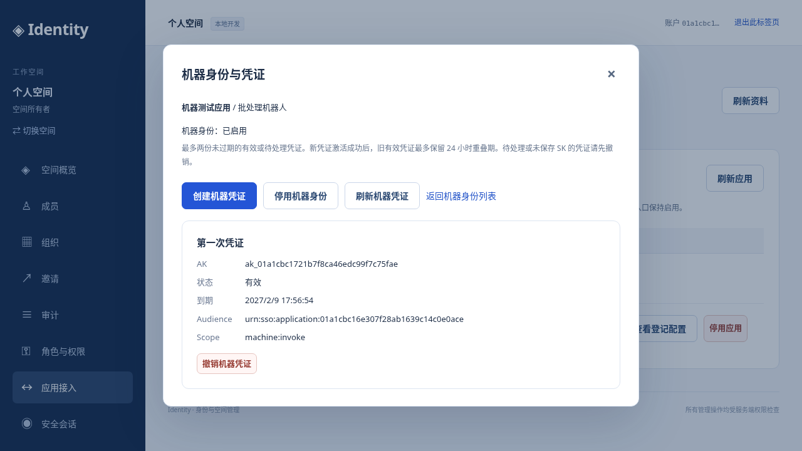
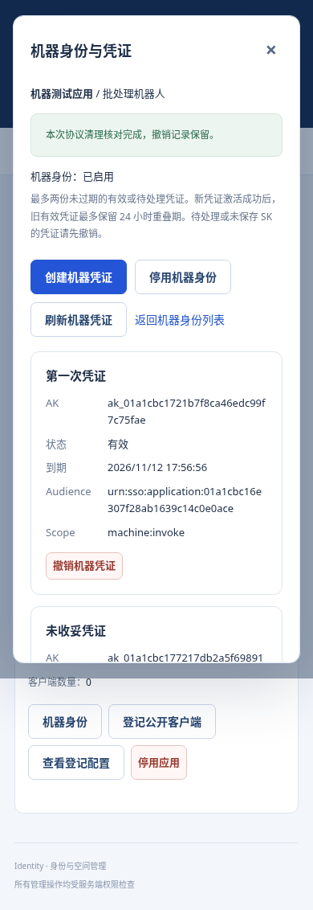

# 机器身份、AK/SK 与机器 API

本切片为租户自有应用增加 Service Principal（SP）、一次性交付的 SK、双凭证轮换和独立机器资源样例。管理操作属于 User/MFA realm；机器调用属于独立 application audience。固定周五演示基线继续保留，CI/GCP 部署由 SRE 负责。

## 控制台操作

登录控制台，进入「应用接入」，在自有应用行选择「机器身份」。空间所有者可创建 SP，进入凭证列表，填写名称和 1–90 天有效期，确认后创建凭证。共享内置应用不能登记本空间机器身份。

成功页面只展示一次 SK；AK 为公开标识 `ak_<credential ID>`，不是秘密。复制按钮只在明确点击时写剪贴板，没有自动下载、浏览器存储或再次查看接口。选择「我已安全保存 SK」、关闭、刷新或离开页面后不能恢复 SK。响应使用 no-store。不要录屏或截取秘密页。

如果创建超时或未收到 SK，先返回列表核对。无论看到 pending 还是 active，只要 SK 未保存，都应撤销该凭证，执行协议清理，再创建新凭证。页面不自动重试创建；GET、清理和公开客户端 reconcile 都不能恢复或激活未知 SK。

每个 SP 最多两份未过期 active/pending 凭证。第二份激活成功时，旧 active 凭证的到期时间缩短至最多 24 小时；新建失败不缩短旧凭证。先更新消费者，再撤销旧凭证。到期由服务端主库实时判断；清理保留撤销记录。每应用最多 100 个 SP，每 SP 最多保留 100 条凭证记录，这是当前明确的容量边界。

## 管理 API 与 OpenAPI

[公共 User OpenAPI](../api/openapi.yaml) 0.14.0 共 54 项业务操作，本次增加 11 项；[Console BFF 合同](../api/console.openapi.yaml) 为相同管理操作提供 cookie/context/CSRF 边界。

| 方法 | 路径（前缀 `/v1/tenants/{tenant}`） | 作用 |
| --- | --- | --- |
| GET / POST | `/applications/{application}/service-principals` | 列表 / 创建 SP |
| GET | `/applications/{application}/service-principals/{principal}` | SP 元数据与 ETag |
| POST | `.../{principal}/disable`、`.../{principal}/enable` | 停用 / 恢复 SP |
| GET / POST | `.../{principal}/credentials` | 元数据列表 / 创建并一次性交付 SK |
| GET | `.../{principal}/credentials/{credential}` | 元数据与 ETag，不含 SK |
| POST | `.../{credential}/revoke`、`.../{credential}/cleanup` | 先本地撤销 / 后核对清理 |
| GET | `/machine-events` | 独立机器签发审计 |

管理读取/写入需要 active owner 的保留 `roles.manage` 权限；写入还要求 `platform:write` 和最近 300 秒 MFA。签发审计读取只需 `audit.read`，不因此获得凭证管理权。分页使用 `limit`/`next_cursor`。SP 的 If-Match 为 `"sp-<tenant>-<principal>-<version>"`，凭证为 `"cred-<tenant>-<credential>-<version>"`；从当前目标 GET 获取，不自行构造。缺少 428，格式错误 400，错对象/旧版本 412。创建不提供通用幂等重试。

创建凭证请求示例：

```json
{"name":"nightly-import","expires_in_days":30}
```

唯一含 SK 的成功响应为 HTTP 201 `{"credential":{...},"secret_key":"<one-time value>"}`。数据库不保存可恢复 SK 副本，协议引擎保存自己的认证散列；业务元数据、审计与 outbox 不含 SK。公开 Playground 展示全部 54 项管理合同，其中凭证创建仅供查看并引导专用页面，避免通用响应脱敏吞掉唯一 SK；其余 53 项支持现有真实执行流程。

## 机器换取 token 和访问资源

机器协议与业务资源的合同单列在 [Machine OpenAPI](../api/machine.openapi.yaml)，JSON 版见 [machine.openapi.json](../api/machine.openapi.json)。运行中的匿名只读入口为 `http://api.localhost:8083/machine-openapi.yaml` / `.json`。合同包含一个机器业务资源和引擎 `/oauth2/token`，不计入 54 项 User 管理操作，不加入 User BFF 或 Playground。

在服务端进程内，向本地 `http://auth.localhost:4464/oauth2/token` 发送表单：`grant_type=client_credentials`、`scope=machine:invoke`、`audience=urn:sso:application:<application ID>`。HTTP Basic 的用户名为 AK，密码为 SK。不要把 AK/SK 或换得的 token 写入日志、命令行、URL、前端代码或导出文档；使用秘密管理系统或进程内配置注入。

成功得到最长 300 秒的 access token，无 refresh token、ID token 或用户会话。业务资源样例为 `GET http://api.localhost:8083/v1/machine/applications/<application ID>/identity`，使用 `Authorization: Bearer <access token>`。返回租户、应用、SP、credential 的非秘密身份元数据。

该接口按资源路径构造预期 audience，验 RS256、固定 issuer、到期、scope、机器 claims，再查询业务主库检查凭证/SP/应用/空间状态和版本。不接受调用者选择 issuer/JWKS；payload/header 中的身份 hint 不提供权限。User token 不能调用此资源，机器 token 不能管理平台，另一应用 token 也不能调用此资源。

机器 JWT 的 `ext` 包括 `principal_type=service_principal`、tenant/application/principal/credential ID；安全版本与 `credential_expires_at` 使用规范十进制字符串，避免引擎处理扩展数字时产生浮点格式或精度差异。标准 `exp` 仍由协议引擎签发。消费者不能只解码而跳过验签。

## 状态、并发与撤销

先在主库提交 pending，再私有创建并逐项核对协议 profile，最后复查 owner/MFA 与 SP/应用版本并激活。创建期间发生停用再恢复也不能激活旧 pending。已有引擎对象不被收养或覆写，因为无法证明其秘密；未知结果关闭权限，保留待撤销记录。

撤销先在主库递增安全版本并关闭资格，协议删除失败不会恢复权限。清理只处理已撤销且所有权和固定 profile 完全匹配的对象，保留墓碑。SP 停用/恢复不影响其他 SP 或人的会话；恢复后旧 JWT 仍失效，尚有效 AK/SK 可换取新 token。应用停用/恢复同样不复活旧 JWT。机器长期资格来自租户/SP/credential，而非创建者后续是否仍有登录会话。

API 元数据 revision 与 token security version 分开：轮换只缩短旧凭证 expiry 并改变其 ETag，重叠期内缓存 JWT 仍可用；撤销则改变安全版本。资源每次检查实时 expiry，因此旧 JWT 中较长的到期提示不能绕过缩短后的期限。

机器签发动作写独立 `machine_events` 和 `machine_outbox_events`，actor 为 SP/credential，不伪造创建者作为调用人。记录表示 Hook 已授权签发，不证明客户端收到 token。机器资源样例的实时拒绝保证不能自动推广到外部仅离线验签的服务；外部业务服务需实施同等在线资格校验或接受短 JWT 的撤销延迟。

## 本地验收与剩余工作

运行 `scripts/console machine-api-test` 与 `scripts/console machine-test`；测试使用真实账户/MFA、MySQL 和 Hydra，秘密仅在测试进程内，秘密页面不截图。主库专项 `scripts/m1 test` 还验证协议失败和并发，故障注入与真实协议证据分别记录在 [validation.md](validation.md)。

本切片未提供 private_key_jwt、机器自定义 scope、任意业务权限策略、自动轮换代理、周期性对账/清理、外部资源 SDK 或生产 TLS/KMS/邮件/HA 验收。迁移 009 为新增表；已应用的 001–008 不修改。周五演示账户与恢复码、原始上传参考、固定基线备份不变。

## 元数据页面

以下截图只含合成身份与公开 AK/元数据，不包含一次性 SK。




