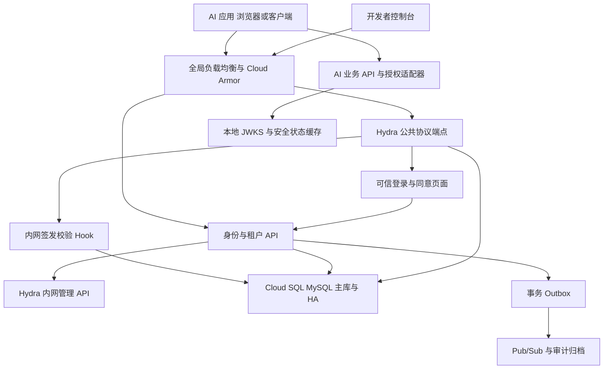
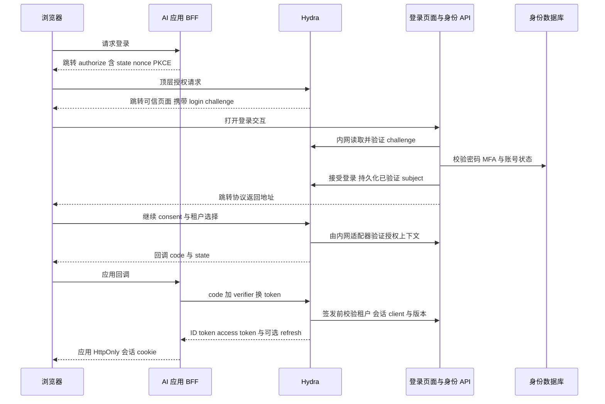
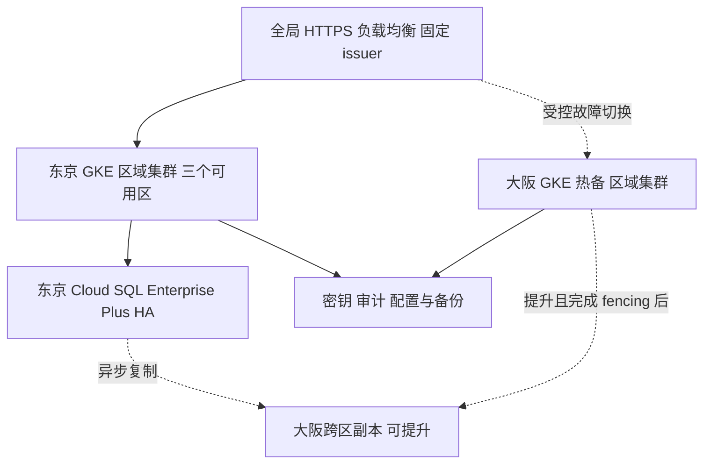

# 公共多租户 SSO 身份服务设计与开发规格

版本：1.0  
日期：2026年11月10日  
用途：架构评审、Codex 开发输入、AI 应用接入和生产上线验收  
状态：推荐实施基线。容量、故障恢复时间与 99.99% 可用性是待实测的目标，不是已达到的指标。

## 1 设计结论

建立独立的公共身份平台，统一管理用户、租户成员关系、登录会话、OAuth 客户端和机器身份。应用通过 OpenID Connect 登录，通过标准 OAuth access token 访问 API。平台提供面向应用的身份 API 和开发者控制台；注册、登录、找回密码等页面由应用团队开发。

推荐采用 **Ory Hydra 自托管协议引擎 + Go 身份与租户服务 + 应用提供的可信登录前端 + 开发者控制台**。协议引擎负责 OAuth/OIDC 协议、安全令牌与协议会话，业务代码负责账户、租户、组织和权限边界。不从零编写 OAuth/OIDC 协议服务器，不修改 Hydra 自有数据库表。

部署于 GCP：GKE Standard 区域集群、Cloud SQL for MySQL Enterprise Plus HA、全局外部 Application Load Balancer、Cloud Armor、Secret Manager、Cloud KMS、Pub/Sub 和 GCS。东京主区、异地主备，数据库保持单写。用户说的 MySQL 兼容 RDS 在此按“托管关系数据库”解释，具体采用 GCP Cloud SQL，避免跨云访问 AWS RDS 成为认证关键依赖。

权限采用 **带作用域的 RBAC**，借鉴 AWS IAM 的 Role、短期凭证、权限边界和显式拒绝思想，但不复制完整 AWS IAM 策略语言。第一版实现平台自身所需的最小 RBAC，并定义应用授权接口；后续扩展资源条件和关系授权时保留身份、绑定和作用域模型。

开发者控制台支持 AccessKey/SecretKey，但它们属于租户内的机器身份，用于标准 client credentials 流程换取短期 token。AK/SK 不代表用户，不直接调用管理 API，也不作为 GKE 工作负载访问 GCP 的凭证。

生产服务以端到端月度 **99.99%** 为目标，需要 HA、灾备、容量余量、24×7 值守、演练和故障预算共同支撑。试运行完成前不得对外声称已实现该 SLA。

## 2 范围与阶段

| 范围 | 第一版必须完成 | 后续扩展 |
| --- | --- | --- |
| 身份 | 全局用户、邮箱验证、密码登录、找回密码、MFA、账号冻结 | Passkey、外部企业身份联合、受控账号合并 |
| 多租户 | 用户跨租户成员关系、邀请、租户切换、成员禁用 | 企业专用部署、租户分片 |
| 组织 | 根节点、树结构和闭包表、组织成员关系、受控移动 | 复杂组织审批、SCIM 同步 |
| 协议 | OIDC code + PKCE、client credentials、refresh、撤销、JWKS | PAR、DPoP、标准 token exchange、SAML 联合 |
| 权限 | 平台最小 RBAC、应用命名空间、作用域绑定、授权适配接口 | 通用 PDP、条件策略、资源共享与 ReBAC |
| 开发者 | 应用登记、回调地址、服务身份、AK/SK 发放与轮换、审计查询 | 自动化企业接入审批 |
| 运维 | GKE 多可用区、数据库 HA、热备区、备份、监控和演练 | 按实测需要分区和分片 |

第一版不包括 AI 推理网关、模型配额计费、业务数据权限的完整迁移、支付结算，以及任意第三方自定义脚本执行。身份授权与付费额度分别管理：具备调用权限不代表存在余额。

## 3 必须保持的架构不变量

1. User、Tenant、Membership、Application、ServicePrincipal、Credential 分别建模，不能合并成一张 users 表。
2. 每个业务 access token 只有一个有效租户上下文，不能用客户端提供的 header 覆盖 token 的租户。
3. 租户 A 的管理员不能访问租户 B；平台运营权限走独立后台、独立 audience 和受控身份。
4. 用户登录证明身份，成员关系证明租户资格，角色绑定证明操作权限，资源服务证明资源归属；四者不能相互替代。
5. 修改角色、关闭账号、禁用密钥后，旧 JWT 的失效时间有明确上限，不能把“签名校验成功”称为“实时授权成功”。
6. 数据库是安全状态的权威源。Redis、Pub/Sub、JWT 和本地缓存不能成为成员关系或密钥状态的唯一记录。
7. 数据库跨区始终单写。数据库失去写入权威时拒绝新发 token，不使用只读副本签发凭证。
8. 未明确授权即拒绝。网络错误、策略错误和租户解析失败不能被解释为允许。
9. 所有身份、租户、权限和密钥管理变更均有审计；审计不能包含凭证原文。
10. 所有生产路径必须通过标准协议引擎；不得为“兼容前端”新增密码直接换 token 的旁路。

## 4 逻辑架构



### 4.1 模块和部署单元

| 模块 | 职责 | 推荐初始部署 |
| --- | --- | --- |
| protocol | Hydra OAuth/OIDC、token 生命周期、协议存储 | 独立 Deployment，公共与管理端口隔离 |
| identity-api | 用户、租户、组织、交互流程、成员关系、客户端管理 | Go 模块化单体，独立 Deployment |
| token-policy-hook | 每次签发校验资格、client、租户、scope、audience、会话及版本 | 同一 Go 仓库，独立进程和 Deployment |
| developer-console | 开发者页面与 BFF | 独立 Deployment，OIDC 登录 |
| event-worker | outbox、审计投递、协议对象同步、补偿、通知 | 独立 Deployment |
| application-sdk | 验签、租户上下文、角色适配、安全状态检查 | 先提供 Go 与 TypeScript 服务端包 |

不要第一版拆出十几个微服务。模块边界、数据库所有权和协议适配接口必须清晰，但可共享代码仓库。按瓶颈拆部署，不按名词拆服务。

### 4.2 协议引擎选型与开发前置验证

Hydra 官方资料提供 MySQL、M2M 和自定义登录/同意流程支持。其公共端口与管理端口必须隔离。[S3][S4][S5]

M0 必须锁定一个仍受维护的稳定版本、镜像 digest、许可证和 SDK 版本，完成以下可运行验证，然后冻结选择：

- Cloud SQL 目标 MySQL 版本可完成 migration、HA 重连和并发 token 签发。
- JWT access token、自定义 ext claims、准确 audience、code + S256 PKCE 工作正常。
- **所有启用的 grant 类型**均调用签发校验 Hook，尤其 authorization_code、refresh_token、client_credentials；非成功响应或超时不会产生可用 token。
- 能把 code、consent、refresh chain 与平台的租户和会话上下文稳定绑定，刷新不能替换租户或 subject。
- client secret 散列、禁用 client、refresh 重用检测、签名密钥轮换符合本设计。
- logout、remembered login/consent、prompt=none 和 max_age 行为符合实际 SDK 接入预期。

官方当前配置 schema 中存在用于全部 grant 类型的 token_hook；这不是任意历史版本都兼容的承诺。[S6] 若选定版本缺失关键能力，先在 ADR 中记录并升级受支持版本或替换适配器；不能通过删除安全校验、直接签发业务 JWT 或 fork 核心协议来“通过验收”。

## 5 身份与多租户模型

### 5.1 身份模型

| 实体 | 含义 | 关键规则 |
| --- | --- | --- |
| User | 一个自然人的平台账户 | 稳定 ID，不包含 tenant_id；状态 active/suspended/deleted |
| Identity | 登录来源与外部 subject | 外部身份唯一键为 provider issuer + provider subject；邮箱不能代替该键 |
| Membership | User 加入 Tenant 的关系 | UNIQUE(tenant_id,user_id)，状态 invited/active/suspended/left |
| Tenant | 安全、管理和配额边界 | 不用 parent_tenant_id 表示部门 |
| OrgNode | 租户内组织节点 | 根、公司、部门、团队等通用节点；组织类型是属性 |
| OrgMembership | 用户在组织中的归属 | 绑定 membership，允许多组织；归属本身不自动授予权限 |
| Application | AI 应用或 API 产品 | 全局平台应用登记；通过 TenantApplication 向租户启用 |
| OAuthClient | 一个实际 OAuth 客户端 | 每环境、每客户端类型独立；与业务 Application 分离 |
| ServicePrincipal | 租户内机器身份 | 与自然人分离；不因为创建者离职而自动删除，但必须移交 owner |
| Credential | 机器身份的一把 AK/SK 或公钥凭证 | 独立状态、有效期、用途和最近使用信息 |

用户可以加入多个租户。应用不能通过“用户邮箱后缀”自动授予企业租户成员资格；邀请和经过验证的企业域名加入策略需显式配置。企业域名验证也不能直接授予管理员角色。

默认个人注册策略：先验证身份，再原子创建个人租户、根组织、membership 和 owner 绑定。企业邀请接受时校验邀请邮箱与已验证身份匹配；邀请不能靠修改 URL 中的 tenant_id 转向其他租户。全局用户注册权限不等于租户创建权限；公共租户创建设置风控、速率限制和审批阈值。

账号合并、外部 IdP 联合绑定均要求重新证明双方身份。第一版不通过“邮箱相同”自动合并外部账户。邮箱作为登录别名时执行明确的规范化策略，保留原值；不删除加号后缀、不做 Gmail 特有点号归并、不把 email 当主键。

### 5.2 组织模型

组织树使用 `org_nodes.parent_id + org_closure`：

- parent_id 是直接父节点；闭包表记录祖先、后代与距离，包含 depth=0 的自身行。
- 每租户只有一个 root。所有祖先和后代必须属于同一租户。
- 成员归属 OrgMembership 与 RoleBinding 分离。进入销售部不等于具备销售部管理员权限。
- 组织移动由服务端事务执行：锁定租户组织版本、校验无环、检查跨租户、更新 parent 和闭包表、增加版本、写 outbox。
- 第一版提供树形 API 和组织作用域绑定，默认最大深度 16、单租户节点数 10,000；这是保护参数，后续可按压测提高。
- 移动组织可能改变继承权限。API 必须支持 dry-run，列出受影响绑定数量及权限变化摘要，要求管理者重新认证；事务提交后让旧版本授权缓存失效。

不预设企业将来只有两级部门，不把 group 与 org 混在一起。Group 用于成员集合，Org 用于结构，未来新增 group principal 不需要修改 User。

## 6 授权设计与未来 RBAC 映射

### 6.1 设计选择

身份平台始终负责租户资格、客户端权限上限、平台管理权限与身份状态。AI 应用负责自身资源归属及业务动作。统一 action/resource 命名和授权请求格式，让应用可以先用本地 RBAC，后续接中央 PDP。

AWS IAM 中显式拒绝优先和权限边界的思路可借鉴；完整 AWS 的身份策略、资源策略和 session principal 组合语义较复杂，本系统采用下述更窄、明确的语义，不宣称 AWS IAM 兼容。[S7]

```text
允许访问 = 身份有效
        AND 租户成员或机器身份有效
        AND token 的 audience 与 scope 上限允许
        AND client / credential / tenant 边界允许
        AND 作用域匹配的角色存在允许项
        AND 不存在适用的显式拒绝
```

任何必需边界缺失或解析失败返回拒绝。边界是权限上限，不会单独授予权限。第一版权限规则只支持精确 action 和受控资源作用域，禁止任意表达式、脚本以及隐式全局通配符。

### 6.2 角色与绑定

Role 是权限集合，RoleBinding 是“谁在什么范围内使用哪个角色”：

```json
{
  "tenant_id": "t_example",
  "principal": {"type": "membership", "id": "m_example"},
  "role_id": "role_app_editor",
  "application_id": "app_music",
  "scope": {"type": "org", "id": "org_sales", "include_descendants": true}
}
```

principal 首版支持 membership 和 service_principal；后续通过显式类型增加 group。role 定义可来自平台只读模板或租户自定义；租户自定义角色不能包含平台运营 action。Tenant owner 仅是租户最高管理角色，不能变成全平台超级管理员。

| 维度 | 规则 |
| --- | --- |
| application_id | 必须匹配目标 API，app_music 的 editor 不能映射到 app_finance 的 editor |
| scope | tenant、org、resource；绑定必须带目标租户，资源必须属于该租户 |
| 组织继承 | 只有 include_descendants=true 的绑定向下作用，不向上、不跨租户 |
| 角色继承 | 第一版不开放角色继承；后续如启用须有 DAG 和环检测 |
| 授权委托 | 管理者只能授予自身可委托范围内、且不超过目标角色边界的权限 |
| 显式拒绝 | 在适用作用域内优先；不能因为另一角色有 allow 就绕过 |

第一版内置平台权限至少包含 tenant:read、member:invite、member:suspend、org:manage、role:bind、client:manage、credential:create、credential:revoke、audit:read。owner、admin、developer、auditor、member 为模板；developer 默认不能给自己提权，auditor 默认只读，禁止删除最后一位 active owner。

### 6.3 AI 应用接入合同

action 采用命名空间，例如 `music:composition:create`、`music:composition:read`、`lab:workspace:update`。资源采用规范化对象 `{tenant_id, application_id, type, id, org_id?}`，不信任前端提交的 owner 或 org_id。

应用迁移期可以维护带版本的本地映射：

| 平台绑定 | 应用角色 | 约束 |
| --- | --- | --- |
| app_music + composer + 当前 tenant/org | music_editor | 只允许该范围内创作 |
| app_music + reviewer + 当前 tenant/org | music_reviewer | 不自动允许创建密钥 |
| app_lab + workspace_admin + 当前 tenant/resource | lab_admin | 只管理指定工作区 |

不得仅按字符串 `admin` 映射，不把平台 owner 直接转换成每个应用的所有权限。应用新增角色、映射变化与删除均需审计及回归测试。

### 6.4 授权接口

内部接口 `POST /v1/authorization/check` 预留稳定合同；首版用于平台自身和示范应用：

```json
{
  "action": "music:composition:read",
  "resource": {"application_id": "app_music", "type": "composition", "id": "c_123"}
}
```

principal、tenant、token scope 从已验证凭证获取，不能由普通调用者提交并覆盖。调用者是资源 API 的工作负载身份，并提交经验证的最终用户上下文；资源属性由可信服务端查询，不能直接接受浏览器提供的归属信息。响应包含 allow、reason_code、policy_version、decision_id、cache_ttl，内部延迟目标 p99 ≤ 50ms。

业务 API 不应每次都同步访问中央 SSO。普通读取使用 SDK 和有界缓存；成员变更、密钥操作、权限变更、敏感数据导出等高风险动作进行实时授权。未来完整 PDP 可以替换该接口的实现，不改变应用侧合同。

## 7 登录页面归应用与真正 SSO 的实现

### 7.1 页面与信任边界

“注册登录在 AI 应用部分”解释为：页面由应用团队开发、可带应用品牌，身份平台提供后端 API。为实现跨不同站点的真正 SSO，浏览器仍须经过统一认证域名的顶层跳转。

推荐部署：

- `auth.example.com`：固定 OIDC issuer；协议 API、交互 API、由应用团队构建的可信登录页面分别按路径路由。
- `console.example.com`：开发者控制台及其 BFF。
- 各 AI 应用：自己的业务页面与 BFF，仅持有各自会话。

`example.com` 是部署占位符，不代表已经购买的域名。注册前必须固定 issuer，生产不能随环境或租户改变；dev/staging/prod 使用不同 issuer、client、数据库和密钥。

统一登录页面可以由一个应用仓库提供，但它处在认证信任域内，按身份平台标准审查、部署和限制脚本。第三方应用不能自行提供任意登录 URL 收集平台密码，也不能通过跨域 API 直接获取用户 token。若各应用坚持在自己的不同域名提交密码，仍需统一顶层认证跳转才能建立中央会话，不将这种嵌入密码表单列为第一版方案。

登录页面不加载广告、任意第三方分析脚本或由应用管理员上传的 JS。branding 使用受控配置，不支持自定义 HTML。SSO 不依赖第三方 cookie 或隐藏 iframe。

### 7.2 标准登录流程



图中 consent 的具体请求通过浏览器跳转到可信页面，再由 BFF 调 Hydra 管理端完成；只有内网适配器可以 accept challenge，浏览器不能直接访问管理 API。

交互服务把 login/consent challenge、浏览器事务 cookie、client、redirect、PKCE 交易与完成状态绑定。每步都需要 CSRF/Origin 校验、到期检查和一次性状态迁移；不能只凭知道 challenge 的字符串就代替用户完成登录。

中央登录会话 cookie：`__Host-sso_session`，Secure、HttpOnly、Path=/、无 Domain、SameSite=Lax；服务端会话保存于 MySQL。租户选择不依赖该 cookie 中的可修改明文。应用 BFF 的 cookie 使用各自 host-only cookie，不能把 Domain 设置成整个业务域来共享登录态。

访问第二个应用时仍走 authorize 顶层跳转。中央会话有效时无需重复输入密码；租户资格、应用启用、scope 与 consent 必须重新检查。prompt=none 无法无交互完成时按标准返回 login_required/interaction_required，不弹出隐藏登录页面。[S2]

### 7.3 租户选择和切换

用户登录后，后端读取 active memberships；可接受 tenant hint，但它只能用于展示预选。授权时验证 tenant 存在、membership active、TenantApplication active、client 可以服务该租户。

选定 tenant 后，将 tenant_id 和 membership_id 绑定到当前授权交易及对应 refresh chain。切换租户必须重新发起 authorization code 流程，中央会话可以复用；新 token 使用新 tid，旧租户的 token 不被改写，也不能用旧 refresh token 请求新 tid。

每个授权交易拥有自己的租户上下文，不使用“用户全局当前租户”数据库字段决定签发，避免多个浏览器标签页互相串租户。

### 7.4 注册 找回密码 和 MFA

- 注册、邮箱验证和找回密码返回统一文案，避免账户枚举；接口可返回统一 202，邮件异步发送。
- 验证、邀请和重置 token 使用 CSPRNG，数据库只保存摘要、有效期和使用状态；原子消费，不在日志中记录 URL 查询参数。
- 密码使用 Argon2id，建议起点 m=64MiB、t=3、p=1，最终按生产硬件压测调优，不低于已核实的 OWASP 推荐基线。[S8]
- 身份密码哈希与 Hydra client secret 哈希是两套实现；不强行修改协议引擎哈希格式。
- 第一版实现 TOTP 与一次性恢复码；种子用加密密钥封装后存储，恢复码仅保存散列，校验采用原子消费并防止同一时间片重用。
- owner/admin、控制台密钥发放、回调 URI 修改、角色授予、MFA 解绑和账号恢复要求 MFA 或已验证等效因素，敏感操作要求最近 5 分钟内重新认证。
- 手机/邮箱恢复不能成为绕过管理员 MFA 的普通入口。无可用恢复因素的管理账号通过人工受控流程处理，独立审计并延迟通知。
- 重置密码、冻结账号或 MFA 安全恢复撤销相应登录会话和 refresh chain，并发送安全事件。

## 8 Token 会话与撤销

### 8.1 协议和参数

遵循 OIDC Core 1.0 与 OAuth 2.0 安全最佳实践 RFC 9700。启用 authorization code + PKCE S256；禁用 implicit、password grant、不受控 dynamic client registration 和无必要的 grant 类型。OAuth 授权与用户身份认证各司其职。[S1][S2]

| 项目 | 推荐初始值 | 行为 |
| --- | --- | --- |
| Authorization code | 60 秒 | 单次、绑定 client/redirect/verifier |
| Access token | 5 分钟 | JWT，单租户、单业务 audience |
| ID token | 5 分钟 | 仅给登录客户端，不能作为业务 API 凭证 |
| 用户 refresh token | 空闲 7 天、绝对 30 天 | 单次轮换；绝对期限由平台会话及 Hook 一并约束 |
| SSO 中央会话 | 空闲 8 小时、绝对 24 小时 | 高风险按 max_age 强制重新认证 |
| 控制台会话 | 空闲 30 分钟、绝对 8 小时 | 敏感操作 MFA step-up |
| 邮箱验证 | 24 小时 | 摘要存储、单次 |
| 密码重置 | 15 分钟 | 单次，成功后撤销旧会话 |
| 交互 challenge | 最长 5 分钟 | 受协议引擎实际有效期进一步限制 |
| 时钟容差 | 最多 30 秒 | 不能把过期 token 当成无期限有效 |

refresh token 轮换和重用检测由 Hydra 实现，平台同步会话状态并验证绝对期限。应用 BFF 对同一 refresh chain 串行刷新；响应丢失后不能盲目重试旧 token。初版不启用重用宽限期，特殊移动端需求需独立评审。[S9]

### 8.2 JWT 合同

示意 payload，时间值是示例，不是生产令牌：

```json
{
  "iss": "https://auth.example.com/",
  "sub": "u_example",
  "aud": ["https://api.music.example.com"],
  "client_id": "cli_music_web",
  "iat": 1794270000,
  "exp": 1794270300,
  "jti": "token_unique_id",
  "scope": "music:composition:read music:composition:create",
  "ext": {
    "tenant_id": "t_example",
    "principal_id": "u_example",
    "principal_type": "user",
    "membership_id": "m_example",
    "session_id": "s_example",
    "membership_version": 12,
    "tenant_authz_version": 37,
    "credential_id": null
  }
}
```

标准 claims 由协议引擎生成；tenant 等自定义字段固定放 ext，下发真实样本作为 SDK 合同测试。MFA 的 acr/amr/auth_time 在适用的 OIDC 响应及受控上下文中传递，资源 API 需要 step-up 时通过可信映射读取，不能从浏览器 JSON 自报。

自然人 sub 使用稳定 User ID。M2M 的协议 sub 可以是引擎的 OAuth client_id；跨多把凭证的稳定机器身份使用 `ext.principal_id=ServicePrincipal.id`、`principal_type=service`，不伪装成自然人。API 必须按 iss + principal_type + principal_id 识别主体，不能假定所有 sub 都是 users 表主键。

JWT 不携带完整组织树、全部角色或邮箱电话。scope 只是 token 授权上限，细粒度角色和资源资格由应用授权适配器决定。任何自定义 claim 都不能让调用者覆盖 iss、sub、aud、exp 或签名算法。

SDK 固定 issuer、允许算法和预期 audience；验证签名、exp、nbf、iat 合理范围、必需 ext 字段及实际资源租户。只从预置 issuer 的 JWKS 获取公钥，拒绝 token 里任意 jku/x5u。unknown kid 触发有速率限制的刷新，仍未知则拒绝；不得回退到 HS256 或跳过验签。

### 8.3 撤销等级与一致性

| 路径 | 失效目标 | 机制 |
| --- | --- | --- |
| 普通业务读取 | 不超过 5 分钟 + 最多 30 秒时钟容差 | 短期 JWT；可用安全事件提前失效 |
| 管理与高风险动作 | 变更提交后下一次权威校验拒绝；平台额外传播目标 ≤30 秒 | 主库资格/版本校验、受信撤销状态服务；依赖不可用则拒绝 |
| 新 token 与 refresh | 禁用状态提交后拒绝新授权；有并发边界 | 每次 Hook 读取权威状态，禁用协议 client/chain 双重执行 |

Pub/Sub 推送只加速传播，不承担绝对撤销保证。SDK 维护版本快照、安全事件水位与最后成功同步时间；高风险缓存最长 30 秒且超时必须访问权威服务，失败拒绝。租户、用户、membership、session、credential 均有各自状态或版本，防止只提升 tenant version 却漏掉单账号撤销。

禁用事务与已经在途的 token 签发存在并发窗口：若 Hook 在禁用提交前已通过，token 可能稍后返回。此 token 仍受高风险权威检查与普通 token TTL 限制；不能承诺“禁用后绝不返回任何在途 token”。强一致敏感操作在业务事务执行前再次检查授权版本；高价值任务在提交执行或下载前检查，不能只在入队时检查。

退出分三类：当前应用退出、中央 SSO 退出、所有设备退出。中央退出撤销中央会话和相应 refresh，并通知应用 BFF 清理本地会话；back-channel logout 采用受签名和重放防护的标准机制或明确标注的内部事件协议。通知失败不意味着旧 JWT 立刻消失，仍遵循上表时限。控制台每次敏感请求检查中央 session 状态，不能只看自己的长寿命 cookie。

## 9 开发者控制台与 AK SK

### 9.1 页面与权限

提供租户切换、应用登记、客户端配置、机器身份、凭证管理、权限绑定、审计和安全设置页面。显示 credential 的名称、AK、所属 tenant/SP/app、状态、创建与到期日期、最近使用时间、来源 IP 摘要和允许 scope；从不提供“查看已有 SK”。

公共开发者可以申请开通；初版只有已验证邮箱且具备 credential:create 权限的成员能为自己的租户创建机器身份。生产应用、较高配额或高权限凭证采用审批。页面不要求普通用户理解 Hydra 或 GKE。

### 9.2 AK SK 的具体含义

选择 **标准 OAuth client 凭证**，而不是 AWS SigV4 兼容协议：

- AccessKey 是 Credential 对应的 OAuth client_id，例如 `ak_live_...`，它是标识符。
- SecretKey 是该 OAuth client 的 client_secret，至少 256 bit CSPRNG 熵，base64url 编码；生成长度与选定引擎哈希输入限制需联合测试。
- 一把 Credential 对应一个独立、不可跨租户移动的 OAuth client，映射到同一 ServicePrincipal。轮换通过新增 Credential 完成，避免依赖协议引擎支持同 client 双 secret。
- 固定 client_credentials grant，不授予 openid 或用户 refresh token。每次换取有效期 5 分钟、单 audience、受 scope 限制的 access token。
- client registry 由平台管理，Hydra 的 admin API 不对开发者开放。

示意请求，尖括号内容为占位符，禁止在真实 shell 历史中粘贴生产密钥：

```http
POST /oauth2/token HTTP/1.1
Host: auth.example.com
Authorization: Basic <base64_of_accesskey_colon_secretkey>
Content-Type: application/x-www-form-urlencoded

grant_type=client_credentials&scope=music%3Acomposition%3Acreate&audience=https%3A%2F%2Fapi.music.example.com
```

`audience` 为选定 Hydra 版本适配参数；M0 固定实际请求编码并提供 SDK，不将示例当成 RFC 8707 全兼容承诺。客户端只能请求预注册 audience 和授权 scope 的子集；tenant 来自服务器 registry，不能通过请求选择其他租户。

### 9.3 密钥生命周期

状态：pending → active → disabled → revoked，expired 为到期判断结果。默认 90 天有效，最长按租户策略限制；轮换重叠建议不超过 24 小时。ServicePrincipal 默认最多两把 active 凭证；停用和撤销不可偷偷复活。

创建流程：

1. 验证开发者、当前租户、MFA step-up、可委托权限和配额，创建 pending Credential 与审计/outbox。
2. 生成一次性 SK，内网调用 Hydra 创建精确权限的 client；引擎存储其支持的安全散列，身份数据库不再另存 SK。
3. 写入 client 映射并使 Credential active，回传 SK 一次。只有 Hook 同时看到 active 的本地记录与匹配的引擎 client 才可签发。
4. 返回包含 Cache-Control: no-store、Pragma: no-cache。控制台响应不得缓存、录屏采集或进入 analytics。
5. 若创建结果不确定或响应丢失，用户创建新 credential 并撤销旧 credential；幂等重试不能返回原 SK。返回已创建的 AK 和 `secret_unavailable` 状态指引，不保留可再次读取的明文。

跨业务数据库与 Hydra 数据库不能原子提交，使用 pending + 补偿清理与定期对账。孤立的 Hydra client 若无 active 本地映射，Hook 必须拒绝。创建失败保留审计；回收 pending 和 orphan 对象需幂等，不删掉合法 active client。

撤销先提交权威本地 revoked 状态，使 Hook 拒绝，再异步禁用协议 client 并撤销链。若异步操作失败，重试和告警；不能以“Hydra 尚未更新”为理由继续签发。

### 9.4 不同安全等级的接入方式

| 场景 | 建议方式 |
| --- | --- |
| 普通外部服务端开发者 | AK/SK → client credentials → 短期 token |
| 高安全企业服务端 | private_key_jwt，私钥留在调用方；断言校验 aud、exp、jti 防重放 |
| GKE 工作负载访问 GCP | Workload Identity Federation for GKE；禁止 GCP SA JSON key |
| GKE 工作负载调用本平台 | 可先用受控 private_key_jwt；后续接可信工作负载联合，不拿 GCP access token 直接当本平台 token |
| 浏览器与移动端 | OIDC code + PKCE；不得内置 AK/SK |
| AI Agent 代用户执行 | 用户委托且有 scope/资源上限；不能偷换成拥有租户所有权限的 SP |

第一版不实现 HMAC API 签名。如果将来需要请求签名，不得一边宣称 SK 只保存不可逆散列、一边要求服务端用 SK 计算 HMAC；应采用客户端公私钥签名，或另行审查加密保管对称密钥的方案。

## 10 数据库设计

### 10.1 通用约定

MySQL 使用受支持版本，推荐先验证 Cloud SQL MySQL 8.4 与选定 Hydra 版本的兼容性；不要采用未经驱动和 migration 验证的新版本。InnoDB、utf8mb4、UTC datetime(6)，对 ID、client_id、provider subject 等采用精确比较 collation。

ID 使用应用生成的 UUIDv7，库内 BINARY(16)，API 可包装为带类型前缀字符串；不能把前缀混入二进制主键。ID 可能暴露大致创建时间，因此不能作为保密机制。所有管理实体有 created_at、updated_at、version，必要时 deleted_at。

所有租户内实体带 tenant_id，引用使用 `(tenant_id, target_id)` 组合外键和唯一键；跨租户引用在数据库和服务层双重拒绝。MySQL 没有本设计所依赖的原生行级租户策略，因此必须使用 tenant-aware repository、SQL 约束和跨租户测试，而不能只依靠 ORM 自动 filter。

### 10.2 核心表

| 表 | 主要字段 | 关键索引与约束 |
| --- | --- | --- |
| users | id, status, security_version | PK(id) |
| identities | id, user_id, provider_issuer, provider_subject, status | UNIQUE(provider_issuer,provider_subject)；长 issuer 可用规范化 provider FK |
| login_aliases | id, user_id, normalized_email, verified_at | 唯一登录别名；保留 email 原值，服务端受控变更 |
| password_credentials | user_id, hash, hash_version, changed_at | UNIQUE(user_id) |
| mfa_factors | id, user_id, type, encrypted_material, status | INDEX(user_id,status)；恢复码独立散列表 |
| tenants | id, slug, status, authz_version, org_version | UNIQUE(slug) |
| memberships | id, tenant_id, user_id, status, security_version | UNIQUE(tenant_id,user_id), UNIQUE(tenant_id,id), INDEX(user_id,status) |
| org_nodes | id, tenant_id, parent_id, type, name | UNIQUE(tenant_id,id), INDEX(tenant_id,parent_id)；组合 FK(parent) |
| org_closure | tenant_id, ancestor_id, descendant_id, depth | PK(tenant_id,ancestor_id,descendant_id), INDEX(tenant_id,descendant_id,depth) |
| org_memberships | tenant_id, org_id, membership_id | PK(tenant_id,org_id,membership_id)；双组合 FK |
| applications | id, code, status, owner_tenant_id? | UNIQUE(code)；平台审核的产品登记 |
| tenant_applications | tenant_id, application_id, status | PK(tenant_id,application_id) |
| oauth_client_registry | client_id, application_id, tenant_id?, kind, status, audience_config | client_id 唯一；平台 Web client 可服务多个显式启用租户 |
| roles | id, tenant_id, application_id, code, definition_version | UNIQUE(tenant_id,application_id,code), UNIQUE(tenant_id,id) |
| role_permissions | tenant_id, role_id, action, effect | UNIQUE(tenant_id,role_id,action,effect)；effect allow/deny |
| role_bindings | id, tenant_id, principal_kind, membership_id?, service_principal_id?, role_id, scope_type, org_id?, resource_type?, resource_id?, include_descendants | 主体二选一 CHECK；组合 FK；作用域按 type 校验；索引覆盖 tenant/principal/app/scope |
| service_principals | id, tenant_id, application_id, owner_membership_id, status, security_version | UNIQUE(tenant_id,id), INDEX(tenant_id,application_id,status) |
| credentials | id, tenant_id, service_principal_id, hydra_client_id, status, expires_at, last_used_at, boundary_version | UNIQUE(hydra_client_id), UNIQUE(tenant_id,id), INDEX(tenant_id,service_principal_id,status) |
| sessions | id, user_id, status, idle_expires_at, absolute_expires_at, security_version | INDEX(user_id,status)；中央身份会话，与协议会话分开 |
| authorization_contexts | id, tenant_id, membership_id?, service_principal_id?, session_id?, client_id, protocol_binding, expires_at, status | protocol_binding 唯一；固定授权交易与租户 |
| invitations | id, tenant_id, target_email, token_digest, role_plan, expires_at, consumed_at | UNIQUE(token_digest), INDEX(tenant_id,target_email) |
| verification_challenges | id, user_id?, type, digest, expires_at, consumed_at, attempts | UNIQUE(digest), INDEX(expires_at) |
| idempotency_records | tenant_id, actor_id, operation, key_digest, request_digest, result_ref, expires_at | UNIQUE(tenant_id,actor_id,operation,key_digest)；不存 SK 或 token 响应 |
| audit_events | event_id, tenant_id?, actor, action, target, outcome, trace_id, occurred_at | INDEX(tenant_id,occurred_at,event_id) |
| outbox_events | event_id, aggregate_id, aggregate_version, type, payload, available_at, delivered_at | INDEX(delivered_at,available_at)；payload 禁止凭证原文 |

平台全局角色模板放独立 template 表，向租户实例化或只读引用，避免 nullable tenant_id 的 UNIQUE 语义破坏隔离。角色绑定尽量用真实 FK，不能只存无约束的 principal_id 字符串。跨租户存在的全局 User 与 Application 引用是有意边界，需在 ADR 中列白名单。

root 通过 tenants.root_org_id 指向唯一根并受事务维护；不能仅靠 UNIQUE(tenant_id,parent_id) 保证只有一个 NULL parent。角色绑定的 resource_type/resource_id 在应用中验证真实归属，不能只因该表填了正确 tenant_id 就认为资源属于该租户。

### 10.3 一致性与存储所有权

业务状态变更与 audit/outbox 同事务提交。消费者至少一次处理，按 event_id 去重并按 aggregate_version 忽略旧事件。邮件失败不回滚已提交注册；通知状态和重试可查询。

Hydra 独立 database/schema 和专属数据库账号；业务服务不能直接读写其表。协议迁移由独立受控 Job 执行，不让每个 Pod 启动时竞争运行 migration。用户与平台业务库也分离 migration 权限和运行权限。

成员资格、凭证、密码、会话、组织变更和授权读取主库。管理报表、延迟可接受的审计查询可以读副本。连接失败采用有界重试和随机退避；非幂等写入必须判断提交结果，不能无条件重放。

审计先写事务记录再归档 GCS，提供完整性校验、独立项目访问控制和经过确认的 retention lock。默认拟定安全审计保留 365 天、在线查询 90 天；最终依用户协议与数据保留政策确认，不擅自承诺法定期限。密码、SK、Authorization、cookie、token、TOTP seed 及恢复码禁止进入任何日志。

## 11 API 合同与访问控制

### 11.1 公共协议端点

以下路径按选定 Hydra 版本保持其真实协议定义，不为美观改写行为：

| 端点 | 用途 |
| --- | --- |
| GET /.well-known/openid-configuration | OIDC discovery |
| GET /.well-known/jwks.json | 公钥 |
| GET /oauth2/auth | 授权请求 |
| POST /oauth2/token | code/refresh/client credentials 换 token |
| POST /oauth2/revoke | 标准凭证撤销 |
| GET/POST /userinfo | 获取授权用户资料，按引擎实际支持方法 |
| GET /oauth2/sessions/logout | 经允许的 OIDC logout 流程，绑定安全回跳 URI |

introspection 通过内网代理提供给已认证的资源服务，不直接暴露 Hydra admin 端口。所有 `/admin`、`/clients`、`/keys`、Hook 和管理指标均不能由公网路由到达。

### 11.2 身份业务 API

| 分组 | 端点示例 | 安全要求 |
| --- | --- | --- |
| 交互 | POST /v1/interactions；GET /v1/interactions/{id} | 验证协议 challenge、绑定 browser transaction；不能任意创建可信会话 |
| 身份证明 | POST /v1/interactions/{id}/password；/mfa；/complete | 可信登录 UI 同源、CSRF、限流、一次性状态迁移；不直接返回 OAuth token |
| 注册恢复 | POST /v1/registrations；/email-verifications；/password-resets | 反枚举、挑战 token、限流；依完整 OpenAPI 明确 request/response |
| 个人 | GET /v1/me；GET /v1/me/memberships；GET /v1/me/sessions | 平台 profile audience；只返回本人的最小必要数据 |
| 租户 | POST /v1/tenants；GET /v1/tenants/{tid} | 租户创建策略及配额；读取要求目标租户成员或特许运营身份 |
| 成员 | POST /v1/tenants/{tid}/invitations；PATCH /memberships/{mid} | member:invite/suspend；重新认证及 owner 保护 |
| 组织 | GET/POST /v1/tenants/{tid}/orgs；POST /orgs/{oid}:move | org:manage；无环、同租户、dry-run 与版本校验 |
| 角色 | GET/POST /v1/tenants/{tid}/roles；POST/DELETE /role-bindings | 禁止越权委托，支持审计与版本控制 |
| 开发者 | POST /v1/tenants/{tid}/applications；/oauth-clients | audience、redirect URI、grant 白名单及审核 |
| 机器身份 | POST /v1/tenants/{tid}/service-principals | 授权范围不能超过创建者可委托权限 |
| 凭证 | POST /v1/tenants/{tid}/service-principals/{sid}/credentials；POST /credentials/{cid}:revoke | MFA step-up；SK 一次返回；敏感字段无缓存 |
| 审计 | GET /v1/tenants/{tid}/audit-events | audit:read；游标分页、PII 最小化 |

所有租户内路径里的 tid 必须与 token 中 tid 相同；个人跨租户列表使用专用 profile audience，仅允许 GET 自己的成员关系列表，不能凭该 token 执行任何租户管理或业务操作。加入/接受邀请与租户创建采用单独的受限引导流程，不能为了这些操作跳过全部 tid 检查。

后台 API 使用明确 audience `identity-admin-api`；业务 AI token 不能调用密钥管理。第三方开发者的 M2M token 默认仅具业务 API audience，不能管理平台或签发新凭证。

### 11.3 通用约定

- 非协议接口采用 JSON、`application/problem+json` 错误、trace_id、安全 reason_code，不泄露 SQL 或内部栈。
- HTTP：401 未认证、403 无权限、404 不泄露跨租户对象存在性、409 冲突、412 版本不匹配、429 限流、503 依赖或容量不可用。
- 修改请求支持 If-Match/实体 version；创建、邀请、密钥创建等使用 Idempotency-Key 与请求摘要，幂等作用域包含 tenant 和 actor。
- 列表使用有上限的游标分页，不对外提供无限 page size 或任意 SQL filter。
- OAuth 错误保持协议定义，不套业务错误 envelope；token 响应禁止缓存。
- 完整 OpenAPI 3.1、示例、字段边界、权限矩阵必须纳入代码评审，表中端点不是完整 OpenAPI 的替代品。

## 12 安全基线

### 12.1 主要威胁和工程控制

| 威胁 | 必须实现的控制 |
| --- | --- |
| 跨租户 IDOR | token tid、路径 tid、资源真实归属三方匹配；组合 FK；负面用例 |
| 凭证填充与枚举 | IP + 账号 + client 多维限流、渐进延迟、统一响应、风险挑战、并发密码哈希闸门 |
| code 截获和登录 CSRF | S256 PKCE、state、nonce、事务绑定、精确回调、一次性 code |
| token 混用 | 固定 issuer、audience、算法；ID token 禁止调用 API；平台 audience 隔离 |
| confused deputy | 服务端校验调用应用、委托人、scope 和资源归属，不信任传入 tenant/subject |
| secret 泄露 | SK 一次返回、散列存储、日志脱敏、短期 token、可撤销和轮换 |
| XSS 和点击劫持 | CSP、禁止第三方脚本、输出编码、frame-ancestors 'none'、HttpOnly |
| SSRF 与回调攻击 | 不接受任意远端 JWKS/webhook URL；预注册审核；拦截私网、metadata 与重定向绕过 |
| 重放 | code/challenge/recovery 单次，refresh 轮换，private_key_jwt jti 去重 |
| 管理员越权 | MFA、step-up、最小授权、委托边界、最后 owner 保护和独立运营后台 |
| AI 工具误用 | LLM 不接触 SK、refresh、管理员 cookie；Agent token 有限权限与有效期 |
| 供应链和集群突破 | 镜像 digest、SBOM、签名与准入、无 root、只读根盘、最小网络和工作负载身份 |

### 12.2 网络与运行环境

公网仅允许全局 HTTPS 入口进入已登记路由。TLS 最低 1.2 并优先 1.3，使用现代安全策略；集群、数据库与 Hydra 管理端不对公网开放。GKE 私有节点、控制面受控访问、Cloud SQL private IP，网络策略默认拒绝，再按组件开放。

每个 Deployment 使用独立 KSA 与 GCP 最小 IAM 绑定。运行账号不拥有 migration、项目管理员或 Secret Manager 全读权限。出网按邮件服务、必要 GCP API 与经过批准的 IdP 限制，禁止直接访问实例 metadata 获取不必要凭证。

签名默认 RS256，使用足够强度密钥；由协议引擎管理 JWT keys，Secret Manager 保存系统/数据库等必要 secret，KMS 与受控加密保护落盘数据。**不能因为使用 Cloud KMS 加密，就声称 JWT 每次在 HSM 内签名或私钥不可导出。** 第一版接受受控 Pod 内的引擎签名私钥，权限与备份风险需登记；如需 HSM 不可导出签名，先验证引擎签名接口与吞吐，独立实施。

密钥轮换：提前发布新公钥 → 等待 JWKS 缓存传播 → 新签名切换 → 旧公钥保留至少最长相关 token 生命周期加缓存和时钟余量。access token、ID token、logout token 等均需计入。系统加密密钥不能照搬 JWT keys 的删除时限，需覆盖仍需解密的数据和备份。泄露应急按 kid 拒绝并强制重新认证，不能等待普通轮换周期。

访问生产采用短时身份、MFA、审批/JIT 和完整审计，不分发长期云 AK/SK。数据库管理通过受控运维路径；开发者控制台只提供产品凭证。

## 13 高并发 高吞吐和横向扩展

### 13.1 先区分请求类型

业务每秒 100,000 次 API 请求，不意味着 SSO 每秒签发 100,000 次 token。资源服务本地验 JWT，并复用有效 token；机器 SDK 缓存 token，在到期前带抖动刷新、singleflight 合并换取请求。密码哈希、client secret 哈希、数据库写入和 JWT 验签分别压测。

建议初始容量假设：100 万注册用户、1 万租户、10 万台活跃机器客户端，按每 5 分钟换 token 估算平均约 333 次/秒 M2M 请求，再叠加用户刷新与突发。这个估算不代替真实峰值测量；活跃用户的刷新频率、应用数与多区域流量均影响结果。

| 负载 | 上线压测目标 | 延迟目标 | 说明 |
| --- | --- | --- | --- |
| 新密码认证 | 持续 100 RPS，突发 300 RPS 60 秒 | p95 ≤500ms，p99 ≤1s | 含密码哈希，不含用户交互与邮件 |
| refresh + M2M 混合签发 | 持续 1,000 RPS，突发 3,000 RPS 60 秒 | p95 ≤150ms，p99 ≤300ms | 固定 token/claims 大小与 secret 哈希成本 |
| 本地 JWT 验证 | 整体应用集群 50,000 RPS | 单服务端验签 p99 ≤5ms | 不计入中央签发吞吐；按语言与 CPU 单独报告 |
| 普通身份元数据读 | 持续 2,000 RPS | p99 ≤100ms | 明确缓存命中率与数据规模 |
| 中央授权 check | 持续 1,000 RPS | p99 ≤50ms | 内部网络，分别测缓存命中和未命中 |

上述均为设计目标，不是产品性能声明。生产上线按已测容量开放租户配额；不得为满足表中 RPS 降低密码哈希成本、取消 Hook 或允许错误 audience。

### 13.2 计算与连接预算

Go API、Hook、Hydra 无本地权威状态，允许水平扩容。主区关键 Deployment 起始至少 6 副本、每区至少 2 个，实际数量以 HA 和压测结果决定。使用 topology spread、pod anti-affinity、PDB、优雅退出；PDB 不能防止可用区突然故障，也不能替代容量。

HPA 使用 CPU、活跃请求/队列深度与 p99 指标；保留最低暖副本，不能依赖突发后才启动节点。密码校验采用独立有界 worker pool；按每次哈希 64MiB 计算内存上限，100 个并发仅哈希内存约 6.25GiB，不能无限开 goroutine。

数据库连接预算按所有 Deployment、最大副本数、worker 和滚动 surge 一起计算：

```text
总连接上限 = Σ(每种进程的最大副本数 × 每副本 pool 上限)
            + migration / worker / 运维保留
            + 滚动更新临时连接
```

初始可使用每副本 10～20 连接作为压测起点，设全平台预算及数据库最大连接保护。连接池接近预算时背压，不能让 HPA 越扩越把数据库打穿。Cloud SQL Auth Proxy/Connector 解决连接认证和加密，不应被当作自动连接池。

每个接口有超时、请求体上限、并发上限、队列长度与重试预算；token 端点请求体初始限制 16KiB。非安全敏感 last_used_at 采用聚合异步更新，不能每次校验写同一 credential 热行。组织和角色缓存按 tenant/application/version 分片，避免大租户拖累所有用户。

Redis 仅作可丢弃缓存和限流加速，可采用 Memorystore HA；身份与撤销权威不依赖它。Redis 故障时进入更严格的本地限流和全局入口保护，若无法控制密码爆破或哈希负载则对相关登录请求返回 503；不能无限流地回源数据库。

全局安全限流与公平配额分开：单租户、client、IP、账号均有限额，防止一个恶意租户耗尽全平台。Cloud Armor 防护是第一层，不能代替账号级应用限流。

## 14 GCP 部署与 99.99 可用性

### 14.1 推荐生产拓扑



备区具体地区以所需 GCP 服务、Cloud SQL edition、可用区和合规要求实际可用性为准；东京/大阪为首选规划，不是已验证采购配置。主备环境均用 Terraform 和 GitOps 管理，预部署相同镜像、配置与密钥版本。备区必须有承接故障流量的预留容量和配额，不能只准备一个空 namespace。

普通情况下仅主区接收签发和身份写入。备区健康探测区分“进程已启动”和“具备权威写能力”；不能因主区 SQL 不可达，负载均衡自动把签发流量送到仍只连只读副本的备区。

### 14.2 SLA 计算和依赖边界

99.99% 对 30 天月份约允许 4.32 分钟不可用；365 天约 52.56 分钟。以自然月及实际分钟数结算，不用年度平均掩盖某个月失败。

Cloud SQL Enterprise Plus HA 官方提供 99.99% 覆盖，而 GKE 区域控制面 SLA 为 99.95%；GKE 控制面中断不必然导致已有 Pod 数据面中断，两者不能直接等同。[S10][S11] 单组件 SLA 不构成端到端承诺；例如三个真正独立且串联的 99.99% 依赖，简单相乘仅约 99.97%。相关故障和不同 SLA 计量方法使该计算也只能作为示意。

定义三个独立观测面，不能互相冲抵：

| SLI | 月度目标 | 观测方式 |
| --- | --- | --- |
| 核心交互登录与有效 token 签发 | ≥99.99%，上线验收后才对外承诺 | 真实流量成功率 + 外部标准用户合成探测 |
| 已签发 token 的应用端验证 | 应用自身 SLO，平台提供 SDK/JWKS 支撑 | 不依赖每次调用中央 SSO |
| 开发者控制台与注册邮件 | 控制台初始 99.9%；邮件单独交付指标 | 不混入核心 token SLI 来抬高可用性 |

用户要求的 99.99% 作用于核心登录/签发服务；若合同要求控制台、邮件送达和全部管理 API 也同样达到 99.99%，必须把对应依赖纳入同级容量、冗余和故障预算，不能默认包括。

核心 SLI：使用有效凭证、有效配额及合法请求的登录/换 token 成功，且在总请求 deadline 2 秒内完成。恶意和错误凭证导致的 4xx 不算平台失败；正常负载下因容量不足产生的 429、5xx、超时均算失败。正常重定向是协议步骤成功，不是完整登录完成。用户输入时间不计，但平台服务步骤由合成浏览器按完整登录交易验证。

同时保留按分钟的核心可用性指标，合成探测至少每 15 秒从两个独立地点进行 token/refresh 和登录链路检查，认证失败、签名验证失败、错误 tenant/claim 也算失败。请求加权 SLI 与时间指标同时满足，避免低谷停机被高峰大量成功请求冲淡。计划维护计入内部核心 SLO；外部 SLA 排除项与赔偿须另行约定。

### 14.3 灾备与数据安全

同区 HA 目标：数据库已确认事务 RPO=0，应用恢复目标 ≤60 秒，需要真实故障演练验证。跨区复制为异步，Cloud SQL 官方明确可能存在非零 RPO；不能承诺跨区 RPO=0。[S12]

跨区切换工程目标：检测、旧主隔离、提升、新主校验与路由恢复合计 ≤120 秒，正常复制时滞目标 ≤5 秒；这两个数均非供应商保证。若选定数据库恢复机制或人工审批无法达到，需要调整目标、预算或数据库方案，不能把预计 10 分钟 RTO 写成满足 4.32 分钟月度预算。

跨区流程：

1. 多源探测确认区域故障，冻结签发/写入控制面，记录最后权威点及复制水位。
2. 完成旧主 fencing，保证只有一个写入权威；无法证明时保持拒绝写入。
3. 按已验证的 Cloud SQL DR runbook 提升目标副本，切换应用连接并确认业务库与 Hydra 库恢复点。
4. 处理安全回退风险：异步复制可能丢失已提交的禁用、密码重置、refresh 已用标记或角色变更。启用预演过的“灾备安全重置”任务，拒绝恢复屏障之前的 access token、作废旧中央会话、协议授权链和已有 refresh；应用 SDK 必须确认新屏障水位后才恢复验证。
5. 对仍可能从旧快照恢复的 active AK/SK，默认临时冻结。根据独立归档的凭证/撤销与权限记录核对后逐项恢复；不能仅凭副本中的 active 就自动放行。
6. 校验管理员入口、样例租户、所有 grant、MFA、审计和资源服务屏障，逐步恢复流量；旧主恢复后不能自动重新接收写入，回切通过重建复制和计划切换完成。

灾备安全重置必须在 M5 做成可运行程序及 SDK 合同测试，明确引擎授权链撤销方式、会话屏障和缓存过期策略，不允许靠手工临时改表。独立安全日志若未同步完成，跨区恢复需要重新认证、重新确认成员/权限或重新发密钥，因此完整签发恢复可能超出 120 秒目标。

**取舍必须诚实记录：在 Cloud SQL 异步跨区复制、零安全状态回退、全部用户与机器无中断、任意区域故障都满足 99.99% 四项之间，不能凭本设计声称已经同时保证。** 本方案优先安全与可审计，跨区故障可能消耗或超出月度预算。若业务合同要求区域级故障下也持续满功能且安全状态 RPO=0，需要另立 ADR，评估满足约束的同步多区域存储/外部强一致安全状态层及成本，重新验证 MySQL 兼容与引擎适配，不得宣称异步主备天然满足。

### 14.4 依赖失败时的行为

| 故障 | 行为 |
| --- | --- |
| 单 Pod/节点/可用区 | 剩余副本接管；容量必须足够，禁止扩容等待成为唯一恢复方式 |
| GKE 控制面短暂失联 | 已有数据面继续服务；暂停发布和依赖调度的操作 |
| 主库不可用或写入权威不明 | 新登录完成、签发、refresh、凭证管理拒绝；已有 JWT 在规定边界内验证 |
| Hook 不可用 | 所有需 Hook 的签发失败，不跳过资格校验 |
| Pub/Sub 不可用 | outbox 累积重试；高风险实时校验，普通 JWT 保持 TTL 边界 |
| Redis 不可用 | 有界回源、严格限流，必要时拒绝高成本登录 |
| JWKS 上游不可用 | 使用已缓存且仍在信任窗口的已知公钥；未知 kid 拒绝；不能无限信任已撤销 key |
| Secret Manager/KMS 不可用 | 已启动且持有必要配置的实例在既有安全范围运行；新实例/轮换可能受阻，告警并保留暖容量 |
| 邮件服务不可用 | 已有账号正常登录；注册验证和重置投递延迟，排队重试并独立告警 |
| 审计落库失败 | 安全管理变更与签发所需审计事务失败则拒绝；归档投递失败可重试 |

### 14.5 运行保障

24×7 轮值，严重告警 1 分钟内触发、5 分钟内响应；明确主备切换负责人，避免只有一个人持有权限。监控覆盖按 grant 的成功率/延迟、Hook、SQL 连接与锁、复制 lag、outbox lag、JWKS、key 轮换、MFA 和异常登录。

按 30 天错误预算使用多窗口 burn-rate 告警：14.4× 同时满足 1 小时和 5 分钟触发快告警，6× 同时满足 6 小时和 30 分钟触发慢告警；低流量补充连续合成探测失败告警。预算快速消耗时冻结非必要发布。

每月执行数据库/PubSub/节点故障演练，每季度完整跨区灾备与备份恢复演练。PITR、恢复后的密钥可用性、审计追溯与旧凭证拒绝同时检查。生产承诺至少以 30 天受控试运行、容量报告和演练报告为依据，不以“Terraform apply 成功”作为 SLA 证明。

## 15 开发路线与验收门槛

### M0 协议验证与架构冻结

产物：技术 ADR、锁定的版本和镜像、真实协议样本、Hook 全 grant 测试、DB compatibility、最小登录与 M2M demo。输出端到端依赖图和威胁模型。M0 不通过不扩写业务功能。

### M1 数据与租户骨架

产物：users/identities/memberships/tenant/org/role 等 migration、tenant-aware repository、组织树 API、引导注册与邀请、事务 outbox、审计。实现组合 FK、最后 owner 保护和并发组织移动测试。

### M2 用户 SSO 与应用接入

产物：可信页面 API、密码/邮箱/MFA、code+PKCE、中央会话、tenant selection、refresh、logout、Go/TS SDK、两个不同 origin 的示范应用。证明登录第二个应用无需重复密码，且无法拿 A tenant token 访问 B tenant。

### M3 开发者控制台与机器身份

产物：应用/client 登记、scope/audience 约束、service principal、AK/SK 一次性发放、轮换、撤销、private_key_jwt 接入样例、幂等与 orphan 对账。验证响应丢失不会重新显示 SK。

### M4 权限适配与应用试接

产物：平台 RBAC、角色作用域、SDK 映射、check API、缓存/撤销时限、两类 AI 应用示范。完整通用 PDP 可后续开发，但平台自身权限不能延期到生产之后。

### M5 生产可用性与上线

产物：Terraform/GitOps、主备 GKE、Cloud SQL HA/DR、限流、监控、压测、故障注入、灾备安全重置、恢复报告、运维 runbook 与安全审查。先灰度少量真实租户，再逐步开放配额；所有上线门槛满足后才进入 99.99% 承诺阶段。

### 验收用例清单

| 类别 | 必须自动化或可重复验证的用例 |
| --- | --- |
| 租户隔离 | 篡改 tid、对象 ID、header、scope、audience；用户有两个 tenant；缓存 key 不能串租户 |
| 组织 | 跨租户挂载、自环/间接环、并发移动、移动后的继承撤销、root 唯一 |
| 协议 | 缺/错 PKCE、code 重用、state/nonce 错、非法 redirect、ID token 调业务 API、issuer/alg 混淆 |
| 会话 | refresh 并发与重用、绝对期限、密码重置后刷新、冻结用户、中央退出与本地 BFF 残留 |
| 凭证 | SK 只展示一次、日志无 secret、AK 超出 scope/audience、过期/撤销、轮换、pending/orphan 拒绝 |
| 权限 | developer 自提权、跨 app admin 映射、显式 deny、last owner、服务身份不伪装用户 |
| 性能 | 第13节负载、真实数据量、缓存冷启动、租户热点、连接预算与 rollout surge |
| HA | 节点/区故障、SQL 切换、Hook 故障、Redis/PubSub 故障、限流保护不失效 |
| 灾备 | 隔离旧主、复制 lag、丢失禁用记录、refresh 回放、旧 JWT 屏障、旧 AK 冻结、恢复与回切 |
| 审计 | 变更与审计同事务、事件去重与乱序、归档完整性、脱敏与查询权限 |

## 16 Codex 实施指令

建议仓库结构：

```text
identity-platform/
  cmd/identity-api/
  cmd/token-policy-hook/
  cmd/event-worker/
  internal/identity/
  internal/tenant/
  internal/organization/
  internal/authorization/
  internal/credential/
  internal/session/
  internal/audit/
  internal/adapter/hydra/
  internal/storage/mysql/
  api/openapi.yaml
  migrations/business/
  sdk/go/
  sdk/typescript/
  apps/developer-console/
  examples/login-ui/
  examples/ai-app-a/
  examples/ai-app-b/
  deploy/helm/
  infra/terraform/
  tests/integration/
  tests/isolation/
  tests/protocol/
  tests/load/
  docs/adr/
  docs/runbooks/
```

`examples/login-ui` 是参考实现，最终可由应用团队接管并部署到可信认证域；它不是让每个第三方应用获得可收集密码的页面权限。开发者控制台默认 TypeScript + React + 独立 BFF，Go 服务使用维护中的稳定工具链，锁定版本，不在此预先编造工具链版本号。

可直接给 Codex 的工作说明：

> 请按本设计建立 identity-platform 仓库，首先只完成 M0 的可运行协议与 MySQL 验证，再按 M1～M5 分阶段实施。身份平台部署目标为 GCP GKE 与 Cloud SQL MySQL，协议引擎采用通过 M0 的 Ory Hydra 稳定版本。不要自写 OAuth/OIDC 协议、不要使用 password grant、不要直接修改 Hydra 表、不要把 tenant_id 塞进 users、不要提供全平台共享 SK、不要让浏览器持有机器密钥。每个阶段交付可运行代码、必要 migration、OpenAPI、真实集成测试和部署/运行说明。测试必须连接真实 MySQL 与协议引擎，mock 不能代替租户隔离、事务与 token 生命周期测试。遇到引擎能力、许可证或 SLA 冲突，先记录 ADR 并说明影响，不能静默删除安全要求。生产部署及对外服务承诺须在验收完成后另行执行。

第一阶段默认开发环境，不要求一上来采购所有生产 HA/DR 资源；但 Terraform 必须保留生产拓扑和安全边界，不能因本地 demo 成功而把生产清单改成单副本、公开数据库或固定明文密钥。

## 17 关键 ADR 与待验证项

| 决策 | 当前基线 | 复审触发 |
| --- | --- | --- |
| 租户模型 | 全局 User + Membership；单 tenant token | 企业独立身份域或数据驻留要求 |
| 组织 | 树 + closure，身份与组织分离 | 跨组织关系授权大量出现 |
| 协议 | OIDC/OAuth + Hydra，业务模块自主 | M0 兼容性或许可不满足 |
| 权限 | scoped RBAC + boundary + deny；应用适配 | 通用 ABAC/ReBAC 需求明确 |
| 开发者凭证 | 每 credential 独立 OAuth client | 客户端数量或 client secret 哈希成为瓶颈 |
| 数据库 | Cloud SQL MySQL Enterprise Plus HA，异步跨区备份 | 写入容量、跨区强一致或 RPO=0 要求 |
| 部署 | 东京主区、多区 GKE、大阪热备 | 服务可用性、地区容量或监管变化 |
| 安全 | 短期 JWT + 高风险实时资格检查 | 所有请求都要求即时撤销 |
| SLO | 核心登录/签发 99.99% 目标 | 试运行与 DR 指标无法满足 |

成本在确定目标峰值、主备热容量、SQL sizing、日志量和外部邮件服务后，用实际 GCP 区域报价计算。主要固定成本为两区 GKE 暖容量、Enterprise Plus HA 与跨区副本；该方案不是低成本单机原型的预算。没有未经验证的月度金额承诺。

## 18 参考资料

核实日期为 2026年11月10日。实施时再次核对版本、地区、SLA 条款和许可证；本文原创建模与目标参数不属于供应商性能保证。

- [S1 RFC 9700 OAuth 2.0 Security Best Current Practice](https://www.rfc-editor.org/info/rfc9700/)
- [S2 OpenID Connect Core 1.0](https://openid.net/specs/openid-connect-core-1_0.html)
- [S3 Ory Hydra 产品与数据库支持说明](https://www.ory.com/hydra)
- [S4 Ory 自定义登录与同意流程](https://www.ory.com/docs/oauth2-oidc/custom-login-consent/flow)
- [S5 Ory Hydra 生产部署与端口隔离](https://www.ory.com/docs/hydra/self-hosted/production)
- [S6 Ory Hydra 当前配置 schema](https://github.com/ory/hydra/blob/master/.schema/config.schema.json) — master 仅用于核实能力存在，实际实施必须改为固定版本链接。
- [S7 AWS IAM Policy Evaluation Logic](https://docs.aws.amazon.com/IAM/latest/UserGuide/reference_policies_evaluation-logic.html)
- [S8 OWASP Password Storage Cheat Sheet](https://cheatsheetseries.owasp.org/cheatsheets/Password_Storage_Cheat_Sheet.html)
- [S9 Ory 刷新轮换与重用处理说明](https://www.ory.com/docs/hydra/debug)
- [S10 Cloud SQL SLA](https://cloud.google.com/sql/sla)
- [S11 GKE SLA](https://cloud.google.com/kubernetes-engine/sla)
- [S12 Cloud SQL MySQL 灾难恢复与非零 RPO](https://docs.cloud.google.com/sql/docs/mysql/intro-to-cloud-sql-disaster-recovery)
