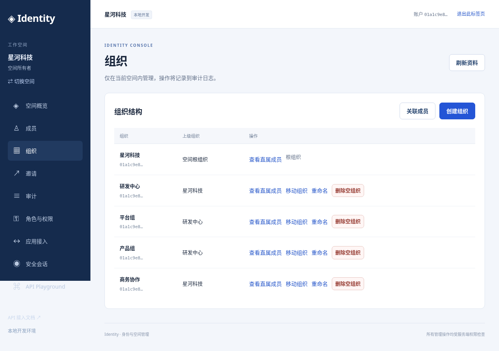
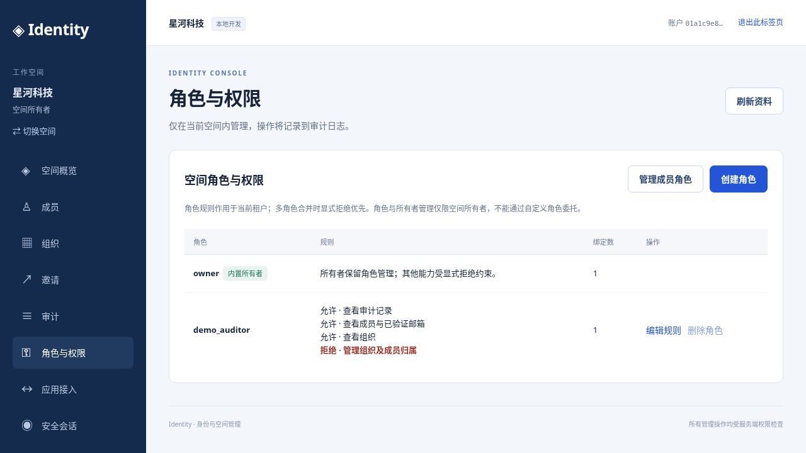
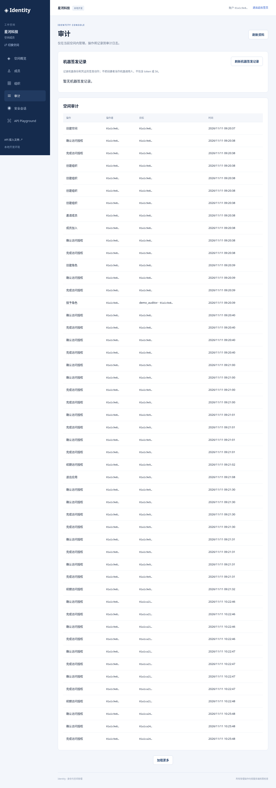
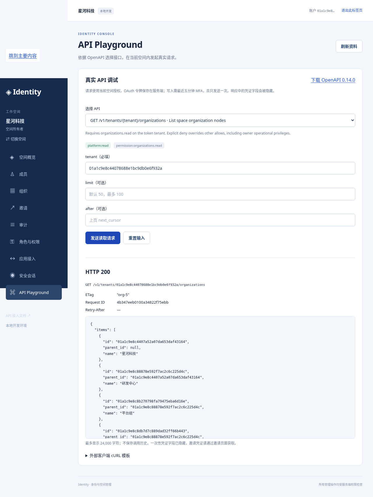
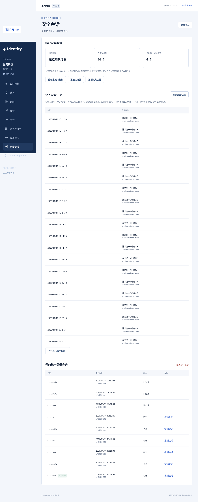

# 周五演示：10 分钟主线与彩排

本演示面向 2026-11-13（周五）。现有 SSO、MFA、空间/组织、租户角色、公共 API、Playground 与个人安全记录组成一期演示范围。演示使用真实 Hydra、MySQL、BFF 和权限检查；合成业务数据由本地工具通过真实账户流程与公开 API 创建。

## 准备入口

在 `/workspace/sso` 执行：

```sh
scripts/demo prepare       # 构建/启动本地服务，建立独立演示数据
scripts/demo rehearse      # 真实密码/TOTP、双应用 SSO、权限和 UI 全流程彩排
scripts/demo check         # 演示前快速检查，可重复运行
```

已准备好的环境可直接使用 `scripts/demo seed` 创建数据。重复 seed 会检查现有数据，不重复建空间或覆盖密码。失败的部分数据会保留，只能显式 reset 后重新创建，避免网络结果不明时重复写入。

| 入口 | 地址 |
| --- | --- |
| 主控制台 | http://console.localhost:3003 |
| 应用 A | http://app-a.localhost:3001 |
| 应用 B | http://app-b.localhost:3002 |
| 公开 API 参考与合同下载 | http://api.localhost:8083/docs |

.localhost 入口请在当前托管工作区的 Desktop 面板浏览器中访问；自己电脑的 localhost 不会自动指向这个工作区。也可以在自己的电脑启动同一仓库后访问。

这些入口由服务所在机器上的浏览器访问；`.localhost` 指向浏览器所在机器。远程演示入口/正式域名由 SRE 提供，本工具只用于本地参考环境。SRE 环境是否能演示须在实际入口另行验收；不得把本地彩排记为云端验收。本工具不改变 CI、网络暴露或部署配置。

登录资料仅写入 `.local/demo/presenter.md` 和 `.local/demo/manifest.json`（目录 0700、文件 0600，均被 Git 忽略）。其中包含随机密码、TOTP 密钥和恢复码，不进入公开文档包、截图或工具日志。请提前从私有文件将两个账号导入认证器（SHA-1、6 位、30 秒）；也可使用尚未消费的单次恢复码。不要在共享的演示画面中打开私有资料文件。

管理员和审计员使用两个独立浏览器用户配置/浏览器应用，避免中央会话互相影响。不要用同一普通配置的两个窗口假装两个独立身份。可以提前登录备用配置，主线仍从管理员的真实登录开始。

## 固定演示数据

- **星河科技**：主要演示空间，含“研发中心 → 平台组 / 产品组”与“商务协作”。
- **远山合作社**：独立空间，用于解释空间隔离；审计员未加入。
- **管理员**：两个演示空间的 owner，可管理组织、成员与角色。
- **只读审计员**：加入星河科技，绑定 demo_auditor；允许 members.read / organizations.read / audit.read，显式拒绝 organizations.write。

个人空间仍保留用于正常账户行为。演示时明确选择“星河科技”；切换空间要重新确认授权。同一用户在各空间的个人安全记录仍属于该用户。数据 ID 与无凭证的操作提示位于 `.local/demo/dataset.md`。

## 10 分钟讲解顺序

| 时间 | 操作 | 讲解与成功标准 |
| --- | --- | --- |
| 0:00–1:30 | 管理员从控制台登录，输入密码和认证器动态码，选择“星河科技”并同意 | 登录、第二因素和空间授权分开；进入有真实组织/成员数据的控制台 |
| 1:30–2:30 | 在同一浏览器配置依次打开应用 A/B 的“使用统一登录”，选择星河科技 | 复用中央登录，无需再次输入密码/TOTP；两个应用具有独立会话，显示相同用户/空间 |
| 2:30–4:00 | 回控制台查看“组织”“成员”“角色与权限” | 展示研发中心/两个小组、两名成员和 demo_auditor 的允许/拒绝规则。可创建一个“周五演示组”；写入最近 MFA 过期时先重新验证 |
| 4:00–5:30 | 切到另一个浏览器配置中的只读审计员，打开组织/审计 | 能读组织和审计，组织创建控件不可用；在其 Playground 选择 listRoles，发送后得到 403，说明隐藏按钮之外还有服务端鉴权 |
| 5:30–7:00 | 管理员打开 API Playground，选择 listOrganizations → 发送；再选 listMySecurityEvents | 展示真实 200、JSON、所需 scope、当前空间与受控 cURL 模板；打开公开 API 页下载 OpenAPI 3.1，演示基线 0.10.0 为 29 操作，后续开发版以页面当前合同为准 |
| 7:00–8:00 | 管理员“安全会话”，展示 MFA/恢复码数量、登录会话和个人安全记录 | 只展示元数据；重置请求仅代表收到请求，时间线不等于完整设备/异常登录监控 |
| 8:00–9:00 | 应用 B 点击“仅退出此应用”，再查看应用 A | B 退出而 A 仍可用，展示应用会话与中央登录的边界 |
| 9:00–10:00 | 展示一期范围和后续清单 | 动态 client/机器凭证、细粒度资源授权、遗失认证器受控恢复、正式通知与独立归档继续开发，部署交付由 SRE 负责 |

彩排自动验证：组织树、owner/委托权限、审计读取、组织写入 403、跨空间资源 404、两应用 SSO/续期、真实控制台与 Playground 200/403、安全记录和应用局部退出。彩排不消费恢复码、不改变组织结构；会追加正常认证事件及应用会话。结果写入本地私有 `.local/demo/verification.json`，不保存 token/cookie。

## 演示前检查与备用路线

周五演示前运行 `scripts/demo check`，确认命令成功且 verification.json 时间为本次检查。TOTP 时间片被登录使用过时等下一组，脚本最多等待下一周期并重试一次。检查按真实身份流程执行，不关闭 MFA、跳过邮箱证明或放宽权限。

提前打开控制台、应用 A/B、API 文档和审计员独立配置。高风险的认证器更换、恢复码重生成、全设备退出会撤销现有会话，放在主线结束后的备用环节；它们有单独手册。演示途中若需要 step-up，完成验证后明确重新提交原操作，系统不会自动重放写入。

备用材料使用以下真实彩排截图，也包含在完整离线文档包中。现场入口不可用时可按这些截图讲解，并明确当时展示的是彩排记录。

### 组织数据



### 角色与委托



### 只读审计员



### 真实 API Playground



### 账户安全



## 重置与故障处理

```sh
scripts/demo reset         # 只删除工具清单中的合成账户和封闭演示空间
scripts/demo seed          # 新账号/密码/密钥与新空间；重新导入认证器
scripts/demo rehearse
```

reset 使用封闭账户集合检查：如果演示空间中出现了清单之外的账户，会拒绝删除；先核实这些真实关系，不自动扩大删除范围。不要把真实用户邀请进这套可重置数据。工具不会 down -v 或删除其他开发数据。状态清单与当前本地密钥 fingerprint 绑定，切换环境时拒绝使用旧清单操作新数据库。

同一时间只运行一个 demo 命令。崩溃可能留下 `.local/demo/command.lock`；它只含进程号。确认对应进程已经退出后才能手工移除这个锁，再运行 reset/seed；不要在命令仍运行时解锁。日志只输出阶段与受控失败信息，禁止为排障打印整个清单、邮箱、浏览器 cookie 或原始 Playwright 异常。

准备/检查失败时先确认本地服务健康和数据库仍是当前环境，再重跑相应命令；已有完整演示数据不需要每天重建。SRE 环境的部署和访问问题由 SRE 对应，本地彩排包可供其核对数据与演示顺序。

## 固定基线

已将通过彩排的 5d8b46b 固定为标签 `demo-friday-2026-11-13`，源码与原文档另存于 artifacts 的 sso-demo-baseline-5d8b46b 文件及 SHA-256 清单；私有账号资料仍只保留在原工作区。后续开发版与原 0.10.0 文档包分开，必要时在干净工作区切回此标签，重新 prepare/up 后运行 check。不要重置或重新生成已有本地数据库密钥。

## 保留演示数据的测试保护

普通测试清理工具会先读取本地演示清单，拒绝受保护邮箱/空间，即使邮箱也符合 browser-* 合成格式。只有显式 scripts/demo reset 才携带匹配当前清单与环境的重置上下文；不要按邮箱前缀批量选择数据清理。此保护用于防止误操作，不替代独立备份；2026-11-11 清理事故与原行恢复的实际记录见 validation.md。
