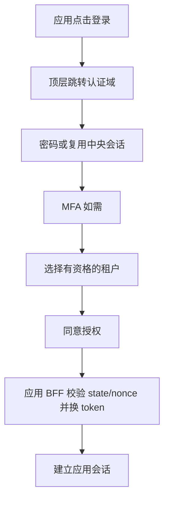

# UI 与交互规格

## 信息架构与视觉

控制台采用中文优先、可国际化布局：顶部租户选择器和账号菜单；左侧概览、成员与邀请、组织、应用与客户端、机器身份与凭证、角色与绑定、审计、安全。主区使用清晰表格、状态标签、详情抽屉和分页。认证页使用单列卡片，展示经过审核的应用名称、目的地和当前步骤。界面只描述用户任务，不显示 Hydra、集群、内部数据库等实现细节。

设计 token：背景 #F6F8FC、正文 #172033、主色 #2457D6、成功 #147D50、危险 #B42318；间距 4/8/12/16/24/32px，正文 16px、行高 1.5，表单宽度 400px，内容最大宽度 1280px。上线前测量实际对比度，不能只凭颜色传达状态。360px 手机单列、768px 折叠菜单、桌面固定侧栏；表格窄屏提供带字段名的卡片或明确横向滚动。

键盘操作覆盖导航、弹窗、菜单、租户选择；焦点可见、弹窗陷获焦点且关闭后回到触发器；表单 label、错误关联 aria-describedby、异步结果 aria-live。目标 WCAG 2.2 AA，人工键盘/读屏和自动化检查共同验收。

## 页面与状态

| 页面 | 主要行为 | 空/错误/安全状态 |
| --- | --- | --- |
| 登录 | 邮箱、密码、MFA、恢复入口 | 统一认证失败；限流带重试提示；不区分账号存在 |
| 注册/找回 | 提交邮箱、验证一次性链接 | 统一“若地址符合条件，将发送邮件”；链接过期可重发 |
| MFA | TOTP、恢复码 | 不显示种子；重复时间片/恢复码拒绝；恢复触发安全通知 |
| 租户选择 | 只展示 active memberships | 无资格显示申请/联系管理员；hint 只预选；失效刷新列表 |
| 同意 | 展示应用、当前租户、scope 的可读说明 | 拒绝结束授权；未知 scope 不展示默认允许 |
| 概览 | 当前租户、集成进度、安全待办 | 没有真实数据时显示空态，禁止伪造统计 |
| 成员 | 搜索、邀请、暂停、详情 | 删除最后 owner 禁止；越权返回无权限；并发冲突刷新 |
| 组织 | 树、成员、移动 dry-run | 显示影响范围；重新认证；跨租户/环/版本冲突拒绝 |
| 客户端 | 精确回调 URI、scope、audience | 保存前展示差异；生产禁止通配符；敏感修改 step-up |
| 机器身份 | owner、应用、凭证列表 | 无 owner 显示待移交；机器身份不展示为用户 |
| 凭证 | 创建、一次性 SK、轮换、撤销 | 无“查看旧 SK”；响应丢失仅显示 AK，指引撤销并重建 |
| 角色绑定 | principal + app + scope + 权限摘要 | 超委托边界禁止；显式 deny 可见；保存前确认影响 |
| 审计 | 时间/操作者/action/结果筛选 | 脱敏；分页；导出实时授权；不显示密码或 token |
| 安全 | MFA、会话、当前/全部设备退出 | 退出范围明确；旧 JWT 有界失效，不能宣称立即全部消失 |

## 关键流程

返回地址完全由协议交易决定，UI 不接受任意 next URL。多个标签页每个交易单独保存租户上下文。切换租户重新发起授权；切换后清空列表、查询缓存与未完成表单，取消旧请求，迟到响应必须匹配当前租户才能显示。

凭证创建：选择机器身份/用途/scope/到期 → 展示最小权限摘要 → 最近 5 分钟 MFA step-up → 确认 → SK 一次性页面。复制是显式点击；不自动下载文件、不自动写剪贴板；关闭/刷新后无法找回。页面与响应 no-store、不加载分析/录屏。确认“已安全保存”后关闭；未保存离开提示不会承诺可以恢复。

破坏性操作显示对象名称、当前租户、后果及不可逆性。按钮提交时禁用，服务端幂等保护；重试不会重新显示秘密。权限不足显示联系管理员入口；错误使用安全 reason code 与 request_id，避免泄露内部状态。

## UI 验收

E2E 覆盖登录→租户选择→控制台、第二应用 SSO、双标签页隔离、跨租户切换迟到响应、一次性 SK、MFA 超时、401 重新登录/403 不循环跳转、409 并发冲突、429 和离线恢复。当前设计不等于已实现控制台；M0 仅协议实验工具，后续 React/BFF 按此规范交付。

## 可交互线框

[静态 UI 原型](ui/index.html) 展示桌面/手机布局、租户切换、凭证创建说明、认证流程与弹窗焦点。所有数据明确标为示例，不连接 API、不收集密码、不生成密钥。可用本地静态服务器内部查看；不要作为线上控制台发布。

已生成 [桌面截图](ui/desktop.png) 与 [手机截图](ui/mobile.png)。可重复检查：环境提供 Node、Playwright 和 Chromium 时，运行 `node tests/ui/prototype.cjs`；脚本自行启动并关闭 loopback 静态服务。此检查不是完整 WCAG 或真实登录验收。

## 已实现账户页面

账户验证与恢复页面现已连接真实本地 API、MySQL 和私有邮箱 worker，源文件位于 internal/identity/web。与此前控制台静态原型分开：注册请求、验证设密、密码确认、恢复请求和重置均可执行。验证 fragment 被清除，操作完成不自动建立登录态。截图见 [账户桌面](ui/accounts-desktop.png) 和 [账户手机](ui/accounts-mobile.png)。

## 已实现可信登录与示范应用

真实流程为应用发起 → 可信密码页面 → 首次 TOTP 设置或已有因素验证 → 一次性恢复码保存 → 选择本次空间并同意 → BFF 回调。可取消本次授权、强制重新验证、单应用退出及全设备退出。授权范围采用可读说明；认证页不接受任意 next URL，challenge 在加载后从地址栏移除。种子/恢复码只显示一次，刷新后需从应用重新开始，不能重复获取秘密。

截图：[授权确认](ui/sso-consent.png)、[应用 A](ui/sso-app-a.png)、[应用 B](ui/sso-app-b.png)、[应用手机](ui/sso-app-mobile.png)。这些页面连接真实本地服务；前述 React 控制台仍是设计与静态原型。浏览器验收见 `node tests/sso/browser.cjs`，不等于完整无障碍审计。

## 公共 API 参考页面

新增实际服务的 `/docs` 页面，直接从嵌入 OpenAPI 渲染 43 个业务操作，展示 OAuth/scopes、分页、If-Match 和错误约定，提供 YAML/JSON 下载。页面不收集令牌、不使用第三方 CDN。截图：[桌面](ui/api-reference-desktop.png)、[手机](ui/api-reference-mobile.png)；验收脚本 `node tests/api/docs.cjs`。真实 React 管理控制台见下节。

## 真实 React 控制台第一切片

当前已接入真实 BFF/API 的页面包括：空间概览/创建、成员停用恢复、组织创建/移动预览与执行/归属、一次性邀请/接受/撤销、审计与自己的会话。导航和写入按钮按有效权限显示，无绑定成员不显示管理入口，伪造请求仍由服务端拒绝。最近 MFA 过期会要求重新认证，完成后不自动提交旧表单；权限变化会清空旧数据并提示重新授权。

桌面/手机均显示本地环境标识。标签页独立绑定授权，URL fragment 仅保存非秘密 context；导航/空间切换清除一次性秘密、取消旧读取并丢弃迟到结果。邀请凭证通过明确动作展示/复制，关闭后不能再次获取。模态框使用原生 dialog 的焦点与 Escape 行为、提交中禁用操作；导航和表单提供可访问标签。

截图：[空间概览](ui/console-overview.png)、[成员](ui/console-members.png)、[审计](ui/console-audit.png)、[手机](ui/console-mobile.png)。验收命令 `scripts/console test`；前面的静态原型继续保留为设计输入，不能当成当前业务页面或完整无障碍认证。

租户角色管理已实现：逐权限选择未设置/允许/拒绝，明确提示拒绝覆盖 owner 操作权限；角色列表显示规则与绑定数。成员管理可进入角色绑定对话框；owner 授予/移除需额外勾选确认，最后 owner 由后端拒绝。members.read 标签明确包含已验证邮箱。权限变更立即清空旧数据并要求重新授权。截图见 [角色页](ui/rbac-roles.png) 与 [受委托审计页](ui/rbac-auditor.png)，范围与恢复规则见 ADR 0008。

API Playground 已接入真实控制台授权：接口选择、参数、JSON、If-Match、写入预览/明确确认和响应面板。依据实际 OpenAPI 展示 scope/权限，响应凭证脱敏，cURL 使用占位符；401/MFA/412 不自动重放。桌面/手机截图见 [Playground](ui/playground-desktop.png)。离线完整手册与交互调试分开，前者不发起网络调用。

账户安全页提供“更换认证器”可信域链接。先验证旧因素，再显示新种子供手动导入并要求新 TOTP/撤销确认，最后一次展示恢复码；取消保留旧因素，最终提交前旧会话有效。结果不明时清空秘密、停止提交并引导重新登录核对。安全初始页截图见 [认证器更换](ui/authenticator-entry.png)；不对种子/恢复码页面截图。

“安全会话”增加“个人安全记录”：中文事件说明/受控代码/时间，20 条分页、刷新到最新页、加载/错误/空态和手机布局；明确收到密码重置请求不代表本人发起。读取按 context/cursor/generation 绑定并可取消，离开页面不接收迟到内容。见 [手册](security-events.md) 与 [桌面](ui/security-events-desktop.png)/[手机](ui/security-events-mobile.png)截图。

“应用接入”仅 owner 可见，展示本空间关联状态与客户端数量；登记配置对话框显示 issuer/回调/scope/audience。停用/恢复前读取目标版本、勾选影响确认；平台管理入口保持启用。加载/失败/空态、客户端分页、对话框取消、导航取消和手机布局均纳入验收。截图：[桌面](ui/application-access-desktop.png)、[手机](ui/application-access-mobile.png)。

## 组织管理操作

组织行增加直属成员、非根重命名和删除空节点。直属成员入口同时检查两种读取权限；成员弹窗显示直接关联及停用状态、分页和显式移除。写入要求目标/影响确认，版本或网络错误后禁用旧表单，关闭刷新再决定，不自动重发；关闭/切换空间取消在途读取。见 [组织管理](organization-management.md)。

## 自有应用与客户端登记

应用接入页为 owner 提供创建应用和自有应用下的公开客户端登记，现有共享应用保持只读客户端元数据。显式区分 pending/active/revoked，核对、撤销和协议清理均需确认；失败后刷新状态，不自动重放。手机端应用列表使用纵向卡片保留所有操作，确认 checkbox 与说明同行，元数据不包含 secret。详见 [客户端登记](managed-clients.md)。

## 机器身份切片

机器凭证当前交互：应用行进入专用模态页，SP/凭证列表与一次性秘密页分开；确认后创建，不自动重试。返回、关闭或切换空间清除显示中的 SK；网络结果不明引导先核对、撤销后重建。Playground 中创建 SK 的操作只读合同并指向此专用页，其余管理操作仍可执行。详见 machine-credentials.md。

## 审计导出切片 0.16.0

审计页增加独立批次卡片：管理/机器类型、25/50/100 条、首批预览、下载与下一批。下载重新请求当前资格，不从旧预览保存文件；读取期间可取消，离开/切换空间或授权版本变化后清空旧数据。结果含条数、版本、生成时间、继续游标及可展开 JSON；按固定类型/空间/UTC 时间命名。桌面与手机的实际截图见 [桌面](ui/audit-export-desktop.png) / [手机](ui/audit-export-mobile.png)，按钮可换行，无页面横向溢出。只读审计员也可导出，不能因页面具备此功能而管理凭证。

## 邀请凭证更新 0.17.0

待接受/过期邀请行可打开专用更新对话框，先读当前 metadata/ETag；勾选旧凭证失效与安全转交确认后只提交一次。成功后新 proof 只在内存与专用 DOM 一次展示，允许显式复制，关闭不恢复。读取中可关闭；写入中明确关闭不撤销已提交操作。未知回包不自动重发，先重新读当前状态；关闭或换空间后的迟到 proof 不显示。控制台明确未发送邮件。截图见 [桌面](ui/invitation-reissue-desktop.png) / [手机](ui/invitation-reissue-mobile.png)，只记录确认表单。

## 协议登记核对 0.18.0

客户端专页和机器凭证卡片增加「只读核对协议登记」，初次不自动请求。按受控字段展示未发现/一致/差异状态，只有已审核字段名称与时间；失败清除旧的一致状态，未知额外字段受控拒绝。父记录写入/刷新、取消、关闭和换空间都清除旧观察，显式激活/撤销/清理仍按原确认与 MFA 流程。截图：[桌面](ui/protocol-inspection-desktop.png) / [手机](ui/protocol-inspection-mobile.png) / [机器凭证](ui/machine-protocol-inspection.png)。

## 外部 User 审计消费入口 0.19.0

本切片增加 Go SDK 和本地 CLI，浏览器界面与现有审计下载流程沿用 0.18。控制台 Playground 仍展示 59 项 User 合同、执行其中 58 项；CLI 一次输出一个已验证批次，错误只输出受控类别，不回显输入。需要交互登录/分页下载时使用既有控制台；SDK 调用方持有真实 User Bearer，完整接入说明见 user-audit-client.md。
