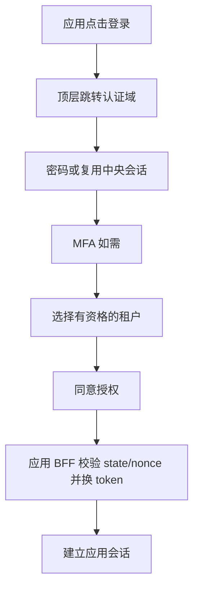

# UI 与交互规格

## 信息架构与视觉

控制台采用中文优先、可国际化布局：顶部租户选择器和账号菜单；左侧概览、成员与邀请、组织、应用与客户端、机器身份与凭证、角色与绑定、审计、安全。主区使用清晰表格、状态标签、详情抽屉和分页。认证页使用单列卡片，展示经过审核的应用名称、目的地和当前步骤。界面只描述用户任务，不显示 Hydra、集群、内部数据库等实现细节。

设计 token：背景 #F6F8FC、正文 #172033、主色 #2457D6、成功 #147D50、危险 #B42318；间距 4/8/12/16/24/32px，正文 16px、行高 1.5，表单宽度 400px，内容最大宽度 1280px。上线前测量实际对比度，不能只凭颜色传达状态。360px 手机单列、768px 折叠菜单、桌面固定侧栏；表格窄屏提供带字段名的卡片或明确横向滚动。

键盘操作覆盖导航、弹窗、菜单、租户选择；焦点可见、弹窗陷获焦点且关闭后回到触发器；表单 label、错误关联 aria-describedby、异步结果 aria-live。目标 WCAG 2.2 AA，人工键盘/读屏和自动化检查共同验收。

## 页面与状态

| 页面 | 主要行为 | 空/错误/安全状态 |
| --- | --- | --- |
| 登录 | 邮箱、密码、MFA、恢复入口 | 统一认证失败；限流带重试提示；不区分账号存在 |
| 注册/找回 | 提交邮箱、验证一次性链接 | 统一“若地址符合条件，将发送邮件”；链接过期可重发 |
| MFA | TOTP、恢复码 | 不显示种子；重复时间片/恢复码拒绝；恢复触发安全通知 |
| 租户选择 | 只展示 active memberships | 无资格显示申请/联系管理员；hint 只预选；失效刷新列表 |
| 同意 | 展示应用、当前租户、scope 的可读说明 | 拒绝结束授权；未知 scope 不展示默认允许 |
| 概览 | 当前租户、集成进度、安全待办 | 没有真实数据时显示空态，禁止伪造统计 |
| 成员 | 搜索、邀请、暂停、详情 | 删除最后 owner 禁止；越权返回无权限；并发冲突刷新 |
| 组织 | 树、成员、移动 dry-run | 显示影响范围；重新认证；跨租户/环/版本冲突拒绝 |
| 客户端 | 精确回调 URI、scope、audience | 保存前展示差异；生产禁止通配符；敏感修改 step-up |
| 机器身份 | owner、应用、凭证列表 | 无 owner 显示待移交；机器身份不展示为用户 |
| 凭证 | 创建、一次性 SK、轮换、撤销 | 无“查看旧 SK”；响应丢失仅显示 AK，指引撤销并重建 |
| 角色绑定 | principal + app + scope + 权限摘要 | 超委托边界禁止；显式 deny 可见；保存前确认影响 |
| 审计 | 时间/操作者/action/结果筛选 | 脱敏；分页；导出实时授权；不显示密码或 token |
| 安全 | MFA、会话、当前/全部设备退出 | 退出范围明确；旧 JWT 有界失效，不能宣称立即全部消失 |

## 关键流程

返回地址完全由协议交易决定，UI 不接受任意 next URL。多个标签页每个交易单独保存租户上下文。切换租户重新发起授权；切换后清空列表、查询缓存与未完成表单，取消旧请求，迟到响应必须匹配当前租户才能显示。

凭证创建：选择机器身份/用途/scope/到期 → 展示最小权限摘要 → 最近 5 分钟 MFA step-up → 确认 → SK 一次性页面。复制是显式点击；不自动下载文件、不自动写剪贴板；关闭/刷新后无法找回。页面与响应 no-store、不加载分析/录屏。确认“已安全保存”后关闭；未保存离开提示不会承诺可以恢复。

破坏性操作显示对象名称、当前租户、后果及不可逆性。按钮提交时禁用，服务端幂等保护；重试不会重新显示秘密。权限不足显示联系管理员入口；错误使用安全 reason code 与 request_id，避免泄露内部状态。

## UI 验收

E2E 覆盖登录→租户选择→控制台、第二应用 SSO、双标签页隔离、跨租户切换迟到响应、一次性 SK、MFA 超时、401 重新登录/403 不循环跳转、409 并发冲突、429 和离线恢复。当前设计不等于已实现控制台；M0 仅协议实验工具，后续 React/BFF 按此规范交付。

## 可交互线框

[静态 UI 原型](ui/index.html) 展示桌面/手机布局、租户切换、凭证创建说明、认证流程与弹窗焦点。所有数据明确标为示例，不连接 API、不收集密码、不生成密钥。可用本地静态服务器内部查看；不要作为线上控制台发布。

已生成 [桌面截图](ui/desktop.png) 与 [手机截图](ui/mobile.png)。可重复检查：环境提供 Node、Playwright 和 Chromium 时，运行 `node tests/ui/prototype.cjs`；脚本自行启动并关闭 loopback 静态服务。此检查不是完整 WCAG 或真实登录验收。

## 已实现账户页面

账户验证与恢复页面现已连接真实本地 API、MySQL 和私有邮箱 worker，源文件位于 internal/identity/web。与此前控制台静态原型分开：注册请求、验证设密、密码确认、恢复请求和重置均可执行。验证 fragment 被清除，操作完成不自动建立登录态。截图见 [账户桌面](ui/accounts-desktop.png) 和 [账户手机](ui/accounts-mobile.png)。

## 已实现可信登录与示范应用

真实流程为应用发起 → 可信密码页面 → 首次 TOTP 设置或已有因素验证 → 一次性恢复码保存 → 选择本次空间并同意 → BFF 回调。可取消本次授权、强制重新验证、单应用退出及全设备退出。授权范围采用可读说明；认证页不接受任意 next URL，challenge 在加载后从地址栏移除。种子/恢复码只显示一次，刷新后需从应用重新开始，不能重复获取秘密。

截图：[授权确认](ui/sso-consent.png)、[应用 A](ui/sso-app-a.png)、[应用 B](ui/sso-app-b.png)、[应用手机](ui/sso-app-mobile.png)。这些页面连接真实本地服务；前述 React 控制台仍是设计与静态原型。浏览器验收见 `node tests/sso/browser.cjs`，不等于完整无障碍审计。
